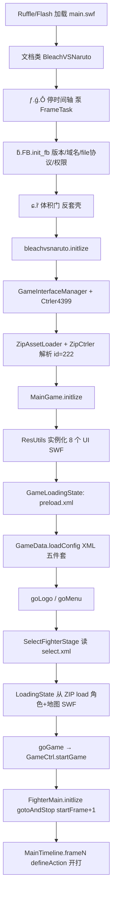

# 死神 vs 火影 3.3 — 全项目逆向总索引

离线样本授权：`offline-sample`，`granted`。权威源是 `decompiled/`（894 个 `.as`）、`extracted/assets/config/*.xml`、`extracted/full/INVENTORY.md`。本次**没有**再次完整反编译 `main.swf`。

本文件覆盖整个仓库树，不只是壳+引擎主干。

调研对照增量：[`BVN-RESEARCH-REVERSE.md`](BVN-RESEARCH-REVERSE.md)（官方 5DPLAY 开源仓 ↔ 本 3.3 样本）。

分册：

| 分册 | 路径 | 内容 |
|---|---|---|
| 引擎 | [`reverse/01-engine.md`](reverse/01-engine.md) | `net.play5d.game.bvn` 全部子包 + `kyo`，类名/职责/关键方法 |
| 壳 | [`reverse/02-greenhd.md`](reverse/02-greenhd.md) | `com.green` / `ƃ.FB` / `ɕ.ȑ` / `ƒ.ǵ`，体积门、LC、4399 |
| 角色 | [`reverse/03-fighters.md`](reverse/03-fighters.md) | 76 个目录 + fighter.xml/assist.xml 全 id |
| 地图 UI XML | [`reverse/04-maps-ui-xml.md`](reverse/04-maps-ui-xml.md) | 14 地图实例名、8 个 CWS15、七份 XML 字段 |
| 类清单 | [`reverse/CLASS-INDEX.md`](reverse/CLASS-INDEX.md) | **894** 条相对路径，按目录分组 |

先前 `BVN-ANALYSIS.md` / `BVN-REVERSE.md` / `BVN-REVERSE-CODE.md` 只覆盖壳与引擎主干，本套不替代阅读分册。

## 0. Evidence → Finding → Path

### Evidence

| ID | 内容 | 来源 |
|---|---|---|
| E-hash | SHA-256 `5ddf9410af93872c2b988af81e2580d466cc0f87d5e885198687f129cc00ba3e` | `sha256sum main.swf` |
| E-inv | FWS v14，69431196 字节，3 帧，4 DoABC，9 BinaryData | `extracted/full/INVENTORY.md` |
| E-as | 894 个 `.as`：main 264 / fighters 468 / ui 73 / effect 89 / maps 0 | `decompiled/SUMMARY.md` + 实扫 |
| E-xml | fighter 59 / assist 37 / map 15（含 random）/ select 网格 / mission 4 design | `extracted/assets/config/*.xml` |
| E-boot | `BleachVSNaruto` → `ǵ.Ȱ` → `FB`/`ȑ` → `bleachvsnaruto` → `MainGame` | 对应 `.as` |
| E-zip | BinaryData id=222 ZIP 65699574 B，407 members | INVENTORY |
| E-ui | 8 个嵌套 SWF 均为 CWS v15 | `extracted/full/swf/bin_*.swf` 文件头 |
| E-skin | `FighterMain.initlize`：`gotoAndStop(startFrame+1)` | `FighterMain.as:292` |
| E-vol | `bytesTotal == loaderInfo.bytes.length` | `ɕ/ȑ.as` `§ͦ§` |

### Finding

1. 这是 4399 发行的 play5d 引擎格斗 Flash：壳（green/SH）+ 嵌入 ZIP 资源 + 8 个 UI SWF + 角色/地图嵌套 SWF。
2. 可玩 41 个 SWF 对应 56 个有 file 的 fighter id（加 3 个 random）；13 个 SWF 多皮肤。辅助 35 个 SWF + 3 random。包内另有 `sasuke_xz_old`、`fz/soifong` 两份 XML 未引用的遗留。
3. 地图无脚本，碰撞全靠实例名。选人布局在 `select.xml`；`salect.xml` 是未加载的旧拼写副本。
4. 本地 Ruffle 可玩，但必须 HTTP；`file:///` 被壳拒绝。4399 `serviceHold` 为空时排行榜为空操作。

### Path（callflow）

见下一节「启动到开打」。`path_type: callflow`。

## 1. 项目树（仓库根 `/workspace/bvn-3.3`）

```
bvn-3.3/
├── main.swf                 原始样本 69 431 196 B  FWS14
├── main.swf.zip / .hdr / .4mb / swf-tail.bin   拆片残留
├── decompiled/              ★ 权威脚本（894 .as）
│   ├── main/scripts/        264  引擎+壳+嵌入符号
│   ├── fighters/            468  76 角色目录
│   ├── ui/                  73   八个 UI SWF
│   ├── other/effect/        89
│   ├── maps/                0 as / 14 目录
│   └── SUMMARY.md
├── extracted/
│   ├── assets/config/       七份 XML（从 ZIP 抽出）
│   └── full/                INVENTORY.md、zips/bin_222、swf/bin_*、nested-swf、abc、tags
├── play/                    本地 Ruffle 运行
│   ├── vendor/ruffle/
│   ├── games/bvn-3.3/       player.html、main.swf、main-mod.swf
│   ├── games/bvn-3.3-mod/ bvn-orig/ bvn-zh/
│   ├── local-runtime-guard.js
│   └── start-server.sh      127.0.0.1:8765
├── reverse/                 本套分册
├── rebuild-mod.sh           FFDec -importScript → main-mod.swf
├── index.html / main.js / ruffle.js   根目录播放壳
└── work/                    case 与路由产物
```

`import-only/` 只有 1 个 `.as`，是菜单导入试验，不是权威全集。

## 2. 894 脚本怎么分

| 桶 | 数量 | 是什么 |
|---|---:|---|
| `decompiled/main/` | 264 | 壳 + `net.play5d` + TweenLite/FZip + 嵌入 UI/音效 Class |
| `decompiled/fighters/` | 468 | 41 可玩 + 35 辅助（含 2 个 XML 未引用）的时间轴脚本 |
| `decompiled/ui/` | 73 | 8 个 CWS15 UI |
| `decompiled/other/effect/` | 89 | 打击特效与音效文档类 |
| `decompiled/maps/` | 0 | 14 个资源-only SWF |
| **合计** | **894** | `SUMMARY.md` 与实扫一致 |

`main` 再拆：

- `net/play5d/game/bvn/` 约 158 个业务类（ctrl/data/fighter/state/ui/web…）
- `net/play5d/kyo/` 23 个工具类
- 混淆壳约 28 个（`com/green` `com/sh` `ƃ` `ɕ` `ƒ` `ǹ` `ȁ` `Ȋ`…）
- 第三方：`com/greensock` `deng/fzip` `com/adobe` `fl/motion`
- 根目录文档类：`BleachVSNaruto.as`、`bleachvsnaruto_2.as`、`LOADING_bvn.as`、`snd_*`、`*_swf$…ByteArray`

完整路径：[`reverse/CLASS-INDEX.md`](reverse/CLASS-INDEX.md)。

## 3. 启动到开打全链路



逐步对应代码：

1. **壳** — [`02-greenhd.md`](reverse/02-greenhd.md)
2. **应用入口** `bleachvsnaruto_2.as`：`setAssetLoader(ZipAssetLoader)`，`GameConfig.MAP_LOGO_STATE = 1`，`Ctrler4399.init()`
3. **MainGame.initlize** — `GameRender`、`GameInputer`、`GameData.loadData`（SharedObject `bvn3.01`）、`KyoStageCtrl`
4. **配置链** `GameData.loadConfig`：`fighter.xml` → `assist.xml` → `select.xml` → `map.xml` → `mission.xml`
5. **选人** `SelectFighterStage` + `select.xml` 网格
6. **加载战斗资源** `GameLoader.loadFighter/Assister/Map` 全部走 ZIP 路径 `assets/fighter/*.swf` 等
7. **皮肤** `FighterMain`：`setFighterCtrler` 后 `gotoAndStop(startFrame+1)`，该帧 `defineAction`
8. **循环** `GameRender` → `GameCtrl` / `GameMainLogicCtrler` → `FighterMC.renderAnimate`（跳过 `bdmn`/`atm*`/`AImain` 的自动 nextFrame）

菜单树在 `GameInterface.getDefaultMenu`：小队/单人 × 闯关/2P/CPU、设置、练习、制作组、更多游戏；`GameInterfaceManager` 再插入「排行榜」。

## 4. 壳 / ZIP / Ruffle

### 壳

三帧 DoABC：前两帧 greenhd 引导，第三帧才是 play5d + 资源。详见 [`02-greenhd.md`](reverse/02-greenhd.md)。

要点：Flash ≥11.0；`allowScriptAccess=always`；`allowNetworking=all`；禁止 `file:///`；4399/Kongregate 域名白名单；`serviceHold` 注入。

### ZIP（DefineBinaryData id=222）

- 未压缩成员约 65.7 MB，407 个文件
- 角色、地图、特效、XML、BGM、脸图全在这里
- `ZipCtrler.init`：`new assets_zip$…()` → `FZip.loadBytesStep(bytes, 20)`
- 之后 `getLoader`/`getXML`/`getSound` 按成员名读取
- `removeFile` 可在运行时丢掉成员（仅内存）

改角色数值：改 ZIP 内对应 fighter SWF 的 ABC，或改 XML 后重打包并替换 BinaryData 222。只改 `decompiled/main/scripts` **碰不到** 角色 SWF。

### Ruffle 本地运行

| 文件 | 作用 |
|---|---|
| `play/start-server.sh` | `python3 -m http.server 8765 --bind 127.0.0.1` |
| `play/vendor/ruffle/` | 自带播放器 |
| `play/games/bvn-3.3/player.html` | 加载 `main-mod.swf`，canvas，800×600 |
| `play/games/bvn-3.3/player-orig.html` | 原版 |
| `index.html` + `main.js` + `ruffle.js` | 根目录另一套播放页 |
| `local-runtime-guard.js` | 给父页 `bvnplay.online` / localhost 发 `postMessage`，采样画布判断是否真正出画（不是游戏逻辑） |
| `rebuild-mod.sh` | `ffdec -importScript main.swf → play/games/bvn-3.3/main-mod.swf`，脚本目录 `decompiled/main/scripts` |

`MainGame.VERSION` 当前反编译值为 `"V3.3-MOD"`（`VERSION_DATE` `"2019.3.32"`）。这是工作区已改过引擎脚本的痕迹，不是 XML 里的版本号。

## 5. 完整性校验

| 检查 | 结果 | 代码/数据 |
|---|---|---|
| 文件长度 | `declared_length == actual == 69431196` | INVENTORY |
| 签名 | `FWS`（未压缩 SWF14） | 文件头 |
| 体积门 | `bytesTotal == timeline.loaderInfo.bytes.length` | `ɕ.ȑ.§ͦ§` |
| 反套壳 | 外层 Loader 且 SH 未挂上 →「不允许加壳运行」 | `ɕ.ȑ.§ͣ§` |
| 数据破坏文案 | 「重要数据被破坏」 | 同文件 `labelXML.appError` |
| `file:///` | 直接拒绝 | `ƃ.FB` `localURL` |
| embed 参数 | `allowScriptAccess` / `allowNetworking` 不符则 reload | `FB.init_fb` |
| ZIP | 407 members，0 错误 | INVENTORY `Zips unpacked` |
| UI SWF | 8× CWS15，与 SymbolClass id 对齐 | `extracted/full/swf/` |
| 反编译 | 100 个唯一 SWF，FFDec 失败 0 | `decompiled/SUMMARY.md` |

补丁后若长度变化，体积门会把包判为异常。正确做法是整文件替换（`-importScript` 输出新 SWF），不要在原 69431196 上打补丁洞。

## 6. 补丁策略（不做 exploit）

目标是改玩法/翻译/去 logo/本地可运行，不是破解 4399 或绕过付费。

1. **引擎逻辑**（菜单、物理、AI、UI 流程）  
   改 `decompiled/main/scripts/net/play5d/**/*.as`，然后：
   ```
   bash rebuild-mod.sh
   ```
   产出 `play/games/bvn-3.3/main-mod.swf`。不要重新导出 69 MB 的全部脚本。

2. **配置（角色表、选人、闯关、地图 BGM）**  
   改 `extracted/assets/config/*.xml` 后写回 ZIP 成员 `assets/config/*.xml`，再嵌回 BinaryData 222。`salect.xml` 改了无效。

3. **招式数值**  
   改 `decompiled/fighters/<id>/scripts/<name>_fla/MainTimeline.as` 的 `defineAction`，再把该 fighter SWF 写回 ZIP。主 SWF 的 `-importScript` **不会**带上这些文件。

4. **地图碰撞**  
   改地图 SWF 实例 `line_*` / `p1` / `floor` 的位置，无需 AS。

5. **去 4399 logo**  
   `bleachvsnaruto_2.as` 把 `GameConfig.MAP_LOGO_STATE` 改为 `0`（引擎默认就是 0，应用入口改成了 1）。

6. **本地运行**  
   HTTP 服务 + Ruffle；不要用 `file:///`。`serviceHold` 保持 null 即可开打。

7. **不要做的**  
   不要再完整反编译 `main.swf`；不要伪造 4399 `serviceHold` 去刷榜；不要为体积门写内存补丁当「破解教程」。长度门的合规修法是输出完整合法 SWF。

## 7. 分册导航

- 每个 `net.play5d` 类的职责与方法：[`reverse/01-engine.md`](reverse/01-engine.md)
- 壳字节串、`m_app_model`、LC、4399 id：[`reverse/02-greenhd.md`](reverse/02-greenhd.md)
- 59+37 个 XML id 与 76 行目录：[`reverse/03-fighters.md`](reverse/03-fighters.md)
- 地图实例名、CWS15 导出类、XML 字段：[`reverse/04-maps-ui-xml.md`](reverse/04-maps-ui-xml.md)
- 894 路径：[`reverse/CLASS-INDEX.md`](reverse/CLASS-INDEX.md)

## 8. 关键数字速查

| 项 | 值 |
|---|---|
| 舞台 | 800×600，菜单 30fps，战斗默认 60fps |
| 重力 | `GameConfig.G = 12` |
| 存档键 | 配置 `bvn3.01`；包装存档 `bvn3_save` |
| 4399 gameList id | `944c23f5e64a80647f8d0f3435f5c7a8` |
| 4399 score id | `d8c8d4731a33a0a581edc746e73eadc7200` |
| 壳应用 id | `BleachVSNaruto_3_3` |
| 发布戳 | `2019-4-28 00:00:00` |
| comic_type | 0 死神 / 1 火影 / -1 随机 |

## 9. 方法与范围

- PRIMARY：静态 ActionScript 阅读（路由曾误指向 IDA；本样本是 SWF/ABC，IDA 不适用）。
- 未做动态插桩、未对 4399 线上发包、未写 exploit。
- case：`work/bvn-3.3-full-reverse/`，`auth.status=granted`，`network_profile=offline`。
