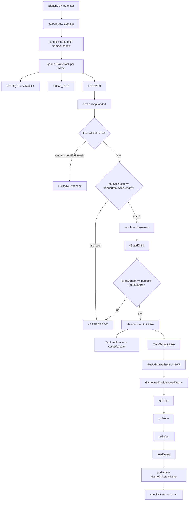

# 死神 vs 火影 3.3 — 逆向代码（调用链原文）

> 分析日期：2026-09-01  
> 分析人员：Grok 4.6  
> 阶段：Static（权威源 = `decompiled/` FFDec AS3；**不再完整反编译** `main.swf`）  
> flavor：`null`（普通 Flash/AVM2 代码逆向，非 malware/APT）  
> 样本授权：`work/bvn-3.3-swf/scope.md` — `auth.status=granted`，`network_profile=offline`，`preset=offline-sample`  
> 本报告只贴关键函数原文，不复述 `BVN-REVERSE.md` 的容器/架构。不写 exploit。

FFDec 把同名类写成 `*_2.as`：`ƒ/ǵ` → `decompiled/main/scripts/ƒ/ǵ_2.as`，`bleachvsnaruto` → `decompiled/main/scripts/bleachvsnaruto_2.as`。下文路径用磁盘文件名。

`uts(n,n,...)` 是 `String.fromCharCode`。本报告已解码，不在每段里重复。

| 字节序列 | 字符串 |
|---------|--------|
| 108,111,97,100,101,114,73,110,102,111 | `loaderInfo` |
| 98,121,116,101,115 | `bytes` |
| 108,101,110,103,116,104 | `length` |
| 97,112,112,69,114,114,111,114 | `appError` |
| 70,114,97,109,101,84,97,115,107 | `FrameTask` |
| 66,97,99,107,103,114,111,117,110,100 | `Background` |
| 80,108,101,97,115,101,…,33 | `Please, do not crack our game, thank you !` |

---

## 0. Evidence 链

### 0.1 Scope 摘要

| 字段 | 值 |
|------|---|
| case | `work/bvn-3.3-swf/scope.md` |
| auth | granted / own_system / offline-sample |
| in_scope | `main.swf`、`extracted/`、`decompiled/`、`play/` |
| out_of_scope | dos、phishing_real_users、unrestricted_exfil |
| network | offline；本阶段不执行样本、不外连 |
| 本阶段不做 | 完整再反编译、Ruffle 动态、写可运行 exploit |

### 0.2 Evidence

| E-id | source_ref | repro_command | content_hash |
|------|------------|---------------|--------------|
| E-id-fmt | `main.swf` | `python3 -c "from pathlib import Path; d=Path('main.swf').read_bytes(); print(int.from_bytes(d[4:8],'little'), len(d))"` | SHA-256 `5ddf9410af93872c2b988af81e2580d466cc0f87d5e885198687f129cc00ba3e` |
| E-imports-avm2 | 4×DoABC multiname / `decompiled/main/scripts/**` | SWF 无 PE IAT；见 `work/bvn-3.3-swf/evidence/E-static.md` | n/a |
| E-code | `decompiled/main/scripts/` 下列 `.as` | 见各节路径+行号；`python3` 搜 `#04236f9c` / `APP ERROR` / `V3.3` | n/a（逻辑证据） |
| E-anticheck | `#04236f9c` @ `118927`；`#4236f9c` @ `2596`；`APP ERROR` @ `117004` | `parseInt("0x"+"#04236f9c"[1:]) == 69431196` | 常量 ASCII 原样在文件中 |
| E-ver-drift | ABC `V3.3` @ `135422`；`MainGame.as:32` 写 `V3.3-MOD` | `data.find(b'V3.3-MOD') == -1` | n/a |

### 0.3 Findings

| F-id | severity | evidence_ids | confidence | location | status |
|------|----------|--------------|------------|----------|--------|
| F-frametask-boot | n/a_re | E-code | high | `BleachVSNaruto` → `ǵ.Ȱ` → `ǵ.ȹ` → `ƃ.FB` / `ɕ.ȑ` | confirmed |
| F-size-two-gates | n/a_re | E-code, E-anticheck | high | `ɕ/ȑ.as` `§ͦ§` + `§͵§` | confirmed |
| F-app-error | n/a_re | E-code, E-anticheck | high | `§͸§` → `FB.showError` → HTML `#error` | confirmed |
| F-zip-then-uiswf | n/a_re | E-code | high | `ZipAssetLoader.loadPreLoad` → `ZipCtrler.init`；`ResUtils.initalize` 8 个 embed SWF | confirmed |
| F-menu-cn-first | n/a_re | E-code | high | `MenuBtn` 优先显示 `cn`；`getDefaultMenu` 提供 `txt`/`cn` | confirmed |
| F-hit-atm-bdmn | n/a_re | E-code | high | 子剪辑名 `atm*` / `bdmn` → `HitVO.currentArea` ∩ body | confirmed |
| F-decompile-drift | info | E-ver-drift | high | `decompiled/.../MainGame.as` `V3.3-MOD`，ABC 仍是 `V3.3` | confirmed |

### 0.4 Path

**P-boot** `path_type=callflow`

1. 文档类构造 `ǵ.ɐ.Ȱ(this,Ǵ)` 〔E-code〕
2. `ȵ` 把时间轴 `nextFrame()` 到 `framesLoaded`；`ȹ` 按帧调 FrameTask 〔E-code〕
3. F1 `Ǵ.ȝ` → F2 `FB.init_fb` → F3 `ȑ.§͢§`；`§͗§ = bleachvsnaruto` 〔E-code〕
4. 体积/反加壳门；通过后 `addChild(bleachvsnaruto)` 〔E-anticheck〕
5. `bleachvsnaruto.initlize` → `ZipAssetLoader` + `MainGame.initlize` 〔E-code〕

**P-hit** `path_type=callflow`

1. 角色 SWF `defineAction(id, {power,...})` → `FighterHitModel.addHitVO` 〔E-code〕
2. 当前帧子剪辑 `atm*` → `getHitVOByDisplayName` 去前缀 → `HitVO.currentArea` 〔E-code〕
3. `bdmn` → `getCurrentBodyArea` 〔E-code〕
4. `GameMainLogicCtrler.checkHit`：`hitArea ∩ bodyArea` 非空 → `beHit` / `hit` 〔E-code〕

### 0.5 Timeline 摘要

| 时间 | 事件 |
|------|------|
| 2026-09-01 01:43 | case-init，scope granted |
| 此前 | FFDec 导出 `decompiled/`（264/264 脚本，0 failure） |
| 2026-09-01 Static | `BVN-REVERSE.md` 容器/体积常量 |
| 2026-09-01 Code | 本报告：六条链原文 + 补丁点 |

---

## 1. 执行摘要

文档类 `BleachVSNaruto` 只做一件事：把自身交给 GreenHD 引导器 `ƒ.ǵ.Ȱ`。引导器用 `[FrameTask]` 元数据按时间轴三帧拉起 `ƒ.Ǵ`、`ƃ.FB`、`ɕ.ȑ`。`ȑ` 把 `bleachvsnaruto` 实例化进舞台，游戏才开始跑 `MainGame.initlize`。

体积门有两道，比较对象都是 `69431196`（`0x04236f9c`）：一道读 `[Background(color="#4236f9c")]` 写进 `bytesTotal`，一道把字面量 `"#04236f9c"` `parseInt`。失败走 `§͸§` → `FB.showError`，界面文案键是 `appError`（英文字面 `APP ERROR!`）。

资源分两层：embed ZIP（`ZipCtrler`）给角色/地图/XML；8 个 embed UI SWF（`ResUtils`）给菜单/选人/战斗 HUD。菜单文案在 `getDefaultMenu` 的 `cn` 字段，`MenuBtn` 构造时优先画中文。战斗判定是时间轴约定：`bdmn` 身体盒、`atm*` 攻击盒、`HitVO` 数值。

---

## 2. 总调用图



---

## 3. 引导：`BleachVSNaruto` → `ƒ/ǵ` → `ɕ/ȑ` → `bleachvsnaruto.initlize`

### 3.1 文档类只把 `this` 交给壳

`decompiled/main/scripts/BleachVSNaruto.as:10-14`

```actionscript
public function BleachVSNaruto()
{
   super();
   ǵ.ɐ.Ȱ(this,Ǵ);
}
```

**这段在干什么：** AVM2 实例化文档类后立刻调用单例 `ǵ.ɐ` 的 `Ȱ`，第二参是配置类 `ƒ.Ǵ`（不是游戏类）。文档类自身没有 `init`、没有 `addChild` 游戏。

**补丁点：** 改这里等于拆引导。要进游戏，应改后面的 `bleachvsnaruto` / `MainGame`，不要动这一行。

### 3.2 `Ȱ` 登记三帧任务并停时间轴

`decompiled/main/scripts/ƒ/ǵ_2.as:77-103`

```actionscript
[FrameTask(p2="ƃ",p3="ɕ",c2="FB",c3="ȑ")]
public function Ȱ(param1:MovieClip, ... rest) : void
{
   Ȭ = param1;
   Ɏ.length = 0;
   _loc4_ = 0;
   while(_loc4_ < rest.length)
   {
      ȼ(rest[_loc4_]);
      _loc4_++;
   }
   for each(var _loc3_ in ȱ())
   {
      ȼ(_loc3_);
   }
   if(Ȭ.totalFrames < Ɏ.length)
   {
      throw new Error("timeline frames length error");
   }
   Ȭ.stop();
   Ȭ.addChild(ȭ);
   Ȭ.addChild(Ȯ);
   Ȭ.addChild(ȯ);
   Ȳ();
   Ȭ.stage ? ȳ(null) : Ȭ.addEventListener("addedToStage",ȳ);
}
```

**这段在干什么：** `rest` 里的 `Ǵ` 进任务表（F1）。`ȱ()` 读自己身上的 `[FrameTask(p2,p3,c2,c3)]`，拼出 `"ƃ.FB"`、`"ɕ.ȑ"`（F2/F3）。时间轴必须 ≥ 任务数。三个空 `Sprite` 分别是 app / progress / remote 容器。`Ȳ()` 从 `[Background]` 元数据抽出体积期望值。

`decompiled/main/scripts/ƒ/ǵ_2.as:117-121`（`ȱ` 拼类名）

```actionscript
_loc3_ = (_loc4_ = _loc5_[0]).arg.(@key == "p2").@value;
_loc1_ = _loc4_.arg.(@key == "p3").@value;
_loc6_ = _loc4_.arg.(@key == "c2").@value;
_loc7_ = _loc4_.arg.(@key == "c3").@value;
_loc2_.push(_loc3_ ? [_loc3_,_loc6_].join(".") : _loc6_,_loc1_ ? [_loc1_,_loc7_].join(".") : _loc7_);
```

`p2+c2` → `ƃ.FB`，`p3+c3` → `ɕ.ȑ`。

**补丁点：** 改 FrameTask 包名/类名会让 `getDefinitionByName` 失败，下一节 `ȹ` 会抛「Please, do not crack…」。汉化/改菜单不需要碰这里。

### 3.3 `ȵ` 推进帧；`ȹ` 调每帧的 `[FrameTask]` 方法

`decompiled/main/scripts/ƒ/ǵ_2.as:182-201`

```actionscript
private function ȵ() : void
{
   while(Ȭ.currentFrame < Ȭ.framesLoaded)
   {
      try
      {
         Ȭ.nextFrame();
      }
      catch(error:Error)
      {
         Ȧ("go to error:",error);
      }
   }
   ȹ();
   if(ɉ)
   {
      Ȧ("real size:",Ȭ.loaderInfo.bytes.length);
   }
}
```

`decompiled/main/scripts/ƒ/ǵ_2.as:254-291`

```actionscript
private function ȹ() : void
{
   var _loc6_:int = int(Ȭ[uts(102,114,97,109,101,115,76,111,97,100,101,100)]);
   while(_loc6_ > ȩ)
   {
      if(ȩ < Ɏ.length)
      {
         _loc7_ = Ȼ(ȩ);
         if(_loc7_)
         {
            _loc4_ = ȸ(_loc7_,uts(70,114,97,109,101,84,97,115,107));
            ...
            _loc2_ = _loc1_.@name;
            if(_loc2_ in _loc7_)
            {
               _loc7_[_loc2_]();
               _loc3_ = true;
               break;
            }
            ...
            if(!_loc3_)
            {
               throw new Error(uts(80,108,101,97,115,101,...));
            }
         }
      }
      ȩ = ȩ + 1;
   }
}
```

**这段在干什么：** 对已加载的每一帧：取出任务表里的类（F1=`Ǵ`，F2=`ƃ.FB`，F3=`ɕ.ȑ`），用 `describeType` 找名为 `FrameTask` 的元数据，调那个方法。找不到就抛 `Please, do not crack our game, thank you !`。这是壳的完整性钩子，不是体积门。

**补丁点：** 给类加/改方法时必须保留 `[FrameTask]` 元数据，否则直接崩。体积自检不在这里。

### 3.4 F1 / F2 / F3 各自的 FrameTask

`decompiled/main/scripts/ƒ/Ǵ.as:34-38`

```actionscript
[FrameTask]
public static function ȝ() : void
{
   ǵ.ɐ.Ⱦ();
   Ȥ(new Ƕ());
```

`decompiled/main/scripts/ƃ/FB.as:85-87`

```actionscript
[FrameTask]
public static function init_fb() : void
{
```

`decompiled/main/scripts/ɕ/ȑ.as:50-73`

```actionscript
public static var §͗§:* = bleachvsnaruto;

[FrameTask]
public static function §͢§() : void
{
   if(ǵ.ɐ.ɉ)
   {
      §ͣ§();
   }
   else
   {
      ǵ.ɐ.addEventListener("complete",§ͣ§);
   }
}
```

**这段在干什么：** F1 画底并挂 loading UI。F2 `init_fb` 建 `app_model`（id `BleachVSNaruto_3_3`、loading 类 `LOADING_bvn`）。F3 把游戏类绑定在静态字段 `§͗§`，SWF 加载完立刻走 `§ͣ§`。

**补丁点：** 换游戏入口类 = 改 `§͗§` 的初值。`init_fb` 里的 `app_model.id` / `loading` 是壳配置，不是玩法。

### 3.5 `§ͣ§` 过门后实例化游戏类

`decompiled/main/scripts/ɕ/ȑ.as:76-97`

```actionscript
private static function §ͣ§(param1:ȏ = null) : void
{
   Ȧ("app loaded");
   FB.updateLoadingUI(false);
   if(ǵ.ɐ.Ʌ)
   {
      if(!FB.serviceHold.ˢ && FB.serviceHold.isReady)
      {
         _loc2_ = getLabel("shell");
         FB.showError(_loc2_);
         return;
      }
   }
   §͞§ = §ͥ§(§͗§);
   if(!ǵ.ɐ.Ɉ && §ͦ§())
   {
      §͸§();
      return;
   }
   §ͧ§();
}
```

`Ʌ` = `!!timeline.loaderInfo.loader`（被别的 Loader 包着）。`Ɉ` = 存在 `__go_to_definition_help` 元数据（调试 SWF）。`§ͥ§(bleachvsnaruto)` 用 `FB.getInstanceBy` `new` 出显示对象。`§ͧ§` 在 DisplayObject 路径上设 `§͝§ = 实例` 然后 `§ͭ§` → `§΃§` → `§͵§` `addChild`。

游戏真正启动：

`decompiled/main/scripts/bleachvsnaruto_2.as:41-74`

```actionscript
public function bleachvsnaruto()
{
   super();
   if(stage)
   {
      initlize();
   }
   else
   {
      addEventListener("addedToStage",initlize);
   }
}

private function initlize(param1:Event = null) : void
{
   removeEventListener("addedToStage",initlize);
   STAGE = stage;
   stage.showDefaultContextMenu = false;
   GameInterface.instance = new GameInterfaceManager();
   Ctrler4399.init();
   _zipAssetLoader = new ZipAssetLoader();
   AssetManager.I.setAssetLoader(_zipAssetLoader);
   buildGame();
}
```

`decompiled/main/scripts/bleachvsnaruto_2.as:99-126`

```actionscript
private function buildGame() : void
{
   _mainGame = new MainGame();
   _mainGame.initlize(this,stage,initBackHandler,initFailHandler);
   ...
}
private function initBackHandler() : void
{
   addEventListener("enterFrame",etHandler);
}
private function etHandler(param1:Event) : void
{
   if(GameUtils.isInTop(this))
   {
      removeEventListener("enterFrame",etHandler);
      _mainGame.goLogo();
   }
}
```

**这段在干什么：** `addChild` 之后 `initlize`：换掉默认 `AssetLoader` 为 ZIP 实现，构造 `MainGame`，资源 OK 后再 `goLogo`。`GameInterfaceManager` 会给默认菜单插「排行榜」。

**补丁点：** 本地离线不需要 4399：`Ctrler4399.init()` 可空实现。菜单汉化不要改这里，改 §7。ZIP 路径从这里注入，是资源层的总开关。

---

## 4. 体积门：`§ͦ§` / `§͵§` / `#04236f9c` / `showError`

期望值两边都是 **69431196**。SWF 头 FileLength（offset 4）也是这个数。

### 4.1 `bytesTotal` 来自 `[Background(color="#4236f9c")]`

`decompiled/main/scripts/ƒ/ǵ_2.as:125-132` + `355-356` + `460-464`

```actionscript
_loc1_[uts(115,105,122,101)] = Ȫ;
Ȫ = parseInt("0x" + (ȸ(this,uts(66,97,99,107,103,114,111,117,110,100)).elements("*").(@key == "color").@value + "").slice(1));

[Background(color="#4236f9c")]
public function Ⱦ(param1:uint = 0) : void { ... }

public function get bytesTotal() : uint
{
   return Ȫ;
}
```

`"#4236f9c".slice(1)` → `"4236f9c"` → `parseInt("0x4236f9c")` = `69431196`。这串在 `main.swf` offset `2596`。

**这段在干什么：** 把「期望文件体积」藏在方法元数据的颜色字段里，运行时读进 `bytesTotal`。不是用来填背景色的（`Ⱦ` 的 `param1` 才是实际 fill）。

**补丁点：** 改文件长度后，若不同步这 7 位 hex，第一道门失败。同长度替换（ABC 字符串、ZIP stored）不动 FileLength，这道过。

### 4.2 第一道：`§ͦ§` 比 `bytesTotal` 和 `loaderInfo.bytes.length`

`decompiled/main/scripts/ɕ/ȑ.as:184-195`

```actionscript
private static function §ͦ§() : Boolean
{
   if(!§͞§)
   {
      return true;
   }
   if(ǵ.ɐ.bytesTotal == ǵ.ɐ.timeline[uts(108,111,97,100,101,114,73,110,102,111)][uts(98,121,116,101,115)][uts(108,101,110,103,116,104)])
   {
      return false;
   }
   return true;
}
```

解码后：`bytesTotal == timeline.loaderInfo.bytes.length`。**返回 `true` = 失败**（调用方 `if(§ͦ§()) §͸§()`）。实例都没造出来时也失败。

**这段在干什么：** `addChild` 之前的体积比较。调试 SWF（`Ɉ`）会在调用处被跳过。

**补丁点：** 函数语义是「有问题吗」。要放行体积变化，要么让两个数相等，要么让调用处的 `!Ɉ && §ͦ§()` 不进。不要只改 SWF 头 4 字节。

### 4.3 第二道：`§͵§` 把 `"#04236f9c"` 当十六进制

`decompiled/main/scripts/ɕ/ȑ.as:458-499`

```actionscript
private static function §͵§() : void
{
   Ȧ("add app");
   ...
   _loc1_.addChild(§͝§);
   if(§͝§.stage)
   {
      if(!ǵ.ɐ.Ɉ && _loc1_.loaderInfo.bytes.length != parseInt("0x" + "#04236f9c".slice(1)))
      {
         ȑ.§͸§();
         §͝§.parent.removeChild(§͝§);
      }
      else
      {
         ǵ.ɐ.dispatchEvent(new ȃ("appAdded"));
         ...
      }
   }
   else
   {
      ȑ.§͸§();
   }
}
```

`"#04236f9c".slice(1)` → `"04236f9c"` → `0x04236f9c` = `69431196`。这串在 `main.swf` offset `118927`（DoABC#1）。比较的是 **app 容器** `Ɂ` 的 `loaderInfo.bytes.length`（代码 `new Sprite()`，loaderInfo 仍是主 SWF）。失败会把刚 `addChild` 的游戏摘掉。

**这段在干什么：** 上舞台后再比一次，常量写成带前导 0 的 8 位 hex，和第一道 7 位 `#4236f9c` 是同一个整数。`addChild` 后没有 `stage` 也当失败。

**补丁点：** 改体积必须让 FileLength、`#4236f9c`、`#04236f9c` 三个数一致。只改一处会在这里被摘舞台。同长度补丁不必动这三处。

### 4.4 失败 UI：`§͸§` → `FB.showError`（APP ERROR）

`decompiled/main/scripts/ɕ/ȑ.as:52-55` + `519-525`

```actionscript
<appError en="APP ERROR!" zh-CN="程序发生错误：重要数据被破坏" zh-TW="程式數據被破壞" ru="ошибка приложения"/>
<shell en="No running in a loader." zh-CN="不允许加壳运行" zh-TW="不允許加殼運行" />

public static function §͸§(... rest) : void
{
   var _loc3_:String = uts(97,112,112,69,114,114,111,114);
   var _loc2_:String = getLabel(_loc3_);
   rest.unshift(_loc2_);
   FB.showError.apply(null,rest);
}
```

`decompiled/main/scripts/ƃ/FB.as:661-665` + `516-578` 关键替换

```actionscript
public static function showError(... rest) : void
{
   show_html(get_error_html(rest));
}

str = str.replace(/#error/g,getLabel("error"))
         .replace(/#issue/g, ers.length > 0 ? "<li>"+ers.join("</li><li>")+"</li>" : getLabel("unknowError"));
```

`getLabel("error")` 的英文是 `WARNING`，中文是 `游戏运行出现问题`。`#issue` 列表第一项是 `APP ERROR!` / `程序发生错误：重要数据被破坏`。SWF 里 ASCII `APP ERROR` 在 offset `117004`。

**这段在干什么：** 体积门和反加壳最终都走同一套 HTML 错误页。`shell` 文案只在 `loaderInfo.loader` 分支用。

**补丁点：** 改玩家可见的报错字 → `labelXML` 的 `appError`/`error`。要让门失效 → 改 `§ͦ§`/`§͵§` 的比较，不要改 `showError`（那只改文案，门还在）。

---

## 5. 游戏门面：`MainGame.initlize` / `goLogo` / `goMenu` / `goSelect` / `loadGame` / `goGame`

`decompiled/main/scripts/net/play5d/game/bvn/MainGame.as:32-33` 注意漂移：

```actionscript
public static const VERSION:String = "V3.3-MOD";
public static const VERSION_DATE:String = "2019.3.32";
```

ABC 字符串池只有 `V3.3`（offset `135422`），没有 `V3.3-MOD`。这是本地反编译树被改过，不是 SWF 原文。引用版本号以 ABC 为准。

### 5.1 `initlize`：UI SWF → 子系统 → `GameLoadingState`

`decompiled/main/scripts/net/play5d/game/bvn/MainGame.as:64-103`

```actionscript
public function initlize(param1:Sprite, param2:Stage, param3:Function = null, param4:Function = null) : void
{
   var resInitBack:* = function():void
   {
      _rootSprite = root;
      _stage = stage;
      GameRender.initlize(stage);
      GameInputer.initlize(_stage);
      GameData.I.loadData();
      GameData.I.config.applyConfig();
      GameInputer.updateConfig();
      root.scrollRect = new Rectangle(0,0,GameConfig.GAME_SIZE.x,GameConfig.GAME_SIZE.y);
      stageCtrl = new KyoStageCtrl(_rootSprite);
      var _loc1_:GameLoadingState = new GameLoadingState();
      stageCtrl.goStage(_loc1_);
      _loc1_.loadGame(loadGameBack,initFail);
   };
   var loadGameBack:* = function():void
   {
      EffectModel.I.initlize();
      if(initBack != null) { initBack(); }
   };
   ResUtils.I.initalize(resInitBack,initFail);
}
```

**这段在干什么：** 先异步解开 8 个 UI SWF（§6.3），成功后再挂渲染/输入/存档，切到 `GameLoadingState`。`loadGame` 在 loading 里会 `AssetManager.loadPreLoad` → ZIP。`initBack` 回到 `bleachvsnaruto.initBackHandler` → `goLogo`。

**补丁点：** 启动顺序锁在这里。缺 UI SWF 会走 `initFail`（当前是空函数）。改分辨率看 `GameConfig.GAME_SIZE` + `scrollRect`，不是这里。

### 5.2 六个切场

`decompiled/main/scripts/net/play5d/game/bvn/MainGame.as:124-163`

```actionscript
public function goLogo() : void
{
   stageCtrl.goStage(new LogoState());
   setFPS(30);
}
public function goMenu() : void
{
   MainGame.I.stage.dispatchEvent(new DataEvent("5d_message",false,false,JSON.stringify(["go_menu_stage"])));
   resetDefault();
   stageCtrl.goStage(new MenuState());
   setFPS(30);
}
public function goSelect() : void
{
   stageCtrl.goStage(new SelectFighterStage());
   setFPS(30);
}
public function loadGame() : void
{
   var _loc1_:LoadingState = new LoadingState();
   stageCtrl.goStage(_loc1_,true);
   setFPS(30);
}
public function goGame() : void
{
   var _loc1_:GameState = new GameState();
   stageCtrl.goStage(_loc1_);
   GameCtrl.I.startGame();
   setFPS(GameConfig.FPS_GAME);
}
```

**这段在干什么：** 全部走 `KyoStageCtrl.goStage`。菜单前 `resetDefault()` 把自动结束/自动开局/选人自动完成加回去。`loadGame` 是选人之后的角色 SWF 加载（`LoadingState`），不是启动时的 ZIP preload。`goGame` 才 `GameCtrl.startGame()` 并把帧率切到战斗 FPS。

`decompiled/main/scripts/net/play5d/game/bvn/ctrl/game_ctrls/GameCtrl.as:243-261` + `338-340`

```actionscript
public function startGame() : void
{
   if(!autoStartAble) { return; }
   fightFinished = false;
   doStartGame();
}
public function doStartGame() : void
{
   gameRunData.reset();
   initTeam();
   buildGame();
   GameEvent.dispatchEvent("GAME_START");
   GameRender.add(render);
}
// addFighter:
param1.initlize();
param1.setActionCtrl(_loc3_);
```

**补丁点：** 跳过 Logo → 改 `etHandler` 里 `goLogo()` 为 `goMenu()`。练习模式 `GameMode = 40` 在 `buildGame` 里走 `TrainingCtrler`，不经 `GameStartCtrl.start1v1`。改 FPS：菜单 30，战斗 `GameConfig.FPS_GAME`。

---

## 6. 资源：`ZipCtrler` + `ZipAssetLoader` + `ResUtils`

### 6.1 embed ZIP 解析

`decompiled/main/scripts/net/play5d/game/bvn/web/ZipCtrler.as:16` + `38-65` + `67-75`

```actionscript
private var _embedZip:Class = assets_zip$1de7dd7d6855592a2a2b869bcaf19a4b1288174545;

public function init(param1:Function, param2:Function = null) : void
{
   _zipBytes = new _embedZip();
   _fZip = new FZip();
   _fZip.addEventListener("complete",onZipComplete);
   _fZip.loadBytesStep(_zipBytes,20);
}
public function getLoader(param1:String) : Loader
{
   _loc2_ = _fZip.getFileByName(param1);
   _loc3_.loadBytes(_loc2_.content);
   return _loc3_;
}
```

`deng/fzip/FZipFile.as:567-586`：`uncompress()` 只 `inflate`/`uncompress`，**读路径不比对 `_crc32`**（CRC 只在写 ZIP 头时出现）。

**这段在干什么：** SymbolClass 把 DefineBinaryData id=222 绑成 `_embedZip`。`init` 分 20 步喂给 FZip。之后按 ZIP 内路径 `getFileByName` → `Loader.loadBytes`。

**补丁点：** 换角色/地图 SWF = 改 ZIP 里同名项。本副本 inflate 后不校验 CRC，改 stored/deflate 内容不必修 CRC32（头里的 CRC 仍是旧值，只影响外部 zip 工具）。改 ZIP 体积会牵动整包 FileLength → 回到体积门。

### 6.2 `ZipAssetLoader` 接到 `AssetManager`

`decompiled/main/scripts/net/play5d/game/bvn/web/ZipAssetLoader.as:17-27` + `130-137`

```actionscript
public function loadXML(param1:String, param2:Function, param3:Function = null) : void
{
   var _loc4_:XML = ZipCtrler.I.getXML(param1);
   if(_loc4_) { doNextFrame(param2,_loc4_); }
   else { doNextFrame(param3); }
}
public function needPreLoad() : Boolean { return true; }
public function loadPreLoad(param1:Function, param2:Function = null, param3:Function = null) : void
{
   ZipCtrler.I.init(param1,param3);
}
```

`decompiled/main/scripts/net/play5d/game/bvn/state/GameLoadingState.as:34-46`

```actionscript
public function loadGame(param1:Function, param2:Function) : void
{
   if(AssetManager.I.needPreLoad())
   {
      AssetManager.I.loadPreLoad(loadPreloadBack,loadPreloadFail,loadPreloadProcess);
      msg("游戏初始化：准备游戏资源");
   }
   else { loadPreloadBack(); }
}
```

**这段在干什么：** `bleachvsnaruto` 已经 `setAssetLoader(ZipAssetLoader)`，所以 `needPreLoad()` 恒为 true，loading 条先跑 ZIP。XML/SWF/图片/音效全部从 ZIP 名字取，失败回调下一帧执行（避免同步栈溢出）。

**补丁点：** 要改成外置文件加载，实现另一个 `IAssetLoader` 再 `setAssetLoader`。路径字符串在 `AssetManager` / `FighterModel` 的 `assets/fighter/*.swf` 一类字段，不在 Loader 里。

### 6.3 `ResUtils`：8 个 UI SWF + 按链接名实例化

`decompiled/main/scripts/net/play5d/game/bvn/utils/ResUtils.as:27-41` + `67-98` + `131-149`

```actionscript
public var common_ui:Class = common_ui_swf$a3bf7921c1ba01403bf4dfe7a7fe5c9e1164926403;
public var fight:Class = fight_swf$9ccdf9d2a37e1fb6b6f0df6717a547941873914523;
public var title:Class = §title_swf$...§;
// setting / select / loading / howtoplay / gameover 同结构

public function initalize(param1:Function = null, param2:Function = null) : void
{
   var _loc5_:XML = describeType(this);
   for each(var _loc6_ in _loc5_.variable)
   {
      _loc3_ = this[_loc6_.@name];
      _loc7_ = new InsSwf(_loc3_);
      _swfPool[_loc3_] = _loc7_;
   }
}
public function createDisplayObject(param1:Class, param2:String) : *
{
   var _loc4_:Class = getItemClass(param1,param2);
   if(_loc4_)
   {
      _loc3_ = new _loc4_();
      if(_loc3_ is Sprite)
      {
         _loc6_.volume = GameData.I.config.soundVolume;
         return _loc5_;
      }
      return _loc3_;
   }
}
```

`InsSwf`（同文件 198–212）：`new embedClass()` → 读 `movieClipData` → `Loader.loadBytes(..., allowCodeImport=true)` 进 `ApplicationDomain.currentDomain`。

**这段在干什么：** 用 `describeType` 扫自己的 8 个 `Class` 字段，全部 loadBytes。之后 `createDisplayObject(ResUtils.I.common_ui, "mc_wzbtn")` 按导出类名从 domain 取出。

**补丁点：** 菜单按钮皮肤 = `common_ui` 里链接名 `mc_wzbtn`。选人界面 = `select` / `stg_select`。改这些 UI 不用动 ZIP。`initalize` 拼写是源码原样（少一个 i）。

---

## 7. 菜单：`GameInterface.getDefaultMenu` + `MenuBtn` 构造

### 7.1 默认树（`txt` 是逻辑键，`cn` 是显示）

`decompiled/main/scripts/net/play5d/game/bvn/interfaces/GameInterface.as:13-54`

```actionscript
public static function getDefaultMenu() : Array
{
   return [{
      "txt":"TEAM PLAY","cn":"小队模式",
      "children":[
         {"txt":"TEAM ACRADE","cn":"闯关模式"},
         {"txt":"TEAM VS PEOPLE","cn":"2P对战"},
         {"txt":"TEAM VS CPU","cn":"对战电脑"}]
   },{
      "txt":"SINGLE PLAY","cn":"单人模式",
      "children":[
         {"txt":"SINGLE ACRADE","cn":"闯关模式"},
         {"txt":"SINGLE VS PEOPLE","cn":"2P对战"},
         {"txt":"SINGLE VS CPU","cn":"对战电脑"}]
   },{
      "txt":"OPTION","cn":"游戏设置"
   },{
      "txt":"TRAINING","cn":"练习模式"
   },{
      "txt":"CREDITS","cn":"制作组"
   },{
      "txt":"MORE GAMES","cn":"更多游戏"
   }];
}
```

`GameInterfaceManager.getGameMenu` 在下标 4 前插入 `{txt:"RANK", cn:"排行榜"}`。`MenuBtnGroup.build`：先 `instance.getGameMenu()`，空则回落到 `getDefaultMenu()`。

`decompiled/main/scripts/net/play5d/game/bvn/ui/MenuBtnGroup.as:77-110`

```actionscript
_btnConfig = GameInterface.instance.getGameMenu();
if(!_btnConfig) { _btnConfig = GameInterface.getDefaultMenu(); }
...
var _loc5_:MenuBtn = new MenuBtn(param1.txt,param1.cn,param1.func);
```

选中后若无 `func`，用 `txt` 当 switch 键：

`decompiled/main/scripts/net/play5d/game/bvn/ui/MenuBtnGroup.as:274-307`

```actionscript
private function getFucByLabel(param1:String) : Function
{
   switch(label)
   {
      case "TEAM ACRADE":
         func = function():void {
            GameMode.currentMode = 10;
            MessionModel.I.reset();
            MainGame.I.goSelect();  // 或 goHowToPlay
         };
         break;
      case "TEAM VS PEOPLE":
         func = function():void { GameMode.currentMode = 11; MainGame.I.goSelect(); };
```

**这段在干什么：** `txt` 必须保持英文，因为 `getFucByLabel` 按它跳模式。`cn` 只给按钮显示。`TEAM ACRADE` 是源码拼写（不是 ARCADE）。

**补丁点：** 汉化改 `cn`，不要改 `txt`。加菜单项要么给 `func`，要么在 `getFucByLabel` 加 case。4399 的 RANK 在 `getGameMenu`，离线可删那一项。

### 7.2 `MenuBtn` 构造：皮肤 + 中文优先

`decompiled/main/scripts/net/play5d/game/bvn/ui/MenuBtn.as:39-67`

```actionscript
public function MenuBtn(param1:String, param2:String = "", param3:Function = null)
{
   super();
   this.cn = param2;
   this.label = param1;
   this.func = param3;
   ui = ResUtils.I.createDisplayObject(ResUtils.I.common_ui,"mc_wzbtn");
   ui.buttonMode = true;
   _bitmapText = new BitmapFontText(AssetManager.I.getFont("font1"));
   _bitmapText.text = param1;
   _bitmapText.visible = false;
   ui.addChild(_bitmapText);
   ui.bg.visible = false;
   var showTxt:String = param2 != null && param2.length > 0 ? param2 : param1;
   _cnTxt = new BitmapText();
   UIUtils.formatText(_cnTxt.textfield,{"font":"黑体","size":28,"color":16777215});
   _cnTxt.text = showTxt;
   ui.addChild(_cnTxt);
}
```

**这段在干什么：** `param1`=`txt` 写进位图字体但 `visible=false`。真正画出来的是 `_cnTxt`：有 `cn` 用 `cn`，否则用英文。皮肤来自 `common_ui` 的 `mc_wzbtn`（含 `bg` 子剪辑）。`hover()` 才把 `bg` 拉出来。

**补丁点：** 中文菜单 = 改 `cn` 或这里的 `showTxt`。字号/字体 = `formatText` 那三行。英文位图 `_bitmapText` 目前隐藏，改它玩家看不见。按钮高度默认 75，子项 `childMode()` 改成 55。

`MenuState.showBtns`（`decompiled/main/scripts/net/play5d/game/bvn/state/MenuState.as:104-117`）在 title SWF 的 `btnct` 里 `new MenuBtnGroup()` 再 `build()`。

---

## 8. 战斗：`FighterMain.initlize`、`FighterMC` 的 `bdmn`/`atm*`、`checkHit`、`HitVO`

### 8.1 入场：SWF 必须有 `setFighterCtrler`

`decompiled/main/scripts/net/play5d/game/bvn/fighter/FighterMain.as:284-296`

```actionscript
public function initlize() : void
{
   _fighterCtrl = new FighterCtrler();
   if(_mainMc.setFighterCtrler)
   {
      _mainMc.setFighterCtrler(_fighterCtrl);
      _fighterCtrl.initFighter(this);
      _buffCtrler = new FighterBuffCtrler(this);
      _mainMc.gotoAndStop(data ? data.startFrame + 1 : 2);
      return;
   }
   throw new Error("初始化失败，SWF未定义setFighterCtrler()");
}
```

角色 SWF 侧（鸣人，其它角色同一模式）：

`decompiled/fighters/naruto/scripts/naruto_fla/MainTimeline.as:36-72`

```actionscript
public function setFighterCtrler(param1:*) : void
{
   this.$fighter_ctrler = param1;
   this.defineAction = this.$fighter_ctrler.defineAction;
}
internal function frame2() : *
{
   if(!this.$fighter_ctrler) { return; }
   this.defineAction("tk",{
      "power":30,"hitType":2,"hitx":3,"hity":8,
      "hurtTime":400,"hurtType":0,"isBreakDef":false
   });
```

`FighterCtrler.defineAction` → `hitModel.addHitVO`。`initMc` 里 `new FighterMC().initlize(mc, fighter, mcCtrl)`。

**这段在干什么：** 引擎把控制器塞进角色文档类，时间轴第 2 帧用 `defineAction(id, 数值表)` 注册招式。`id` 必须和后面攻击盒实例名去掉 `atm` 后相同（`tk` ↔ `atmtk`）。

**补丁点：** 改伤害/硬直 = 改 `defineAction` 的 `power`/`hurtTime`/`hitType`。新招必须：① 这里登记 id；② 动画帧里放名为 `atm<id>` 的子剪辑；③ 有 `bdmn`。缺 `setFighterCtrler` 的 SWF 进不了战斗。

### 8.2 每帧扫 `bdmn` / `atm*`

`decompiled/main/scripts/net/play5d/game/bvn/fighter/FighterMC.as:138-154` + `268-282` + `317-344` + `347-372`

```actionscript
public function renderAnimate() : void
{
   ...
   renderChildren();
   findBodyArea();
   findHitArea();
}

public function getCurrentHitSprite() : Array
{
   while(_loc3_ < _mc.numChildren)
   {
      _loc1_ = _mc.getChildAt(_loc3_);
      if(_loc1_ && _loc1_.name.indexOf("atm") != -1)
      {
         _loc2_.push(_loc1_);
      }
      _loc3_++;
   }
   return _loc2_;
}

var _loc3_:DisplayObject = _mc.getChildByName("bdmn");
if(_loc3_)
{
   _loc2_ = _loc3_.getBounds(_fighterDisplay);
   _loc1_ = _bodyAreaCache.cacheAreaByDisplay(_loc3_,_loc2_);
}

_loc6_ = _loc8_.getHitVOByDisplayName(_loc2_.name);
```

`renderChildren` 明确 **不** 推进名为 `bdmn` / `atm*` / `AImain` 的子剪辑（它们只当盒子）。

`decompiled/main/scripts/net/play5d/game/bvn/fighter/models/FighterHitModel.as:47-67`

```actionscript
public function getHitVOByDisplayName(param1:String) : HitVO
{
   var _loc3_:HitVO = getHitVO(param1);
   if(_loc3_) { return _loc3_; }
   if(param1.indexOf("atm") == -1) { return null; }
   var _loc2_:String = param1.replace("atm","");
   return getHitVO(_loc2_);
}
public function addHitVO(param1:String, param2:Object) : void
{
   var _loc3_:HitVO = new HitVO(param2);
   _loc3_.owner = _fighter;
   _loc3_.id = param1;
   _hitObj[param1] = _loc3_;
}
```

**这段在干什么：** 身体盒固定实例名 `bdmn`（getChildByName，每帧一个）。攻击盒是名字前缀 `atm` 的任意子剪辑，用去前缀后的 id 查 `HitVO`。盒矩形 `getBounds(fighterDisplay)` 后缓存。

**补丁点：** 碰撞对不上，先查时间轴实例名是不是 `bdmn`/`atm<id>`，再查 `defineAction` 的 id。改盒大小 = 改这些剪辑的图形，不必改 AS3。`indexOf("atm")` 是子串匹配，`xxxatm` 也会被当成攻击盒。

### 8.3 `HitVO` 数值 + `currentArea`

`decompiled/main/scripts/net/play5d/game/bvn/fighter/models/HitVO.as:10-50` + `59-76`

```actionscript
public var id:String;
public var power:Number = 0;
public var powerRate:Number = 1;
public var hitType:int = 1;
public var isBreakDef:Boolean = false;
public var hitx:Number = 0;
public var hity:Number = 0;
public var hurtTime:Number = 300;
public var currentArea:Rectangle;

public function HitVO(param1:Object = null)
{
   if(param1) { KyoUtils.setValueByObject(this,param1); }
   if(hitType == 1 && hurtTime < 100) { hurtTime = 100; }
}
public function isBisha() : Boolean
{
   return id.indexOf("bs") != -1 || id.indexOf("sbs") != -1
       || id.indexOf("cbs") != -1 || id.indexOf("kbs") != -1;
}
public function getDamage() : int { return power * powerRate; }
```

`FighterCtrler.getCurrentHits`（`decompiled/main/scripts/net/play5d/game/bvn/fighter/ctrler/FighterCtrler.as:365-400`）把缓存的 `area` 写进 `HitVO.currentArea`（会做一次坐标系转换 `getCurrentRect`）。

**这段在干什么：** `defineAction` 的匿名对象原样灌进字段。必杀靠 **id 子串** `bs`/`sbs`/`cbs`/`kbs`，不是单独 flag。`powerRate` 后期 `setPowerRate` 可统一放大。

**补丁点：** 全局伤害倍率 → `FighterHitModel.setPowerRate`。必杀判定改 id 命名即可，不必改 `isBisha`。`hitType==1` 时硬直下限 100。

### 8.4 `checkHit`：两边的攻击盒 ∩ 对方身体盒

`decompiled/main/scripts/net/play5d/game/bvn/ctrl/game_ctrls/GameMainLogicCtrler.as:114-129` + `305-343` + `345-381`

```actionscript
checkBodyHit(_loc2_,_loc1_);
if(_renderAnimate) { checkHit(_loc2_,_loc1_); }

private function checkHit(param1:IGameSprite, param2:IGameSprite) : void
{
   if(!renderHit) { return; }
   var _loc7_:Array = param1.getCurrentHits();
   var _loc5_:Array = param2.getCurrentHits();
   if(param1 is BaseGameSprite && !(param1 as BaseGameSprite).isAllowBeHit)
   {
      _loc8_ = null;
   }
   else
   {
      _loc8_ = param1.getBodyArea();
   }
   if(param2 is BaseGameSprite && !(param2 as BaseGameSprite).isAllowBeHit)
   {
      _loc4_ = null;
   }
   else
   {
      _loc4_ = param2.getBodyArea();
   }
   var _loc6_:Object = getHitObj(_loc7_,_loc4_);
   var _loc3_:Object = getHitObj(_loc5_,_loc8_);
   if(_loc6_)
   {
      param2.beHit(_loc6_.hitVO,_loc6_.hitRect);
      param1.hit(_loc6_.hitVO,param2);
   }
   if(_loc3_)
   {
      param1.beHit(_loc3_.hitVO,_loc3_.hitRect);
      param2.hit(_loc3_.hitVO,param1);
   }
}

_loc4_ = _loc6_.intersection(param2);
if(_loc4_ && _loc4_.isEmpty() == false)
{
   return {"hitVO":_loc3_,"hitRect":_loc4_};
}
```

**这段在干什么：** 只在不同队伍之间成对检测。`checkHit` 跟动画帧走（`_renderAnimate`），身体推挤 `checkBodyHit` 每逻辑帧都走。`getHitObj` 用 `Rectangle.intersection`，空矩形不算命中。无敌 = `isAllowBeHit=false` → 身体盒变 null。`renderHit=false` 可整场关掉判定。

**补丁点：** 训练场关伤害判定 → `renderHit=false`。改判定精度不要动这里，动 `bdmn`/`atm*` 图形。对打双方可以同一帧互打（两段 `if` 都执行）。

---

## 9. 补丁点一览（不是 exploit）

| 目标 | 动哪里 | 不要动 |
|------|--------|--------|
| 中文菜单 | `getDefaultMenu` 的 `cn`；`MenuBtn` 的 `showTxt` / 黑体 28 | `txt`（`getFucByLabel` 键） |
| 按钮皮肤 | `common_ui` 链接名 `mc_wzbtn` | `ZipCtrler` |
| 跳过 Logo | `bleachvsnaruto.etHandler` 里 `goLogo()` | 壳 FrameTask |
| 角色伤害 | 角色 SWF `defineAction` 的 `power`/`hurtTime` | `checkHit` |
| 碰撞盒 | 时间轴实例 `bdmn`、`atm<id>` | `HitVO` 类本身 |
| 换角色 SWF | ZIP 内同路径文件 | 体积三常量（同长度时） |
| 改整包体积 | **同步** FileLength + `#4236f9c` + `#04236f9c` | 只改其中一处 |
| 报错文案 | `ȑ.labelXML` `appError` / `FB.labelXML` `error` | 当绕过用 |
| 版本字符串 | ABC 里 `V3.3`（offset `135422`） | 只改 `decompiled/.../MainGame.as`（那是漂移） |

同长度 ASCII/ZIP stored 替换不触发体积门。本阶段未做 Ruffle 动态验证。

---

## 10. 复现（静态，offline）

```bash
# 体积三常量
python3 -c "
from pathlib import Path
d=Path('/workspace/bvn-3.3/main.swf').read_bytes()
print('FileLength', int.from_bytes(d[4:8],'little'), 'size', len(d))
print('#04236f9c', d.find(b'#04236f9c'))
print('#4236f9c', d.find(b'#4236f9c'))
print('APP ERROR', d.find(b'APP ERROR'))
print('V3.3', d.find(b'V3.3'), 'V3.3-MOD', d.find(b'V3.3-MOD'))
"

# 源码锚点
rg -n "function §ͦ§|function §͵§|#04236f9c|getDefaultMenu|function checkHit|getChildByName\(\"bdmn\"\)" \
  decompiled/main/scripts
```

工具：JPEXS FFDec 26.2.1（既有反编译）、Python 3.13、`rg`。未使用 IDA/r2 动态。

---

## 11. 遗留

- `uts` / `[Alias(key=ascii ordinals)]` 未做全表；本报告只解码引导和体积门用到的。
- `FB.init_fb` 后半（平台过滤、4399 `serviceHold`）未展开。
- `checkBodyHit` 推挤向量未贴；命中管线以 `checkHit` 为准。
- 角色 `defineAction` 只举鸣人 `tk`；76 个 fighter SWF 同一 API。
- 动态：未在 Ruffle 里触发 APP ERROR / 对打。
