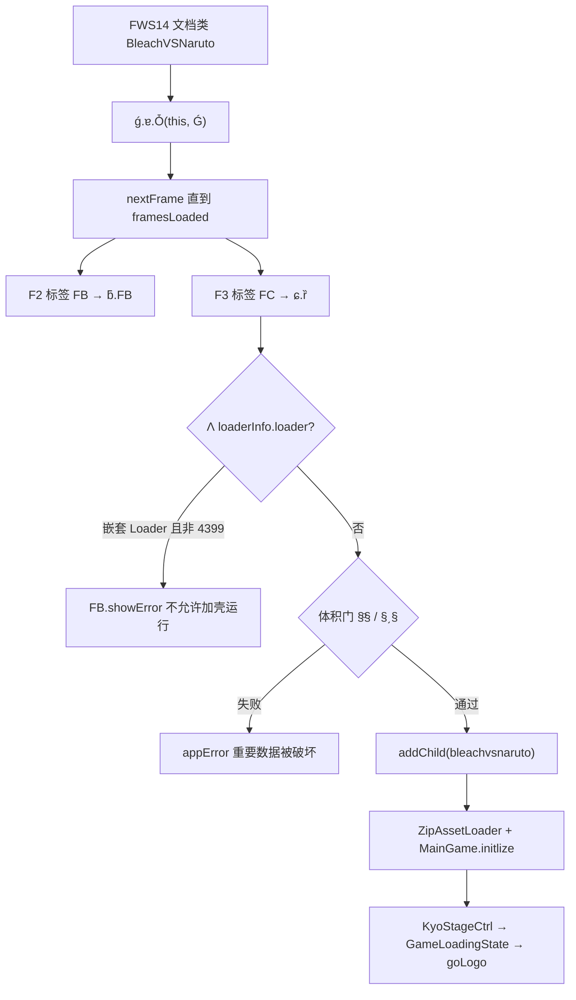
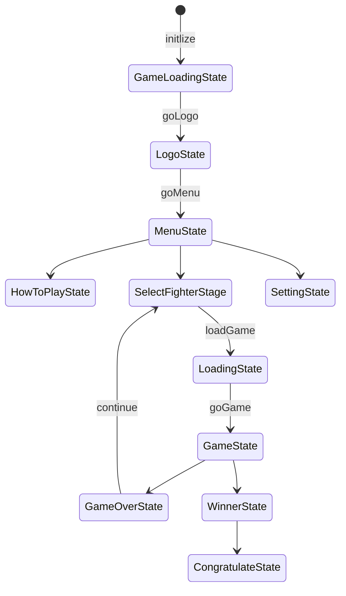
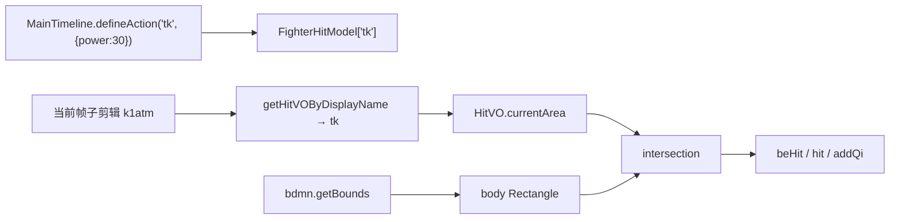

# 死神 vs 火影 3.3（main.swf）逆向分析报告

> 分析日期：2026-09-01  
> 分析人员：Grok 4.6（静态阶段）  
> 阶段：Triage 已完成 → **Static**（本报告）；未跑 AVM2/Ruffle 动态  
> 工具链：Python 3.13 `struct`/`zipfile` 标签行走、`file(1)`、JPEXS FFDec 26.2.1 既有反编译（**本阶段不再完整反编译**）  
> flavor：`null`（普通 Flash/AVM2 逆向，非 malware/APT）  
> 样本授权：`work/bvn-3.3-swf/scope.md` — `auth.status=granted`，`network_profile=offline`，`preset=offline-sample`

本报告按「发现 → 证据 → 含义」写。游戏玩法介绍见 `BVN-ANALYSIS.md`，此处不重复。  
权威字节来源是 `/workspace/bvn-3.3/main.swf` 与 ABC 字符串池；`decompiled/` 中个别 `.as` 已被本地改过（见 F-decompile-drift），引用时以 SWF 为准。

---

## 0. Evidence 链

### 0.1 Scope 摘要

| 字段 | 值 |
|------|---|
| case | `work/bvn-3.3-swf/scope.md` |
| auth | granted / own_system / offline-sample |
| in_scope | `main.swf`、`extracted/`、`decompiled/`、`play/` |
| out_of_scope | dos、phishing_real_users、unrestricted_exfil |
| network | offline；本阶段不访问外部服务、不执行样本 |
| 本阶段不做 | 完整再反编译、Ruffle 动态、写可运行 exploit |

### 0.2 Evidence

| E-id | source_ref | repro_command | content_hash |
|------|------------|---------------|--------------|
| E-id-fmt | `main.swf` 头 21 字节 + 38 tags | 见 §13 | SHA-256 `5ddf9410af93872c2b988af81e2580d466cc0f87d5e885198687f129cc00ba3e` |
| E-imports-avm2 | 4×DoABC multiname / `decompiled/main/scripts/**` | SWF 无 PE IAT；见 `work/bvn-3.3-swf/evidence/E-static.md` | n/a（逻辑证据） |
| E-boot | `BleachVSNaruto.as`、`ƒ/ǵ_2.as`、`ɕ/ȑ.as`、`bleachvsnaruto_2.as` | 类名 + FrameTask 元数据 | n/a |
| E-anticheck | `#04236f9c` @ `118927`；`#4236f9c` @ `2596`；FileLength @ `4` | `parseInt("0x"+"#04236f9c"[1:]) == 69431196` | 常量 ASCII 原样在文件中 |
| E-zipcrc | DefineBinaryData id=222 @ `526923`；`deng/utils/ChecksumUtil.as`；`deng/fzip/FZipFile.as` | `zipfile` + `zlib.crc32` | `fighter.xml` CRC32 `2b4904c1` |
| E-maingame | DoABC#3 @ `125190`；`MainGame.as`；`KyoStageCtrl.as` | ABC 字符串 `V3.3` @ `135422` | n/a |
| E-res | `ZipCtrler.as`；`ZipAssetLoader.as`；`ResUtils.as`；`GameData.as` | embed 名 `assets_zip$1de7dd7d…` | ZIP 65,699,574 B |
| E-fight | `FighterMain.as`；`FighterMC.as`；`HitVO.as`；`GameMainLogicCtrler.as`；角色 `*_fla` | `bdmn` / `atm*` 实例名 | n/a |
| E-patch | 同 E-anticheck + ABC 定长字符串约束 | 见 §5 / §9 | n/a |

### 0.3 Findings

| F-id | severity | evidence_ids | confidence | location | status |
|------|----------|--------------|------------|----------|--------|
| F-greenhd-shell | n/a_re | E-boot, E-imports-avm2 | high | 文档类 `BleachVSNaruto` → `ɕ.ȑ` → `bleachvsnaruto` | confirmed |
| F-size-selfcheck | n/a_re | E-anticheck, E-id-fmt | high | `ɕ/ȑ.as` `§ͦ§` / `§͵§`；FileLength UI32 | confirmed |
| F-antiloader | n/a_re | E-boot | high | `ǵ.Ʌ` = `loaderInfo.loader`；文案「不允许加壳运行」 | confirmed |
| F-zip-nocrc-on-read | n/a_re | E-zipcrc | high | `FZipFile.uncompress()` 不比对 `_crc32` | confirmed |
| F-asset-bind | n/a_re | E-res | high | SymbolClass id 222 + `ResUtils` 8 个 UI SWF | confirmed |
| F-hit-pipeline | n/a_re | E-fight | high | `atm*` → `HitVO` ∩ `bdmn` body | confirmed |
| F-decompile-drift | info | E-maingame | high | `decompiled/.../MainGame.as` 写 `V3.3-MOD`，SWF ABC 仍是 `V3.3` | confirmed |
| F-same-len-patch | n/a_re | E-patch | med-high | 同长度 ASCII / 同步 FileLength+两处 hex | static-only |

### 0.4 Path

**P-boot** `path_type=callflow`

1. AVM2 实例化文档类 `BleachVSNaruto` → `ǵ.ɐ.Ȱ(this, Ǵ)` 〔E-boot〕
2. `ǵ.ȵ` 对时间轴 `nextFrame()` 直到 `framesLoaded`：F1 `BleachVSNaruto` → F2 `FB` → F3 `FC` 〔E-id-fmt, E-boot〕
3. FrameTask 拉起 `ƃ.FB` 再拉起 `ɕ.ȑ`；`ȑ.§͗§ = bleachvsnaruto` 〔E-boot〕
4. 体积/反加壳门闩；通过后 `addChild(bleachvsnaruto)` 〔E-anticheck, F-size-selfcheck〕
5. `bleachvsnaruto.initlize` → `ZipAssetLoader` + `MainGame.initlize` → `ResUtils` → `KyoStageCtrl.goStage(GameLoadingState)` → `goLogo` 〔E-maingame, E-res〕

**P-hit** `path_type=callflow`

1. 角色 SWF `MainTimeline.defineAction(id, {power, hitType, ...})` → `FighterHitModel.addHitVO` 〔E-fight〕
2. 当前帧子剪辑名 `atm*` → `getHitVOByDisplayName`（去前缀 `atm`）→ 缓存为 `HitVO.currentArea` 〔E-fight〕
3. `bdmn` 提供受击体 `getCurrentBodyArea` 〔E-fight〕
4. `GameMainLogicCtrler.checkHit`：`hitArea ∩ bodyArea` 非空 → `beHit` / `hit` 〔E-fight〕

**P-bypass-size** `path_type=solve`（分析思路，不是 exploit）

1. 改体积必须同时满足：SWF 头 FileLength、`#04236f9c`、`#4236f9c` 三者数值一致 〔E-anticheck〕
2. 或不改体积：只做同长度 ABC/ZIP stored 替换 〔F-same-len-patch〕
3. 动态验证本阶段未做 〔timeline `dynamic=deferred`〕

### 0.5 Timeline 摘要

| 时间 | 事件 |
|------|------|
| 2026-09-01 01:43 | case-init，scope granted |
| 此前（Triage） | `GROK-SWF-REPORT.md`：FWS14、38 tags、4×DoABC、ZIP 407 项 |
| 此前 | FFDec 导出 `decompiled/`（264/264 脚本，0 failure） |
| 2026-09-01 Static | 本报告：引导链、双体积校验、资源绑定、命中管线 |

---

## 1. 执行摘要

`main.swf` 是 **GreenHD 加壳的 Flash Player 14 容器**，把 5DPLAY / `net.play5d.game.bvn` 游戏 ABC、65.7 MB 资源 ZIP、8 个 CWS15 UI 影片打进一个 69,431,196 字节的 FWS 文件。文档类不是游戏入口；真正入口是壳在时间轴第 3 帧实例化的 `bleachvsnaruto`。

壳有两道**文件体积自校验**，目标值都是 `0x04236f9c = 69431196`（与 SWF 头 FileLength 相同），外加一道「不允许加壳运行」的 `Loader` 嵌套检测。内嵌 ZIP 用 deng.fzip；**本副本在 inflate 后不校验 CRC32**，CRC 只写在 ZIP 头里。战斗判定是时间轴约定：`bdmn` 是身体盒，`atm*` 是攻击盒，`HitVO` 是数值。

过壳的最小思路是：**同长度补丁不动 FileLength**；改体积则必须同步头 4 字节与两处 hex 字符串。不要只改一处。

---

## 2. 分析目标

1. 确认样本身份与 SWF 容器布局（FWS14、DoABC、DefineBinaryData、GreenHD）。  
2. 还原文档类 → 壳 → 游戏类的调用链。  
3. 定位反分析比较/常量，给出**最小过壳补丁思路**（非 exploit）。  
4. 定位游戏 ABC 状态机、ZIP 资源绑定、战斗判定面。  
5. 区分「改字符串」与「改体积」两类补丁风险。

---

## 3. 样本身份与格式

### 3.1 发现

文件是未压缩 SWF14（签名 `FWS`），声明长度等于实际长度。时间轴 3 帧、800×600、30 fps。几乎没有时间轴图形标签；可玩内容在 DoABC 与 DefineBinaryData 里。

### 3.2 证据

```
path     /workspace/bvn-3.3/main.swf
file(1)  Macromedia Flash data, version 14
size     69431196
SHA-256  5ddf9410af93872c2b988af81e2580d466cc0f87d5e885198687f129cc00ba3e
MD5      487ee65863f0caf8cd57d07fdd093b13
```

头（offset 0）：

| 偏移 | 字段 | 值 |
|------|------|-----|
| 0 | Signature | `FWS` |
| 3 | Version | 14 |
| 4 | FileLength UI32 LE | `9c 6f 23 04` = **69431196** = `0x04236f9c` |
| 8 | RECT | nbits=15，800×600 px（twips 16000×12000） |
| 17 | FrameRate 8.8 | 30.0 |
| 19 | FrameCount | 3 |
| 21 | first tag | FileAttributes |

38 个标签，End 在 EOF，leftover 0。DoABC 全部 `flags=1`（lazy init）、名字 `merged`、ABC `minor 16 / major 46`。

| # | 标签偏移 | ABC 偏移 | ABC 长度 | 时间轴 | 内容 |
|---|---------|----------|----------|--------|------|
| 0 | 83 | 100 | 11,880 | F1 `BleachVSNaruto` | 文档类 + `ƒ.ǵ` 引导 |
| 1 | 12,008 | 12,025 | 64,819 | F2 `FB` | GreenHD loader（`ƃ.FB`、`ɕ.ȑ`、体积串） |
| 2 | 116,847 | 116,864 | 8,326 | F3 `FC` | GreenHD app host |
| 3 | 125,190 | 125,207 | 334,334 | F3 `FC` | **游戏** `net.play5d.game.bvn` |

DefineBinaryData id **222** @ blob `526923`：`PK\x03\x04`，65,699,574 字节，407 个 ZIP 项。其余 8 个 BinaryData 均为 `CWS\x0f`（压缩 SWF15）UI 影片。ProductInfo（tag 41 @38）`productId` 字节 `04 07 e6 52`，不是 Adobe 编译器时间戳，与第三方壳残留一致。

ABC 字符串（DoABC#1/#3）：

- `http://www.greenhd.net/ns/greenload` @ `33238`
- `发布支持：GreenHD<br/>`（DoABC#3 字符串池）
- 游戏常量 `VERSION` = **`V3.3`** @ `135422`，`VERSION_DATE` = `2019.3.32` @ `135440`

`FB.m_app_model`（`ƃ/FB.as`）：`id="BleachVSNaruto_3_3"`，`publishDate="2019-4-28 00:00:00"`，`minVersion="11.0"`，`forceSHCheck=true`。

### 3.3 含义

这不是「时间轴动画 + 少量脚本」。它是 **FP14 壳 + FP15 内容** 的发布包：外壳为了 GreenHD 停在 v14，内嵌 UI/角色/地图是 CWS15。Ruffle 必须同时吃 FWS14 与 `loadBytes` 出来的 CWS15。Triage 报告里的标签表与本次逐字节解析一致，Static 不再重解整包。

**F-decompile-drift**：`decompiled/main/scripts/net/play5d/game/bvn/MainGame.as` 与 `MenuState.as` 把版本写成 `V3.3-MOD`，但整份 `main.swf` **搜不到** `V3.3-MOD`。那是导出后的本地改写，不能当样本版本号。

### 3.1.1 导入表 / 依赖（SWF 等价锚点）〔E-imports-avm2〕

无 PE IAT。AVM2 侧敏感 API 聚类：

| 簇 | 符号 | 含义 |
|----|------|------|
| 加载 | `flash.display.Loader.loadBytes`、`LoaderContext.allowCodeImport=true` | 壳二次加载、UI SWF、ZIP 内角色 SWF |
| 自校验 | `LoaderInfo.bytes.length`、`LoaderInfo.loader` | 体积门、反嵌套 Loader |
| IPC | `flash.net.LocalConnection` | `_app_to_manager` / `_manager_to_app` |
| 归档 | `deng.fzip.FZip.loadBytesStep` | 内嵌 ZIP |
| 存档 | `KyoSharedObject` / `SharedObject`，id `bvn3.01` | 本地配置 |
| 宿主 | `ExternalInterface.call`（`ǵ.ɑ` 用 `uts(102,108,97,115,104,46,101,120,116,101,114,110,97,108,46,69,120,116,101,114,110,97,108,73,110,116,101,114,102,97,99,101)` 拼出类名） | 平台桥 |

「导入过干净」在这里不成立：业务全在 ABC 里。`Ctrler4399` / `serviceHold` / `_4399_function_score_id` 是编译进去的 4399 钩子，不等于运行时一定连网。

---

## 4. 加壳 / 引导调用链

### 4.1 发现

文档类 `BleachVSNaruto` 只把自身交给 GreenHD 帧管理器 `ƒ.ǵ`。`ǵ` 按 FrameTask 元数据推进时间轴，第 2 帧跑 `ƃ.FB`，第 3 帧跑 `ɕ.ȑ`。`ȑ` 的静态字段直接绑游戏类 `bleachvsnaruto`，校验通过后把它 `addChild` 到舞台。

### 4.2 证据

文档类（`decompiled/main/scripts/BleachVSNaruto.as`）：

```actionscript
public class BleachVSNaruto extends MovieClip
{
   public function BleachVSNaruto()
   {
      super();
      ǵ.ɐ.Ȱ(this,Ǵ);
   }
}
```

`ǵ.Ȱ` 带元数据（`ƒ/ǵ_2.as`）：

```actionscript
[FrameTask(p2="ƃ",p3="ɕ",c2="FB",c3="ȑ")]
public function Ȱ(param1:MovieClip, ... rest) : void
```

含义：第 2 步类 `ƃ.FB`，第 3 步类 `ɕ.ȑ`。`ȵ()` 在 `framesLoaded` 前循环 `nextFrame()`，因此 F1→F2→F3 是引导，不是关卡。

`ɕ/ȑ.as`：

```actionscript
public static var §͗§:* = bleachvsnaruto;
private static var labelXML:XML = <language>
  <appError en="APP ERROR!" zh-CN="程序发生错误：重要数据被破坏" .../>
  <shell en="No running in a loader." zh-CN="不允许加壳运行" zh-TW="不允許加殼運行" />
</language>;
```

`§ͥ§(§͗§)` 用 `FB.getInstanceBy` 取出 `DisplayObject`（此处即 `bleachvsnaruto` 实例）。类型为 `DisplayObject` 时走 `§͚§ = 1` 直接上舞台，不走 `loadBytes` 的 ByteArray 分支。

游戏类（`bleachvsnaruto_2.as`）：

```actionscript
public class bleachvsnaruto extends Sprite
{
   public function bleachvsnaruto() { ... initlize(); }
   private function initlize(...) {
      STAGE = stage;
      GameInterface.instance = new GameInterfaceManager();
      Ctrler4399.init();
      _zipAssetLoader = new ZipAssetLoader();
      AssetManager.I.setAssetLoader(_zipAssetLoader);
      buildGame();  // new MainGame().initlize(this, stage, ...)
   }
}
```

`uts(...)` 是 `String.fromCharCode` 包装，用来藏 `loaderInfo` / `bytes` / `length` / `setHold` 等属性名（`ɕ/ȑ.as` 277–279 行）。

LocalConnection：`connect(name + "_app_to_manager")`，`send(name + "_manager_to_app", ...)`。`bleachvsnaruto` 字符串在文件中至少两处（`116954`、`126206`）。

### 4.3 含义



`FB`/`FC` **不是** 游戏场景名，是壳的第二/第三步。游戏状态机从 `bleachvsnaruto` 才开始。

---

## 5. 反分析与过壳最小补丁思路

### 5.1 发现

三道门：

1. **反嵌套 Loader**（「加壳运行」）。  
2. **bytesTotal vs loaderInfo.bytes.length**（Background 元数据里的体积）。  
3. **loaderInfo.bytes.length vs `#04236f9c`**（硬编码 hex 字符串）。  

调试 SWF 元数据 `__go_to_definition_help` 会置 `ǵ.Ɉ`，后两道被跳过。

### 5.2 证据

**门 1 — 反 Loader**（`ɕ/ȑ.as` `§ͣ§`）：

```actionscript
if(ǵ.ɐ.Ʌ)   // Alias "inLoader" = !!timeline.loaderInfo.loader
{
   if(!FB.serviceHold.ˢ && FB.serviceHold.isReady)
   {
      _loc2_ = getLabel("shell");  // "No running in a loader." / "不允许加壳运行"
      FB.showError(_loc2_);
      return;
   }
}
```

`ǵ.Ʌ`（`ƒ/ǵ_2.as` 429–432 行）：`return !!Ȭ.loaderInfo.loader;`  
文案 ASCII @ `117151`（en）、UTF-8 中文紧随其后。

**门 2 — Background 体积**（`§ͦ§`）：

```actionscript
if(ǵ.ɐ.bytesTotal == ǵ.ɐ.timeline[uts(108,111,97,100,101,114,73,110,102,111)]
                                      [uts(98,121,116,101,115)]
                                      [uts(108,101,110,103,116,104)])
   return false;  // 未篡改
return true;      // 视为破坏 → §͸§
```

`uts(108,111,97,...)` = `loaderInfo.bytes.length`。  
`ǵ.bytesTotal` 来自：

```actionscript
[Background(color="#4236f9c")]   // ǵ_2.as:355
Ȫ = parseInt("0x" + color.slice(1));  // 0x4236f9c = 69431196
```

`#4236f9c` 位于文件偏移 **2596**（DoABC#0 字符串池）。这不是舞台背景色（SetBackgroundColor 仍是 `#000000`），而是把文件长度藏进 metadata。

**门 3 — 硬编码 FileLength**（`§͵§`，addChild 之后）：

```actionscript
if(!ǵ.ɐ.Ɉ && _loc1_.loaderInfo.bytes.length != parseInt("0x" + "#04236f9c".slice(1)))
{
   ȑ.§͸§();  // getLabel("appError") → "重要数据被破坏"
   §͝§.parent.removeChild(§͝§);
}
```

`#04236f9c` 位于偏移 **118927**（DoABC#1）。  
`parseInt("0x" + "#04236f9c".slice(1))` = `0x04236f9c` = **69431196**。  
`ǵ.Ɉ`（Alias `isDebugSWF`）：`ȸ(this,"__go_to_definition_help").length() > 0`。

失败 UI：`FB.showError` ← `labelXML.appError`（en `APP ERROR!` / zh-CN `程序发生错误：重要数据被破坏`）。

**ZIP CRC**（资源层，不是壳层）：

- `FZipFile.parseHead` 从 local header 读 `_crc32`（`FZipFile.as:448`）。  
- `ChecksumUtil.CRC32` 使用 IEEE 多项式 `0xEDB88320`（`ChecksumUtil.as:30`）。  
- `setContent` 会重算 CRC 并写回（写路径）。  
- **`uncompress()` / `parseContent()` 没有 `CRC32(_content) == _crc32` 比较**。  
- 抽查：`assets/config/fighter.xml` ZIP 头 CRC `2b4904c1`，与 Python `zlib.crc32` 一致；`effect.swf` stored（method 0）CRC `a90ba469`。

### 5.3 含义

两道体积门用**同一数值、两种 ASCII 宽度**：

| 位置 | 形式 | 宽度 | 数值 |
|------|------|------|------|
| offset 4 | UI32 LE | 4 字节 | 69431196 |
| offset 2596 | `#4236f9c` | 8 ASCII（7 hex） | 0x4236f9c |
| offset 118927 | `#04236f9c` | 9 ASCII（8 hex） | 0x04236f9c |

改文件长度却只补 SWF 头，会在 `§ͦ§` 或 `§͵§` 被卸游戏实例。把 SWF 再包进外层 Loader 会撞门 1（4399 `serviceHold.ˢ` 除外）。

ZIP CRC **在本 deng.fzip 读路径上不是门闩**；用外部 zip 工具重打包或换实现时仍会炸。不要假设「游戏能读 = CRC 无意义」。

### 5.4 过壳最小补丁思路（分析，不是 exploit）

只列比较点与同步项，不提供补丁机。

**思路 A — 不改体积（优先）**  
补丁落在 ABC 定长字符串或 ZIP **stored、等长** 文件上。FileLength / 两处 hex 原样。`V3.3`（4 字节）改 UI 文案必须仍 4 字节，或改 `MenuState` 里动态拼接（那是 AS 源，不是样本）。

**思路 B — 改比较**  
目标是 `§ͦ§` 的 `==` 与 `§͵§` 的 `!=`。在 ABC 里把失败分支改成与成功分支等长的跳转（或让 `ǵ.Ɉ` 恒真）。比较指令长度变了会移动 DoABC#1 后续常量池，连带 `#04236f9c` 偏移失效。

**思路 C — 同步 FileLength（改体积时的最小充分集）**

1. 新文件实际长度写入 offset 4（UI32 LE）。  
2. 把 `#04236f9c` **就地**换成等长 9 字节 `#`+8 hex（不足左补 `0`）。  
3. 把 `#4236f9c` **就地**换成等长 8 字节 `#`+7 hex。7 hex 的上限是 `0xFFFFFFF`（268,435,455）。超过 256 MiB 会涨字符串长度，必须改 ABC 结构，不再是「最小补丁」。  
4. 若只改了 ZIP 内部、SWF 外壳长度没变，**不要**改这三处。

**不要做的**：只改头 4 字节；只改一处 hex；用外层 Loader 包一层指望「脱壳」；指望改 ZIP CRC 就能过 GreenHD（过不了，体积门在 ZIP 解析之前）。

---

## 6. 游戏 ABC 入口与状态机

### 6.1 发现

游戏逻辑全在 DoABC#3。入口类 `bleachvsnaruto` 构造 `MainGame`，`MainGame.initlize` 初始化渲染/输入/存档后，用 `KyoStageCtrl` 切 `Istage` 实现。战斗帧率 60，UI 帧率 30。

### 6.2 证据

`MainGame.initlize`（`decompiled/main/scripts/net/play5d/game/bvn/MainGame.as`）：

```actionscript
ResUtils.I.initalize(resInitBack, initFail);
// resInitBack:
GameRender.initlize(stage);
GameInputer.initlize(_stage);
GameData.I.loadData();           // SharedObject id "bvn3.01"
GameData.I.config.applyConfig();
stageCtrl = new KyoStageCtrl(_rootSprite);
var _loc1_:GameLoadingState = new GameLoadingState();
stageCtrl.goStage(_loc1_);
_loc1_.loadGame(loadGameBack, initFail);
```

`bleachvsnaruto.initBackHandler` 在 `GameUtils.isInTop(this)` 后：

```actionscript
_mainGame.goLogo();  // LogoState → 播完 logo_movie → goMenu
```

`KyoStageCtrl.goStage`：按 `getQualifiedClassName` 拒重入（`sameChange` 可覆盖）；`destory` 旧舞台，`build`+`addChild`+`afterBuild` 新舞台。

`MainGame` 状态切换（均为 `stageCtrl.goStage(...)`）：

| 方法 | 状态类 | FPS |
|------|--------|-----|
| `goLogo` | `LogoState` | 30 |
| `goMenu` | `MenuState` | 30 |
| `goHowToPlay` | `HowToPlayState` | 30 |
| `goSelect` | `SelectFighterStage` | 30 |
| `loadGame` | `LoadingState` | 30 |
| `goGame` | `GameState` + `GameCtrl.I.startGame()` | `GameConfig.FPS_GAME`（60） |
| `goOption` | `SettingState` | 30 |
| `goContinue` / `goGameOver` | `GameOverState` | 30 |
| `goWinner` | `WinnerState` | 30 |
| `goCredits` | `CreditsState` | 30 |
| `goCongratulations` | `CongratulateState` | 30 |

ABC 字符串池：`VERSION`/`V3.3`/`VERSION_DATE`/`2019.3.32`（`135422` 起）。`GameConfig.GAME_SIZE = Point(800,600)`。

`GameLoadingState.loadGame`：`AssetManager.I.loadPreLoad` → `GameData.I.loadConfig` → `AssetManager.I.loadBasic`。

`LogoState.build`：`ResUtils.I.createDisplayObject(ResUtils.I.common_ui, "logo_movie")`，`complete` → `MainGame.I.goMenu()`。

### 6.3 含义



切状态不切 SWF 时间轴（时间轴停在 FC）。UI 皮肤来自 `ResUtils` 里 8 个已 embed 的 CWS15，角色/地图来自 ZIP。

---

## 7. ZipAssetLoader / ResUtils 资源绑定

### 7.1 发现

两套绑定：

- **ZIP（角色、地图、XML、BGM、特效）**：SymbolClass id 222 → `assets_zip$1de7dd7d6855592a2a2b869bcaf19a4b1288174545` → `ZipCtrler` → `deng.fzip.FZip`。  
- **UI SWF（标题/选人/战斗 HUD…）**：`ResUtils` 八个 `Class` 字段 → `InsSwf` `loadBytes(movieClipData)` 进当前 `ApplicationDomain`。

路径字符串是 ZIP 内路径，不是 HTTP。

### 7.2 证据

`ZipCtrler`（`web/ZipCtrler.as`）：

```actionscript
private var _embedZip:Class = assets_zip$1de7dd7d6855592a2a2b869bcaf19a4b1288174545;
_zipBytes = new _embedZip();
_fZip.loadBytesStep(_zipBytes, 20);
// getLoader(url): _fZip.getFileByName(url) → Loader.loadBytes(content)
```

embed 桩类（`assets_zip$1de7dd7d….as`）`extends ByteArray`。SymbolClass 第三帧：`char 222 -> assets_zip$1de7dd7d6855592a2a2b869bcaf19a4b1288174545`（文件偏移 `69430503` 附近仍有该名字）。

`ZipAssetLoader.loadPreLoad` → `ZipCtrler.I.init`。`needPreLoad() == true`。

`GameData.loadConfig` 顺序：

1. `assets/config/fighter.xml`  
2. `assets/config/assist.xml`  
3. `assets/config/select.xml`  
4. `assets/config/map.xml`  
5. `assets/config/mission.xml`  

另：`GameLogic.setGameMode(1)` 会改读 **`assets/config/salect.xml`**（拼写如此，ZIP 内真实存在，CRC `f666a7d8`）。`preload.xml` 由 `AssetManager.loadBasic` 第一步加载。`FighterVO.initByXML`：`fileUrl = param1.file.@url`，例 `assets/fighter/ichigo.swf`（`extracted/assets/config/fighter.xml`）。

`ResUtils` 字段 → SymbolClass / DefineBinaryData：

| 字段 | 绑定类（截断） | BinaryData id | blob 魔数 |
|------|----------------|---------------|-----------|
| `common_ui` | `common_ui_swf$a3bf7921…` | 225 | CWS15 |
| `fight` | `fight_swf$9ccdf9d2…` | 226 | CWS15 |
| `gameover` | `gameover_swf$284eb874…` | 227 | CWS15 |
| `howtoplay` | `howtoplay_swf$d10d084c…` | 228 | CWS15 |
| `loading` | `loading_swf$7f39eada…` | 229 | CWS15 |
| `select` | `select_swf$f2bee001…` | 2210 | CWS15 |
| `setting` | `setting_swf$4adf08ab…` | 2211 | CWS15 |
| `title` | `title_swf$528f79a0…` | 2215 | CWS15 |

`InsSwf`：`LoaderContext(false, ApplicationDomain.currentDomain); allowCodeImport = true; loadBytes(_swf.movieClipData)`。`createDisplayObject(cls, "stg_title")` 用 `getDefinition` 取导出类名（`ResUtils.TITLE = "stg_title"` 等）。

`AssetManager.loadBasic` 四步：`preload.xml` 声音 → `assets/effect.swf` → `assets/font/font1.xml` → 头像位图。`GameLoader.loadFighter`：`new FighterMain(mc)`，`mc` 来自 ZIP SWF。

### 7.3 含义

改角色数值/列表：动 ZIP 里 XML（deflate，要重算 local+CD 的 CRC/size）。改菜单皮肤：动 8 个 UI BinaryData（等长 CWS 可避免碰 FileLength）。改一护贴图：ZIP `assets/fighter/ichigo.swf` 或 `assets/face/ichigo*.png`。HTML/Ruffle **不会** 再按 URL 拉角色。

---

## 8. 战斗：FighterMain、bdmn / atm*、HitVO

### 8.1 发现

角色 SWF 是时间轴影片，不是逻辑脚本。引擎约定：

- `bdmn`：身体/受击盒。  
- 名字含 `atm` 的子剪辑：攻击盒。  
- `MainTimeline.defineAction(id, props)`：把招式 id 登记成 `HitVO`。  
- 判定：攻击盒矩形 ∩ 对方 `bdmn` 矩形。

### 8.2 证据

角色侧实例名（`decompiled/fighters/itachi/scripts/itachi_fla/卡卡西_1.as`，文件名是 FLA 残留，类里字段才是运行名）：

```actionscript
public var bdmn:MovieClip;
public var cbs1atm:MovieClip;
public var k1atm:MovieClip;
public var k2atm:MovieClip;
```

`itachi_fla/MainTimeline.as`：

```actionscript
this.defineAction = this.$fighter_ctrler.defineAction;
this.defineAction("tz", {power:120, hitType:6, hitx:5, hurtType:1, isBreakDef:false});
this.defineAction("tk", {power:30, hitType:1, hitx:3, hurtTime:500, hurtType:0, isBreakDef:false});
```

`FighterCtrler.defineAction` → `hitModel.addHitVO`。  
`FighterHitModel.getHitVOByDisplayName`：先精确匹配，否则若 `name` 含 `atm` 则 `replace("atm","")` 再查（`atm`+`k1` → `k1`）。

`FighterMC`：

- `renderChildren`：**跳过** `AImain`、`bdmn`、名字含 `atm` 的子 MC（不自动循环它们的时间轴）。  
- `getCurrentHitSprite`：收集 `name.indexOf("atm") != -1`。  
- `findBodyArea`：`_mc.getChildByName("bdmn")` → `getBounds` 缓存。  
- `findHitArea`：每个子显示对象 `getHitVOByDisplayName` → 缓存 `{hitVO, area}`。

`Assister.renderChildren` 同样排除 `bdmn` / `atm*`。

`HitVO` 字段：`id, owner, power, powerRate, hitType, isBreakDef, hitx, hity, hurtTime, hurtType, checkDirect, currentArea`。`getDamage() = power * powerRate`。`isBisha()`：`id` 含 `bs`/`sbs`/`cbs`/`kbs`。`isCatch()`：`hitType==11 && isBreakDef`。

`HitType`：`KAN=1, DA=2, DA_HEAVY=3, MAGIC=4, MAGIC_HEAVY=5, KAN_HEAVY=6, FIRE=7, ICE=8, ELECTRIC=9, STONE=10, CATCH=11`。

`GameMainLogicCtrler.checkHit`：

```actionscript
_loc6_ = getHitObj(param1.getCurrentHits(), param2.getBodyArea());
if(_loc6_) { param2.beHit(_loc6_.hitVO, _loc6_.hitRect); param1.hit(_loc6_.hitVO, param2); }
```

`getHitObj`：`hitVO.currentArea.intersection(body)` 非空即命中。

`FighterMain.hit`：非必杀回气 `power*0.17`（上限 15），必杀 `power*0`；`GameLogic.hitTarget` 仅在对方 `actionState` 为 21/22（受击/击飞）时派发 `HIT_TARGET`。`beHit`：回气 `power*0.08`（上限 20）。

`FighterActionState`：`NORNAL=0, ATTACK_ING=10, SKILL_ING=11, BISHA_ING=12, DEFENCE_ING=20, HURT_ING=21, HURT_FLYING=22, DEAD=30, WAN_KAI_ING=50, KAI_CHANG=60, WIN=61`。

`FighterMain` 资源常量：`qiMax=300`, `energyMax=100`, `fzqiMax=100`, `speed=6`, `jumpPower=15`。

### 8.3 含义



改伤害：角色 SWF 时间轴脚本里的 `defineAction` 对象（嵌套 CWS，等长替换最稳）。改判定框：改 `atm*` / `bdmn` 影片尺寸，不是改 `HitVO.power`。引擎 `FighterMain.as` 在 DoABC#3，改它会影响所有角色，且动 ABC 长度会碰到体积门。

---

## 9. 可补丁面与风险

### 9.1 发现

补丁按「是否改变 `main.swf` 字节长度」分成两类。同长度安全得多；改体积必须过 §5 三处同步。

### 9.2 证据与含义

| 面 | 位置 | 同长度？ | 风险 |
|----|------|----------|------|
| UI 文案 / `V3.3` | DoABC#3 字符串池 @ `135422`，4 字节 | 必须 4 字节 | 改成 `V3.4` 可以；`V3.3-MOD`（8 字节）会涨 ABC，触发体积门 |
| 壳 hex 体积串 | `#04236f9c` 9 B；`#4236f9c` 8 B | 必须等长 | 与 FileLength 不一致 → `appError` 卸实例 |
| FileLength | offset 4，UI32 | 4 字节字段本身固定 | 必须等于真实文件长，否则播放器/壳双重不认 |
| UI SWF BinaryData | id 225–2215 | 等长 CWS 可原地 | 变长要重写 tag length + FileLength + hex |
| ZIP stored 文件 | 如 `effect.swf` method 0 | 等长可原地 | 变长要改 local header + central directory + 外壳长度 |
| ZIP deflate XML | `fighter.xml` 等 | 压缩后长度几乎必变 | 必须重写 CRC/csz/usz；本 FZip 读路径不验 CRC，但 CD 尺寸错会解失败 |
| 角色 `defineAction` | ZIP 内 CWS15 | 数字字面量等长较稳 | `power:30` → `power:99` 可能仍 2 位；`30`→`100` 涨 1 字节 |
| 反加壳文案 | `#04236f9c` 旁 XML | 等长中文不可随意换 | 只改文案不过门；比较仍在 |
| `ǵ.Ɉ` 调试元数据 | `__go_to_definition_help` | 插入会涨 ABC | 等于关体积门，但要改 DoABC#0 |

**F-decompile-drift 的实践含义**：在 `decompiled/*.as` 里改 `VERSION = "V3.3-MOD"` **不会**写回 SWF。要改运行时标题，得补 ABC 或 `MenuState` 对应字节，并遵守定长。

嵌套 CWS15 自己还有内部 FileLength；改 UI SWF 内部同样要同步该嵌套头。外壳 GreenHD 只看**最外层** `main.swf` 的 69,431,196。

---

## 10. Evidence 摘要（hash / 偏移 / 常量）

| 项 | 值 |
|----|-----|
| SHA-256 | `5ddf9410af93872c2b988af81e2580d466cc0f87d5e885198687f129cc00ba3e` |
| MD5 | `487ee65863f0caf8cd57d07fdd093b13` |
| 签名 / 版本 | `FWS` / 14 |
| FileLength @4 | `9c 6f 23 04` = 69431196 = `0x04236f9c` |
| 舞台 | 800×600，30 fps，3 frames |
| DoABC×4 | @83 / @12008 / @116847 / @125190；ABC 16.46；name `merged`；flags 1 |
| ZIP id 222 | blob @526923，`PK\x03\x04`，65,699,574 B，407 entries |
| `#4236f9c` | @2596（`ǵ` Background → `bytesTotal`） |
| `#04236f9c` | @118927（`ȑ.§͵§` parseInt） |
| 反加壳 en | @117151 `No running in a loader.` |
| GreenHD ns | @33238 `http://www.greenhd.net/ns/greenload` |
| `V3.3` | @135422（ABC；**不是** `V3.3-MOD`） |
| `2019.3.32` | @135440 |
| 文档类 | SymbolClass char 0 = `BleachVSNaruto` @66 帧标签 / @11986 符号 |
| 游戏类 | `bleachvsnaruto`；`ȑ.§͗§` 绑定 |
| CRC 多项式 | `0xEDB88320`；`fighter.xml` `2b4904c1` |
| 存档 id | `bvn3.01` |
| 体积门跳过条件 | `ǵ.Ɉ`（`__go_to_definition_help`） |

---

## 11. 动态分析

本阶段按用户要求停在 Static，**未**用 Ruffle/Flash 跑样本，未 hook `LoaderInfo.bytes.length`。  
体积门与 `addChild` 卸实例的结论是静态比较还原，runtime 验证记为 `dynamic=deferred`。

---

## 12. 遗留问题

1. `FB.serviceHold.ˢ`（疑 `in4399`）与 `forceSHCheck` 的完整平台指纹未展开。  
2. `ǵ.ɑ` → `ExternalInterface.call` 的实参表未逐条还原。  
3. 角色 SWF 内部时间轴标签（「站立」「必杀」等）未逐人枚举；约定已由 `FighterMC.goFrame` / `checkFrame` 证明。  
4. `ChecksumUtil.CRC32` 反编译循环写成 `while(_loc5_ < param3)`（未加 start），与「全缓冲 param2=0」路径一致；若 start≠0 可能是 FFDec 伪代码瑕疵，本样本读路径不调用该比较。  
5. 未做等长补丁的运行时回归（需 Dynamic）。

---

## 13. 复现步骤

```bash
# 身份
file /workspace/bvn-3.3/main.swf
sha256sum /workspace/bvn-3.3/main.swf
# 5ddf9410af93872c2b988af81e2580d466cc0f87d5e885198687f129cc00ba3e

python3 - <<'PY'
import struct, hashlib
from pathlib import Path
b = Path("/workspace/bvn-3.3/main.swf").read_bytes()
assert b[:3]==b"FWS" and b[3]==14
fl = struct.unpack_from("<I", b, 4)[0]
assert fl==len(b)==0x04236f9c==69431196
assert b[2596:2604]==b"#4236f9c"
assert b[118927:118936]==b"#04236f9c"
assert b[135422:135426]==b"V3.3"
assert b.find(b"V3.3-MOD")<0
assert b[526923:526927]==b"PK\x03\x04"
print("ok", hashlib.sha256(b).hexdigest())
PY
```

关键源（只读，本阶段未再跑 FFDec）：

- `decompiled/main/scripts/BleachVSNaruto.as`
- `decompiled/main/scripts/ɕ/ȑ.as`
- `decompiled/main/scripts/ƒ/ǵ_2.as`
- `decompiled/main/scripts/bleachvsnaruto_2.as`
- `decompiled/main/scripts/net/play5d/game/bvn/MainGame.as`（VERSION 行以 SWF 为准）
- `decompiled/main/scripts/net/play5d/game/bvn/web/ZipCtrler.as`
- `decompiled/main/scripts/net/play5d/game/bvn/utils/ResUtils.as`
- `decompiled/main/scripts/net/play5d/game/bvn/fighter/{FighterMain,FighterMC}.as`
- `decompiled/main/scripts/net/play5d/game/bvn/fighter/models/HitVO.as`
- `decompiled/SUMMARY.md`、`extracted/full/INVENTORY.md`、`GROK-SWF-REPORT.md`

---

## 14. 附录

| 工具 | 版本 / 路径 | 用途 |
|------|-------------|------|
| file | `/usr/bin/file` | 类型 |
| Python | 3.13.5 | 标签行走、ZIP、常量定位 |
| OpenJDK | 21.0.12.1 | 既有 FFDec 导出（本阶段未重跑） |
| JPEXS FFDec | 26.2.1 `/workspace/tools/ffdec/ffdec.jar` | Triage 反编译 |
| 非 PE 菜谱 | `reverse-engineering/references/nonpe-format-cookbook.md` | 无 SWF 专章；按 cookbook §0「类型 → 主 skill」走 RE workflow Static + ABC 字符串/标签解析 |

**IOC**：n/a（离线游戏样本，非 malware flavor）。GreenHD URL `http://www.greenhd.net/ns/greenload` 是壳命名空间字符串，不是本阶段观察到的网络 IOC。
