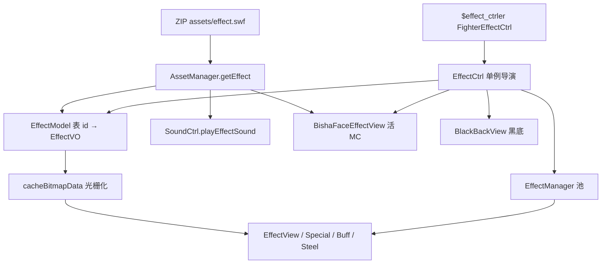

# effect.swf line-by-line 总索引 — `decompiled/other/effect`

壳：[`../shell/00-INDEX.md`](../shell/00-INDEX.md)。引擎 `net.play5d`：[`../engine/00-INDEX.md`](../engine/00-INDEX.md)（A–D 已闭合）。角色：[`../fighters/00-INDEX.md`](../fighters/00-INDEX.md)（A–G 已闭合）。UI：[`../ui/00-INDEX.md`](../ui/00-INDEX.md)（已闭合）。

本目录注 **1 个战斗特效 SWF**（ZIP `assets/effect.swf` → `decompiled/other/effect/scripts/**.as`，**89** 个）。镜像路径：`decompiled/other/effect/` 之后原样换成 `.md`。不改 `decompiled/`。不播 / 不重打包 SWF。

**状态：本批 89 个 `.as` 全部 done。**

对照总表（非逐行）：[`../../04-maps-ui-xml.md`](../../04-maps-ui-xml.md)「effect.swf」。清单源：[`../_maps/effect-batch-files.txt`](../_maps/effect-batch-files.txt)。

## 这份 SWF 怎么接到引擎

```
MainGame.initlize
  AssetManager.loadBasic
    IAssetLoader.loadSwf("assets/effect.swf")
    KyoClassLoader.addSwf("assets/effect.swf", loader)   // 灌域，不 new 文档类
  loadGameBack
    EffectModel.I.initlize
      initEffects / initHitEffect / initDefenseEffect
      initSpeicalEffect / initBuffEffect / initSteelHitEffect
      cacheEffects → 每条 EffectVO.cacheBitmapData
           AssetManager.getEffect(className)  // new MC，扫帧画 Bitmap，丢掉 MC
GameState.build
  EffectCtrl.initlize(this, _playerLayer)  // new EffectManager + BlackBackView
之后
  角色 SWF $effect_ctrler  → FighterEffectCtrl → EffectCtrl
  FighterMcCtrler.doHitEffect / doDefenseEffect / doSteelHitEffect
  FighterBuffCtrler → doEffectById("buff_effect_*") + doBuffEffect("buff_*")
  FightUI KO → hit_end / BGEffect("kobg")
```

[`AssetManager.getEffect`](../engine/game/bvn/ctrl/AssetManager.md) 对 **MC 和 Sound 同一条路**：`getClass(name, "assets/effect.swf")` 再 `new`。声音经 [`SoundCtrl.playEffectSound`](../engine/game/bvn/ctrl/SoundCtrl.md)；火花经 [`EffectVO.cacheBitmapData`](../engine/game/bvn/data/EffectVO.md) 光栅化。例外：[`bisha_face_mc`](scripts/bisha_face_mc.md) 由 [`BishaFaceEffectView`](../engine/game/bvn/views/effects/BishaFaceEffectView.md) **运行时 new 活 MC**，不进 `EffectModel`。



根时间轴：[`effect_fla.MainTimeline`](scripts/effect_fla/MainTimeline.md) F1 `stop`。引擎不把 Loader content 加到舞台。SWF 头 30fps、根 8 帧、59 个 DefineSprite、31 条 DefineSound、SymbolClass 89 条（含文档类 char 0）。

## 引擎类对照

| 引擎 | 注 | 本 SWF 角色 |
|------|----|-------------|
| [`EffectModel`](../engine/game/bvn/data/EffectModel.md) | 启动建表 | `className` = 导出类名 |
| [`EffectVO`](../engine/game/bvn/data/EffectVO.md) | 一条特效 | 烘焙；**最后一帧永不进 cache** |
| [`EffectManager`](../engine/game/bvn/utils/EffectManager.md) | 池 | 按 VO 引用复用 View；HitVO clone 改 shake |
| [`EffectCtrl`](../engine/game/bvn/ctrl/EffectCtrl.md) | 战斗导演 | 挂层、顿帧、闪光、震动、黑底、替身/爆气/鬼步 |
| [`EffectView`](../engine/game/bvn/views/effects/EffectView.md) | 默认播放器 | 播位图，不实例化 MC |
| [`SpecialEffectView`](../engine/game/bvn/views/effects/SpecialEffectView.md) | `isSpecial` | 火/冰/电持续，读 `loop`/`finish` |
| [`BuffEffectView`](../engine/game/bvn/views/effects/BuffEffectView.md) | `isBuff` | `loopPlay=true`，跟 buff 剩余 |
| [`SteelHitEffect`](../engine/game/bvn/views/effects/SteelHitEffect.md) | `isSteelHit` | 复用轻击剪辑 |
| [`BishaFaceEffectView`](../engine/game/bvn/views/effects/BishaFaceEffectView.md) | 特写 | 活 `bisha_face_mc` |
| [`FighterEffectCtrl`](../engine/game/bvn/fighter/ctrler/FighterEffectCtrl.md) | `$effect_ctrler` | SWF 转发 |

`HitType`：1 斩、2 拳、3 重拳、4 法、5 重法、6 重斩、7 火、8 冰、9 电、10 石（**无特效**）、11 抓。见 [`HitType.md`](../engine/game/bvn/data/HitType.md)。

## 共享模式

### 命中火花

轻击 freeze **50ms**、add、`randRotate`、无闪无震。重击/属性 freeze **400ms** + 白/属性闪 alpha 0.2 + shake `pow:6, time:400`（[`EffectManager`](../engine/game/bvn/utils/EffectManager.md) 把 `pow` 抄到 `shake.y`）。

| hitType | 剪辑 | 声 | 备注 |
|---------|------|----|------|
| 1 KAN | [`XG_kan2`](scripts/XG_kan2.md) | `snd_kan1` | 钢体复用剪辑 |
| 6 KAN_HEAVY | [`XG_kanx2`](scripts/XG_kanx2.md) | `snd_kan2` | |
| 2 DA | [`XG_qdj`](scripts/XG_qdj.md) | `snd_hit2` | 钢体复用 |
| 3 DA_HEAVY | [`XG_qdjx`](scripts/XG_qdjx.md) | `snd_hit_heavy` | |
| 4 MAGIC | [`XG_mfdj`](scripts/XG_mfdj.md) | `snd_hit2` | 钢体复用 |
| 5 MAGIC_HEAVY | [`XG_mfdjx`](scripts/XG_mfdjx.md) | `snd_mfdjx` | 破防 `break_def` 同剪辑 |
| 7 FIRE | [`XG_fire`](scripts/XG_fire.md) | `snd_hit_fire` | + `fire_ing` |
| 8 ICE | [`XG_ice`](scripts/XG_ice.md) | `snd_hit_ice` | + `ice_ing` |
| 9 ELECTRIC | [`XG_leidian`](scripts/XG_leidian.md) | `snd_hit_dian` | **hardlight** + `shock_ing` |
| 11 CATCH | [`xg_catch_hit`](scripts/xg_catch_hit.md) | `snd_hit_cache` | 无 add / 无旋转 |

钢体三条：`steel_hit_kan/qdj/mfdj` 复用轻击剪辑，声一律 [`snd_hit11`](scripts/snd_hit11.md)，freeze 400、白闪、`randRotate`、**无 shake**。

### 防御火花

全部 `followDirect=true`（朝向跟攻击者）。无 `randRotate`、无 `specialEffectId`（防住不挂火/冰/电持续）。`defenseType==1` 把斩 1→2、6→3。未知类型回落 `defense_5` [`XG_mffyx`](scripts/XG_mffyx.md)。

| type | 剪辑 | 档 |
|------|------|----|
| 1 / 6 | [`XG_fykan`](scripts/XG_fykan.md) / [`XG_fykanx`](scripts/XG_fykanx.md) | 斩防 |
| 2 / 3 | [`XG_fyq`](scripts/XG_fyq.md) / [`XG_fyqx`](scripts/XG_fyqx.md) | 拳防 |
| 4 / 5 | [`XG_mffy`](scripts/XG_mffy.md) / [`XG_mffyx`](scripts/XG_mffyx.md) | 法防 |
| 7 / 8 / 9 | [`XG_fire_fy`](scripts/XG_fire_fy.md) / [`XG_ice_fy`](scripts/XG_ice_fy.md) / [`XG_dian_fy`](scripts/XG_dian_fy.md) | 属性防 |

### 属性持续（special）

`isSpecial` → `SpecialEffectView`：跟随受击者，按 `targetColorOffset` 染色。MC 标签 **`loop`**（基类 `renderFrameLabel` → `gotoAndPlay(1)`，与 1-based 帧号错一位 ?）和 **`finish`**（idle/倒地/弹起才跳）。无 `loopPlay`。

| id | 剪辑 | offset | 标签 |
|----|------|--------|------|
| `fire_ing` | [`xg_fire_ing`](scripts/xg_fire_ing.md) | 全黑 | F12 loop / F13 finish |
| `ice_ing` | [`xg_ice_ing`](scripts/xg_ice_ing.md) | 加蓝 | F5 loop / F6 finish |
| `shock_ing` | [`xg_dian_ing`](scripts/xg_dian_ing.md) | 蓝紫 | F6 loop / F7 finish |

### buff

上 buff 两发：`buff_effect_*` 一次性爆发（普通 `EffectView`）+ `buff_*` 循环光（`isBuff` → `BuffEffectView`，8 帧，`loopPlay`）。无声、add、无染色。

### 必杀脸 / 黑底演出

| 演出 | 剪辑 | 声 | 黑底 | 特写 |
|------|------|----|------|------|
| 必杀 | [`XG_bs`](scripts/XG_bs.md) @ `(x,y-50)` | `snd_bs` | ✓ | 可选 [`bisha_face_mc`](scripts/bisha_face_mc.md) |
| 超必 / 万解 | [`XG_cbs`](scripts/XG_cbs.md) | `snd_cbs` | ✓ + zoom 3.5 | 可选 |
| 替身 | [`XG_tishen`](scripts/XG_tishen.md) → [`XG_tishen2`](scripts/XG_tishen2.md) | `snd_fz` / 无 | ✓ 1s | — |
| 爆气 | [`XG_bsq`](scripts/XG_bsq.md) → [`XG_baoqi`](scripts/XG_baoqi.md) | `snd_baoqi1` / `snd_baoqi` | ✓ 0.7s | — |
| 鬼步 | [`XG_ghost_step`](scripts/XG_ghost_step.md) | `snd_ghost_step` + 主 SWF `snd_ghost_jump` | ✓ | — |
| KO 背景 | [`kobg_effect_mc`](scripts/kobg_effect_mc.md) | — | 藏地图，hold≈2s | — |

`bisha_face_mc`：71 帧，F2 入场，F71 标签 **`destory`**（原拼写）`stop()`。槽 `facemc1`/`facemc2`，脸图来自角色 SWF `defineBishaFace`，拉到 254×180。

### 辅助出场

[`EffectCtrl.assisterEffect`](../engine/game/bvn/ctrl/EffectCtrl.md)：`comicType==1` → [`XG_fz_naruto_mc`](scripts/XG_fz_naruto_mc.md)+`snd_fz`；否则 [`XG_fz_bleach_mc`](scripts/XG_fz_bleach_mc.md)+**`snd_dash`**（地面冲刺实际用 `snd_dash_air`）。

### 跳 / 冲 / 落地

| id | 剪辑 | 声 |
|----|------|----|
| `jump` / `jump_air` | [`XG_jump`](scripts/XG_jump.md) / [`XG_jump_air`](scripts/XG_jump_air.md) | 共用 `snd_jump` |
| `dash` / `dash_air` | [`XG_rush`](scripts/XG_rush.md) / [`XG_rush_air`](scripts/XG_rush_air.md) | 共用 `snd_dash_air` |
| `touch_floor` | [`XG_luodi`](scripts/XG_luodi.md) | `snd_luodi` |
| `hit_floor` / `_low` / `_heavy` | [`XG_hitfloor`](scripts/XG_hitfloor.md) / [`xg_hitfloor_low`](scripts/xg_hitfloor_low.md) / [`xg_hitfllor_heavy`](scripts/xg_hitfllor_heavy.md) | 对应 `snd_hitfloor*` |
| `hit_floor_yan` | [`xg_hitfloor_yan`](scripts/xg_hitfloor_yan.md) | 无声，lighten，仅强度 2 |
| `hit_end` | [`xg_hitover`](scripts/xg_hitover.md) | KO 收招 |

`xg_hitfllor_heavy` 少一个 o，是 FLA 原拼写。

## 未登记遗留（导出了、表没用）

启动 `cacheEffects` **不**烘焙这些。`AssetManager.getEffect` 仍能 `new`。

| 剪辑 | 像什么 | 配对声 |
|------|--------|--------|
| [`XG_kan`](scripts/XG_kan.md) / [`XG_kanx`](scripts/XG_kanx.md) | 旧斩 / 旧重斩 | — |
| [`XG_qdjx2`](scripts/XG_qdjx2.md) | 旧重拳 | — |
| [`XG_ice2`](scripts/XG_ice2.md) | 更长的冰击 | — |
| [`XG_bdj`](scripts/XG_bdj.md) | 短「绊打击」 | — |
| [`XG_xdash`](scripts/XG_xdash.md) | 旧冲刺 | [`snd_xdash`](scripts/snd_xdash.md) |
| [`XG_fzbs`](scripts/XG_fzbs.md) | 辅助必杀 | [`snd_fzbs`](scripts/snd_fzbs.md) |
| [`xg_dian_ing2`](scripts/xg_dian_ing2.md) | 旧感电环（有 loop/finish） | — |
| — | — | [`snd_hit1`](scripts/snd_hit1.md)、[`snd_hit10`](scripts/snd_hit10.md) |

`snd_dash` 与 `snd_dash_air` 样本数相同（17952）。`snd_hit1` 与 `snd_hit_cache` 样本数相同（5344）。像同一条音两份导出。?

## 清单（89/89）

### 文档类 / 特写 / KO

- [x] [`scripts/effect_fla/MainTimeline.md`](scripts/effect_fla/MainTimeline.md)
- [x] [`scripts/bisha_face_mc.md`](scripts/bisha_face_mc.md)
- [x] [`scripts/kobg_effect_mc.md`](scripts/kobg_effect_mc.md)

### 命中 / 防御 / 属性 MC（`XG_*`）

- [x] [`scripts/XG_baoqi.md`](scripts/XG_baoqi.md)
- [x] [`scripts/XG_bdj.md`](scripts/XG_bdj.md)
- [x] [`scripts/XG_bs.md`](scripts/XG_bs.md)
- [x] [`scripts/XG_bsq.md`](scripts/XG_bsq.md)
- [x] [`scripts/XG_cbs.md`](scripts/XG_cbs.md)
- [x] [`scripts/XG_dian_fy.md`](scripts/XG_dian_fy.md)
- [x] [`scripts/XG_fire.md`](scripts/XG_fire.md)
- [x] [`scripts/XG_fire_fy.md`](scripts/XG_fire_fy.md)
- [x] [`scripts/XG_fykan.md`](scripts/XG_fykan.md)
- [x] [`scripts/XG_fykanx.md`](scripts/XG_fykanx.md)
- [x] [`scripts/XG_fyq.md`](scripts/XG_fyq.md)
- [x] [`scripts/XG_fyqx.md`](scripts/XG_fyqx.md)
- [x] [`scripts/XG_fz_bleach_mc.md`](scripts/XG_fz_bleach_mc.md)
- [x] [`scripts/XG_fz_naruto_mc.md`](scripts/XG_fz_naruto_mc.md)
- [x] [`scripts/XG_fzbs.md`](scripts/XG_fzbs.md)
- [x] [`scripts/XG_ghost_step.md`](scripts/XG_ghost_step.md)
- [x] [`scripts/XG_hitfloor.md`](scripts/XG_hitfloor.md)
- [x] [`scripts/XG_ice.md`](scripts/XG_ice.md)
- [x] [`scripts/XG_ice2.md`](scripts/XG_ice2.md)
- [x] [`scripts/XG_ice_fy.md`](scripts/XG_ice_fy.md)
- [x] [`scripts/XG_jump.md`](scripts/XG_jump.md)
- [x] [`scripts/XG_jump_air.md`](scripts/XG_jump_air.md)
- [x] [`scripts/XG_kan.md`](scripts/XG_kan.md)
- [x] [`scripts/XG_kan2.md`](scripts/XG_kan2.md)
- [x] [`scripts/XG_kanx.md`](scripts/XG_kanx.md)
- [x] [`scripts/XG_kanx2.md`](scripts/XG_kanx2.md)
- [x] [`scripts/XG_leidian.md`](scripts/XG_leidian.md)
- [x] [`scripts/XG_luodi.md`](scripts/XG_luodi.md)
- [x] [`scripts/XG_mfdj.md`](scripts/XG_mfdj.md)
- [x] [`scripts/XG_mfdjx.md`](scripts/XG_mfdjx.md)
- [x] [`scripts/XG_mffy.md`](scripts/XG_mffy.md)
- [x] [`scripts/XG_mffyx.md`](scripts/XG_mffyx.md)
- [x] [`scripts/XG_qdj.md`](scripts/XG_qdj.md)
- [x] [`scripts/XG_qdjx.md`](scripts/XG_qdjx.md)
- [x] [`scripts/XG_qdjx2.md`](scripts/XG_qdjx2.md)
- [x] [`scripts/XG_rush.md`](scripts/XG_rush.md)
- [x] [`scripts/XG_rush_air.md`](scripts/XG_rush_air.md)
- [x] [`scripts/XG_tishen.md`](scripts/XG_tishen.md)
- [x] [`scripts/XG_tishen2.md`](scripts/XG_tishen2.md)
- [x] [`scripts/XG_xdash.md`](scripts/XG_xdash.md)

### 小写 `xg_*`（buff / 持续 / 砸地 / 抓 / KO）

- [x] [`scripts/xg_buff_defense.md`](scripts/xg_buff_defense.md)
- [x] [`scripts/xg_buff_effect_defense.md`](scripts/xg_buff_effect_defense.md)
- [x] [`scripts/xg_buff_effect_power.md`](scripts/xg_buff_effect_power.md)
- [x] [`scripts/xg_buff_effect_speed.md`](scripts/xg_buff_effect_speed.md)
- [x] [`scripts/xg_buff_power.md`](scripts/xg_buff_power.md)
- [x] [`scripts/xg_buff_speed.md`](scripts/xg_buff_speed.md)
- [x] [`scripts/xg_catch_hit.md`](scripts/xg_catch_hit.md)
- [x] [`scripts/xg_dian_ing.md`](scripts/xg_dian_ing.md)
- [x] [`scripts/xg_dian_ing2.md`](scripts/xg_dian_ing2.md)
- [x] [`scripts/xg_fire_ing.md`](scripts/xg_fire_ing.md)
- [x] [`scripts/xg_hitfllor_heavy.md`](scripts/xg_hitfllor_heavy.md)
- [x] [`scripts/xg_hitfloor_low.md`](scripts/xg_hitfloor_low.md)
- [x] [`scripts/xg_hitfloor_yan.md`](scripts/xg_hitfloor_yan.md)
- [x] [`scripts/xg_hitover.md`](scripts/xg_hitover.md)
- [x] [`scripts/xg_ice_ing.md`](scripts/xg_ice_ing.md)

### 嵌入音 `snd_*`

- [x] [`scripts/snd_baoqi.md`](scripts/snd_baoqi.md)
- [x] [`scripts/snd_baoqi1.md`](scripts/snd_baoqi1.md)
- [x] [`scripts/snd_bs.md`](scripts/snd_bs.md)
- [x] [`scripts/snd_cbs.md`](scripts/snd_cbs.md)
- [x] [`scripts/snd_dash.md`](scripts/snd_dash.md)
- [x] [`scripts/snd_dash_air.md`](scripts/snd_dash_air.md)
- [x] [`scripts/snd_def.md`](scripts/snd_def.md)
- [x] [`scripts/snd_defx.md`](scripts/snd_defx.md)
- [x] [`scripts/snd_fykan.md`](scripts/snd_fykan.md)
- [x] [`scripts/snd_fykanx.md`](scripts/snd_fykanx.md)
- [x] [`scripts/snd_fz.md`](scripts/snd_fz.md)
- [x] [`scripts/snd_fzbs.md`](scripts/snd_fzbs.md)
- [x] [`scripts/snd_ghost_step.md`](scripts/snd_ghost_step.md)
- [x] [`scripts/snd_hit1.md`](scripts/snd_hit1.md)
- [x] [`scripts/snd_hit10.md`](scripts/snd_hit10.md)
- [x] [`scripts/snd_hit11.md`](scripts/snd_hit11.md)
- [x] [`scripts/snd_hit2.md`](scripts/snd_hit2.md)
- [x] [`scripts/snd_hit_cache.md`](scripts/snd_hit_cache.md)
- [x] [`scripts/snd_hit_dian.md`](scripts/snd_hit_dian.md)
- [x] [`scripts/snd_hit_fire.md`](scripts/snd_hit_fire.md)
- [x] [`scripts/snd_hit_heavy.md`](scripts/snd_hit_heavy.md)
- [x] [`scripts/snd_hit_ice.md`](scripts/snd_hit_ice.md)
- [x] [`scripts/snd_hitfloor.md`](scripts/snd_hitfloor.md)
- [x] [`scripts/snd_hitfloor_heavy.md`](scripts/snd_hitfloor_heavy.md)
- [x] [`scripts/snd_hitfloor_low.md`](scripts/snd_hitfloor_low.md)
- [x] [`scripts/snd_jump.md`](scripts/snd_jump.md)
- [x] [`scripts/snd_kan1.md`](scripts/snd_kan1.md)
- [x] [`scripts/snd_kan2.md`](scripts/snd_kan2.md)
- [x] [`scripts/snd_luodi.md`](scripts/snd_luodi.md)
- [x] [`scripts/snd_mfdjx.md`](scripts/snd_mfdjx.md)
- [x] [`scripts/snd_xdash.md`](scripts/snd_xdash.md)

**合计 89。** 不要把 `decompiled/ui/**`、`decompiled/fighters/**`、`decompiled/main/**`、shell 再注一遍。
