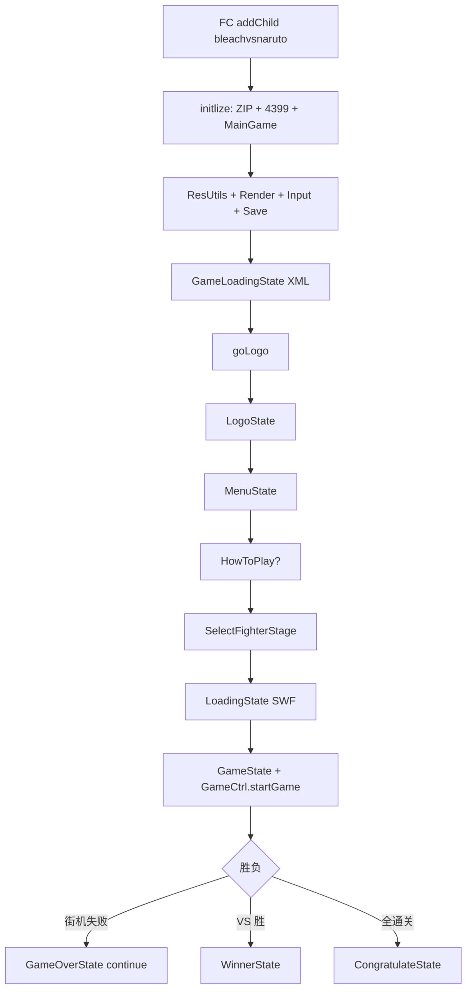

# 引擎 Batch A 索引 — `net.play5d.game.bvn` 主链

壳 line-by-line 已完成（`../shell/`）。本目录是 **玩法引擎主链**：`MainGame`、配置、Debugger、ctrl / game_ctrls、state、events、input、interfaces、map、utils、web。不含 `fighter/**`、`ui/**`、`data/**`、`views/**`（后续批次）。

文件清单：[`../_maps/engine-batch-A-files.txt`](../_maps/engine-batch-A-files.txt)（60 个 `.as`）。交叉备忘：[`../_maps/ENGINE-NOTES.md`](../_maps/ENGINE-NOTES.md)。

## 壳如何把控制权交给 MainGame

时间轴 3 帧走完 FM → FA → FB → FC 之后，FC 把 `bleachvsnaruto`（游戏根 Sprite）`addChild` 到壳的 app 容器。之后 **不再经过 GreenHD**。

详见 [`../shell/00-INDEX.md`](../shell/00-INDEX.md) 与 [`../shell/bleachvsnaruto_2.md`](../shell/bleachvsnaruto_2.md)。

```
AVM2 文档类 BleachVSNaruto
  → ǵ.ɐ.Ȱ  FM attach（任务 FA/FB/FC）
  → ƃ.FB.init_fb  版本 / embed / Hold / 远程
  → ɕ.ȑ  体积门 + new bleachvsnaruto + addChild
  → bleachvsnaruto.initlize
       GameInterface.instance = GameInterfaceManager
       Ctrler4399.init()
       出厂：quality=medium, AI=1, keyInputMode=1
       GameConfig.MAP_LOGO_STATE = 1
       AssetManager.setAssetLoader(ZipAssetLoader)   // 内嵌 ZIP，不走 HTTP
       buildGame → new MainGame().initlize(this, stage, ok, fail)
  → MainGame.initlize
       ResUtils.initalize          // 8 个 UI SWF Class
       GameRender.initlize(stage)  // ENTER_FRAME 分发
       GameInputer.initlize
       GameData.loadData + config.applyConfig
       KyoStageCtrl.goStage(GameLoadingState)
         loadPreLoad(preload.xml) → fighter/assist/select/map/mission XML
       EffectModel.initlize
  → 壳 initBackHandler → enterFrame 等到 isInTop
  → 派 DataEvent("5d_message", ["games_inited"])
  → MainGame.goLogo() → LogoState
```

失败：`initFailHandler` 是空函数。体积门在壳里已经过了；引擎 init 失败不会再 `FB.showError`。

`MainGame.VERSION` 当前反编译现场是 `V3.3-REV`。SWF ABC 字符串池仍是 `V3.3`（改 `.as` 不会写回播放文件）。



## 状态机

舞台控制器是 `net.play5d.kyo.stage.KyoStageCtrl`（kyo 包，本批不注解）。`MainGame.stageCtrl.goStage(Istage)`：

1. 若当前 stage 非空：`destory` → `removeChild`。
2. 新 stage：`build()` → `addChild(display)` → `afterBuild()`（同步）。
3. 同类名默认拒绝重入；`loadGame` 传 `sameChange=true` 绕过。

所有 `state.*` 实现 `Istage`：`display` / `build` / `afterBuild` / `destory`。

| `MainGame` 方法 | 下一状态 | FPS | 谁调用 |
|-----------------|----------|-----|--------|
| `goLogo` | `LogoState` | 30 | 壳 `etHandler` |
| `goMenu` | `MenuState` | 30 | Logo 播完、暂停回标题、设置/制作组返回；会 `resetDefault()` |
| `goHowToPlay` | `HowToPlayState` | 30 | 菜单街机且 `SHOW_HOW_TO_PLAY` |
| `goSelect` | `SelectFighterStage` | 30 | 菜单多数模式、HowToPlay 结束、GameOver 再选 |
| `loadGame` | `LoadingState` | 30 | 选人 `transIn`；`sameChange=true` |
| `goGame` | `GameState` + `GameCtrl.startGame` | `FPS_GAME` | Loading 完成 `transIn` |
| `goOption` | `SettingState` | 30 | 菜单 OPTION |
| `goContinue` | `GameOverState.showContinue` | 30 | `GameCtrl` 街机失败 |
| `goGameOver` | `GameOverState.showGameOver` | 30 | **本包无调用方** |
| `goWinner` | `WinnerState` | 30 | `GameCtrl` VS/未全通 |
| `goCredits` | `CreditsState` | 30 | 菜单 |
| `goCongratulations` | `CongratulateState` | 30 | `GameCtrl` 全通关 |
| `moreGames` / `submitScore` / `showRank` | 不切 state | — | 转 `GameInterface` |

转场黑屏走 `StateCtrl.transIn/transOut`（选人→加载、加载→战斗），不是 Kyo 的 fade。

`GameLoadingState`（启动 XML）与 `LoadingState`（选人后角色/地图 SWF）不是同一个类。

## ctrl 总览

对局帧循环：`GameRender`（stage ENTER_FRAME）→ `GameCtrl` 注册的 render → `GameMainLogicCtrler`（物理/碰撞）+ `EffectCtrl` + `SoundCtrl` + 开场/结束 ctrl。

```
GameRender.render
  └ GameCtrl（注册回调）
       ├ GameStartCtrl.render     开场倒计时 / 可 skip
       ├ GameMainLogicCtrler      精灵物理、碰撞、renderAnimate 隔帧
       ├ GameEndCtrl.render       回合结束演出
       ├ TrainingCtrler           练习锁血
       ├ EffectCtrl.render
       └ FighterEventCtrl         子弹 / 辅助 / 攻击体 事件
```

| 类 | 角色 |
|----|------|
| `AssetManager` | 资源中枢。本包 `setAssetLoader(ZipAssetLoader)` |
| `AssetLoader` | HTTP 默认实现；正式包被 ZIP 换掉 |
| `GameLoader` | 按 id 拉 fighter/assister/map SWF 并包装 |
| `GameLogic` | 出界、连击、死亡、加分、可选角色过滤 |
| `GameRender` | ENTER_FRAME 多路回调；`isRender` 总闸 |
| `SoundCtrl` | BGM / 音效 / 选人确认音 |
| `StateCtrl` | `transIn` / `transOut` / `quickTrans` |
| `EffectCtrl` | 受击/防御/必杀黑屏/震动/残影/慢动作 |
| `GameCtrl` | 对局主控单例：开局、回合、暂停、结束、精灵表 |
| `GameMainLogicCtrler` | 每帧物理；写 `GameConfig.SPEED_PLUS` |
| `GameStartCtrl` / `GameEndCtrl` | 开场 / 结束演出 |
| `FighterEventCtrl` | `FighterEvent` → 生成子弹/辅助/攻击体 |
| `TrainingCtrler` | 练习模式 |

输入：`GameInputer` 持有 P1/P2/`menu` 的 `IGameInput`（本包键盘 `GameKeyInput`）。平台可经 `IGameInterface.getGameInput` 换实现。

精灵：`IGameSprite` ← `BaseGameSprite`（重力/速度/朝向）。角色/子弹/辅助在 fighter 批。

地图：`MapMain` 解析库实例名 `line_*` / `p1` `p2` / `map` `front` `bg` / `floor` / `logo4399`；`FloorVO` 是地板线段。

平台：`GameInterface.instance` = `GameInterfaceManager`。4399 分数按钮 `Ctrler4399` + `SubmitScoreBtn`。资源 `ZipCtrler` + `deng.fzip` 读内嵌 `assets_zip`。

## 清单（60 / 60 done）

路径相对 `reverse/line-by-line/engine/`。源文件相对 `decompiled/main/scripts/`。清单文件 61 行含空行，实为 60 个 `.as`。

| # | 源 `.as` | 本文 | 状态 |
|---|----------|------|------|
| 1 | `net/play5d/game/bvn/Debugger.as` | [`game/bvn/Debugger.md`](game/bvn/Debugger.md) | done |
| 2 | `net/play5d/game/bvn/GameConfig.as` | [`game/bvn/GameConfig.md`](game/bvn/GameConfig.md) | done |
| 3 | `net/play5d/game/bvn/GameQuailty.as` | [`game/bvn/GameQuailty.md`](game/bvn/GameQuailty.md) | done |
| 4 | `net/play5d/game/bvn/MainGame.as` | [`game/bvn/MainGame.md`](game/bvn/MainGame.md) | done |
| 5 | `.../ctrl/AssetLoader.as` | [`game/bvn/ctrl/AssetLoader.md`](game/bvn/ctrl/AssetLoader.md) | done |
| 6 | `.../ctrl/AssetManager.as` | [`game/bvn/ctrl/AssetManager.md`](game/bvn/ctrl/AssetManager.md) | done |
| 7 | `.../ctrl/EffectCtrl.as` | [`game/bvn/ctrl/EffectCtrl.md`](game/bvn/ctrl/EffectCtrl.md) | done |
| 8 | `.../ctrl/GameLoader.as` | [`game/bvn/ctrl/GameLoader.md`](game/bvn/ctrl/GameLoader.md) | done |
| 9 | `.../ctrl/GameLogic.as` | [`game/bvn/ctrl/GameLogic.md`](game/bvn/ctrl/GameLogic.md) | done |
| 10 | `.../ctrl/GameRender.as` | [`game/bvn/ctrl/GameRender.md`](game/bvn/ctrl/GameRender.md) | done |
| 11 | `.../ctrl/SoundCtrl.as` | [`game/bvn/ctrl/SoundCtrl.md`](game/bvn/ctrl/SoundCtrl.md) | done |
| 12 | `.../ctrl/StateCtrl.as` | [`game/bvn/ctrl/StateCtrl.md`](game/bvn/ctrl/StateCtrl.md) | done |
| 13 | `.../ctrl/game_ctrls/FighterEventCtrl.as` | [`game/bvn/ctrl/game_ctrls/FighterEventCtrl.md`](game/bvn/ctrl/game_ctrls/FighterEventCtrl.md) | done |
| 14 | `.../ctrl/game_ctrls/GameCtrl.as` | [`game/bvn/ctrl/game_ctrls/GameCtrl.md`](game/bvn/ctrl/game_ctrls/GameCtrl.md) | done |
| 15 | `.../ctrl/game_ctrls/GameEndCtrl.as` | [`game/bvn/ctrl/game_ctrls/GameEndCtrl.md`](game/bvn/ctrl/game_ctrls/GameEndCtrl.md) | done |
| 16 | `.../ctrl/game_ctrls/GameMainLogicCtrler.as` | [`game/bvn/ctrl/game_ctrls/GameMainLogicCtrler.md`](game/bvn/ctrl/game_ctrls/GameMainLogicCtrler.md) | done |
| 17 | `.../ctrl/game_ctrls/GameStartCtrl.as` | [`game/bvn/ctrl/game_ctrls/GameStartCtrl.md`](game/bvn/ctrl/game_ctrls/GameStartCtrl.md) | done |
| 18 | `.../ctrl/game_ctrls/TrainingCtrler.as` | [`game/bvn/ctrl/game_ctrls/TrainingCtrler.md`](game/bvn/ctrl/game_ctrls/TrainingCtrler.md) | done |
| 19 | `.../events/GameEvent.as` | [`game/bvn/events/GameEvent.md`](game/bvn/events/GameEvent.md) | done |
| 20 | `.../events/SetBtnEvent.as` | [`game/bvn/events/SetBtnEvent.md`](game/bvn/events/SetBtnEvent.md) | done |
| 21 | `.../input/GameInputType.as` | [`game/bvn/input/GameInputType.md`](game/bvn/input/GameInputType.md) | done |
| 22 | `.../input/GameInputer.as` | [`game/bvn/input/GameInputer.md`](game/bvn/input/GameInputer.md) | done |
| 23 | `.../input/GameKeyInput.as` | [`game/bvn/input/GameKeyInput.md`](game/bvn/input/GameKeyInput.md) | done |
| 24 | `.../input/IGameInput.as` | [`game/bvn/input/IGameInput.md`](game/bvn/input/IGameInput.md) | done |
| 25 | `.../interfaces/BaseGameSprite.as` | [`game/bvn/interfaces/BaseGameSprite.md`](game/bvn/interfaces/BaseGameSprite.md) | done |
| 26 | `.../interfaces/GameInterface.as` | [`game/bvn/interfaces/GameInterface.md`](game/bvn/interfaces/GameInterface.md) | done |
| 27 | `.../interfaces/IAssetLoader.as` | [`game/bvn/interfaces/IAssetLoader.md`](game/bvn/interfaces/IAssetLoader.md) | done |
| 28 | `.../interfaces/IExtendConfig.as` | [`game/bvn/interfaces/IExtendConfig.md`](game/bvn/interfaces/IExtendConfig.md) | done |
| 29 | `.../interfaces/IFighterActionCtrl.as` | [`game/bvn/interfaces/IFighterActionCtrl.md`](game/bvn/interfaces/IFighterActionCtrl.md) | done |
| 30 | `.../interfaces/IGameInterface.as` | [`game/bvn/interfaces/IGameInterface.md`](game/bvn/interfaces/IGameInterface.md) | done |
| 31 | `.../interfaces/IGameSprite.as` | [`game/bvn/interfaces/IGameSprite.md`](game/bvn/interfaces/IGameSprite.md) | done |
| 32 | `.../interfaces/IInnerSetUI.as` | [`game/bvn/interfaces/IInnerSetUI.md`](game/bvn/interfaces/IInnerSetUI.md) | done |
| 33 | `.../interfaces/ILoger.as` | [`game/bvn/interfaces/ILoger.md`](game/bvn/interfaces/ILoger.md) | done |
| 34 | `.../map/FloorVO.as` | [`game/bvn/map/FloorVO.md`](game/bvn/map/FloorVO.md) | done |
| 35 | `.../map/MapMain.as` | [`game/bvn/map/MapMain.md`](game/bvn/map/MapMain.md) | done |
| 36 | `.../state/CongratulateState.as` | [`game/bvn/state/CongratulateState.md`](game/bvn/state/CongratulateState.md) | done |
| 37 | `.../state/CreditsState.as` | [`game/bvn/state/CreditsState.md`](game/bvn/state/CreditsState.md) | done |
| 38 | `.../state/GameCamera.as` | [`game/bvn/state/GameCamera.md`](game/bvn/state/GameCamera.md) | done |
| 39 | `.../state/GameLoadingState.as` | [`game/bvn/state/GameLoadingState.md`](game/bvn/state/GameLoadingState.md) | done |
| 40 | `.../state/GameOverState.as` | [`game/bvn/state/GameOverState.md`](game/bvn/state/GameOverState.md) | done |
| 41 | `.../state/GameState.as` | [`game/bvn/state/GameState.md`](game/bvn/state/GameState.md) | done |
| 42 | `.../state/HowToPlayState.as` | [`game/bvn/state/HowToPlayState.md`](game/bvn/state/HowToPlayState.md) | done |
| 43 | `.../state/LoadingState.as` | [`game/bvn/state/LoadingState.md`](game/bvn/state/LoadingState.md) | done |
| 44 | `.../state/LogoState.as` | [`game/bvn/state/LogoState.md`](game/bvn/state/LogoState.md) | done |
| 45 | `.../state/MenuState.as` | [`game/bvn/state/MenuState.md`](game/bvn/state/MenuState.md) | done |
| 46 | `.../state/SelectFighterStage.as` | [`game/bvn/state/SelectFighterStage.md`](game/bvn/state/SelectFighterStage.md) | done |
| 47 | `.../state/SettingState.as` | [`game/bvn/state/SettingState.md`](game/bvn/state/SettingState.md) | done |
| 48 | `.../state/WinnerState.as` | [`game/bvn/state/WinnerState.md`](game/bvn/state/WinnerState.md) | done |
| 49 | `.../utils/BitmapAssetLoader.as` | [`game/bvn/utils/BitmapAssetLoader.md`](game/bvn/utils/BitmapAssetLoader.md) | done |
| 50 | `.../utils/EffectManager.as` | [`game/bvn/utils/EffectManager.md`](game/bvn/utils/EffectManager.md) | done |
| 51 | `.../utils/GameLoger.as` | [`game/bvn/utils/GameLoger.md`](game/bvn/utils/GameLoger.md) | done |
| 52 | `.../utils/GameUtils.as` | [`game/bvn/utils/GameUtils.md`](game/bvn/utils/GameUtils.md) | done |
| 53 | `.../utils/KeyBoarder.as` | [`game/bvn/utils/KeyBoarder.md`](game/bvn/utils/KeyBoarder.md) | done |
| 54 | `.../utils/MCUtils.as` | [`game/bvn/utils/MCUtils.md`](game/bvn/utils/MCUtils.md) | done |
| 55 | `.../utils/ResUtils.as` | [`game/bvn/utils/ResUtils.md`](game/bvn/utils/ResUtils.md) | done |
| 56 | `.../web/Ctrler4399.as` | [`game/bvn/web/Ctrler4399.md`](game/bvn/web/Ctrler4399.md) | done |
| 57 | `.../web/GameInterfaceManager.as` | [`game/bvn/web/GameInterfaceManager.md`](game/bvn/web/GameInterfaceManager.md) | done |
| 58 | `.../web/SubmitScoreBtn.as` | [`game/bvn/web/SubmitScoreBtn.md`](game/bvn/web/SubmitScoreBtn.md) | done |
| 59 | `.../web/ZipAssetLoader.as` | [`game/bvn/web/ZipAssetLoader.md`](game/bvn/web/ZipAssetLoader.md) | done |
| 60 | `.../web/ZipCtrler.as` | [`game/bvn/web/ZipCtrler.md`](game/bvn/web/ZipCtrler.md) | done |

未列入：`data/**`、`fighter/**`、`ui/**`、`views/**`、`kyo/**`。

## 阅读顺序（主链）

1. [`game/bvn/MainGame.md`](game/bvn/MainGame.md) ← [`../shell/bleachvsnaruto_2.md`](../shell/bleachvsnaruto_2.md)
2. [`game/bvn/web/ZipAssetLoader.md`](game/bvn/web/ZipAssetLoader.md) + [`game/bvn/ctrl/AssetManager.md`](game/bvn/ctrl/AssetManager.md) + [`game/bvn/utils/ResUtils.md`](game/bvn/utils/ResUtils.md)
3. [`game/bvn/state/GameLoadingState.md`](game/bvn/state/GameLoadingState.md) → [`game/bvn/state/LogoState.md`](game/bvn/state/LogoState.md) → [`game/bvn/state/MenuState.md`](game/bvn/state/MenuState.md)
4. [`game/bvn/state/SelectFighterStage.md`](game/bvn/state/SelectFighterStage.md) → [`game/bvn/state/LoadingState.md`](game/bvn/state/LoadingState.md)
5. [`game/bvn/ctrl/game_ctrls/GameCtrl.md`](game/bvn/ctrl/game_ctrls/GameCtrl.md) + [`game/bvn/state/GameState.md`](game/bvn/state/GameState.md) + [`game/bvn/ctrl/game_ctrls/GameMainLogicCtrler.md`](game/bvn/ctrl/game_ctrls/GameMainLogicCtrler.md)
6. [`game/bvn/interfaces/BaseGameSprite.md`](game/bvn/interfaces/BaseGameSprite.md) + [`game/bvn/map/MapMain.md`](game/bvn/map/MapMain.md) + [`game/bvn/ctrl/EffectCtrl.md`](game/bvn/ctrl/EffectCtrl.md)
