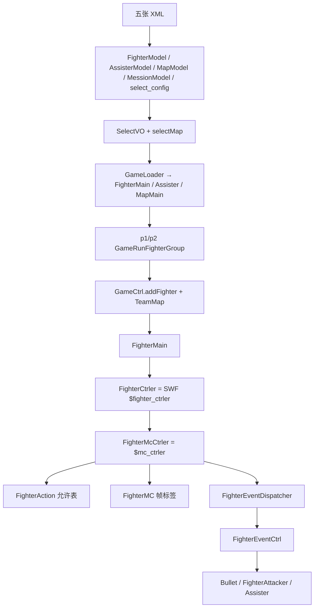

# 引擎 Batch B 索引 — `data/**` + `fighter/**`

Batch A 是主链（`MainGame`、ctrl、state、input、map、web）。本批是 **配表与战斗实体**：选人/关卡/设置数据，以及角色、子弹、辅助、攻击体和它们的控制器。不含 `ui/**`、`views/**`、`kyo/**`（后续批次）。

文件清单：[`../_maps/engine-batch-B-files.txt`](../_maps/engine-batch-B-files.txt)（52 个 `.as`）。交叉备忘：[`../_maps/ENGINE-NOTES.md`](../_maps/ENGINE-NOTES.md)（Batch A 写的拼写与主链接线，本批沿用）。

Batch A 入口：[`00-BATCH-A-INDEX.md`](00-BATCH-A-INDEX.md)。

## 本批接到主链的位置

```
GameLoadingState
  → GameData.loadConfig
       fighter.xml  → FighterModel
       assist.xml   → AssisterModel
       select.xml   → ConfigVO.select_config (SelectStageConfigVO)
       map.xml      → MapModel
       mission.xml  → MessionModel
  → EffectModel.initlize          // effect.swf 已在 loadBasic 里
MenuBtnGroup 写 GameMode.currentMode
SelectFighterStage 写 GameData.p1Select / p2Select / selectMap
街机：MessionModel.initMession 灌敌方 + 地图
LoadingState + GameLoader → FighterMain / Assister / MapMain
  填进 GameCtrl.gameRunData 两组 GameRunFighterGroup
GameCtrl.addFighter
  → FighterKeyCtrl 或 FighterAICtrl
  → FighterMain.setActionCtrl
GameMainLogicCtrler 每帧
  → IGameSprite.render / renderAnimate / getCurrentHits / beHit
FighterEventCtrl 听 FighterEventDispatcher
  → new Bullet / new FighterAttacker / 放出已加载的 Assister
```



## data 总览

进程级单例：`GameData.I`、`FighterModel.I`、`AssisterModel.I`、`MapModel.I`、`MessionModel.I`、`EffectModel.I`。`GameMode` 是全静态。

| 类 | 角色 |
|----|------|
| `GameData` | 设置、双方 SelectVO、地图 id、街机分数、`winnerId`。存档 id `"bvn3.01"`，**不含**分数/选人。 |
| `ConfigVO` | 键位三套、画质、音量、`AI_level`、HP 倍率、回合秒、`keyInputMode`。 |
| `KeyConfigVO` | 10 个 keyCode + `selects`。P1 WASD+JKL UIO；P2 方向+小键盘。 |
| `GameMode` | 10/11/12 组队，20/21/22 单挑，30 生存，40 练习。`isAcrade` 含 10/20/30。 |
| `SelectVO` | `fighter1/2/3` + `fuzhu`。 |
| `SelectStageConfigVO` | 选人网格；内含两份 `SelectCharListConfigVO`。 |
| `FighterVO` | 角色/辅助共用元数据。`comicType` 选关卡线。 |
| `MapVO` | 地图 id / SWF / 预览 / BGM。 |
| `MessionVO` / `MessionStageVO` / `MessionModel` | 街机线。XML `gameMode` 是 **0 组队表 / 1 单人表**，不是 10/20。 |
| `TeamMap` / `TeamVO` | 对局 1=P1 / 2=P2。children 挂该队全部 `IGameSprite`。 |
| `GameRunDataVO` | `GameCtrl` 持有的一场状态：两组、回合、计时、lastWinner*。 |
| `GameRunFighterGroup` | 最多 3 个 `FighterMain` + 1 个 `Assister` + `currentFighter`。 |
| `HitType` | 1–11 打击类型。引擎只调 `isHeavy`。 |
| `EffectModel` / `EffectVO` / `BitmapDataCacheVO` | 特效图鉴 + MC 光栅化缓存。 |

### 模式数字

| 值 | 名 | 选人数 | P2 | 关卡 |
|----|----|--------|----|------|
| 10 | `TEAM_ACRADE` | 3 | AI（街机敌） | `MessionModel` |
| 11 | `TEAM_VS_PEOPLE` | 3 | 键控 | 选手选图 |
| 12 | `TEAM_VS_CPU` | 3 | AI | 选手选图 |
| 20 | `SINGLE_ACRADE` | 1 | AI | 关卡线 |
| 21 | `SINGLE_VS_PEOPLE` | 1 | 键控 | 选手选图 |
| 22 | `SINGLE_VS_CPU` | 1 | AI | 选手选图 |
| 30 | `SURVIVOR` | 视表 | AI | 关卡线（算 `isAcrade`，不算组队） |
| 40 | `TRAINING` | 1 | 键控（`isVsCPU(false)`） | 练习 |

`isVsCPU()` 默认把 40 也算 CPU；`GameCtrl.addFighter` 传 `false` 把练习排除。

### 街机 AI 难度坑

`ConfigVO.AI_level` 默认 1。真正喂给 `FighterAICtrl` 的是 `MessionModel.AI_LEVEL`，**默认 6（HELL）**，只在 `initMession` 从 config 拷一次。VS CPU 不走 `initMession`，会吃到 6 或上一局街机残留。

## fighter 实体

战斗场景里能打人的东西：

```
IGameSprite
├── BaseGameSprite
│     ├── FighterMain     可玩角色。有身体、受击、气/能量、FighterCtrler
│     ├── Assister        辅助。能打人，getBodyArea=null，isAlive 恒 false
│     └── FighterAttacker 攻击体（分身/武器）。跟 owner 或独立飞
└── Bullet                直接实现接口。无重力/阻尼 Point；身体盒=攻击盒
```

`GameCtrl.addGameSprite(teamId, sprite)` 把实体挂进 `TeamVO.children`。`GameMainLogicCtrler` 跨队 `checkBodyHit`（只要 `BaseGameSprite`）和 `checkHit`（全体 `IGameSprite`）。

角色 SWF 两层 MC：

1. 根 `FighterMain.mc`（`MainTimeline`）→ `setFighterCtrler` → `$fighter_ctrler`
2. 内部动作 MC → `FighterCtrler.initMc` → `FighterMC`；时间轴另存 `$mc_ctrler`

判定面元件名见 `FighterHitRange`（`kanmian` / `bsmian` / …）。`McAreaCacher` 按帧号+几何指纹缓存 `getBounds`。

### `FighterActionState`（`FighterMain.actionState`）

| 值 | 名 | 语义 |
|----|----|------|
| 0 | `NORNAL` | 站立/可行动（NORMAL 拼错） |
| 10–13 | 攻/技能/必杀/超必 | `isAttacking` |
| 14 / 15 / 16 | 跳 / 冲 / hurtAct | |
| 20 | 防御 | |
| 21–24 | 受击 / 击飞 / 倒地 / 弹起 | `isHurting` |
| 30 | 死 | |
| 40 | 冻结 | |
| 50 | 万解 | |
| 60–62 | 开场 / 胜 / 负 | |

`isAllowWinState` 与 `allowGhostStep` 同体：禁 12/13/50。`isBishaIng` 本包零调用。

### `HitVO.hitType`

时间轴写数字，不 import `HitType`。`isCatch` = `hitType==11 && isBreakDef`。`isBisha` = id 含 `"bs"`。`FighterDefenseType`（`SWOARD=0` / `HAND=1`）同样只当字典，运行时是 `FighterMain.defenseType` 整型。

## 控制器栈

```
IFighterActionCtrl                 每帧「这一招要不要出」
  ├── FighterKeyCtrl               P1 总是；P2 非 CPU
  └── FighterAICtrl                VS CPU / 街机 P2
         └── FighterAILogic        决策树 + 基类骰子表

FighterMain
  └── FighterCtrler                SWF 门面：$fighter_ctrler
        ├── FighterMcCtrler        动作脑：$mc_ctrler（2234 行）
        ├── FighterEffectCtrl      残影 / glow / 落地尘
        ├── FighterVoiceCtrler     槽 0 受击 / 1 击飞 / 2 死
        ├── FighterHitModel        id → HitVO
        └── FighterBuffCtrler      speed / attackRate / defenseRate 限时
```

`FighterMcCtrler` 每逻辑帧：`FighterAction.render`（CD）→ 地面/空中/防御/受击/鬼步轮询 `IFighterActionCtrl` → `FighterMC.goFrame`。时间轴回调 `fire` / `addAttacker` / `moveTarget` / `setSteelBody` / `setAttack("砍2")`。

辅助 / 攻击体各有平行门面：`AssisiterCtrler`（类名少一个 s）、`FighterAttackerCtrler`。都能 `FIRE_BULLET` / `ADD_ATTACKER`。

抓取拉人：`moveTarget({followmc, speed, x, y})` → `MoveTargetParamVO` → 每逻辑帧 `renderMoveTarget`。

## 招式事件

静态总线 `FighterEventDispatcher`（每 type 表里只留一个 listener）。`FighterEventCtrl` 听 7 个字符串（与 `FighterEvent` 常量同文）：

| type | 谁派 | 效果 |
|------|------|------|
| `FIRE_BULLET` | Mc / Attacker / Assister ctrler | `new Bullet` |
| `ADD_ATTACKER` | Mc / Assister ctrler | `new FighterAttacker` |
| `ADD_ASSISTER` | McCtrler（耗 `fzqi`） | 放出组里已加载的 `fuzhu` |
| `HIT_TARGET` | `GameLogic.hitTarget` | 连击 UI；街机 P1 加分 |
| `HURT_RESUME` / `HURT_DOWN` | McCtrler / FighterMC | 清以自己为 target 的连击 |
| `DIE` | McCtrler | `GameCtrl.gameEnd` |

`DO_ACTION` 派到 **fighter 实例**，总线无 listener。

子弹/攻击体进 **发射者** 的 `TeamVO`，因此只对敌队 `checkHit`。辅助 `hit()` 把连击和加气算在 **owner 角色** 上。

## 拼写（本批新增，全文保留）

Batch A 已列：`initlize`、`destory`、`Mession`、`ACRADE`、`fuzhu`、`specailSkill`、`waiKai`。

本批额外：

| 名 | 应为 | 出现处 |
|----|------|--------|
| `AssisiterCtrler` | Assister | 类名少 s |
| `NORNAL` | NORMAL | `FighterActionState` |
| `SWOARD` | SWORD | `FighterDefenseType` |
| `isFristRun` | First | `GameData` |
| `initSpeicalEffect` | Special | `EffectModel` |
| `ghostJumpDowm` | Down | `FighterAILogic` |
| `isDefenseHiting` | Hitting | `FighterAction` |
| `defult` | default | AI 基类骰子键 |
| `renderDefensHiting` | DefenseHitting | `FighterMcCtrler` |
| `xg_hitfllor_heavy` | floor | `EffectModel` 符号 |

## 死 / 弱 API

- `FighterModel.getFighter` / `AssisterModel.getAssister` 第二参 `Boolean` **未读**；`GameLoader` 仍传 `true`。
- `HitType` / `FighterDefenseType` / `FighterVoice` 常量名主包零引用；时间轴写数字。
- `FighterAction.setCD` / `CDOK` 本包零调用。
- `FighterActionState.isBishaIng` 本包零调用。
- `FighterVO.clone` 本包零调用，且 `_cloneKey` 漏 `faceWinUrl`。
- `TeamMap.remove` 本包零调用。`clear` 不清公开字段 `teams`（随后 `add` 会重建）。
- `GameRunDataVO.setAllowLoseHP`：组的 `currentFighter` 空则 NPE（? 终场前应还在）。

## 清单（52 / 52 done）

路径相对 `reverse/line-by-line/engine/`。源文件相对 `decompiled/main/scripts/`。清单文件 52 行，无空行。

| # | 源 `.as` | 本文 | 状态 |
|---|----------|------|------|
| 1 | `.../data/AssisterModel.as` | [`game/bvn/data/AssisterModel.md`](game/bvn/data/AssisterModel.md) | done |
| 2 | `.../data/BitmapDataCacheVO.as` | [`game/bvn/data/BitmapDataCacheVO.md`](game/bvn/data/BitmapDataCacheVO.md) | done |
| 3 | `.../data/ConfigVO.as` | [`game/bvn/data/ConfigVO.md`](game/bvn/data/ConfigVO.md) | done |
| 4 | `.../data/EffectModel.as` | [`game/bvn/data/EffectModel.md`](game/bvn/data/EffectModel.md) | done |
| 5 | `.../data/EffectVO.as` | [`game/bvn/data/EffectVO.md`](game/bvn/data/EffectVO.md) | done |
| 6 | `.../data/FighterModel.as` | [`game/bvn/data/FighterModel.md`](game/bvn/data/FighterModel.md) | done |
| 7 | `.../data/FighterVO.as` | [`game/bvn/data/FighterVO.md`](game/bvn/data/FighterVO.md) | done |
| 8 | `.../data/GameData.as` | [`game/bvn/data/GameData.md`](game/bvn/data/GameData.md) | done |
| 9 | `.../data/GameMode.as` | [`game/bvn/data/GameMode.md`](game/bvn/data/GameMode.md) | done |
| 10 | `.../data/GameRunDataVO.as` | [`game/bvn/data/GameRunDataVO.md`](game/bvn/data/GameRunDataVO.md) | done |
| 11 | `.../data/GameRunFighterGroup.as` | [`game/bvn/data/GameRunFighterGroup.md`](game/bvn/data/GameRunFighterGroup.md) | done |
| 12 | `.../data/HitType.as` | [`game/bvn/data/HitType.md`](game/bvn/data/HitType.md) | done |
| 13 | `.../data/KeyConfigVO.as` | [`game/bvn/data/KeyConfigVO.md`](game/bvn/data/KeyConfigVO.md) | done |
| 14 | `.../data/MapModel.as` | [`game/bvn/data/MapModel.md`](game/bvn/data/MapModel.md) | done |
| 15 | `.../data/MapVO.as` | [`game/bvn/data/MapVO.md`](game/bvn/data/MapVO.md) | done |
| 16 | `.../data/MessionModel.as` | [`game/bvn/data/MessionModel.md`](game/bvn/data/MessionModel.md) | done |
| 17 | `.../data/MessionStageVO.as` | [`game/bvn/data/MessionStageVO.md`](game/bvn/data/MessionStageVO.md) | done |
| 18 | `.../data/MessionVO.as` | [`game/bvn/data/MessionVO.md`](game/bvn/data/MessionVO.md) | done |
| 19 | `.../data/SelectCharListConfigVO.as` | [`game/bvn/data/SelectCharListConfigVO.md`](game/bvn/data/SelectCharListConfigVO.md) | done |
| 20 | `.../data/SelectCharListItemVO.as` | [`game/bvn/data/SelectCharListItemVO.md`](game/bvn/data/SelectCharListItemVO.md) | done |
| 21 | `.../data/SelectStageConfigVO.as` | [`game/bvn/data/SelectStageConfigVO.md`](game/bvn/data/SelectStageConfigVO.md) | done |
| 22 | `.../data/SelectVO.as` | [`game/bvn/data/SelectVO.md`](game/bvn/data/SelectVO.md) | done |
| 23 | `.../data/TeamMap.as` | [`game/bvn/data/TeamMap.md`](game/bvn/data/TeamMap.md) | done |
| 24 | `.../data/TeamVO.as` | [`game/bvn/data/TeamVO.md`](game/bvn/data/TeamVO.md) | done |
| 25 | `.../fighter/Assister.as` | [`game/bvn/fighter/Assister.md`](game/bvn/fighter/Assister.md) | done |
| 26 | `.../fighter/Bullet.as` | [`game/bvn/fighter/Bullet.md`](game/bvn/fighter/Bullet.md) | done |
| 27 | `.../fighter/FighterAction.as` | [`game/bvn/fighter/FighterAction.md`](game/bvn/fighter/FighterAction.md) | done |
| 28 | `.../fighter/FighterActionState.as` | [`game/bvn/fighter/FighterActionState.md`](game/bvn/fighter/FighterActionState.md) | done |
| 29 | `.../fighter/FighterAttacker.as` | [`game/bvn/fighter/FighterAttacker.md`](game/bvn/fighter/FighterAttacker.md) | done |
| 30 | `.../fighter/FighterDefenseType.as` | [`game/bvn/fighter/FighterDefenseType.md`](game/bvn/fighter/FighterDefenseType.md) | done |
| 31 | `.../fighter/FighterHitRange.as` | [`game/bvn/fighter/FighterHitRange.md`](game/bvn/fighter/FighterHitRange.md) | done |
| 32 | `.../fighter/FighterMC.as` | [`game/bvn/fighter/FighterMC.md`](game/bvn/fighter/FighterMC.md) | done |
| 33 | `.../fighter/FighterMain.as` | [`game/bvn/fighter/FighterMain.md`](game/bvn/fighter/FighterMain.md) | done |
| 34 | `.../fighter/ctrler/AssisiterCtrler.as` | [`game/bvn/fighter/ctrler/AssisiterCtrler.md`](game/bvn/fighter/ctrler/AssisiterCtrler.md) | done |
| 35 | `.../fighter/ctrler/FighterAICtrl.as` | [`game/bvn/fighter/ctrler/FighterAICtrl.md`](game/bvn/fighter/ctrler/FighterAICtrl.md) | done |
| 36 | `.../fighter/ctrler/FighterAttackerCtrler.as` | [`game/bvn/fighter/ctrler/FighterAttackerCtrler.md`](game/bvn/fighter/ctrler/FighterAttackerCtrler.md) | done |
| 37 | `.../fighter/ctrler/FighterBuffCtrler.as` | [`game/bvn/fighter/ctrler/FighterBuffCtrler.md`](game/bvn/fighter/ctrler/FighterBuffCtrler.md) | done |
| 38 | `.../fighter/ctrler/FighterCtrler.as` | [`game/bvn/fighter/ctrler/FighterCtrler.md`](game/bvn/fighter/ctrler/FighterCtrler.md) | done |
| 39 | `.../fighter/ctrler/FighterEffectCtrl.as` | [`game/bvn/fighter/ctrler/FighterEffectCtrl.md`](game/bvn/fighter/ctrler/FighterEffectCtrl.md) | done |
| 40 | `.../fighter/ctrler/FighterKeyCtrl.as` | [`game/bvn/fighter/ctrler/FighterKeyCtrl.md`](game/bvn/fighter/ctrler/FighterKeyCtrl.md) | done |
| 41 | `.../fighter/ctrler/FighterMcCtrler.as` | [`game/bvn/fighter/ctrler/FighterMcCtrler.md`](game/bvn/fighter/ctrler/FighterMcCtrler.md) | done |
| 42 | `.../fighter/ctrler/FighterVoice.as` | [`game/bvn/fighter/ctrler/FighterVoice.md`](game/bvn/fighter/ctrler/FighterVoice.md) | done |
| 43 | `.../fighter/ctrler/FighterVoiceCtrler.as` | [`game/bvn/fighter/ctrler/FighterVoiceCtrler.md`](game/bvn/fighter/ctrler/FighterVoiceCtrler.md) | done |
| 44 | `.../fighter/ctrler/ai/FighterAILogic.as` | [`game/bvn/fighter/ctrler/ai/FighterAILogic.md`](game/bvn/fighter/ctrler/ai/FighterAILogic.md) | done |
| 45 | `.../fighter/ctrler/ai/FighterAILogicBase.as` | [`game/bvn/fighter/ctrler/ai/FighterAILogicBase.md`](game/bvn/fighter/ctrler/ai/FighterAILogicBase.md) | done |
| 46 | `.../fighter/events/FighterEvent.as` | [`game/bvn/fighter/events/FighterEvent.md`](game/bvn/fighter/events/FighterEvent.md) | done |
| 47 | `.../fighter/events/FighterEventDispatcher.as` | [`game/bvn/fighter/events/FighterEventDispatcher.md`](game/bvn/fighter/events/FighterEventDispatcher.md) | done |
| 48 | `.../fighter/models/FighterHitModel.as` | [`game/bvn/fighter/models/FighterHitModel.md`](game/bvn/fighter/models/FighterHitModel.md) | done |
| 49 | `.../fighter/models/HitVO.as` | [`game/bvn/fighter/models/HitVO.md`](game/bvn/fighter/models/HitVO.md) | done |
| 50 | `.../fighter/utils/McAreaCacher.as` | [`game/bvn/fighter/utils/McAreaCacher.md`](game/bvn/fighter/utils/McAreaCacher.md) | done |
| 51 | `.../fighter/vos/FighterBuffVO.as` | [`game/bvn/fighter/vos/FighterBuffVO.md`](game/bvn/fighter/vos/FighterBuffVO.md) | done |
| 52 | `.../fighter/vos/MoveTargetParamVO.as` | [`game/bvn/fighter/vos/MoveTargetParamVO.md`](game/bvn/fighter/vos/MoveTargetParamVO.md) | done |

未列入：`ui/**`、`views/**`、`kyo/**`。角色 SWF 时间轴（`decompiled/fighters/*/scripts/`）作 callers 引用，本批不逐文件注解。

## 阅读顺序（战斗实体）

1. [`game/bvn/data/GameData.md`](game/bvn/data/GameData.md) + [`GameMode.md`](game/bvn/data/GameMode.md) + [`ConfigVO.md`](game/bvn/data/ConfigVO.md)
2. [`FighterVO.md`](game/bvn/data/FighterVO.md) → [`FighterModel.md`](game/bvn/data/FighterModel.md) / [`AssisterModel.md`](game/bvn/data/AssisterModel.md) / [`MessionModel.md`](game/bvn/data/MessionModel.md)
3. [`GameRunDataVO.md`](game/bvn/data/GameRunDataVO.md) + [`TeamVO.md`](game/bvn/data/TeamVO.md)（Batch A：`GameCtrl` / `LoadingState`）
4. [`FighterMain.md`](game/bvn/fighter/FighterMain.md) ← Batch A [`BaseGameSprite.md`](game/bvn/interfaces/BaseGameSprite.md)
5. [`FighterCtrler.md`](game/bvn/fighter/ctrler/FighterCtrler.md) + [`FighterMcCtrler.md`](game/bvn/fighter/ctrler/FighterMcCtrler.md) + [`FighterMC.md`](game/bvn/fighter/FighterMC.md)
6. [`FighterAction.md`](game/bvn/fighter/FighterAction.md) + [`FighterActionState.md`](game/bvn/fighter/FighterActionState.md) + Batch A [`IFighterActionCtrl.md`](game/bvn/interfaces/IFighterActionCtrl.md)
7. [`FighterKeyCtrl.md`](game/bvn/fighter/ctrler/FighterKeyCtrl.md) / [`FighterAICtrl.md`](game/bvn/fighter/ctrler/FighterAICtrl.md) + [`FighterAILogic.md`](game/bvn/fighter/ctrler/ai/FighterAILogic.md)
8. [`HitVO.md`](game/bvn/fighter/models/HitVO.md) + [`FighterEvent.md`](game/bvn/fighter/events/FighterEvent.md) ← Batch A [`FighterEventCtrl.md`](game/bvn/ctrl/game_ctrls/FighterEventCtrl.md)
9. [`Bullet.md`](game/bvn/fighter/Bullet.md) / [`FighterAttacker.md`](game/bvn/fighter/FighterAttacker.md) / [`Assister.md`](game/bvn/fighter/Assister.md)
