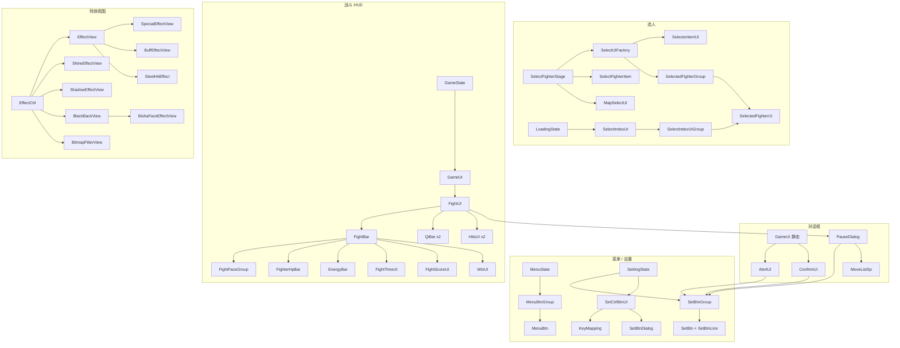

# 引擎 Batch C 索引 — `ui/**` + `views/effects/**`

Batch A 是主链（`MainGame`、ctrl、state、input）。Batch B 是配表与战斗实体。本批是 **屏幕层**：菜单/设置/对话框、选人控件、战斗 HUD、转场遮罩，以及 `EffectCtrl` 真正挂到舞台上的特效视图。不含 `kyo/**`（Batch D）。

文件清单：[`../_maps/engine-batch-C-files.txt`](../_maps/engine-batch-C-files.txt)（46 个 `.as`）。交叉备忘：[`../_maps/ENGINE-NOTES.md`](../_maps/ENGINE-NOTES.md)。

Batch A 入口：[`00-BATCH-A-INDEX.md`](00-BATCH-A-INDEX.md)。Batch B 入口：[`00-BATCH-B-INDEX.md`](00-BATCH-B-INDEX.md)。

## 本批接到主链的位置

```
MenuState.showBtns
  → MenuBtnGroup.build（getGameMenu / getDefaultMenu）
  → getFucByLabel 写 GameMode.currentMode → goHowToPlay / goSelect / goOption / …

SettingState
  → SetBtnGroup.initMainSet（ConfigVO 档位）
  → SetCtrlBtnUI（IInnerSetUI 键位页）

SelectFighterStage
  → SelectUIFactory.createSelecter → SelecterItemUI + SelectedFighterGroup
  → SelectFighterItem 格子
  → MapSelectUI（VS / 练习；街机走 MessionModel）

LoadingState
  → SelectIndexUI 排出场顺序（小队 10/11/12）

GameState.build
  → new GameUI()
GameState.initFight
  → GameUI.initFight → FightUI.initlize
  → addChild(FightUI.ui)   // 屏幕空间，不进 GameCamera

GameCtrl.pause(true)  → IGameUI.pause → PauseDialog
GameStartCtrl         → FightUI.showStart / fadIn
GameEndCtrl           → FightUI.showEnd / fadOut(false)
FighterEventCtrl      → FightUI.showHits / hideHits

StateCtrl             → TransUI / QuickTransUI

EffectCtrl + EffectManager
  → EffectView 子类池、Shine、Shadow、BlackBack、BitmapFilter
```



## 两套坐标系

| 层 | 坐标 | 谁 |
|----|------|-----|
| 世界 | 地图像素，随 `GameCamera` 滚/缩放 | 角色、子弹、`EffectView.display`、残影 |
| 屏幕 | 固定 `GAME_SIZE`（800×600） | `ui_fight`、菜单、对话框、`TransUI`、闪光 Bitmap、黑底 |

`FightUI` 挂在 `GameState` 上、**镜头层外面**。hits 数字是 SWF 固定位，不跟角色；跟角色的是 `player_pos_p1/p2`（zoom ≤ 1.8）。`GameState.getGameSpriteGlobalPosition(..., 0, -50)` 给屏外标记用，不是连击数字。

## `GameUI` 门面

本类 **不是** `IGameUI`。`IGameUI` 只有 `FightUI` 一个实现。

| API | 做什么 |
|-----|--------|
| `GameUI.I` | `GameState.build` 构造的实例。`destory` 不清 `I` |
| `initFight` | 懒 `new FightUI`，已有则复用只 `initlize` |
| `render` | 转 `FightUI.render`；按 `ceil(FPS_GAME/30)-1` 抽 `renderAnimate` |
| `getUI()` | 返回 `IGameUI` |
| `getUIDisplay()` | 要 `addChild` 的 `DisplayObject` |
| `fadIn()` | 转 `FightUI.fadIn` + `setVolume`。练习模式立刻出 HUD |
| `fadOut()` | **体内调 `_ui.fadIn()`**，写反。本包无调用方；终场走 `getUI().fadOut(false)` |
| `alert` / `confrim` | 静态，盖在 `MainGame.I.root`。派 `5d_message` `show_alert` / `show_confrim` / `close_*` |
| `showingDialog()` | 确认/提示框非空。**不含** `PauseDialog` |

`BITMAP_UI=true`、`SHOW_CN_TEXT=true`：本包无写入。生产路径血条/气条走位图烘焙；对话框/选人条出中文。壳可扳。

`IGameUI` 契约：`setVolume` / `destory` / `fadIn` / `fadOut` / `getUI` / `render` / `renderAnimate` / `showHits` / `hideHits` / `showStart` / `showEnd` / `clearStartAndEnd` / `pause` / `resume`。`FightUI` 另有 `initlize` / `showWins`，不在接口上。

## 菜单与设置

`MenuBtnGroup` 读 `GameInterface.instance.getGameMenu()`，空则 `getDefaultMenu()`。本包 GIM 在 CREDITS 前插 `RANK`（靠 `func`，不进 `getFucByLabel`）。

| 顶层 / 子项 `txt` | `currentMode` | 出口 |
|-------------------|---------------|------|
| TEAM ACRADE / SINGLE ACRADE | 10 / 20 | `MessionModel.reset`；`SHOW_HOW_TO_PLAY` → `goHowToPlay` 否则 `goSelect` |
| TEAM/SINGLE VS PEOPLE | 11 / 21 | `goSelect` |
| TEAM/SINGLE VS CPU | 12 / 22 | `goSelect` |
| TRAINING | 40 | `goSelect` |
| OPTION | — | `goOption` |
| CREDITS | — | `goCredits` |
| MORE GAMES | — | `moreGames` |
| SURVIVOR（`getFucByLabel` 有，菜单树无） | 30 | 死分支 |

`SetBtnGroup` 是通用列表：设置主页、键位页、暂停、Alert/Confrim、制作组、通关、出招表都 new 一份。`GameRender.add(render, this)` 用 owner 分桶，多实例不抢。数据字段拼成 `optoinKey`。

默认设置档（`getSettingMenu()` 本包 null）：P1/P2 KEY SET、COM LEVEL、OPERATE MODE、LIFE、TIME、SOUND、BGM、QUALITY，末尾硬加 APPLY。QUALITY 无 `"higher"`（`GameQuailty` 有这个常量，设置页没有）。

键位页 `SetCtrlBtnUI` 实现 `IInnerSetUI`：clone `KeyConfigVO` 到 `_tmpKeyConfig`，SET ALL 顺序听 `keyDown`，APPLY 写回，CANCEL 丢。`KeyMapping` 用 `font1` 位图字 + 去饱和滤镜画键名。

## 战斗 HUD

`ResUtils.fight` → `ui_fight`。P1 左、P2 右、计时正中。

| 子件 | SWF 槽 | 读什么 |
|------|--------|--------|
| `FightBar` | `hpbarmc` | 脸 / HP / 体力 / 计时 / 胜场 / 街机分数 |
| `FightFaceGroup` | `face1/2` | 当前大脸 + 候补两张。`getFighterFaceBar` |
| `FighterHpBar` | `bar1/2` | `hp/hpMax` 绿条；红条延迟拖尾（受击 21 / 击飞 22–23） |
| `EnergyBar` | `energy1/2` | **体力** `energy/energyMax`，不是气。过载 / <30% 闪 |
| `FightTimeUI` | `timemc` | `gameTime`；`-1` 亮「无限」 |
| `FightScoreUI` | `scoremc` | 街机 `GameData.score`，`MCNumber` |
| `WinUI` | `win_p1/p2` | 胜场灯。`comicType` 0 bleach / 1 naruto |
| `QiBar` | `fzqi1/2` | `qi/100` 封顶 3 格（0–300）+ `fzqi` 辅助条 + **辅助脸** |
| `HitsUI` | `hits1/2` | 连击数字，屏幕固定位 |
| `PauseDialog` | 代码加 | GAME TITLE / MOVE LIST / CONTINUE |

`FightUI.QI_BAR_MODE` 对齐 `FightQiBarMode`（0 AUTO / 1 TOP / 2 BOTTOM），**本包零写入**，恒 0。`renderQibarPos`（zoom < 1.5 把气条挪到顶部）**从未调用**。TOP 外观本包看不到。

`BITMAP_UI` 下 `FightBar` 把装饰烘焙成一张 Bitmap，HP/体力/计时数字/胜场/分数挪到 `ui_fight`；MC 淡入不播。

开场/KO 走 `ui.startKOmc`：`renderAnimate` 里 `nextFrame()`，不是 `play()`。标签 `start` / `start_final` / `ko` / `timeover` / `drawgame` / `winner`。`showStart` 的 `"fight"` 监听空体；真正开操作靠 `"complete"`。

## 选人控件

格子阶段（`SelectFighterStage`）和出战顺序（`LoadingState`）是两套 UI。

```
SelectUIFactory.createSelecter(1|2)
  SelecterItemUI          光标 MC select_item_mc
  SelectedFighterGroup    底部叠卡 selected_item_p1/p2_mc
    SelectedFighterUI     单张卡 + 名字
SelectFighterItem         格子 slt_item_mc + getFighterFace 50×50
MapSelectUI               select_map_mc；random 项再抽一次
SelectIndexUI             LoadingState 小队排出场顺序
  SelectIndexUIGroup ×2   编号 1/2/3，发 SELECT_FIGHTER_INDEX
```

`SelectFighterStage._p1SelectedGroup / _p2SelectedGroup` 是死字段；真正底部条是 `SelecterItemUI.group`。

`SelectIndexUI.initSelect` 按 `GameMode.currentMode - 10`：

| mode | P1 | P2 |
|------|----|----|
| 10 小队街机 | 手选 | `autoSelect` |
| 11 小队 2P | 手选 | `"P2"` |
| 12 小队 VS CPU | 手选完再 | `"P1"` 替电脑选 |
| 其它（单人/练习） | 直接 `isFinish` | 直接 `isFinish` |

`SelectIndexUI.SHOW_MODE`：`GameLogic.setGameMode`（Ctrl+F8/F9）改 1/0，配合 `salect.xml`。mode 1 在 `build` **之前** `setFighterScale`，当时 `_fighters` 仍 null。?

`SelectedFighterUI.setFighter` 在 `getChildByName("ct")` 处结束：字段 `_face` 从未赋值。四个 import 树同文。dump 下已选条 / 出战条可能只有底图+名字。格子脸走 `SelectFighterItem`；HUD 脸走 `FightFaceUI.getFighterFaceBar`。

## 转场

只 `StateCtrl` 用。

| 类 | 视觉 | 速率 |
|----|------|------|
| `TransUI` | `common_ui` 的 `trans_mc`，标签 `fadin` / `fadout` / `stop` | 自己挂 `GameRender`，对齐 `getFPS()/30` |
| `QuickTransUI` | 上下两块 `Box` 合上再打开 | TweenLite 0.1s |

`StateCtrl.removeTrainsUI` 卸 display **不** `TransUI.destory`，实例复用。`clearTrans` 中途卸可能仍跑到 `"stop"` 触发旧 callback。

## 特效视图

`EffectManager.getEffectView` 按 VO 旗互斥：`isSpecial` → `SpecialEffectView`；`isBuff` → `BuffEffectView`；`isSteelHit` → `SteelHitEffect`；否则 `EffectView`。闪光另池 `ShineEffectView`。

```
EffectView          光栅化帧 Bitmap。render() 空；renderAnimate 播缓存
├── SpecialEffectView   跟随角色；actionState 23/24/0 跳 "finish" 并 resumeColor
├── BuffEffectView      loopPlay；buff.finished 则 resumeColor + remove
└── SteelHitEffect      钢体染色；freeze 结束 resumeColor；超钢体再 shine 黄
```

`EffectCtrl` 自己 new、不进池：

| 类 | 角色 |
|----|------|
| `BlackBackView` | 低分辨率黑 Bitmap 铺满。`fadIn`/`renderAnimate` **空 stub**；黑底靠 `addChildAt(...,0)` |
| `BishaFaceEffectView` | 必杀特写 `bisha_face_mc`，槽 `facemc1/2` |
| `ShadowEffectView` | 残影。`Dictionary[DisplayObject → 本类]` |
| `ShineEffectView` | 全屏闪光。`FPS_SHINE_EFFECT` 抽帧；亮色 `add`、暗色 `darken` |
| `BitmapFilterView` | 实现 `IGameSprite`（无碰撞）。把角色+滤镜每帧画成 Bitmap，挂进队伍层 |

`EffectView` 的 `_curFrame` 0-based，`frameLabelCache` 是 MC 1-based。`"loop"` / `"finish"` 可能错一位。?

## 拼写（本批新增，全文保留）

Batch A/B 已列：`initlize`、`destory`、`fadIn`/`fadOut`、`confrim`、`sndConfrim`、`ACRADE`、`fuzhu`、`Mession`、`isFristRun`。

本批额外：

| 名 | 应为 | 出现处 |
|----|------|--------|
| `optoinKey` | optionKey | `SetBtnGroup` 数据字段；赋到 `SetBtn.optionKey` |
| `getFucByLabel` | Func | `MenuBtnGroup` |
| `toogleChildren` | toggle | `MenuBtnGroup` |
| `_showIngChildrenBtn` | Showing | `MenuBtnGroup` |
| `SelecterItemUI` | Selector | 类名 |
| `_empytBd` | empty | `FightBar` |
| `removeTrainsUI` | Trans | `StateCtrl`（A 批，本批 `TransUI` 对上） |

SWF 标签也是 `fadin` / `fadout`（无 e）。`FightBar` / `QiBar` 销毁帧标签叫 `"destory"`。

## 死 / 弱 API

- `GameUI.fadOut` 调 `_ui.fadIn()`。无调用方。
- `FightUI.QI_BAR_MODE` / `FightQiBarMode`：本包零写入 / 零引用。恒 AUTO=0。
- `FightUI.renderQibarPos`：无调用方。AUTO 按 zoom 挪气条是死代码。
- `FightFaceUI.setDirect`：空函数。P2 镜像靠 SWF。
- `FightUI.showStart.onFight`：收到 `"fight"` 只卸监听。
- `FightUI.getPlayerPos`：下沿钳制成 `x = GAME_SIZE.x-5` 不是 y。
- `EffectCtrl.shake(5,0,1.5)` 从 `playKO` 传入：第三参当毫秒，衰减极快。
- `BlackBackView.fadIn` / `renderAnimate`：空。`isRenderFadIn/Out` 字段从未读写。
- `PauseDialog.isShowing`：无调用方。
- `TransUI.destory`：`StateCtrl` 不调，实例复用。
- `MenuBtnGroup.getFucByLabel("SURVIVOR")`：菜单树点不到。
- `SelectedFighterUI.setFighter`：不贴脸（dump 截断或原代码缺失）。
- `AlertUI.setMsg`：无 `_cnTxt` 守卫；`SHOW_CN_TEXT==false` 会 NPE。本包开关恒 true。
- `SetBtnGroup.render` 不看 `GameUI.showingDialog()`（菜单组会看）。
- `MenuBtn.removeAllEventListener` / `SelectFighterItem` 同模式：卸的是用户回调，实际挂的是 `selfHandler`。
- `BitmapFilterView` 大量 `IGameSprite` 空实现（`hit`/`beHit`/`getArea` 恒 null，`allowCrossMap*` 真）。

## 清单（46 / 46 done）

路径相对 `reverse/line-by-line/engine/`。源文件相对 `decompiled/main/scripts/`。清单文件 46 行，无空行。

| # | 源 `.as` | 本文 | 状态 |
|---|----------|------|------|
| 1 | `.../ui/GameUI.as` | [`game/bvn/ui/GameUI.md`](game/bvn/ui/GameUI.md) | done |
| 2 | `.../ui/IGameUI.as` | [`game/bvn/ui/IGameUI.md`](game/bvn/ui/IGameUI.md) | done |
| 3 | `.../ui/KeyMapping.as` | [`game/bvn/ui/KeyMapping.md`](game/bvn/ui/KeyMapping.md) | done |
| 4 | `.../ui/MenuBtn.as` | [`game/bvn/ui/MenuBtn.md`](game/bvn/ui/MenuBtn.md) | done |
| 5 | `.../ui/MenuBtnGroup.as` | [`game/bvn/ui/MenuBtnGroup.md`](game/bvn/ui/MenuBtnGroup.md) | done |
| 6 | `.../ui/MoveListSp.as` | [`game/bvn/ui/MoveListSp.md`](game/bvn/ui/MoveListSp.md) | done |
| 7 | `.../ui/PauseDialog.as` | [`game/bvn/ui/PauseDialog.md`](game/bvn/ui/PauseDialog.md) | done |
| 8 | `.../ui/QuickTransUI.as` | [`game/bvn/ui/QuickTransUI.md`](game/bvn/ui/QuickTransUI.md) | done |
| 9 | `.../ui/SetBtn.as` | [`game/bvn/ui/SetBtn.md`](game/bvn/ui/SetBtn.md) | done |
| 10 | `.../ui/SetBtnDialog.as` | [`game/bvn/ui/SetBtnDialog.md`](game/bvn/ui/SetBtnDialog.md) | done |
| 11 | `.../ui/SetBtnGroup.as` | [`game/bvn/ui/SetBtnGroup.md`](game/bvn/ui/SetBtnGroup.md) | done |
| 12 | `.../ui/SetBtnLine.as` | [`game/bvn/ui/SetBtnLine.md`](game/bvn/ui/SetBtnLine.md) | done |
| 13 | `.../ui/SetCtrlBtnUI.as` | [`game/bvn/ui/SetCtrlBtnUI.md`](game/bvn/ui/SetCtrlBtnUI.md) | done |
| 14 | `.../ui/TransUI.as` | [`game/bvn/ui/TransUI.md`](game/bvn/ui/TransUI.md) | done |
| 15 | `.../ui/UIUtils.as` | [`game/bvn/ui/UIUtils.md`](game/bvn/ui/UIUtils.md) | done |
| 16 | `.../ui/WinUI.as` | [`game/bvn/ui/WinUI.md`](game/bvn/ui/WinUI.md) | done |
| 17 | `.../ui/dialog/AlertUI.as` | [`game/bvn/ui/dialog/AlertUI.md`](game/bvn/ui/dialog/AlertUI.md) | done |
| 18 | `.../ui/dialog/ConfrimUI.as` | [`game/bvn/ui/dialog/ConfrimUI.md`](game/bvn/ui/dialog/ConfrimUI.md) | done |
| 19 | `.../ui/fight/EnergyBar.as` | [`game/bvn/ui/fight/EnergyBar.md`](game/bvn/ui/fight/EnergyBar.md) | done |
| 20 | `.../ui/fight/FightBar.as` | [`game/bvn/ui/fight/FightBar.md`](game/bvn/ui/fight/FightBar.md) | done |
| 21 | `.../ui/fight/FightFaceGroup.as` | [`game/bvn/ui/fight/FightFaceGroup.md`](game/bvn/ui/fight/FightFaceGroup.md) | done |
| 22 | `.../ui/fight/FightFaceUI.as` | [`game/bvn/ui/fight/FightFaceUI.md`](game/bvn/ui/fight/FightFaceUI.md) | done |
| 23 | `.../ui/fight/FightQiBarMode.as` | [`game/bvn/ui/fight/FightQiBarMode.md`](game/bvn/ui/fight/FightQiBarMode.md) | done |
| 24 | `.../ui/fight/FightScoreUI.as` | [`game/bvn/ui/fight/FightScoreUI.md`](game/bvn/ui/fight/FightScoreUI.md) | done |
| 25 | `.../ui/fight/FightTimeUI.as` | [`game/bvn/ui/fight/FightTimeUI.md`](game/bvn/ui/fight/FightTimeUI.md) | done |
| 26 | `.../ui/fight/FightUI.as` | [`game/bvn/ui/fight/FightUI.md`](game/bvn/ui/fight/FightUI.md) | done |
| 27 | `.../ui/fight/FighterHpBar.as` | [`game/bvn/ui/fight/FighterHpBar.md`](game/bvn/ui/fight/FighterHpBar.md) | done |
| 28 | `.../ui/fight/HitsUI.as` | [`game/bvn/ui/fight/HitsUI.md`](game/bvn/ui/fight/HitsUI.md) | done |
| 29 | `.../ui/fight/QiBar.as` | [`game/bvn/ui/fight/QiBar.md`](game/bvn/ui/fight/QiBar.md) | done |
| 30 | `.../ui/select/MapSelectUI.as` | [`game/bvn/ui/select/MapSelectUI.md`](game/bvn/ui/select/MapSelectUI.md) | done |
| 31 | `.../ui/select/SelectFighterItem.as` | [`game/bvn/ui/select/SelectFighterItem.md`](game/bvn/ui/select/SelectFighterItem.md) | done |
| 32 | `.../ui/select/SelectIndexUI.as` | [`game/bvn/ui/select/SelectIndexUI.md`](game/bvn/ui/select/SelectIndexUI.md) | done |
| 33 | `.../ui/select/SelectIndexUIGroup.as` | [`game/bvn/ui/select/SelectIndexUIGroup.md`](game/bvn/ui/select/SelectIndexUIGroup.md) | done |
| 34 | `.../ui/select/SelectUIFactory.as` | [`game/bvn/ui/select/SelectUIFactory.md`](game/bvn/ui/select/SelectUIFactory.md) | done |
| 35 | `.../ui/select/SelectedFighterGroup.as` | [`game/bvn/ui/select/SelectedFighterGroup.md`](game/bvn/ui/select/SelectedFighterGroup.md) | done |
| 36 | `.../ui/select/SelectedFighterUI.as` | [`game/bvn/ui/select/SelectedFighterUI.md`](game/bvn/ui/select/SelectedFighterUI.md) | done |
| 37 | `.../ui/select/SelecterItemUI.as` | [`game/bvn/ui/select/SelecterItemUI.md`](game/bvn/ui/select/SelecterItemUI.md) | done |
| 38 | `.../views/effects/BishaFaceEffectView.as` | [`game/bvn/views/effects/BishaFaceEffectView.md`](game/bvn/views/effects/BishaFaceEffectView.md) | done |
| 39 | `.../views/effects/BitmapFilterView.as` | [`game/bvn/views/effects/BitmapFilterView.md`](game/bvn/views/effects/BitmapFilterView.md) | done |
| 40 | `.../views/effects/BlackBackView.as` | [`game/bvn/views/effects/BlackBackView.md`](game/bvn/views/effects/BlackBackView.md) | done |
| 41 | `.../views/effects/BuffEffectView.as` | [`game/bvn/views/effects/BuffEffectView.md`](game/bvn/views/effects/BuffEffectView.md) | done |
| 42 | `.../views/effects/EffectView.as` | [`game/bvn/views/effects/EffectView.md`](game/bvn/views/effects/EffectView.md) | done |
| 43 | `.../views/effects/ShadowEffectView.as` | [`game/bvn/views/effects/ShadowEffectView.md`](game/bvn/views/effects/ShadowEffectView.md) | done |
| 44 | `.../views/effects/ShineEffectView.as` | [`game/bvn/views/effects/ShineEffectView.md`](game/bvn/views/effects/ShineEffectView.md) | done |
| 45 | `.../views/effects/SpecialEffectView.as` | [`game/bvn/views/effects/SpecialEffectView.md`](game/bvn/views/effects/SpecialEffectView.md) | done |
| 46 | `.../views/effects/SteelHitEffect.as` | [`game/bvn/views/effects/SteelHitEffect.md`](game/bvn/views/effects/SteelHitEffect.md) | done |

未列入：`kyo/**`（`KyoStageCtrl` / `Istage` / `BitmapFontText` / `MCNumber` / `Box` / `KyoKeyCode`）。SWF 时间轴（`decompiled/ui/*/scripts/`）作槽位引用，本批不逐文件注解。

## 阅读顺序

1. [`game/bvn/ui/GameUI.md`](game/bvn/ui/GameUI.md) + [`IGameUI.md`](game/bvn/ui/IGameUI.md) + [`UIUtils.md`](game/bvn/ui/UIUtils.md)
2. 菜单：[`MenuBtn.md`](game/bvn/ui/MenuBtn.md) → [`MenuBtnGroup.md`](game/bvn/ui/MenuBtnGroup.md) ← Batch A [`MenuState.md`](game/bvn/state/MenuState.md)
3. 设置：[`SetBtn.md`](game/bvn/ui/SetBtn.md) + [`SetBtnGroup.md`](game/bvn/ui/SetBtnGroup.md) + [`SetCtrlBtnUI.md`](game/bvn/ui/SetCtrlBtnUI.md) ← Batch A [`SettingState.md`](game/bvn/state/SettingState.md) / [`SetBtnEvent.md`](game/bvn/events/SetBtnEvent.md)
4. 对话框：[`AlertUI.md`](game/bvn/ui/dialog/AlertUI.md) / [`ConfrimUI.md`](game/bvn/ui/dialog/ConfrimUI.md) / [`PauseDialog.md`](game/bvn/ui/PauseDialog.md)
5. 转场：[`TransUI.md`](game/bvn/ui/TransUI.md) / [`QuickTransUI.md`](game/bvn/ui/QuickTransUI.md) ← Batch A [`StateCtrl.md`](game/bvn/ctrl/StateCtrl.md)
6. 选人：[`SelectUIFactory.md`](game/bvn/ui/select/SelectUIFactory.md) → [`SelecterItemUI.md`](game/bvn/ui/select/SelecterItemUI.md) / [`SelectFighterItem.md`](game/bvn/ui/select/SelectFighterItem.md) / [`MapSelectUI.md`](game/bvn/ui/select/MapSelectUI.md) ← Batch A [`SelectFighterStage.md`](game/bvn/state/SelectFighterStage.md)
7. 出战顺序：[`SelectIndexUI.md`](game/bvn/ui/select/SelectIndexUI.md) + [`SelectIndexUIGroup.md`](game/bvn/ui/select/SelectIndexUIGroup.md) ← Batch A [`LoadingState.md`](game/bvn/state/LoadingState.md)
8. HUD：[`FightUI.md`](game/bvn/ui/fight/FightUI.md) → [`FightBar.md`](game/bvn/ui/fight/FightBar.md) / [`QiBar.md`](game/bvn/ui/fight/QiBar.md) / [`HitsUI.md`](game/bvn/ui/fight/HitsUI.md)
9. 特效：[`EffectView.md`](game/bvn/views/effects/EffectView.md) → 三个子类；[`BlackBackView.md`](game/bvn/views/effects/BlackBackView.md) / [`ShineEffectView.md`](game/bvn/views/effects/ShineEffectView.md) / [`ShadowEffectView.md`](game/bvn/views/effects/ShadowEffectView.md) / [`BitmapFilterView.md`](game/bvn/views/effects/BitmapFilterView.md) ← Batch A [`EffectCtrl.md`](game/bvn/ctrl/EffectCtrl.md) / [`EffectManager.md`](game/bvn/utils/EffectManager.md)
