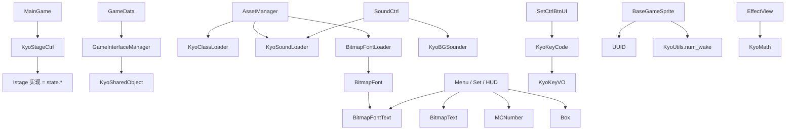

# 引擎 Batch D 索引 — `net.play5d.kyo/**`

Batch A 是主链，B 是配表与战斗实体，C 是屏幕层。本批是 **kyo 工具包**：舞台状态机、位图字体、加载器、键表、SharedObject、杂项数学。`game.bvn` 大量依赖它，自己几乎不往回依赖。

文件清单：[`../_maps/engine-batch-D-files.txt`](../_maps/engine-batch-D-files.txt)（23 个 `.as`）。交叉备忘：[`../_maps/ENGINE-NOTES.md`](../_maps/ENGINE-NOTES.md)。

Batch A：[`00-BATCH-A-INDEX.md`](00-BATCH-A-INDEX.md)。Batch B：[`00-BATCH-B-INDEX.md`](00-BATCH-B-INDEX.md)。Batch C：[`00-BATCH-C-INDEX.md`](00-BATCH-C-INDEX.md)。引擎总索引：[`00-INDEX.md`](00-INDEX.md)。

本批写完后 **`net.play5d` 引擎包 line-by-line 完成**。下一批是 `reverse/line-by-line/fighters`（角色 SWF 时间轴）和 `ui`（UI SWF 脚本），不在本目录。

## 本批接到主链的位置

```
MainGame.initlize
  → new KyoStageCtrl(_rootSprite)
  → goStage(GameLoadingState)          // Istage
GameData.saveData / loadData
  → GameInterfaceManager
       KyoSharedObject.save/load("bvn3_save")
AssetManager.loadBasic
  → KyoSoundLoader.addSound            // 预加载 SFX（ZIP 拉完再登记）
  → KyoClassLoader.addSwf(effect.swf)
  → BitmapFontLoader.addFont(font1)
SoundCtrl.BGM
  → new KyoBGSounder()                 // 不用 KyoBGSounder.I
菜单 / 设置 / HUD
  → BitmapFontText(font1) / BitmapText / MCNumber / Box
设置页键名
  → KyoKeyCode.code2name
BaseGameSprite
  → UUID.create / KyoUtils.num_wake
ZipAssetLoader / GameOverState
  → setFrameOut
```



## 子包总览

| 子包 | 角色 | 本引擎是否主路径 |
|------|------|------------------|
| `kyo.stage` | `goStage` 切 `Istage` | 是。`addLayer` / `IStageFadEffect` 死 |
| `kyo` 根 | SharedObject | 是。槽 `"bvn3_save"` |
| `kyo.display` | 中文 `BitmapText`、HUD `MCNumber` | 是 |
| `kyo.display.bitmap` | BMFont `font1` | 是。HTTP `loadFonts` 死（ZIP `addFont`） |
| `kyo.display.shapes` | 实心 `Box` | 是（对话框 / 快切闸） |
| `kyo.input` | keyCode → 名 | 是。`isDown` 死 |
| `kyo.loader` | 类/声/URL/位图 | 登记 API 活；HTTP `load*` 被 ZIP 绕过 |
| `kyo.sound` | 循环 BGM | 是。静态 `I` 死 |
| `kyo.utils` | 随机 / 阻尼 / 绘图 / UUID / 延帧 | 只用到约 9+4 个符号，`KyoUtils` 其余库存 |

## 舞台

`MainGame.stageCtrl` 是进程内唯一 `KyoStageCtrl`。所有 `goXxx` 同步：`destory` 旧 → `build` → `addChild` → `afterBuild`。同类名默认拒重入；`loadGame` 传 `sameChange=true`。

`CHANGE_STATE` 每次成功切屏都派，本 SWF 无 listener。`addLayer` / `IStageFadEffect` 零实现零调用；转场是 Batch C 的 `TransUI`，不经过 kyo.stage.effect。

`Istage.destory` 带可选回调，给 `buildAfterDestory` 用；`MainGame` 从不传第三参。

## 两套字

| 类 | 用途 | 谁 |
|----|------|-----|
| `BitmapFontText` | 英文/数字位图字，`font1` 图集 | 菜单英文（藏着）、设置、对话框英文、结算分 |
| `BitmapText` | 设备字体光栅化，黑体+发光 | 菜单中文、选人中文名、选地图名 |
| `MCNumber` | 每位一个数字 MC | 连击 / 分数 / 倒计时 |

`AssetManager.initAssets` 把 `font1` 调成 `charGap=-8`、`spaceGap=10`、`offsetY=-5`。

## 加载器在 ZIP 构建下的命运

`bleachvsnaruto.initlize` 设 `ZipAssetLoader`。因此：

| API | 本包运行时 |
|-----|------------|
| `KyoClassLoader.addSwf` / `getClass` | 活。effect.swf |
| `KyoClassLoader.load` | 死 |
| `KyoSoundLoader.addSound` / `getSound` / `unload` | 活 |
| `KyoSoundLoader.loadSounds` / `loadPath` | 死 |
| `BitmapFontLoader.addFont` / `getFont` | 活 |
| `BitmapFontLoader.loadFonts` / `loadFont` | 死 |
| `KyoURLoader.load` | 只在 `AssetLoader`（非 ZIP） |
| `BitmapLoader.load` | 只在死掉的 font HTTP 链 |

战斗 BGM 是 `SoundCtrl` **另一份** `KyoSoundLoader`，与 `AssetManager` 的预加载表分开。

## 拼写（本批新增，全文保留）

Batch A–C 已列：`initlize`、`destory`、`fadIn`/`fadOut`、`confrim`、`GameLoger`、`Mession`、`ACRADE`。

| 名 | 应为 | 出现处 |
|----|------|--------|
| `deletee` | delete | `KyoSharedObject` |
| `_filers` | filters | `BitmapText` |
| `Istage` | IStage | 接口名小写 s |
| `detoryComplete` | destroy | `KyoStageCtrl.goStage` 闭包 |
| `toogle` | toggle | `KyoBGSounder` |
| `N0.name = "O"` | `"0"` | `KyoKeyCode` 主键盘 0 |
| `addZeroBeforNumber` | Before | `KyoUtils` |
| `num_toPersent` | Percent | `KyoUtils` |
| `matchRectangel` | Rectangle | `KyoUtils` |
| `getItemVaribles` | Variables | `KyoUtils` |
| `str_removePrefix` / `getPrefix` | 实际去/取扩展名 | `KyoUtils` 名字反了 |

## 死 / 弱 API

- `KyoStageCtrl.addLayer` / `hasLayer` / `noneLayer` / `removeLayer` / `removeAllLayer` / `clean`：零调用。
- `IStageFadEffect`：无实现。
- `KyoStageEvent.CHANGE_STATE`：有 dispatch，无 listen。
- `KyoBGSounder.I` / `toogle`：`SoundCtrl` 自己 `new`。
- `KyoKeyVO.isDown` / `clone`：从未读写。游戏按键状态在 `GameKeyInput`。
- `KyoKeyCode.SPACE` 不在 `_keyArray`：`code2name(32)` 返回 `null`。
- `KyoKeyCode.N0` 显示成 `"O"`。
- `KyoClassLoader.load` / `KyoSoundLoader.loadSounds` / `KyoURLoader.post` / `getFileType` / `BitmapLoader`：本 ZIP 构建不走。
- `KyoMath` 除 `asRadians`+`getPointByRadians` 外无调用。
- `KyoRandom` 除 `getRandomInArray`+`arraySortRandom` 外无调用。
- `KyoUtils` ~70 个方法里引擎只用 9 个（见该 md 表）。
- `KyoSharedObject.deletee`：无调用。
- `GameOverState.addScore` 找不到 `ct_score` 时 `setFrameOut(..., null)` → 孤儿 Sprite，分数可能永不出现。?

## 清单（23 / 23 done）

路径相对 `reverse/line-by-line/engine/`。源文件相对 `decompiled/main/scripts/`。清单文件 23 行，无空行。

| # | 源 `.as` | 本文 | 状态 |
|---|----------|------|------|
| 1 | `.../kyo/KyoSharedObject.as` | [`kyo/KyoSharedObject.md`](kyo/KyoSharedObject.md) | done |
| 2 | `.../kyo/display/BitmapText.as` | [`kyo/display/BitmapText.md`](kyo/display/BitmapText.md) | done |
| 3 | `.../kyo/display/MCNumber.as` | [`kyo/display/MCNumber.md`](kyo/display/MCNumber.md) | done |
| 4 | `.../kyo/display/bitmap/BitmapFont.as` | [`kyo/display/bitmap/BitmapFont.md`](kyo/display/bitmap/BitmapFont.md) | done |
| 5 | `.../kyo/display/bitmap/BitmapFontLoader.as` | [`kyo/display/bitmap/BitmapFontLoader.md`](kyo/display/bitmap/BitmapFontLoader.md) | done |
| 6 | `.../kyo/display/bitmap/BitmapFontText.as` | [`kyo/display/bitmap/BitmapFontText.md`](kyo/display/bitmap/BitmapFontText.md) | done |
| 7 | `.../kyo/display/shapes/Box.as` | [`kyo/display/shapes/Box.md`](kyo/display/shapes/Box.md) | done |
| 8 | `.../kyo/input/KyoKeyCode.as` | [`kyo/input/KyoKeyCode.md`](kyo/input/KyoKeyCode.md) | done |
| 9 | `.../kyo/input/KyoKeyVO.as` | [`kyo/input/KyoKeyVO.md`](kyo/input/KyoKeyVO.md) | done |
| 10 | `.../kyo/loader/BitmapLoader.as` | [`kyo/loader/BitmapLoader.md`](kyo/loader/BitmapLoader.md) | done |
| 11 | `.../kyo/loader/KyoClassLoader.as` | [`kyo/loader/KyoClassLoader.md`](kyo/loader/KyoClassLoader.md) | done |
| 12 | `.../kyo/loader/KyoSoundLoader.as` | [`kyo/loader/KyoSoundLoader.md`](kyo/loader/KyoSoundLoader.md) | done |
| 13 | `.../kyo/loader/KyoURLoader.as` | [`kyo/loader/KyoURLoader.md`](kyo/loader/KyoURLoader.md) | done |
| 14 | `.../kyo/sound/KyoBGSounder.as` | [`kyo/sound/KyoBGSounder.md`](kyo/sound/KyoBGSounder.md) | done |
| 15 | `.../kyo/stage/Istage.as` | [`kyo/stage/Istage.md`](kyo/stage/Istage.md) | done |
| 16 | `.../kyo/stage/KyoStageCtrl.as` | [`kyo/stage/KyoStageCtrl.md`](kyo/stage/KyoStageCtrl.md) | done |
| 17 | `.../kyo/stage/effect/IStageFadEffect.as` | [`kyo/stage/effect/IStageFadEffect.md`](kyo/stage/effect/IStageFadEffect.md) | done |
| 18 | `.../kyo/stage/events/KyoStageEvent.as` | [`kyo/stage/events/KyoStageEvent.md`](kyo/stage/events/KyoStageEvent.md) | done |
| 19 | `.../kyo/utils/KyoMath.as` | [`kyo/utils/KyoMath.md`](kyo/utils/KyoMath.md) | done |
| 20 | `.../kyo/utils/KyoRandom.as` | [`kyo/utils/KyoRandom.md`](kyo/utils/KyoRandom.md) | done |
| 21 | `.../kyo/utils/KyoUtils.as` | [`kyo/utils/KyoUtils.md`](kyo/utils/KyoUtils.md) | done |
| 22 | `.../kyo/utils/UUID.as` | [`kyo/utils/UUID.md`](kyo/utils/UUID.md) | done |
| 23 | `.../kyo/utils/setFrameOut.as` | [`kyo/utils/setFrameOut.md`](kyo/utils/setFrameOut.md) | done |

未列入：`decompiled/fighters/**`、`decompiled/ui/**` 的 SWF 时间轴脚本。`InsCharVO` 在 `BitmapFont.as` 内，不单独成文件。

## 阅读顺序

1. [`kyo/stage/Istage.md`](kyo/stage/Istage.md) + [`kyo/stage/KyoStageCtrl.md`](kyo/stage/KyoStageCtrl.md) ← Batch A [`MainGame.md`](game/bvn/MainGame.md)
2. [`kyo/KyoSharedObject.md`](kyo/KyoSharedObject.md) ← Batch A [`GameInterfaceManager.md`](game/bvn/web/GameInterfaceManager.md) / Batch B [`GameData.md`](game/bvn/data/GameData.md)
3. [`kyo/display/bitmap/BitmapFont.md`](kyo/display/bitmap/BitmapFont.md) → [`BitmapFontText.md`](kyo/display/bitmap/BitmapFontText.md) / [`BitmapText.md`](kyo/display/BitmapText.md) / [`MCNumber.md`](kyo/display/MCNumber.md)
4. [`kyo/loader/KyoClassLoader.md`](kyo/loader/KyoClassLoader.md) + [`KyoSoundLoader.md`](kyo/loader/KyoSoundLoader.md) ← Batch A [`AssetManager.md`](game/bvn/ctrl/AssetManager.md) / [`SoundCtrl.md`](game/bvn/ctrl/SoundCtrl.md)
5. [`kyo/sound/KyoBGSounder.md`](kyo/sound/KyoBGSounder.md)
6. [`kyo/input/KyoKeyCode.md`](kyo/input/KyoKeyCode.md) ← Batch C [`KeyMapping.md`](game/bvn/ui/KeyMapping.md) / [`SetCtrlBtnUI.md`](game/bvn/ui/SetCtrlBtnUI.md)
7. [`kyo/utils/KyoUtils.md`](kyo/utils/KyoUtils.md) + [`KyoRandom.md`](kyo/utils/KyoRandom.md) + [`UUID.md`](kyo/utils/UUID.md) + [`setFrameOut.md`](kyo/utils/setFrameOut.md)
