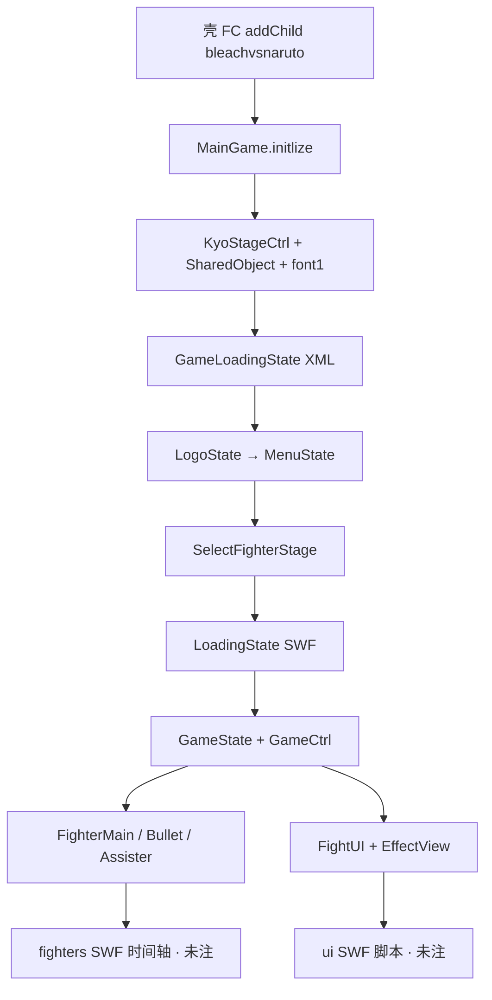

# 引擎 line-by-line 总索引 — `net.play5d` **完成**

壳（GreenHD / `bleachvsnaruto` 交接）在 [`../shell/00-INDEX.md`](../shell/00-INDEX.md)。本目录覆盖 **`decompiled/main/scripts/net/play5d/`** 全部引擎源：`game.bvn.**` + `kyo.**`。

**状态：A+B+C+D 四批均 done。引擎包闭合。** 不包含角色 SWF 时间轴（`decompiled/fighters/**` → 后续 `reverse/line-by-line/fighters`）和 UI SWF 脚本（`decompiled/ui/**` → 后续 `reverse/line-by-line/ui`）。

交叉备忘：[`../_maps/ENGINE-NOTES.md`](../_maps/ENGINE-NOTES.md)（拼写、壳接线、时间倍率；A 批写的，后批沿用）。

## 四批入口

| 批 | 范围 | 文件数 | 索引 |
|----|------|--------|------|
| A | 主链：`MainGame`、ctrl / game_ctrls、state、events、input、interfaces、map、utils、web | 60 | [`00-BATCH-A-INDEX.md`](00-BATCH-A-INDEX.md) |
| B | 配表 + 战斗实体：`data/**`、`fighter/**` | 52 | [`00-BATCH-B-INDEX.md`](00-BATCH-B-INDEX.md) |
| C | 屏幕层：`ui/**`、`views/effects/**` | 46 | [`00-BATCH-C-INDEX.md`](00-BATCH-C-INDEX.md) |
| D | 工具包：`kyo/**` | 23 | [`00-BATCH-D-INDEX.md`](00-BATCH-D-INDEX.md) |
| **合计** | `net.play5d` | **181** | 本文件 |

清单源：[`../_maps/engine-batch-A-files.txt`](../_maps/engine-batch-A-files.txt) … [`engine-batch-D-files.txt`](../_maps/engine-batch-D-files.txt)。

## 从壳到对局

```
AVM2 BleachVSNaruto
  → FM/FA/FB/FC（壳）
  → bleachvsnaruto.initlize
       ZipAssetLoader + MainGame.initlize
  → KyoStageCtrl.goStage(GameLoadingState)     // D
       preload.xml + 五张 XML                   // B models
       AssetManager.loadBasic                  // D loaders + font1
  → goLogo → MenuState                         // A
  → SelectFighterStage                         // A + C select UI
  → LoadingState + GameLoader                  // A：角色/地图 SWF
  → GameState + GameCtrl.startGame             // A + B FighterMain
       GameUI / FightUI                        // C
       EffectCtrl → EffectView*                // C + D KyoMath
```



## 按职责找文件

| 想看 | 去 |
|------|----|
| 切屏 / FPS / `goXxx` | A [`MainGame.md`](game/bvn/MainGame.md) + D [`KyoStageCtrl.md`](kyo/stage/KyoStageCtrl.md) |
| ZIP 资源 | A [`ZipAssetLoader.md`](game/bvn/web/ZipAssetLoader.md) + [`AssetManager.md`](game/bvn/ctrl/AssetManager.md) |
| 存档 | B [`GameData.md`](game/bvn/data/GameData.md) + D [`KyoSharedObject.md`](kyo/KyoSharedObject.md) |
| 模式数字 10–40 | B [`GameMode.md`](game/bvn/data/GameMode.md) |
| 每帧战斗 | A [`GameCtrl.md`](game/bvn/ctrl/game_ctrls/GameCtrl.md) + [`GameMainLogicCtrler.md`](game/bvn/ctrl/game_ctrls/GameMainLogicCtrler.md) |
| 角色实体 | B [`FighterMain.md`](game/bvn/fighter/FighterMain.md) ← A [`BaseGameSprite.md`](game/bvn/interfaces/BaseGameSprite.md) |
| 菜单 / 设置 / HUD | C [`GameUI.md`](game/bvn/ui/GameUI.md) / [`FightUI.md`](game/bvn/ui/fight/FightUI.md) |
| 位图字 / 数字 MC | D [`BitmapFontText.md`](kyo/display/bitmap/BitmapFontText.md) / [`MCNumber.md`](kyo/display/MCNumber.md) |
| BGM | A [`SoundCtrl.md`](game/bvn/ctrl/SoundCtrl.md) + D [`KyoBGSounder.md`](kyo/sound/KyoBGSounder.md) |
| 键名 | D [`KyoKeyCode.md`](kyo/input/KyoKeyCode.md) + C [`KeyMapping.md`](game/bvn/ui/KeyMapping.md) |

## 阅读顺序（整包）

1. 壳 [`../shell/00-INDEX.md`](../shell/00-INDEX.md) → [`../shell/bleachvsnaruto_2.md`](../shell/bleachvsnaruto_2.md)
2. A 主链第 1–3 步（`MainGame` → Loading → Logo/Menu）
3. D 舞台 + 字体 + SharedObject（理解 A 在调什么）
4. B `GameData` / `GameMode` / 五张 XML
5. A 选人 → LoadingState → `GameCtrl`
6. B `FighterMain` 及其 ctrler
7. C HUD / 选人控件 / 特效视图
8. 需要时再下钻 D 的 loader / `KyoUtils` 库存方法

## 刻意未注

- `decompiled/fighters/*/scripts/` — 各角色时间轴与 `$fighter_ctrler`。Batch B 把它们当 callers，不逐文件。
- `decompiled/ui/*/scripts/` — `common_ui` / `fight` / `select` 等 SWF 导出类。Batch C 当槽位引用。
- `import-*` / `import-noload` 等平行树：不是本批源。源只认 `decompiled/main/scripts/`。

改 `.as` **不会**写回播放用 SWF。`MainGame.VERSION` 现场 `V3.3-REV`，ABC 字符串池仍是 `V3.3`。
