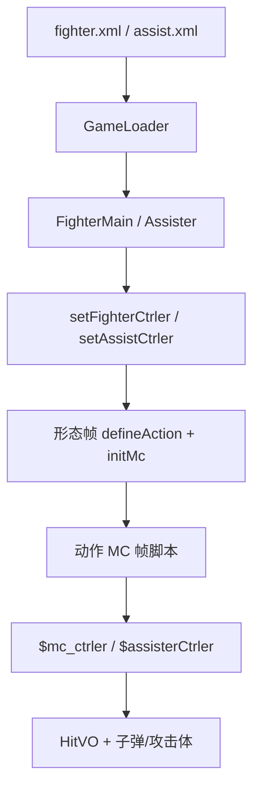

# 角色 SWF Batch A 索引 — aizen / byakuya / chad / didala + `fz/**`

引擎 line-by-line（`net.play5d`）已闭合，见 [`../engine/00-INDEX.md`](../engine/00-INDEX.md)。本批开始注 **角色与助战 SWF 时间轴**（`decompiled/fighters/`），不改 `decompiled/`、不播放/重打包 SWF。

文件清单：[`../_maps/fighters-batch-A-files.txt`](../_maps/fighters-batch-A-files.txt)（73 个 `.as`）。总索引：[`00-INDEX.md`](00-INDEX.md)。B–G 未开始。

## 本批是什么

| 块 | XML | SWF | 本批 `.as` | 注 |
|---|---|---|---|---|
| 蓝染·惣右介 | `aizen` | `assets/fighter/aizen.swf` | 10 | 斩防、speed 13 |
| 朽木·白哉 / 卍解 | `byakuya` sf=1、`byakuya_wanjie` sf=2 | `assets/fighter/byakuya.swf` | 9 | 同一 SWF 两形态；无 `snd_*` |
| 茶渡·泰虎 | `chad` | `assets/fighter/chad.swf` | 5 | 拳防、speed 6、heavy 5 |
| 迪达拉 | `didala` | `assets/fighter/didala.swf` | 6 | comic_type=1；大量 FIRE |
| 助战 `fz/**` | `assist.xml` 35 条 + 遗留 `soifong` | `assets/fighter/fz/*.swf` | 43 | 不是主战花名册 |

引擎加载：`GameLoader.loadFighter` / `loadAssister` → `new FighterMain(mc)` / `new Assister(mc)`。形态：`FighterMain.initlize` 里 `_mainMc.gotoAndStop(data.startFrame+1)`，所以 XML `startFrame="1"` 跑的是时间轴 **第 2 帧**。

交叉：[`FighterMain`](../engine/game/bvn/fighter/FighterMain.md)、[`FighterCtrler`](../engine/game/bvn/fighter/ctrler/FighterCtrler.md)、[`FighterMcCtrler`](../engine/game/bvn/fighter/ctrler/FighterMcCtrler.md)、[`Assister`](../engine/game/bvn/fighter/Assister.md)、[`AssisiterCtrler`](../engine/game/bvn/fighter/ctrler/AssisiterCtrler.md)、[`HitVO`](../engine/game/bvn/fighter/models/HitVO.md)、[`FighterHitRange`](../engine/game/bvn/fighter/FighterHitRange.md)、[`FighterMC`](../engine/game/bvn/fighter/FighterMC.md)。

## 共享时间轴模式

### 可玩角色根时间轴

每个可玩 SWF 文档类 `*_fla.MainTimeline`：

```
FighterMain.initlize
  new FighterCtrler
  mainMc.setFighterCtrler(ctrler)     → $fighter_ctrler，defineAction 别名
  ctrler.initFighter
    setEffectCtrler / setFighterMcCtrler
  gotoAndStop(startFrame+1)           → frame2（或白哉 F3）
    if (!$fighter_ctrler) return
    defineAction(id, HitVO 字面量) × N
    defineBishaFace / defineHurtSound*
    speed / jumpPower / heavy / defenseType
    initMc(this.mc)                   → 内部动作 MC 交给 FighterMC
```

`defineAction` 第一参是 HitVO `id`（`tk`/`k1`/`zh1`/`bs`/`sbs`/`cbs`/`sh1`…），**不是** 帧标签。帧标签在动作 MC 上，由 `setAttack("砍2")` 一类写入 `FighterAction`。

| id 前缀 | 含义 |
|---|---|
| `tk` / `tz` | 跳轻 / 跳重 |
| `k1`… | 地面普攻段 |
| `kj*` | 空中技 |
| `zh*` | 招 1/2/3 |
| `bs` / `sbs` / `kbs` / `cbs` | 必杀 / 上必 / 空必 / 超必（id 含 `bs` → `HitVO.isBisha`） |
| `sh1`/`sh2` | 抓（hitType 11 + isBreakDef → `isCatch`）；`sh12`/`sh22` 是伤害段 |

`defenseType`：0 斩防（蓝染），1 拳防（白哉/茶渡/迪达拉）。

### 动作 MC（`*全动作*` / `Timeline_1` / `sprite631`）

根时间轴的 `this.mc`。脚本走 **`parent.$mc_ctrler`**（`FighterMcCtrler`）、`parent.$effect_ctrler`、偶发 `parent.$fighter_ctrler`。

`FighterMC.renderChildren` **跳过** 名为 `AImain`、`bdmn`、名字含 `atm` 的子剪辑（当盒子，不自动 `nextFrame`）。

Flash 帧标签 **不在** 反编译 AS 里，只留下 `addFrameScript` 数字。注里按帧号分段，标签名从 `setAttack`/`loop`/`gotoAndPlay`/`justHitToPlay` 字符串回推。

典型段序：走 `loop("走")` → 冲刺 `dash` → 回 `idle` → 普攻 `setAttack("砍N")` 中间 `endAct` → 招/必杀 `bisha`/`addAttacker`/`fire` → 胜负 `stop()`。

本批类名坑：

- 白哉、茶渡的动作类都叫 `一护万解全动作_1`（一护 FLA 模板残留）。
- 白哉始解那份 **有** `doWanKai()`；茶渡没有。
- 白哉卍解动作是 `sprite631_14`。
- 迪达拉动作类叫 `Timeline_1`。

### AI 面

实例名 `AImain`。`FighterMC.initHitRange`：`gotoAndStop(2)` → 按 `FighterHitRange.getALL()` 取 `*mian` bounds → 停回第 1 帧并隐藏。`frame1` 只有 `stop()`。缺某个 `*mian` = 该招没有独立 AI 盒。

| 元件 | 范围 |
|---|---|
| `tkanmian` / `tzmian` | 跳轻 / 跳重 |
| `kanmian` | 地面轻 |
| `kj1mian` / `kj2mian` | 下攻 / 上攻 |
| `zh1mian`…`zh3mian` | 三招 |
| `bsmian` / `sbsmian` / `kbsmian` / `cbsmian` | 必杀 / 上必 / 空必 / 超必 |

白哉缺 `kbsmian`（两份 AI 面都缺）。迪达拉类名是 `AI_2` 不是 `AI面*`。

### 必杀脸 / 受击音

- `bsfaceN extends BitmapData`：无名包 + Embed PNG。`defineBishaFace("蓝染1", bsface1)` 只存 Class。
- `snd_hurt1 extends Sound`：Embed MP3。`defineHurtSound` / `Fly` / `Die` 三路常共用同一个 Class。
- **白哉本批没有 `snd_*`**，两形态都不调 `defineHurtSound`。

### 空 `元件*`

无 ctrler、无判定盒，末帧 `stop()`。作为刀光/特效子时间轴，由 `renderChildren` 推进。

### 助战 `fz/**`

文档类同样 `MainTimeline`，但入口是 `setAssistCtrler` → `$assisterCtrler` → 立刻 `defineActions()`。`Assister.goFight()` 从第 2 帧播。HitVO id 习惯 `atm1`…。打中按子件 **name** 查模型（与角色 `getHitVOByDisplayName` 不同）。

`Assister.renderAnimate` 播到 `totalFrames-1` 自动 `finish(true)`。时间轴也可提前 `endAct`（只关 `isAttacking`）或 `finish(false)`（退场不播收招闪光）。

XML 笔误：助战 id `garra` → 文件 `gaara.swf`；id `halibel` → 文件 `harribel.swf`。`fz/soifong` **不在** 现行 `assist.xml`（碎蜂旧档，与 `soifon` 几乎同构）。



## 可玩四人要点

| 角色 | speed / jump / heavy / 防 | 必杀脸 | 语音 | 动作 MC |
|---|---|---|---|---|
| 蓝染 | 13 / 15 / 3 / 斩 | `蓝染1` `蓝染2` | `snd_hurt1` ×3 | [`蓝染全动作_1`](aizen/scripts/aizen_fla/蓝染全动作_1.md) 113 脚本帧 |
| 白哉 F2 | 10 / 15 / 3 / 拳 | `白哉1..3` | 无 | [`一护万解全动作_1`](byakuya/scripts/byakuya_fla/一护万解全动作_1.md) + `doWanKai` |
| 白哉 F3 卍解 | 13 / 17 / 3 / 拳 | 同上 | 无 | [`sprite631_14`](byakuya/scripts/byakuya_fla/sprite631_14.md) |
| 茶渡 | 6 / 15 / 5 / 拳 | `茶渡` | `snd_hurt1` ×3 | [`一护万解全动作_1`](chad/scripts/chad_fla/一护万解全动作_1.md)（无万解） |
| 迪达拉 | 10 / 16 / 3 / 拳 | `迪达拉1` `迪达拉2` | `snd_hurt1` ×3 | [`Timeline_1`](didala/scripts/didala_fla/Timeline_1.md) |

蓝染必杀：F779/F891 `bisha(..., "蓝染1")`，F1212 `bisha(true, "蓝染2")`；攻击体 `dk`、`bsmc`；抓人跟随 `move_mc`。

## 助战一览（`fz/`）

API 列是时间轴里实际出现的调用，不是 XML。

| 目录 | 中文 | 脚本帧 | HitVO | 特点 |
|---|---|---|---|---|
| [byakuya](fz/byakuya/scripts/byakuya_fla/MainTimeline.md) | 朽木·白哉 | 9 | atm1 抓 | 攻击体 `lzgl` 六杖光牢；听目标 state==21 |
| [gaara](fz/gaara/scripts/gaara_fla/MainTimeline.md) | 我爱罗 | 4 | atm1 | addAttacker + moveToTarget |
| [grimmjow](fz/grimmjow/scripts/grimmjow_fla/MainTimeline.md) | 葛力姆乔 | 7 | atm1–3 | |
| [harribel](fz/harribel/scripts/harribel_fla/MainTimeline.md) | 赫丽贝尔 | 7 | atm1 | |
| [hinata](fz/hinata/scripts/hinata_fla/MainTimeline.md) | 雏田 | 5 | atm1 | |
| [ichigo_padipata](fz/ichigo_padipata/scripts/ichigo_padipata_fla/MainTimeline.md) | 一护修行 | 4 | atm1 | |
| [ichigo_white2](fz/ichigo_white2/scripts/ichigo_white2_fla/MainTimeline.md) | 一护虚二段 | 11 | atm1–3 | justHit + finish |
| [ino](fz/ino/scripts/ino_fla/MainTimeline.md) | 井野 | 6 | atm1 | |
| [itachi](fz/itachi/scripts/itachi_fla/MainTimeline.md) | 鼬 | 14 | atm1–3 | 本批助战脚本帧最多之一 |
| [jiraiya](fz/jiraiya/scripts/jiraiya_fla/MainTimeline.md) | 自来也 | 7 | atm1–2 | |
| [kenpachi](fz/kenpachi/scripts/kenpachi_fla/MainTimeline.md) | 剑八 | 5 | atm1 | |
| [kimimaro](fz/kimimaro/scripts/kimimaro_fla/MainTimeline.md) | 君麻吕 | 8 | atm1 | |
| [kon](fz/kon/scripts/kon_fla/MainTimeline.md) | 魂 | 5 | atm1 | 给主人 `getBuffCtrl` |
| [madara](fz/madara/scripts/madara_fla/MainTimeline.md) | 斑 | 6 | atm1–3 | 攻击体 `Timeline_2` |
| [minato](fz/minato/scripts/minato_fla/MainTimeline.md) | 四代 | 17 | atm1–5 | 本批助战最长；残影+justHit |
| [nemu](fz/nemu/scripts/nemu_fla/MainTimeline.md) | 涅音梦 | 11 | atm1–2 | |
| [obito](fz/obito/scripts/obito_fla/MainTimeline.md) | 带土 | 7 | atm1 | |
| [orihime](fz/orihime/scripts/orihime_fla/MainTimeline.md) | 织姬 | 16 | atm1 空 | `checkHitOwner("main")` 连段 `addHp(10)` |
| [rangiku](fz/rangiku/scripts/rangiku_fla/MainTimeline.md) | 乱菊 | 4 | atm1 | addAttacker |
| [sai](fz/sai/scripts/sai_fla/MainTimeline.md) | 佐井 | 6 | atm1 | addAttacker + buff |
| [shikamaru](fz/shikamaru/scripts/shikamaru_fla/MainTimeline.md) | 鹿丸 | 8 | atm1 | 攻击体 `元件3_2` |
| [shishio](fz/shishio/scripts/shishio_fla/MainTimeline.md) | 志志雄 | 10 | atm1–3 | 交叉角色 |
| [soifon](fz/soifon/scripts/soifon_fla/MainTimeline.md) | 碎蜂 | 5 | atm1 FIRE 破防 | `fire("atm1")` |
| [soifong](fz/soifong/scripts/soifong_fla/MainTimeline.md) | 碎蜂遗留 | 5 | 同 soifon | **XML 未引用** |
| [stake](fz/stake/scripts/stake_fla/MainTimeline.md) | 托尼·斯塔克 | 7 | atm1–3 | 交叉角色 |
| [suigetsu](fz/suigetsu/scripts/suigetsu_fla/MainTimeline.md) | 水月 | 7 | atm1–2 | |
| [temari](fz/temari/scripts/temari_fla/MainTimeline.md) | 手鞠 | 7 | atm1 | fire |
| [tenten](fz/tenten/scripts/tenten_fla/MainTimeline.md) | 天天 | 10 | atm1–2 | fire |
| [tsuchikage](fz/tsuchikage/scripts/tsuchikage_fla/MainTimeline.md) | 土影 | 6 | atm1–3 | buff |
| [tsunate](fz/tsunate/scripts/tsunate_fla/MainTimeline.md) | 纲手 | 12 | atm1 | `checkHitOwner` + `addHp`（治疗向，无 bisha） |
| [uryuu](fz/uryuu/scripts/uryuu_fla/MainTimeline.md) | 雨龙 | 6 | atm1 | |
| [yachiru](fz/yachiru/scripts/yachiru_fla/MainTimeline.md) | 八千流 | 8 | atm1 | |
| [yamamoto](fz/yamamoto/scripts/yamamoto_fla/MainTimeline.md) | 山本 | 5 | atm1 | |
| [yin](fz/yin/scripts/yin_fla/MainTimeline.md) | 市丸银 | 5 | atm1 | |
| [yoruichi](fz/yoruichi/scripts/yoruichi_fla/MainTimeline.md) | 夜一 | 2 | atm1 全 0 | 闪光 + `moveOnce(120)` + `speedUp(5,5)`；最短 |

夜一 `atm1` power/hitType 全 0：助战本体不打人，只给主人加速。织姬/纲手走治疗：`checkHitOwner` 打中主人才 `addHp`。

## 清单（73/73 done）

### aizen（10）

- [x] [`aizen/scripts/aizen_fla/AI面_2.md`](aizen/scripts/aizen_fla/AI面_2.md)
- [x] [`aizen/scripts/aizen_fla/MainTimeline.md`](aizen/scripts/aizen_fla/MainTimeline.md)
- [x] [`aizen/scripts/aizen_fla/元件15_7.md`](aizen/scripts/aizen_fla/元件15_7.md)
- [x] [`aizen/scripts/aizen_fla/元件18_8.md`](aizen/scripts/aizen_fla/元件18_8.md)
- [x] [`aizen/scripts/aizen_fla/元件32_12.md`](aizen/scripts/aizen_fla/元件32_12.md)
- [x] [`aizen/scripts/aizen_fla/元件92_14.md`](aizen/scripts/aizen_fla/元件92_14.md)
- [x] [`aizen/scripts/aizen_fla/蓝染全动作_1.md`](aizen/scripts/aizen_fla/蓝染全动作_1.md)
- [x] [`aizen/scripts/bsface1.md`](aizen/scripts/bsface1.md)
- [x] [`aizen/scripts/bsface2.md`](aizen/scripts/bsface2.md)
- [x] [`aizen/scripts/snd_hurt1.md`](aizen/scripts/snd_hurt1.md)

### byakuya（9）

- [x] [`byakuya/scripts/bsface1.md`](byakuya/scripts/bsface1.md)
- [x] [`byakuya/scripts/bsface2.md`](byakuya/scripts/bsface2.md)
- [x] [`byakuya/scripts/bsface3.md`](byakuya/scripts/bsface3.md)
- [x] [`byakuya/scripts/byakuya_fla/AI面副本2_15.md`](byakuya/scripts/byakuya_fla/AI面副本2_15.md)
- [x] [`byakuya/scripts/byakuya_fla/AI面副本_2.md`](byakuya/scripts/byakuya_fla/AI面副本_2.md)
- [x] [`byakuya/scripts/byakuya_fla/MainTimeline.md`](byakuya/scripts/byakuya_fla/MainTimeline.md)
- [x] [`byakuya/scripts/byakuya_fla/sprite631_14.md`](byakuya/scripts/byakuya_fla/sprite631_14.md)
- [x] [`byakuya/scripts/byakuya_fla/一护万解全动作_1.md`](byakuya/scripts/byakuya_fla/一护万解全动作_1.md)
- [x] [`byakuya/scripts/byakuya_fla/元件6_21.md`](byakuya/scripts/byakuya_fla/元件6_21.md)

### chad（5）

- [x] [`chad/scripts/bsface1.md`](chad/scripts/bsface1.md)
- [x] [`chad/scripts/chad_fla/AI面副本_2.md`](chad/scripts/chad_fla/AI面副本_2.md)
- [x] [`chad/scripts/chad_fla/MainTimeline.md`](chad/scripts/chad_fla/MainTimeline.md)
- [x] [`chad/scripts/chad_fla/一护万解全动作_1.md`](chad/scripts/chad_fla/一护万解全动作_1.md)
- [x] [`chad/scripts/snd_hurt1.md`](chad/scripts/snd_hurt1.md)

### didala（6）

- [x] [`didala/scripts/bsface1.md`](didala/scripts/bsface1.md)
- [x] [`didala/scripts/bsface2.md`](didala/scripts/bsface2.md)
- [x] [`didala/scripts/didala_fla/AI_2.md`](didala/scripts/didala_fla/AI_2.md)
- [x] [`didala/scripts/didala_fla/MainTimeline.md`](didala/scripts/didala_fla/MainTimeline.md)
- [x] [`didala/scripts/didala_fla/Timeline_1.md`](didala/scripts/didala_fla/Timeline_1.md)
- [x] [`didala/scripts/snd_hurt1.md`](didala/scripts/snd_hurt1.md)

### fz（43）

- [x] [`fz/byakuya/scripts/byakuya_fla/MainTimeline.md`](fz/byakuya/scripts/byakuya_fla/MainTimeline.md)
- [x] [`fz/byakuya/scripts/byakuya_fla/六杖光牢_2.md`](fz/byakuya/scripts/byakuya_fla/六杖光牢_2.md)
- [x] [`fz/gaara/scripts/gaara_fla/MainTimeline.md`](fz/gaara/scripts/gaara_fla/MainTimeline.md)
- [x] [`fz/grimmjow/scripts/grimmjow_fla/MainTimeline.md`](fz/grimmjow/scripts/grimmjow_fla/MainTimeline.md)
- [x] [`fz/harribel/scripts/harribel_fla/MainTimeline.md`](fz/harribel/scripts/harribel_fla/MainTimeline.md)
- [x] [`fz/hinata/scripts/hinata_fla/MainTimeline.md`](fz/hinata/scripts/hinata_fla/MainTimeline.md)
- [x] [`fz/ichigo_padipata/scripts/ichigo_padipata_fla/MainTimeline.md`](fz/ichigo_padipata/scripts/ichigo_padipata_fla/MainTimeline.md)
- [x] [`fz/ichigo_white2/scripts/ichigo_white2_fla/MainTimeline.md`](fz/ichigo_white2/scripts/ichigo_white2_fla/MainTimeline.md)
- [x] [`fz/ichigo_white2/scripts/ichigo_white2_fla/Timeline_4.md`](fz/ichigo_white2/scripts/ichigo_white2_fla/Timeline_4.md)
- [x] [`fz/ino/scripts/ino_fla/MainTimeline.md`](fz/ino/scripts/ino_fla/MainTimeline.md)
- [x] [`fz/itachi/scripts/itachi_fla/MainTimeline.md`](fz/itachi/scripts/itachi_fla/MainTimeline.md)
- [x] [`fz/jiraiya/scripts/jiraiya_fla/MainTimeline.md`](fz/jiraiya/scripts/jiraiya_fla/MainTimeline.md)
- [x] [`fz/kenpachi/scripts/kenpachi_fla/MainTimeline.md`](fz/kenpachi/scripts/kenpachi_fla/MainTimeline.md)
- [x] [`fz/kimimaro/scripts/kimimaro_fla/MainTimeline.md`](fz/kimimaro/scripts/kimimaro_fla/MainTimeline.md)
- [x] [`fz/kon/scripts/kon_fla/MainTimeline.md`](fz/kon/scripts/kon_fla/MainTimeline.md)
- [x] [`fz/madara/scripts/madara_fla/MainTimeline.md`](fz/madara/scripts/madara_fla/MainTimeline.md)
- [x] [`fz/madara/scripts/madara_fla/Timeline_2.md`](fz/madara/scripts/madara_fla/Timeline_2.md)
- [x] [`fz/minato/scripts/minato_fla/MainTimeline.md`](fz/minato/scripts/minato_fla/MainTimeline.md)
- [x] [`fz/nemu/scripts/nemu_fla/MainTimeline.md`](fz/nemu/scripts/nemu_fla/MainTimeline.md)
- [x] [`fz/obito/scripts/obito_fla/MainTimeline.md`](fz/obito/scripts/obito_fla/MainTimeline.md)
- [x] [`fz/orihime/scripts/orihime_fla/MainTimeline.md`](fz/orihime/scripts/orihime_fla/MainTimeline.md)
- [x] [`fz/rangiku/scripts/rangiku_fla/MainTimeline.md`](fz/rangiku/scripts/rangiku_fla/MainTimeline.md)
- [x] [`fz/sai/scripts/sai_fla/MainTimeline.md`](fz/sai/scripts/sai_fla/MainTimeline.md)
- [x] [`fz/shikamaru/scripts/shikamaru_fla/MainTimeline.md`](fz/shikamaru/scripts/shikamaru_fla/MainTimeline.md)
- [x] [`fz/shikamaru/scripts/shikamaru_fla/元件3_2.md`](fz/shikamaru/scripts/shikamaru_fla/元件3_2.md)
- [x] [`fz/shishio/scripts/shishio_fla/MainTimeline.md`](fz/shishio/scripts/shishio_fla/MainTimeline.md)
- [x] [`fz/shishio/scripts/shishio_fla/元件3_2.md`](fz/shishio/scripts/shishio_fla/元件3_2.md)
- [x] [`fz/soifon/scripts/soifon_fla/MainTimeline.md`](fz/soifon/scripts/soifon_fla/MainTimeline.md)
- [x] [`fz/soifon/scripts/soifon_fla/元件511_5.md`](fz/soifon/scripts/soifon_fla/元件511_5.md)
- [x] [`fz/soifong/scripts/soifong_fla/MainTimeline.md`](fz/soifong/scripts/soifong_fla/MainTimeline.md)
- [x] [`fz/soifong/scripts/soifong_fla/元件511_5.md`](fz/soifong/scripts/soifong_fla/元件511_5.md)
- [x] [`fz/stake/scripts/stake_fla/MainTimeline.md`](fz/stake/scripts/stake_fla/MainTimeline.md)
- [x] [`fz/suigetsu/scripts/suigetsu_fla/MainTimeline.md`](fz/suigetsu/scripts/suigetsu_fla/MainTimeline.md)
- [x] [`fz/temari/scripts/temari_fla/MainTimeline.md`](fz/temari/scripts/temari_fla/MainTimeline.md)
- [x] [`fz/tenten/scripts/tenten_fla/MainTimeline.md`](fz/tenten/scripts/tenten_fla/MainTimeline.md)
- [x] [`fz/tsuchikage/scripts/tsuchikage_fla/MainTimeline.md`](fz/tsuchikage/scripts/tsuchikage_fla/MainTimeline.md)
- [x] [`fz/tsunate/scripts/tsunate_fla/MainTimeline.md`](fz/tsunate/scripts/tsunate_fla/MainTimeline.md)
- [x] [`fz/uryuu/scripts/uryuu_fla/MainTimeline.md`](fz/uryuu/scripts/uryuu_fla/MainTimeline.md)
- [x] [`fz/yachiru/scripts/yachiru_fla/MainTimeline.md`](fz/yachiru/scripts/yachiru_fla/MainTimeline.md)
- [x] [`fz/yamamoto/scripts/yamamoto_fla/MainTimeline.md`](fz/yamamoto/scripts/yamamoto_fla/MainTimeline.md)
- [x] [`fz/yin/scripts/yin_fla/MainTimeline.md`](fz/yin/scripts/yin_fla/MainTimeline.md)
- [x] [`fz/yin/scripts/yin_fla/元件36_2.md`](fz/yin/scripts/yin_fla/元件36_2.md)
- [x] [`fz/yoruichi/scripts/yoruichi_fla/MainTimeline.md`](fz/yoruichi/scripts/yoruichi_fla/MainTimeline.md)

剩余：0。
