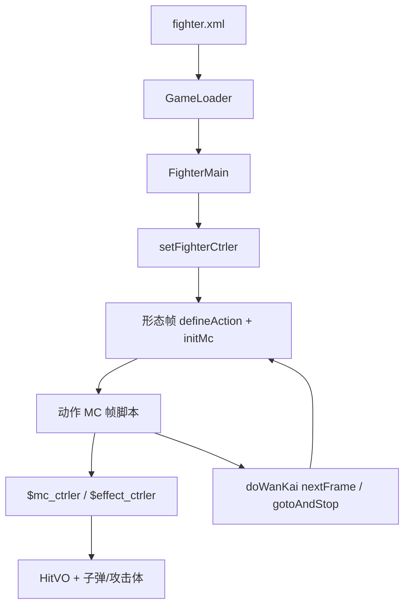

# 角色 SWF Batch B 索引 — gaara / grimmjow / ichigo / ichigo_zero

引擎 line-by-line（`net.play5d`）已闭合，见 [`../engine/00-INDEX.md`](../engine/00-INDEX.md)。本批继续注 **主战角色 SWF 时间轴**（`decompiled/fighters/`），不改 `decompiled/`、不播放/重打包 SWF。不注 `fz/`（A 批已收）。

文件清单：[`../_maps/fighters-batch-B-files.txt`](../_maps/fighters-batch-B-files.txt)（67 个 `.as`）。总索引：[`00-INDEX.md`](00-INDEX.md)。C–G 未开始。

## 本批是什么

| 块 | XML | SWF | 本批 `.as` | 注 |
|---|---|---|---|---|
| 我爱罗 | `gaara` sf=1 | `assets/fighter/gaara.swf` | 9 | 拳防、speed 8、heavy 4；动作类名 `Timeline_1` |
| 葛力姆乔·贾卡杰克 | `grimmjow` sf=1 | `assets/fighter/grimmjow.swf` | 11 | 未写 defenseType→默认斩；动作类名误作 `一护全动作_1` |
| 黑崎·一护 / 卍解 / 半虚 / 虚化 | `ichigo` sf=1、`ichigo_wanjie` sf=2、`ichigo_xuhua_half` sf=3、`ichigo_xuhua` sf=4 | `assets/fighter/ichigo.swf` | 23 | 同一 SWF 四形态；脸键 `一户*`（户≠护） |
| 黑崎·一护 零段 / 内虚 / 内虚卍解 | `ichigo_zero` sf=1、`ichigo_neixu` sf=2、`ichigo_neixu_wanjie` sf=3 | `assets/fighter/ichigo_zero.swf` | 24 | 根上 `wanKai`；白一护 `defineHurtSound(null)` |

引擎加载：`GameLoader.loadFighter` → `new FighterMain(mc)`。形态：`FighterMain.initlize` 里 `_mainMc.gotoAndStop(data.startFrame+1)`，所以 XML `startFrame="1"` 跑的是时间轴 **第 2 帧**。

交叉：[`FighterMain`](../engine/game/bvn/fighter/FighterMain.md)、[`FighterCtrler`](../engine/game/bvn/fighter/ctrler/FighterCtrler.md)、[`FighterMcCtrler`](../engine/game/bvn/fighter/ctrler/FighterMcCtrler.md)、[`HitVO`](../engine/game/bvn/fighter/models/HitVO.md)、[`FighterHitRange`](../engine/game/bvn/fighter/FighterHitRange.md)、[`FighterMC`](../engine/game/bvn/fighter/FighterMC.md)、[`FighterAttacker`](../engine/game/bvn/fighter/FighterAttacker.md)。

## 共享时间轴模式

与 A 批相同的根时间轴骨架：

```
FighterMain.initlize
  new FighterCtrler
  mainMc.setFighterCtrler(ctrler)     → $fighter_ctrler，defineAction 别名（葛力姆乔/一护未别名）
  ctrler.initFighter
    setEffectCtrler / setFighterMcCtrler
  gotoAndStop(startFrame+1)           → frame2（一护可到 F5；零段到 F4）
    if (!$fighter_ctrler) return
    defineAction(id, HitVO 字面量) × N
    defineBishaFace / defineHurtSound*
    speed / jumpPower / heavy / defenseType
    initMc(this.mc)                   → 内部动作 MC 交给 FighterMC
```

`defineAction` 第一参是 HitVO `id`（`tk`/`k1`/`zh1`/`bs`/`sbs`/`cbs`/`sh1`…），**不是** 帧标签。帧标签在动作 MC 上，由 `setAttack("砍2")` 一类写入 `FighterAction`。

| id 前缀 | 含义 |
|---|---|
| `tk` / `tz` | 跳轻 / 跳重 |
| `k1`… | 地面普攻段 |
| `kj*` | 空中技 |
| `zh*` | 招 1/2/3 |
| `bs` / `sbs` / `kbs` / `cbs` | 必杀 / 上必 / 空必 / 超必（id 含 `bs` → `HitVO.isBisha`） |
| `sh1`/`sh2` | 抓（hitType 11 + isBreakDef → `isCatch`）；`sh12`/`sh22` 是伤害段 |

本批 `defenseType`：我爱罗写 1 拳防；零段三形态写 0 斩防；葛力姆乔与一护四形态 **未写** → `FighterMain.defenseType` 默认 0 斩防。

### 动作 MC（`*全动作*` / `Timeline_1`）

根时间轴的 `this.mc`。脚本走 **`parent.$mc_ctrler`**（`FighterMcCtrler`）、`parent.$effect_ctrler`、偶发 `parent.$fighter_ctrler`。

`FighterMC.renderChildren` **跳过** 名为 `AImain`、`bdmn`、名字含 `atm` 的子剪辑（当盒子，不自动 `nextFrame`）。

Flash 帧标签 **不在** 反编译 AS 里，只留下 `addFrameScript` 数字。注里按帧号分段，标签名从 `setAttack`/`loop`/`gotoAndPlay`/`justHitToPlay` 字符串回推。

典型段序：走 `loop("走")` → 冲刺 `dash` → 回 `idle` → 普攻 `setAttack("砍N")` 中间 `endAct` → 招/必杀 `bisha`/`addAttacker`/`fire` → 胜负 `stop()`。

本批类名坑：

- 葛力姆乔动作类叫 `一护全动作_1`（一护 FLA 模板残留），**没有** `doWanKai`。
- 我爱罗动作类叫 `Timeline_1`（与迪达拉同类名习惯）。
- 一护四形态各一份动作 MC；零段三形态各一份。白一护那份最长（118 脚本帧）。

### 万解 / 切形态

[`FighterCtrler.doWanKai`](../engine/game/bvn/fighter/ctrler/FighterCtrler.md)：`param=0` 则根 MC `nextFrame()`，否则 `gotoAndStop(param)`。`_doingWankai` 让下一回 `initMc` 走开场而不是 idle。

| 源 | 调用 | 落到 |
|---|---|---|
| 一护始解 `一护全动作_1` | `doWanKai()` | F3 卍解 |
| 同上 | `doWanKai(4)` | F4 半虚 |
| 一护卍解 `一护万解全动作_15` | `doWanKai(5)` | F5 虚化 |
| 一护半虚 `一护全动作_30` | `doWanKai()` | F5 虚化 |
| 零段 `一护全动作_1` | `parent.wanKai=true` 后 `doWanKai()` | F3 内虚 |
| 白一护 `白一护全动作_11` | `doWanKai()` | F4 内虚卍解 |

万解演出用 `$effect_ctrler.startWanKai` / `endWanKai`。一护脸键写成 **`一户万解`**（户）。

### AI 面

实例名 `AImain`。`FighterMC.initHitRange`：`gotoAndStop(2)` → 按 `FighterHitRange.getALL()` 取 `*mian` bounds → 停回第 1 帧并隐藏。`frame1` 只有 `stop()`。缺某个 `*mian` = 该招没有独立 AI 盒。

| 角色 | AI 类 | 缺 |
|---|---|---|
| 我爱罗 | `AI_2`（不是 `AI面*`） | `kbsmian`（本角色无空必 HitVO） |
| 葛力姆乔 | `AI面_2` | `sbsmian`（本角色无上必 HitVO）；**有** `kbsmian` |
| 一护 | `AI面_2`、`AI面副本_16`、`AI面_31` | 前两份缺 `kbsmian`；`AI面_31` 有 |
| 零段 | `AI面_2`、`AI面2_12`、`AI面副本_30` | 三份都缺 `kbsmian` |

哪一形态绑哪一份 AI 面要从 FLA 实例推断，AS 里看不到。

### 必杀脸 / 受击音

- `bsfaceN extends BitmapData`：无名包 + Embed PNG。`defineBishaFace` 只存 Class。我爱罗/一护/零段默认 168×119；葛力姆乔 170×120。
- `snd_hurt*` / `snd_die` extends Sound：Embed MP3。`defineHurtSound` / `Fly` / `Die` 可 rest 多个 Class。
- 葛力姆乔分轨：受击 `snd_hurt4,snd_hurt3`，击飞 `snd_hurt1,snd_hurt2`，死亡 `snd_die`。
- 一护半虚/虚化死亡用 `snd_hurt2` 不是 `snd_die`。
- 零段内虚：`defineHurtSound(null)`，击飞/死亡 `snd_hurt_ogihci_1`（ichigo 倒写）。
- `wksound` / `kcsound`：零段白一护开场按 `parent.wanKai` 自己 `new` 并 `play()`。一护 SWF 也导出了 `wksound`，动作 MC **未** `new`（? 库残留）。

### 攻击体 / 空 `元件*`

我爱罗 `Timeline_7`/`Timeline_9`/`Timeline_11`、零段 `必杀效果_20`/`必杀效果副本_23`：`setAttackerCtrler` 接 `$attacker_ctrler`。砂缚棺 `zzzz` 会 `target.visible=false` 把对手藏进砂里，收招再显出来。

`sprite185_56`、`元件7_35`、`招1刀光副本_38`：无 ctrler。刀光那份在 F1 `stop()` 并写 `movspeed=30` / `played=0`，时间轴未再读。



## 可玩要点

| 角色 | speed / jump / heavy / 防 | 必杀脸 | 语音 | 动作 MC |
|---|---|---|---|---|
| 我爱罗 | 8 / 15 / 4 / 拳 | `我爱罗1` `我爱罗2` | `snd_hurt1` ×3 | [`Timeline_1`](gaara/scripts/gaara_fla/Timeline_1.md) 88 脚本帧 |
| 葛力姆乔 | 12 / 15 / 3 / 斩（默认） | `葛力姆乔1..3` | hurt4+3 / fly1+2 / die | [`一护全动作_1`](grimmjow/scripts/grimmjow_fla/一护全动作_1.md) 94 |
| 一护 F2 | 6 / 15 / 3 / 斩（默认） | `一户1` `一户2` `一户万解` `一户万解1` | hurt2+1 / fly1 / die | [`一护全动作_1`](ichigo/scripts/ichigo_fla/一护全动作_1.md) 87 |
| 一护 F3 卍解 | 12 / 17 / 3 / 斩（默认） | 同上 | hurt2 / fly1 / die | [`一护万解全动作_15`](ichigo/scripts/ichigo_fla/一护万解全动作_15.md) 108 |
| 一护 F4 半虚 | 12 / 16 / 3 / 斩（默认） | `半虚1..4` | hurt2 / fly1 / die=`snd_hurt2` | [`一护全动作_30`](ichigo/scripts/ichigo_fla/一护全动作_30.md) 117 |
| 一护 F5 虚化 | 14 / 19 / 4 / 斩（默认） | `虚护1..3` | 同半虚 | [`一护虚化全动作_60`](ichigo/scripts/ichigo_fla/一护虚化全动作_60.md) 99 |
| 零段 F2 | 7 / 15 / 3 / 斩 | `一护1` `一护2` | hurt2+1 / fly1 / die | [`一护全动作_1`](ichigo_zero/scripts/ichigo_zero_fla/一护全动作_1.md) 82 |
| 内虚 F3 | 9 / 15 / 3 / 斩 | `白一护1..3`（bsface3/4/6） | hurt=`null` / fly+die `ogihci` | [`白一护全动作_11`](ichigo_zero/scripts/ichigo_zero_fla/白一护全动作_11.md) 118 |
| 内虚卍解 F4 | 11 / 15 / 3 / 斩 | `白一护1..3`（bsface5/6/7） | 同内虚 | [`一护万解全动作_29`](ichigo_zero/scripts/ichigo_zero_fla/一护万解全动作_29.md) 106 |

我爱罗必杀：砂缚棺 `addAttacker("zzzz")` + `justHit("bs1")` 失败则 `gotoAndPlay("必杀1")`；上必 `justHit("sbs3")` 才 `moveTarget` 并把对手 `visible=false`；超必 `bsmc` 跟随 + `justHitToPlay("cbs1","超必杀HIT")`。

葛力姆乔招 3 / 超必用 `targetInRange` 决定 `moveToTarget` 还是 `moveOnce`；超必落地 `setTouchFloor("超必杀2")`。

白一护超必：`getTargetState()==21`（被打）才 `gotoAndPlay("超必杀2")`，否则 `idle()`。开场 F1132 按 `parent.wanKai` 播 `wksound` 或 `kcsound`。

## 清单（67/67 done）

### gaara（9）

- [x] [`gaara/scripts/bsface1.md`](gaara/scripts/bsface1.md)
- [x] [`gaara/scripts/bsface2.md`](gaara/scripts/bsface2.md)
- [x] [`gaara/scripts/gaara_fla/AI_2.md`](gaara/scripts/gaara_fla/AI_2.md)
- [x] [`gaara/scripts/gaara_fla/MainTimeline.md`](gaara/scripts/gaara_fla/MainTimeline.md)
- [x] [`gaara/scripts/gaara_fla/Timeline_1.md`](gaara/scripts/gaara_fla/Timeline_1.md)
- [x] [`gaara/scripts/gaara_fla/Timeline_11.md`](gaara/scripts/gaara_fla/Timeline_11.md)
- [x] [`gaara/scripts/gaara_fla/Timeline_7.md`](gaara/scripts/gaara_fla/Timeline_7.md)
- [x] [`gaara/scripts/gaara_fla/Timeline_9.md`](gaara/scripts/gaara_fla/Timeline_9.md)
- [x] [`gaara/scripts/snd_hurt1.md`](gaara/scripts/snd_hurt1.md)

### grimmjow（11）

- [x] [`grimmjow/scripts/bsface1.md`](grimmjow/scripts/bsface1.md)
- [x] [`grimmjow/scripts/bsface2.md`](grimmjow/scripts/bsface2.md)
- [x] [`grimmjow/scripts/bsface3.md`](grimmjow/scripts/bsface3.md)
- [x] [`grimmjow/scripts/grimmjow_fla/AI面_2.md`](grimmjow/scripts/grimmjow_fla/AI面_2.md)
- [x] [`grimmjow/scripts/grimmjow_fla/MainTimeline.md`](grimmjow/scripts/grimmjow_fla/MainTimeline.md)
- [x] [`grimmjow/scripts/grimmjow_fla/一护全动作_1.md`](grimmjow/scripts/grimmjow_fla/一护全动作_1.md)
- [x] [`grimmjow/scripts/snd_die.md`](grimmjow/scripts/snd_die.md)
- [x] [`grimmjow/scripts/snd_hurt1.md`](grimmjow/scripts/snd_hurt1.md)
- [x] [`grimmjow/scripts/snd_hurt2.md`](grimmjow/scripts/snd_hurt2.md)
- [x] [`grimmjow/scripts/snd_hurt3.md`](grimmjow/scripts/snd_hurt3.md)
- [x] [`grimmjow/scripts/snd_hurt4.md`](grimmjow/scripts/snd_hurt4.md)

### ichigo（23）

- [x] [`ichigo/scripts/bsface1.md`](ichigo/scripts/bsface1.md)
- [x] [`ichigo/scripts/bsface10.md`](ichigo/scripts/bsface10.md)
- [x] [`ichigo/scripts/bsface2.md`](ichigo/scripts/bsface2.md)
- [x] [`ichigo/scripts/bsface3.md`](ichigo/scripts/bsface3.md)
- [x] [`ichigo/scripts/bsface4.md`](ichigo/scripts/bsface4.md)
- [x] [`ichigo/scripts/bsface5.md`](ichigo/scripts/bsface5.md)
- [x] [`ichigo/scripts/bsface6.md`](ichigo/scripts/bsface6.md)
- [x] [`ichigo/scripts/bsface7.md`](ichigo/scripts/bsface7.md)
- [x] [`ichigo/scripts/bsface8.md`](ichigo/scripts/bsface8.md)
- [x] [`ichigo/scripts/bsface9.md`](ichigo/scripts/bsface9.md)
- [x] [`ichigo/scripts/ichigo_fla/AI面_2.md`](ichigo/scripts/ichigo_fla/AI面_2.md)
- [x] [`ichigo/scripts/ichigo_fla/AI面_31.md`](ichigo/scripts/ichigo_fla/AI面_31.md)
- [x] [`ichigo/scripts/ichigo_fla/AI面副本_16.md`](ichigo/scripts/ichigo_fla/AI面副本_16.md)
- [x] [`ichigo/scripts/ichigo_fla/MainTimeline.md`](ichigo/scripts/ichigo_fla/MainTimeline.md)
- [x] [`ichigo/scripts/ichigo_fla/sprite185_56.md`](ichigo/scripts/ichigo_fla/sprite185_56.md)
- [x] [`ichigo/scripts/ichigo_fla/一护万解全动作_15.md`](ichigo/scripts/ichigo_fla/一护万解全动作_15.md)
- [x] [`ichigo/scripts/ichigo_fla/一护全动作_1.md`](ichigo/scripts/ichigo_fla/一护全动作_1.md)
- [x] [`ichigo/scripts/ichigo_fla/一护全动作_30.md`](ichigo/scripts/ichigo_fla/一护全动作_30.md)
- [x] [`ichigo/scripts/ichigo_fla/一护虚化全动作_60.md`](ichigo/scripts/ichigo_fla/一护虚化全动作_60.md)
- [x] [`ichigo/scripts/snd_die.md`](ichigo/scripts/snd_die.md)
- [x] [`ichigo/scripts/snd_hurt1.md`](ichigo/scripts/snd_hurt1.md)
- [x] [`ichigo/scripts/snd_hurt2.md`](ichigo/scripts/snd_hurt2.md)
- [x] [`ichigo/scripts/wksound.md`](ichigo/scripts/wksound.md)

### ichigo_zero（24）

- [x] [`ichigo_zero/scripts/bsface1.md`](ichigo_zero/scripts/bsface1.md)
- [x] [`ichigo_zero/scripts/bsface2.md`](ichigo_zero/scripts/bsface2.md)
- [x] [`ichigo_zero/scripts/bsface3.md`](ichigo_zero/scripts/bsface3.md)
- [x] [`ichigo_zero/scripts/bsface4.md`](ichigo_zero/scripts/bsface4.md)
- [x] [`ichigo_zero/scripts/bsface5.md`](ichigo_zero/scripts/bsface5.md)
- [x] [`ichigo_zero/scripts/bsface6.md`](ichigo_zero/scripts/bsface6.md)
- [x] [`ichigo_zero/scripts/bsface7.md`](ichigo_zero/scripts/bsface7.md)
- [x] [`ichigo_zero/scripts/ichigo_zero_fla/AI面2_12.md`](ichigo_zero/scripts/ichigo_zero_fla/AI面2_12.md)
- [x] [`ichigo_zero/scripts/ichigo_zero_fla/AI面_2.md`](ichigo_zero/scripts/ichigo_zero_fla/AI面_2.md)
- [x] [`ichigo_zero/scripts/ichigo_zero_fla/AI面副本_30.md`](ichigo_zero/scripts/ichigo_zero_fla/AI面副本_30.md)
- [x] [`ichigo_zero/scripts/ichigo_zero_fla/MainTimeline.md`](ichigo_zero/scripts/ichigo_zero_fla/MainTimeline.md)
- [x] [`ichigo_zero/scripts/ichigo_zero_fla/一护万解全动作_29.md`](ichigo_zero/scripts/ichigo_zero_fla/一护万解全动作_29.md)
- [x] [`ichigo_zero/scripts/ichigo_zero_fla/一护全动作_1.md`](ichigo_zero/scripts/ichigo_zero_fla/一护全动作_1.md)
- [x] [`ichigo_zero/scripts/ichigo_zero_fla/元件7_35.md`](ichigo_zero/scripts/ichigo_zero_fla/元件7_35.md)
- [x] [`ichigo_zero/scripts/ichigo_zero_fla/必杀效果_20.md`](ichigo_zero/scripts/ichigo_zero_fla/必杀效果_20.md)
- [x] [`ichigo_zero/scripts/ichigo_zero_fla/必杀效果副本_23.md`](ichigo_zero/scripts/ichigo_zero_fla/必杀效果副本_23.md)
- [x] [`ichigo_zero/scripts/ichigo_zero_fla/招1刀光副本_38.md`](ichigo_zero/scripts/ichigo_zero_fla/招1刀光副本_38.md)
- [x] [`ichigo_zero/scripts/ichigo_zero_fla/白一护全动作_11.md`](ichigo_zero/scripts/ichigo_zero_fla/白一护全动作_11.md)
- [x] [`ichigo_zero/scripts/kcsound.md`](ichigo_zero/scripts/kcsound.md)
- [x] [`ichigo_zero/scripts/snd_die.md`](ichigo_zero/scripts/snd_die.md)
- [x] [`ichigo_zero/scripts/snd_hurt1.md`](ichigo_zero/scripts/snd_hurt1.md)
- [x] [`ichigo_zero/scripts/snd_hurt2.md`](ichigo_zero/scripts/snd_hurt2.md)
- [x] [`ichigo_zero/scripts/snd_hurt_ogihci_1.md`](ichigo_zero/scripts/snd_hurt_ogihci_1.md)
- [x] [`ichigo_zero/scripts/wksound.md`](ichigo_zero/scripts/wksound.md)

剩余：0。
