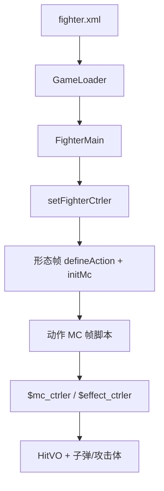

# 角色 SWF Batch C 索引 — ikkaku / itachi / jiraiya / juggo / kakashi / kakashi_sw / karin

引擎 line-by-line（`net.play5d`）已闭合，见 [`../engine/00-INDEX.md`](../engine/00-INDEX.md)。本批继续注 **主战角色 SWF 时间轴**（`decompiled/fighters/`），不改 `decompiled/`、不播放/重打包 SWF。不注 `fz/`（A 批已收）。

文件清单：[`../_maps/fighters-batch-C-files.txt`](../_maps/fighters-batch-C-files.txt)（62 个 `.as`）。总索引：[`00-INDEX.md`](00-INDEX.md)。D–G 未开始。

## 本批是什么

| 块 | XML | SWF | 本批 `.as` | 注 |
|---|---|---|---|---|
| 斑目·一角 | `ikkaku` sf=1 | `assets/fighter/ikkaku.swf` | 7 | 斩防、speed 11；动作类名误作 `鸣人全动作_1` |
| 宇智波·鼬 | `itachi` sf=1 | `assets/fighter/itachi.swf` | 14 | 拳防；动作类名误作 `卡卡西_1`；天照/月读/幻术攻击体 |
| 自来也 | `jiraiya` sf=1 | `assets/fighter/jiraiya.swf` | 8 | 拳防、heavy 4；蛤蟆油雾 `fog` |
| 天秤·重吾 | `juggo` sf=1 | `assets/fighter/juggo.swf` | 8 | 拳防、speed 7、heavy 5；动作类名误作 `迪达拉全动作_XIN_1` |
| 旗木·卡卡西 | `kakashi` sf=1 | `assets/fighter/kakashi.swf` | 10 | 拳防；**无** `snd_*`；狗/水龙/神威攻击体 |
| 旗木·卡卡西 神威 | `kakashi_sw` sf=1 | `assets/fighter/kakashi_sw.swf` | 6 | 独立 SWF，不是同一文件切帧；**无** `bsface*`；`defineHurtSound()` 无参 |
| 漩涡·香磷 | `karin` sf=1 | `assets/fighter/karin.swf` | 9 | 拳防；**无** `snd_*`；动作类名误作 `卡卡西_1`；`addHpPercent(0.03)` |

引擎加载：`GameLoader.loadFighter` → `new FighterMain(mc)`。形态：`FighterMain.initlize` 里 `_mainMc.gotoAndStop(data.startFrame+1)`，所以 XML `startFrame="1"` 跑的是时间轴 **第 2 帧**。本批七人全部 sf=1 → F2，没有万解/切形态。

交叉：[`FighterMain`](../engine/game/bvn/fighter/FighterMain.md)、[`FighterCtrler`](../engine/game/bvn/fighter/ctrler/FighterCtrler.md)、[`FighterMcCtrler`](../engine/game/bvn/fighter/ctrler/FighterMcCtrler.md)、[`HitVO`](../engine/game/bvn/fighter/models/HitVO.md)、[`FighterHitRange`](../engine/game/bvn/fighter/FighterHitRange.md)、[`FighterMC`](../engine/game/bvn/fighter/FighterMC.md)、[`FighterAttacker`](../engine/game/bvn/fighter/FighterAttacker.md)。

## 共享时间轴模式

与 A/B 批相同的根时间轴骨架：

```
FighterMain.initlize
  new FighterCtrler
  mainMc.setFighterCtrler(ctrler)     → $fighter_ctrler，defineAction 别名
  ctrler.initFighter
    setEffectCtrler / setFighterMcCtrler
  gotoAndStop(startFrame+1)           → frame2
    if (!$fighter_ctrler) return
    defineAction(id, HitVO 字面量) × N
    defineBishaFace / defineHurtSound*   // 卡卡西/香磷无语音；神威无脸且语音无参
    speed / jumpPower / heavy / defenseType
    initMc(this.mc)                   → 内部动作 MC 交给 FighterMC
```

`defineAction` 第一参是 HitVO `id`（`tk`/`k1`/`zh1`/`bs`/`sbs`/`cbs`/`sh1`…），**不是** 帧标签。帧标签在动作 MC 上，由 `setAttack("砍2")` 一类写入 `FighterAction`。

| id 前缀 | 含义 |
|---|---|
| `tk` / `tz` | 跳轻 / 跳重 |
| `k1`… | 地面普攻段 |
| `kj*` | 空中技 |
| `zh*` | 招 1/2/3 |
| `bs` / `sbs` / `kbs` / `cbs` | 必杀 / 上必 / 空必 / 超必（id 含 `bs` → `HitVO.isBisha`） |
| `sh1`/`sh2` | 抓（hitType 11 + isBreakDef → `isCatch`）；`sh12`/`sh22` 是伤害段 |

本批 `defenseType`：一角写 0 斩防；其余六人写 1 拳防。无人默认值。

本批 **没有** `doWanKai` / `startWanKai`。神威卡卡西是单独 SWF，不是同一文件 `nextFrame()`。

### 动作 MC（`*全动作*` / `Timeline_1` / `人物全动作*`）

根时间轴的 `this.mc`。脚本走 **`parent.$mc_ctrler`**（`FighterMcCtrler`）、`parent.$effect_ctrler`、偶发 `parent.$fighter_ctrler`。

`FighterMC.renderChildren` **跳过** 名为 `AImain`、`bdmn`、名字含 `atm` 的子剪辑（当盒子，不自动 `nextFrame`）。

Flash 帧标签 **不在** 反编译 AS 里，只留下 `addFrameScript` 数字。注里按帧号分段，标签名从 `setAttack`/`loop`/`gotoAndPlay`/`justHitToPlay` 字符串回推。

典型段序：走 `loop("走")` → 冲刺 `dash` → 回 `idle` → 普攻 `setAttack("砍N")` 中间 `endAct` → 招/必杀 `bisha`/`addAttacker`/`fire` → 胜负 `stop()`。

本批类名坑（FLA 模板残留，与 XML 名对不上）：

- 一角动作类叫 `鸣人全动作_1`。
- 鼬、香磷动作类都叫 `卡卡西_1`。鼬另有元件 `卡卡西_上必杀_狗S_15`（卡卡西狗招残留名）。
- 重吾动作类叫 `迪达拉全动作_XIN_1`。
- 卡卡西动作类叫 `Timeline_1`（与迪达拉/我爱罗同类名习惯）。
- 神威卡卡西动作类叫 `人物全动作_1`。

### AI 面

实例名 `AImain`。`FighterMC.initHitRange`：`gotoAndStop(2)` → 按 `FighterHitRange.getALL()` 取 `*mian` bounds → 停回第 1 帧并隐藏。`frame1` 只有 `stop()`。缺某个 `*mian` = 该招没有独立 AI 盒。

| 角色 | AI 类 | 缺 |
|---|---|---|
| 一角 / 鼬 / 自来也 / 重吾 / 神威 / 香磷 | `AI面_2` | 全部缺 `kbsmian`（本批也无空必 HitVO `kbs`） |
| 卡卡西 | `AI_2`（不是 `AI面*`） | 同样缺 `kbsmian` |

### 必杀脸 / 受击音

- `bsfaceN extends BitmapData`：无名包 + Embed PNG。默认 168×119。`defineBishaFace` 只存 Class。
- `snd_hurt*` / `snd_die` extends Sound：Embed MP3。
- **卡卡西、香磷没有 `snd_*`**，也不调 `defineHurtSound*`。
- **神威卡卡西没有 `bsface*`**，动作里 `bisha(false)` / `bisha(true)` **不传脸键**。根时间轴 `defineHurtSound()` / `Fly` / `Die` **无参**，但库仍导出 `snd_hurt1`、`snd_hurt2`、`§ snd_die§`（类名带空格与 section 符）。? 受击无声，脸也不弹。
- 鼬分轨：受击 `snd_hurt1,snd_hurt2`，击飞 `snd_hurt2`，死亡 `snd_die`。
- 一角 / 自来也 / 重吾：三路共用 `snd_hurt1`。

### 攻击体 / 空 `元件*`

`setAttackerCtrler` 接 `$attacker_ctrler`（没有也不 throw）：

| 角色 | 攻击体类 | 典型 `addAttacker` 名 |
|---|---|---|
| 鼬 | `鼬_幻术1_9` `鼬_幻术2_12` | `fenshen` `tianzhao` `zzzz` `yue` |
| 自来也 | `元件15_5` | `fog` |
| 重吾 | `Symbol1_10` `招1刀光副本3_11` | `tu` `kuwu` |
| 卡卡西 | `Timeline_7` `Timeline_10` `Timeline_11` | `dog1` `shuilong` `shenwei` |
| 香磷 | `招1刀光副本2_15` | `zzz` `zzz2` |

空/只 `stop()`：一角 `sprite2397_8`；鼬 `元件271_22` `天照特效_16` `月读1_18` `卡卡西_上必杀_狗S_15`；自来也 `元件190_12`；卡卡西 `Timeline_12`；香磷 `元件174_10` `元件511_18` `Symbol2copy_14`。

神威卡卡西 `yh = 0` 写在根 F2 末尾，时间轴未见再读（? 残留标志）。



## 可玩要点

| 角色 | speed / jump / heavy / 防 | 必杀脸 | 语音 | 动作 MC | 脚本帧 |
|---|---|---|---|---|---|
| 一角 | 11 / 15 / 3 / 斩 | `一角1` `一角2` | `snd_hurt1` ×3 | [`鸣人全动作_1`](ikkaku/scripts/ikkaku_fla/鸣人全动作_1.md) | 92 |
| 鼬 | 10 / 16 / 4 / 拳 | `鼬1` `鼬2` | hurt1+2 / fly2 / die | [`卡卡西_1`](itachi/scripts/itachi_fla/卡卡西_1.md) | 89 |
| 自来也 | 10 / 15 / 4 / 拳 | `自来也1` `自来也2` | `snd_hurt1` ×3 | [`自来也全动作_1`](jiraiya/scripts/jiraiya_fla/自来也全动作_1.md) | 102 |
| 重吾 | 7 / 14 / 5 / 拳 | `重吾1` `重吾2` | `snd_hurt1` ×3 | [`迪达拉全动作_XIN_1`](juggo/scripts/juggo_fla/迪达拉全动作_XIN_1.md) | 107 |
| 卡卡西 | 10 / 16 / 3 / 拳 | `卡卡西1..3` | 无 | [`Timeline_1`](kakashi/scripts/kakashi_fla/Timeline_1.md) | 93 |
| 神威 | 12 / 16 / 3 / 拳 | 无 | 无参 `defineHurtSound()` | [`人物全动作_1`](kakashi_sw/scripts/kakashi_sw_fla/人物全动作_1.md) | 132 |
| 香磷 | 10 / 15 / 3 / 拳 | `香磷1` `香磷2` | 无 | [`卡卡西_1`](karin/scripts/karin_fla/卡卡西_1.md) | 83 |

一角必杀脸 `一角1`/`一角2`；招段带 `setSteelBody`。动作类名是鸣人模板。

鼬：分身 `addAttacker("fenshen")`；天照 `tianzhao`（`moveToTarget`、`applyG:false`）；月读 `yue`；另有 `zzzz`。上必元件名叫「卡卡西_上必杀_狗S」。`setHurtAction("砍技21")`。

自来也：招放出 `fog`；必杀脸 `自来也1`/`自来也2`；`setSteelBody`。攻击体 `元件15_5` 会 `setTouchFloor("hitfloor")` 并 `effect.shake`。

重吾最慢最重（speed 7 / heavy 5）。`tu` 命中才让主人 `gotoAndPlay("招22")`，否则攻击体 `miss`。必杀 `fire("bs1atm"… hp:200)` / `bsatm` hp:300。

卡卡西：写轮眼狗 `dog1`、水龙 `shuilong`、神威 `shenwei`（跟随目标）；`Timeline_11` 超必命中把对手 `getDisplay().visible=false` 藏进神威，收招再显。`setCross(true)` 穿人。

神威卡卡西脚本帧最多（132）。HitVO 另有性质 id `sui`/`tu`/`huo`/`leiqiebaozha`，以及 `kj9`/`kj99`/`kj6`/`kj26`/`kj27`。攻击体 `wei` `xg1` `gou` `xf`。`targetInRange([0,400])`；`justHitToPlay("cbs1","超必杀HIT",false,true)`。`bisha()` 不传脸键。

香磷 F736 `$fighter_ctrler.addHpPercent(0.03)` 回血 3%，随后 `setAllAct()`。超必 `justHitToPlay("cbs1","超必杀2",false)`。攻击体 `zzz`/`zzz2`。

## 清单（62/62 done）

### ikkaku（7）

- [x] [`ikkaku/scripts/bsface1.md`](ikkaku/scripts/bsface1.md)
- [x] [`ikkaku/scripts/bsface2.md`](ikkaku/scripts/bsface2.md)
- [x] [`ikkaku/scripts/ikkaku_fla/AI面_2.md`](ikkaku/scripts/ikkaku_fla/AI面_2.md)
- [x] [`ikkaku/scripts/ikkaku_fla/MainTimeline.md`](ikkaku/scripts/ikkaku_fla/MainTimeline.md)
- [x] [`ikkaku/scripts/ikkaku_fla/sprite2397_8.md`](ikkaku/scripts/ikkaku_fla/sprite2397_8.md)
- [x] [`ikkaku/scripts/ikkaku_fla/鸣人全动作_1.md`](ikkaku/scripts/ikkaku_fla/鸣人全动作_1.md)
- [x] [`ikkaku/scripts/snd_hurt1.md`](ikkaku/scripts/snd_hurt1.md)

### itachi（14）

- [x] [`itachi/scripts/bsface1.md`](itachi/scripts/bsface1.md)
- [x] [`itachi/scripts/bsface2.md`](itachi/scripts/bsface2.md)
- [x] [`itachi/scripts/itachi_fla/AI面_2.md`](itachi/scripts/itachi_fla/AI面_2.md)
- [x] [`itachi/scripts/itachi_fla/MainTimeline.md`](itachi/scripts/itachi_fla/MainTimeline.md)
- [x] [`itachi/scripts/itachi_fla/元件271_22.md`](itachi/scripts/itachi_fla/元件271_22.md)
- [x] [`itachi/scripts/itachi_fla/卡卡西_1.md`](itachi/scripts/itachi_fla/卡卡西_1.md)
- [x] [`itachi/scripts/itachi_fla/卡卡西_上必杀_狗S_15.md`](itachi/scripts/itachi_fla/卡卡西_上必杀_狗S_15.md)
- [x] [`itachi/scripts/itachi_fla/天照特效_16.md`](itachi/scripts/itachi_fla/天照特效_16.md)
- [x] [`itachi/scripts/itachi_fla/月读1_18.md`](itachi/scripts/itachi_fla/月读1_18.md)
- [x] [`itachi/scripts/itachi_fla/鼬_幻术1_9.md`](itachi/scripts/itachi_fla/鼬_幻术1_9.md)
- [x] [`itachi/scripts/itachi_fla/鼬_幻术2_12.md`](itachi/scripts/itachi_fla/鼬_幻术2_12.md)
- [x] [`itachi/scripts/snd_die.md`](itachi/scripts/snd_die.md)
- [x] [`itachi/scripts/snd_hurt1.md`](itachi/scripts/snd_hurt1.md)
- [x] [`itachi/scripts/snd_hurt2.md`](itachi/scripts/snd_hurt2.md)

### jiraiya（8）

- [x] [`jiraiya/scripts/bsface1.md`](jiraiya/scripts/bsface1.md)
- [x] [`jiraiya/scripts/bsface2.md`](jiraiya/scripts/bsface2.md)
- [x] [`jiraiya/scripts/jiraiya_fla/AI面_2.md`](jiraiya/scripts/jiraiya_fla/AI面_2.md)
- [x] [`jiraiya/scripts/jiraiya_fla/MainTimeline.md`](jiraiya/scripts/jiraiya_fla/MainTimeline.md)
- [x] [`jiraiya/scripts/jiraiya_fla/元件15_5.md`](jiraiya/scripts/jiraiya_fla/元件15_5.md)
- [x] [`jiraiya/scripts/jiraiya_fla/元件190_12.md`](jiraiya/scripts/jiraiya_fla/元件190_12.md)
- [x] [`jiraiya/scripts/jiraiya_fla/自来也全动作_1.md`](jiraiya/scripts/jiraiya_fla/自来也全动作_1.md)
- [x] [`jiraiya/scripts/snd_hurt1.md`](jiraiya/scripts/snd_hurt1.md)

### juggo（8）

- [x] [`juggo/scripts/bsface1.md`](juggo/scripts/bsface1.md)
- [x] [`juggo/scripts/bsface2.md`](juggo/scripts/bsface2.md)
- [x] [`juggo/scripts/juggo_fla/AI面_2.md`](juggo/scripts/juggo_fla/AI面_2.md)
- [x] [`juggo/scripts/juggo_fla/MainTimeline.md`](juggo/scripts/juggo_fla/MainTimeline.md)
- [x] [`juggo/scripts/juggo_fla/Symbol1_10.md`](juggo/scripts/juggo_fla/Symbol1_10.md)
- [x] [`juggo/scripts/juggo_fla/招1刀光副本3_11.md`](juggo/scripts/juggo_fla/招1刀光副本3_11.md)
- [x] [`juggo/scripts/juggo_fla/迪达拉全动作_XIN_1.md`](juggo/scripts/juggo_fla/迪达拉全动作_XIN_1.md)
- [x] [`juggo/scripts/snd_hurt1.md`](juggo/scripts/snd_hurt1.md)

### kakashi（10）

- [x] [`kakashi/scripts/bsface1.md`](kakashi/scripts/bsface1.md)
- [x] [`kakashi/scripts/bsface2.md`](kakashi/scripts/bsface2.md)
- [x] [`kakashi/scripts/bsface3.md`](kakashi/scripts/bsface3.md)
- [x] [`kakashi/scripts/kakashi_fla/AI_2.md`](kakashi/scripts/kakashi_fla/AI_2.md)
- [x] [`kakashi/scripts/kakashi_fla/MainTimeline.md`](kakashi/scripts/kakashi_fla/MainTimeline.md)
- [x] [`kakashi/scripts/kakashi_fla/Timeline_1.md`](kakashi/scripts/kakashi_fla/Timeline_1.md)
- [x] [`kakashi/scripts/kakashi_fla/Timeline_10.md`](kakashi/scripts/kakashi_fla/Timeline_10.md)
- [x] [`kakashi/scripts/kakashi_fla/Timeline_11.md`](kakashi/scripts/kakashi_fla/Timeline_11.md)
- [x] [`kakashi/scripts/kakashi_fla/Timeline_12.md`](kakashi/scripts/kakashi_fla/Timeline_12.md)
- [x] [`kakashi/scripts/kakashi_fla/Timeline_7.md`](kakashi/scripts/kakashi_fla/Timeline_7.md)

### kakashi_sw（6）

- [x] [`kakashi_sw/scripts/kakashi_sw_fla/AI面_2.md`](kakashi_sw/scripts/kakashi_sw_fla/AI面_2.md)
- [x] [`kakashi_sw/scripts/kakashi_sw_fla/MainTimeline.md`](kakashi_sw/scripts/kakashi_sw_fla/MainTimeline.md)
- [x] [`kakashi_sw/scripts/kakashi_sw_fla/人物全动作_1.md`](kakashi_sw/scripts/kakashi_sw_fla/人物全动作_1.md)
- [x] [`kakashi_sw/scripts/snd_hurt1.md`](kakashi_sw/scripts/snd_hurt1.md)
- [x] [`kakashi_sw/scripts/snd_hurt2.md`](kakashi_sw/scripts/snd_hurt2.md)
- [x] [`kakashi_sw/scripts/§ snd_die§.md`](kakashi_sw/scripts/§ snd_die§.md)

### karin（9）

- [x] [`karin/scripts/bsface1.md`](karin/scripts/bsface1.md)
- [x] [`karin/scripts/bsface2.md`](karin/scripts/bsface2.md)
- [x] [`karin/scripts/karin_fla/AI面_2.md`](karin/scripts/karin_fla/AI面_2.md)
- [x] [`karin/scripts/karin_fla/MainTimeline.md`](karin/scripts/karin_fla/MainTimeline.md)
- [x] [`karin/scripts/karin_fla/Symbol2copy_14.md`](karin/scripts/karin_fla/Symbol2copy_14.md)
- [x] [`karin/scripts/karin_fla/元件174_10.md`](karin/scripts/karin_fla/元件174_10.md)
- [x] [`karin/scripts/karin_fla/元件511_18.md`](karin/scripts/karin_fla/元件511_18.md)
- [x] [`karin/scripts/karin_fla/卡卡西_1.md`](karin/scripts/karin_fla/卡卡西_1.md)
- [x] [`karin/scripts/karin_fla/招1刀光副本2_15.md`](karin/scripts/karin_fla/招1刀光副本2_15.md)
