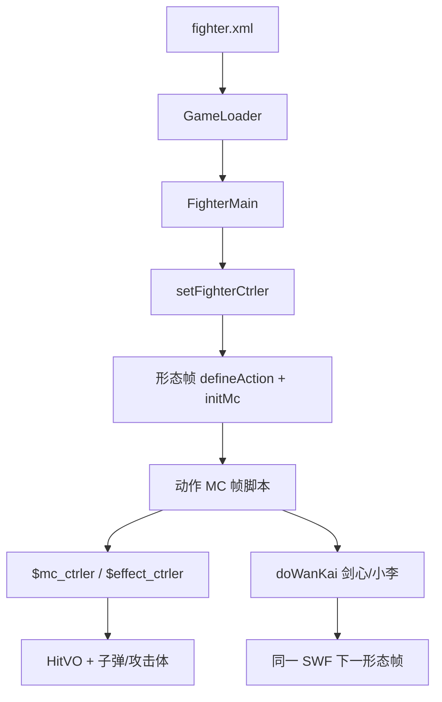

# 角色 SWF Batch D 索引 — kenpachi / kenshin / killerbee / konan / lee / madara / mayuri

引擎 line-by-line（`net.play5d`）已闭合，见 [`../engine/00-INDEX.md`](../engine/00-INDEX.md)。本批继续注 **主战角色 SWF 时间轴**（`decompiled/fighters/`），不改 `decompiled/`、不播放/重打包 SWF。不注 `fz/`（A 批已收）。

文件清单：[`../_maps/fighters-batch-D-files.txt`](../_maps/fighters-batch-D-files.txt)（63 个 `.as`）。总索引：[`00-INDEX.md`](00-INDEX.md)。E–G 未开始。

## 本批是什么

| 块 | XML | SWF | 本批 `.as` | 注 |
|---|---|---|---|---|
| 更木·剑八 | `kenpachi` sf=1 | `assets/fighter/kenpachi.swf` | 9 | 斩防、heavy 5；脸 `剑八1/2` |
| 绯村·剑心 / 拔刀斋 | `kenshin` sf=1、`kenshin_bdz` sf=2 | `assets/fighter/kenshin.swf` | 9 | 同一 SWF 两形态；**无** `bsface*` / `snd_*` |
| 奇拉比 | `killerbee` sf=1 | `assets/fighter/killerbee.swf` | 5 | 拳防、heavy 5；**无** `snd_*` |
| 小南 | `konan` sf=1 | `assets/fighter/konan.swf` | 6 | 拳防、heavy 1；动作类名误作 `卡卡西_1` |
| 李·洛克 / 杜门 | `lee` sf=1、`lee_dm` sf=2 | `assets/fighter/lee.swf` | 14 | 同一 SWF 两形态；常时动作误名 `樱_1` |
| 宇智波·斑 | `madara` sf=1 | `assets/fighter/madara.swf` | 8 | 拳防、speed 14；动作类名误作 `鸣人全动作_1`；AI **有** `kbsmian` |
| 涅茧利 | `mayuri` sf=1 | `assets/fighter/mayuri.swf` | 12 | 斩防、speed 6；脸键写成 **`涅浊利`**（浊≠茧） |

引擎加载：`GameLoader.loadFighter` → `new FighterMain(mc)`。形态：`FighterMain.initlize` 里 `_mainMc.gotoAndStop(data.startFrame+1)`，所以 XML `startFrame="1"` 跑的是时间轴 **第 2 帧**。剑心、小李是同一 SWF 两形态（sf=1→F2，sf=2→F3），其余五人 sf=1 → F2。

交叉：[`FighterMain`](../engine/game/bvn/fighter/FighterMain.md)、[`FighterCtrler`](../engine/game/bvn/fighter/ctrler/FighterCtrler.md)、[`FighterMcCtrler`](../engine/game/bvn/fighter/ctrler/FighterMcCtrler.md)、[`HitVO`](../engine/game/bvn/fighter/models/HitVO.md)、[`FighterHitRange`](../engine/game/bvn/fighter/FighterHitRange.md)、[`FighterMC`](../engine/game/bvn/fighter/FighterMC.md)、[`FighterAttacker`](../engine/game/bvn/fighter/FighterAttacker.md)。

## 共享时间轴模式

与 A/B/C 批相同的根时间轴骨架：

```
FighterMain.initlize
  new FighterCtrler
  mainMc.setFighterCtrler(ctrler)     → $fighter_ctrler，defineAction 别名
  ctrler.initFighter
    setEffectCtrler / setFighterMcCtrler
  gotoAndStop(startFrame+1)           → frame2（剑心/小李 F3）
    if (!$fighter_ctrler) return
    defineAction(id, HitVO 字面量) × N
    defineBishaFace / defineHurtSound*   // 剑心全无；奇拉比无语音
    speed / jumpPower / heavy / defenseType
    initMc(this.mc)                   → 内部动作 MC 交给 FighterMC
```

`defineAction` 第一参是 HitVO `id`（`tk`/`k1`/`zh1`/`bs`/`sbs`/`kbs`/`cbs`/`sh1`…），**不是** 帧标签。帧标签在动作 MC 上，由 `setAttack("砍2")` 一类写入 `FighterAction`。

| id 前缀 | 含义 |
|---|---|
| `tk` / `tz` | 跳轻 / 跳重 |
| `k1`… | 地面普攻段 |
| `kj*` | 空中技 |
| `zh*` | 招 1/2/3 |
| `bs` / `sbs` / `kbs` / `cbs` | 必杀 / 上必 / 空必 / 超必（id 含 `bs` → `HitVO.isBisha`） |
| `sh1`/`sh2` | 抓（hitType 11 + isBreakDef → `isCatch`）；`sh12`/`sh22` 是伤害段 |

本批 `defenseType`：剑八 / 剑心两形态 / 涅茧利写 0 斩防；奇拉比 / 小南 / 小李两形态 / 斑写 1 拳防。无人默认值。

切形态（白哉同款 `doWanKai()`）：

- 剑心 F2 `全动作_1`：`startWanKai()`（无脸键）→ `doWanKai()` 切根时间轴 F3 拔刀斋。
- 小李 F2 `樱_1`：`startWanKai("小李2")` → `doWanKai()` 切根时间轴 F3 杜门。
- 对应 F3 动作收招走 `endWanKai()`。

### 动作 MC（`*全动作*` / `Timeline_1` / 误名模板）

根时间轴的 `this.mc`。脚本走 **`parent.$mc_ctrler`**（`FighterMcCtrler`）、`parent.$effect_ctrler`、偶发 `parent.$fighter_ctrler`。

`FighterMC.renderChildren` **跳过** 名为 `AImain`、`bdmn`、名字含 `atm` 的子剪辑（当盒子，不自动 `nextFrame`）。

Flash 帧标签 **不在** 反编译 AS 里，只留下 `addFrameScript` 数字。注里按帧号分段，标签名从 `setAttack`/`loop`/`gotoAndPlay`/`justHitToPlay` 字符串回推。

典型段序：走 `loop("走")` → 冲刺 `dash` → 回 `idle` → 普攻 `setAttack("砍N")` 中间 `endAct` → 招/必杀 `bisha`/`addAttacker`/`fire` → 胜负 `stop()`。

本批类名坑（FLA 模板残留，与 XML 名对不上）：

- 小南动作类叫 `卡卡西_1`。
- 斑动作类叫 `鸣人全动作_1`。
- 小李常时动作类叫 `樱_1`；杜门才是 `小李杜门_10`。
- 涅茧利动作类叫 `Timeline_1`（与迪达拉/我爱罗/卡卡西同类名习惯）。
- 剑八动作类名与角色一致：`剑八全动作_1`。
- 奇拉比动作类名 `八尾人柱力全动作_1`。

### AI 面

实例名 `AImain`。`FighterMC.initHitRange`：`gotoAndStop(2)` → 按 `FighterHitRange.getALL()` 取 `*mian` bounds → 停回第 1 帧并隐藏。`frame1` 只有 `stop()`。缺某个 `*mian` = 该招没有独立 AI 盒。

| 角色 | AI 类 | 缺 |
|---|---|---|
| 剑八 / 奇拉比 / 小南 | `AI面_2` | 缺 `kbsmian`（本批这三人根时间轴也无空必 HitVO `kbs`） |
| 剑心浪人 | `AI面_2` | 缺 `kbsmian`（F2 无 `kbs`） |
| 剑心拔刀斋 | `AI面_16` | 缺 `kbsmian`（F3 **有** HitVO `kbs*`，但 AI 盒仍缺） |
| 小李常时 | `AI面_2` | 缺 `kbsmian`（动作里却有 `kbsatm`） |
| 小李杜门 | `AI面_11` | 缺 `kbsmian` |
| 斑 | `AI面_2` | **齐全**（本批唯一带 `kbsmian`） |
| 涅茧利 | `AI_2`（不是 `AI面*`） | 缺 `kbsmian` |

### 必杀脸 / 受击音

- `bsfaceN extends BitmapData`：无名包 + Embed PNG。本批默认多为 170×120（C 批常见 168×119）。`defineBishaFace` 只存 Class。
- `snd_hurt*` / `snd_die` extends Sound：Embed MP3。
- **剑心没有 `bsface*` 也没有 `snd_*`**，两形态都不调 `defineBishaFace` / `defineHurtSound*`。拔刀斋切形态 `startWanKai()` 不传脸键。? 受击无声，必杀也不弹脸。
- **奇拉比没有 `snd_*`**，有脸 `奇拉比1/2`，不调 `defineHurtSound*`。
- 剑八 / 小南 / 小李：三路共用 `snd_hurt1`。
- 斑分轨：受击 `snd_hurt1,snd_hurt2`，击飞 `snd_hurt1`，死亡 `snd_die`。
- 涅茧利：受击 `snd_hurt1`，击飞/死亡 `snd_hurt2`。无独立 `snd_die`。
- 小李 F3 杜门只再登记脸 `小李1`，不再登记 `小李2`（`小李2` 用在常时切杜门的 `startWanKai`）。

### 攻击体 / 空 `元件*`

`setAttackerCtrler` 接 `$attacker_ctrler`（没有也不 throw）：

| 角色 | 攻击体类 | 典型 `addAttacker` / `fire` 名 |
|---|---|---|
| 小南 | 动作 MC 子件，无独立导出类 | `zh2mc` `aabb` `sbsmc`（`moveToTarget`，`applyG:false`） |
| 涅茧利 | `Timeline_12` | `wk`；另 `fire("zh2atm")` |
| 斑 | （子弹，无独立攻击体类） | `fire`：`tzatm` `zh12atm` `zh1atm` `zh3atm`（hp:300）`kbsatm`（hp:300） |
| 奇拉比 | （子弹） | `fire("zh3atm")` |

空/只 `stop()`：剑八 `元件2_9` `元件5_10` `元件67副本_12`；剑心 `win_13` `win_29` `元件181_25` `元件20_22`；小李 `Timeline_7`（连 `addFrameScript` 都没有）`sprite124_17` `元件16_7` `元件21_18` `元件35_21` `元件36_22`；涅茧利 `Symbol4_9` `Symbol5_10` `Timeline_6` `Timeline_11`。



## 可玩要点

| 角色 | speed / jump / heavy / 防 | 必杀脸 | 语音 | 动作 MC | 脚本帧 |
|---|---|---|---|---|---|
| 剑八 | 10 / 16 / 5 / 斩 | `剑八1` `剑八2` | `snd_hurt1` ×3 | [`剑八全动作_1`](kenpachi/scripts/kenpachi_fla/剑八全动作_1.md) | 107 |
| 剑心 | 12 / 17 / 2 / 斩 | 无 | 无 | [`全动作_1`](kenshin/scripts/kenshin_fla/全动作_1.md) | 82 |
| 拔刀斋 | 14 / 18 / 2 / 斩 | 无 | 无 | [`全动作_15`](kenshin/scripts/kenshin_fla/全动作_15.md) | 127 |
| 奇拉比 | 11 / 16 / 5 / 拳 | `奇拉比1` `奇拉比2` | 无 | [`八尾人柱力全动作_1`](killerbee/scripts/killerbee_fla/八尾人柱力全动作_1.md) | 99 |
| 小南 | 10 / 16 / 1 / 拳 | `小南1` `小南2` | `snd_hurt1` ×3 | [`卡卡西_1`](konan/scripts/konan_fla/卡卡西_1.md) | 73 |
| 小李 | 10 / 15 / 3 / 拳 | `小李1` `小李2` | `snd_hurt1` ×3 | [`樱_1`](lee/scripts/lee_fla/樱_1.md) | 117 |
| 杜门 | 12 / 15 / 3 / 拳 | 仅 `小李1` | `snd_hurt1` ×3 | [`小李杜门_10`](lee/scripts/lee_fla/小李杜门_10.md) | 137 |
| 斑 | 14 / 16 / 4 / 拳 | `斑1` `斑2` | hurt1+2 / fly1 / die | [`鸣人全动作_1`](madara/scripts/madara_fla/鸣人全动作_1.md) | 103 |
| 涅茧利 | 6 / 15 / 4 / 斩 | `涅浊利1` `涅浊利2` | hurt1 / fly2 / die2 | [`Timeline_1`](mayuri/scripts/mayuri_fla/Timeline_1.md) | 83 |

剑八最重（heavy 5，与奇拉比并列）。招 2/3 走 `hitType` 9 ELECTRIC。超必 `justHitToPlay("cbs1","超必杀1")`。抓第三段 `sh23`。`setHurtAction("招21")`。

剑心两形态都 **没有** 脸和语音。浪人 `doWanKai()` 切拔刀斋（更快：speed 14 / jump 18）。拔刀斋有空必 HitVO `kbs*` 和 `setCross`；F3 `sh22` 写 `hitType:0`（? 不是 `HitType` 表内的砍/打/抓）。

奇拉比无受击音。`setCross` 穿人。招 3 `fire("zh3atm")`。

小南最轻（heavy 1）。动作类名是卡卡西模板。纸鹤/纸天使攻击体是动作 MC 子件 `zh2mc` / `aabb` / `sbsmc`，跟目标、不受重力。布尔 `Cbshit` 时间轴自用。

小李常时 `樱_1`：必杀把对手 `target.visible=false` 再 `moveTarget({followmc:"move_mc"})` 藏进位移盒；`hp > 300` 时 `loseHp(100)` / `loseHp(200)`（? 开门自伤）。切杜门用脸键 `小李2`。杜门脚本帧最多（137），`justHitToPlay("cbs1","超必杀2",false,true)`，`endWanKai()`。

斑最快之一（speed 14）。空必 `fire("kbsatm", hp:300)`；招 3 子弹 hp:300。`justHitToPlay("sbs","上必杀2",false)`。`targetInRange([0,1000])` 再 `moveToTarget` / `moveOnce`。AI 面带 `kbsmian`。

涅茧利最慢（speed 6）。脸键 **涅浊利**（FLA 原拼）。攻击体 `wk`（`Timeline_12`：位移 / `effect.shine(4580164)` / `endAct`）。`justHitToPlay("bs2","必杀2",false)`。`fire("zh2atm")`。

## 清单（63/63 done）

### kenpachi（9）

- [x] [`kenpachi/scripts/bsface1.md`](kenpachi/scripts/bsface1.md)
- [x] [`kenpachi/scripts/bsface2.md`](kenpachi/scripts/bsface2.md)
- [x] [`kenpachi/scripts/kenpachi_fla/AI面_2.md`](kenpachi/scripts/kenpachi_fla/AI面_2.md)
- [x] [`kenpachi/scripts/kenpachi_fla/MainTimeline.md`](kenpachi/scripts/kenpachi_fla/MainTimeline.md)
- [x] [`kenpachi/scripts/kenpachi_fla/元件2_9.md`](kenpachi/scripts/kenpachi_fla/元件2_9.md)
- [x] [`kenpachi/scripts/kenpachi_fla/元件5_10.md`](kenpachi/scripts/kenpachi_fla/元件5_10.md)
- [x] [`kenpachi/scripts/kenpachi_fla/元件67副本_12.md`](kenpachi/scripts/kenpachi_fla/元件67副本_12.md)
- [x] [`kenpachi/scripts/kenpachi_fla/剑八全动作_1.md`](kenpachi/scripts/kenpachi_fla/剑八全动作_1.md)
- [x] [`kenpachi/scripts/snd_hurt1.md`](kenpachi/scripts/snd_hurt1.md)

### kenshin（9）

- [x] [`kenshin/scripts/kenshin_fla/AI面_16.md`](kenshin/scripts/kenshin_fla/AI面_16.md)
- [x] [`kenshin/scripts/kenshin_fla/AI面_2.md`](kenshin/scripts/kenshin_fla/AI面_2.md)
- [x] [`kenshin/scripts/kenshin_fla/MainTimeline.md`](kenshin/scripts/kenshin_fla/MainTimeline.md)
- [x] [`kenshin/scripts/kenshin_fla/win_13.md`](kenshin/scripts/kenshin_fla/win_13.md)
- [x] [`kenshin/scripts/kenshin_fla/win_29.md`](kenshin/scripts/kenshin_fla/win_29.md)
- [x] [`kenshin/scripts/kenshin_fla/元件181_25.md`](kenshin/scripts/kenshin_fla/元件181_25.md)
- [x] [`kenshin/scripts/kenshin_fla/元件20_22.md`](kenshin/scripts/kenshin_fla/元件20_22.md)
- [x] [`kenshin/scripts/kenshin_fla/全动作_1.md`](kenshin/scripts/kenshin_fla/全动作_1.md)
- [x] [`kenshin/scripts/kenshin_fla/全动作_15.md`](kenshin/scripts/kenshin_fla/全动作_15.md)

### killerbee（5）

- [x] [`killerbee/scripts/bsface1.md`](killerbee/scripts/bsface1.md)
- [x] [`killerbee/scripts/bsface2.md`](killerbee/scripts/bsface2.md)
- [x] [`killerbee/scripts/killerbee_fla/AI面_2.md`](killerbee/scripts/killerbee_fla/AI面_2.md)
- [x] [`killerbee/scripts/killerbee_fla/MainTimeline.md`](killerbee/scripts/killerbee_fla/MainTimeline.md)
- [x] [`killerbee/scripts/killerbee_fla/八尾人柱力全动作_1.md`](killerbee/scripts/killerbee_fla/八尾人柱力全动作_1.md)

### konan（6）

- [x] [`konan/scripts/bsface1.md`](konan/scripts/bsface1.md)
- [x] [`konan/scripts/bsface2.md`](konan/scripts/bsface2.md)
- [x] [`konan/scripts/konan_fla/AI面_2.md`](konan/scripts/konan_fla/AI面_2.md)
- [x] [`konan/scripts/konan_fla/MainTimeline.md`](konan/scripts/konan_fla/MainTimeline.md)
- [x] [`konan/scripts/konan_fla/卡卡西_1.md`](konan/scripts/konan_fla/卡卡西_1.md)
- [x] [`konan/scripts/snd_hurt1.md`](konan/scripts/snd_hurt1.md)

### lee（14）

- [x] [`lee/scripts/bsface1.md`](lee/scripts/bsface1.md)
- [x] [`lee/scripts/bsface2.md`](lee/scripts/bsface2.md)
- [x] [`lee/scripts/lee_fla/AI面_11.md`](lee/scripts/lee_fla/AI面_11.md)
- [x] [`lee/scripts/lee_fla/AI面_2.md`](lee/scripts/lee_fla/AI面_2.md)
- [x] [`lee/scripts/lee_fla/MainTimeline.md`](lee/scripts/lee_fla/MainTimeline.md)
- [x] [`lee/scripts/lee_fla/Timeline_7.md`](lee/scripts/lee_fla/Timeline_7.md)
- [x] [`lee/scripts/lee_fla/sprite124_17.md`](lee/scripts/lee_fla/sprite124_17.md)
- [x] [`lee/scripts/lee_fla/元件16_7.md`](lee/scripts/lee_fla/元件16_7.md)
- [x] [`lee/scripts/lee_fla/元件21_18.md`](lee/scripts/lee_fla/元件21_18.md)
- [x] [`lee/scripts/lee_fla/元件35_21.md`](lee/scripts/lee_fla/元件35_21.md)
- [x] [`lee/scripts/lee_fla/元件36_22.md`](lee/scripts/lee_fla/元件36_22.md)
- [x] [`lee/scripts/lee_fla/小李杜门_10.md`](lee/scripts/lee_fla/小李杜门_10.md)
- [x] [`lee/scripts/lee_fla/樱_1.md`](lee/scripts/lee_fla/樱_1.md)
- [x] [`lee/scripts/snd_hurt1.md`](lee/scripts/snd_hurt1.md)

### madara（8）

- [x] [`madara/scripts/bsface1.md`](madara/scripts/bsface1.md)
- [x] [`madara/scripts/bsface2.md`](madara/scripts/bsface2.md)
- [x] [`madara/scripts/madara_fla/AI面_2.md`](madara/scripts/madara_fla/AI面_2.md)
- [x] [`madara/scripts/madara_fla/MainTimeline.md`](madara/scripts/madara_fla/MainTimeline.md)
- [x] [`madara/scripts/madara_fla/鸣人全动作_1.md`](madara/scripts/madara_fla/鸣人全动作_1.md)
- [x] [`madara/scripts/snd_die.md`](madara/scripts/snd_die.md)
- [x] [`madara/scripts/snd_hurt1.md`](madara/scripts/snd_hurt1.md)
- [x] [`madara/scripts/snd_hurt2.md`](madara/scripts/snd_hurt2.md)

### mayuri（12）

- [x] [`mayuri/scripts/bsface1.md`](mayuri/scripts/bsface1.md)
- [x] [`mayuri/scripts/bsface2.md`](mayuri/scripts/bsface2.md)
- [x] [`mayuri/scripts/mayuri_fla/AI_2.md`](mayuri/scripts/mayuri_fla/AI_2.md)
- [x] [`mayuri/scripts/mayuri_fla/MainTimeline.md`](mayuri/scripts/mayuri_fla/MainTimeline.md)
- [x] [`mayuri/scripts/mayuri_fla/Symbol4_9.md`](mayuri/scripts/mayuri_fla/Symbol4_9.md)
- [x] [`mayuri/scripts/mayuri_fla/Symbol5_10.md`](mayuri/scripts/mayuri_fla/Symbol5_10.md)
- [x] [`mayuri/scripts/mayuri_fla/Timeline_1.md`](mayuri/scripts/mayuri_fla/Timeline_1.md)
- [x] [`mayuri/scripts/mayuri_fla/Timeline_11.md`](mayuri/scripts/mayuri_fla/Timeline_11.md)
- [x] [`mayuri/scripts/mayuri_fla/Timeline_12.md`](mayuri/scripts/mayuri_fla/Timeline_12.md)
- [x] [`mayuri/scripts/mayuri_fla/Timeline_6.md`](mayuri/scripts/mayuri_fla/Timeline_6.md)
- [x] [`mayuri/scripts/snd_hurt1.md`](mayuri/scripts/snd_hurt1.md)
- [x] [`mayuri/scripts/snd_hurt2.md`](mayuri/scripts/snd_hurt2.md)
