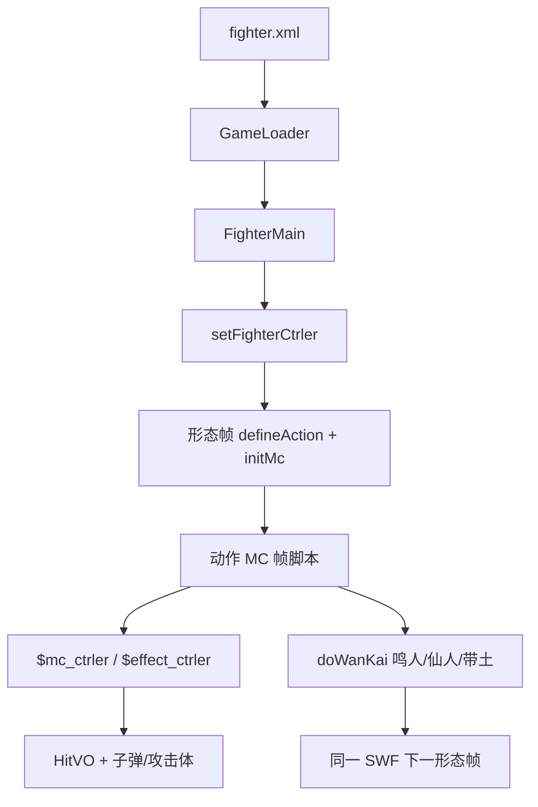

# 角色 SWF Batch E 索引 — naruto / naruto_xr / neji / obito / orihime

引擎 line-by-line（`net.play5d`）已闭合，见 [`../engine/00-INDEX.md`](../engine/00-INDEX.md)。本批继续注 **主战角色 SWF 时间轴**（`decompiled/fighters/`），不改 `decompiled/`、不播放/重打包 SWF。不注 `fz/`（A 批已收）。

文件清单：[`../_maps/fighters-batch-E-files.txt`](../_maps/fighters-batch-E-files.txt)（67 个 `.as`）。总索引：[`00-INDEX.md`](00-INDEX.md)。F–G 未开始。

## 本批是什么

| 块 | XML | SWF | 本批 `.as` | 注 |
|---|---|---|---|---|
| 漩涡·鸣人 / 一尾 / 四尾 | `naruto` sf=1、`naruto_yw` sf=2、`naruto_sw` sf=3 | `assets/fighter/naruto.swf` | 18 | 拳防；同一 SWF 三形态；一尾动作类名写「九尾」 |
| 漩涡·鸣人 仙人 / 黄金 | `naruto_xianren` sf=1、`naruto_gold` sf=2 | `assets/fighter/naruto_xr.swf` | 15 | 拳防；**无** `snd_*`；F3 脸键 `金鸣1/2` |
| 日向·宁次 | `neji` sf=1 | `assets/fighter/neji.swf` | 12 | 拳防；动作类名误作 `一护全动作_1`；语音最全 |
| 宇智波·带土 / 真面目 | `obito` sf=1、`obito_s2` sf=2 | `assets/fighter/obito.swf` | 12 | 拳防；**无** `snd_*`；F2 动作误名 `樱_1`，F3 误名 `鸣人全动作_14` |
| 井上·织姬 | `orihime` sf=1 | `assets/fighter/orihime.swf` | 10 | 拳防、speed 6.5、heavy 1；多帧 `addHp` |

引擎加载：`GameLoader.loadFighter` → `new FighterMain(mc)`。形态：`FighterMain.initlize` 里 `_mainMc.gotoAndStop(data.startFrame+1)`，所以 XML `startFrame="1"` 跑的是时间轴 **第 2 帧**。鸣人三形态 / 仙人黄金 / 带土两形态是同一 SWF 多帧；宁次、织姬 sf=1 → F2。

交叉：[`FighterMain`](../engine/game/bvn/fighter/FighterMain.md)、[`FighterCtrler`](../engine/game/bvn/fighter/ctrler/FighterCtrler.md)、[`FighterMcCtrler`](../engine/game/bvn/fighter/ctrler/FighterMcCtrler.md)、[`HitVO`](../engine/game/bvn/fighter/models/HitVO.md)、[`FighterHitRange`](../engine/game/bvn/fighter/FighterHitRange.md)、[`FighterMC`](../engine/game/bvn/fighter/FighterMC.md)、[`FighterAttacker`](../engine/game/bvn/fighter/FighterAttacker.md)。

## 共享时间轴模式

与 A/B/C/D 批相同的根时间轴骨架：

```
FighterMain.initlize
  new FighterCtrler
  mainMc.setFighterCtrler(ctrler)     → $fighter_ctrler，defineAction 别名
  ctrler.initFighter
    setEffectCtrler / setFighterMcCtrler
  gotoAndStop(startFrame+1)           → frame2（鸣人 F3/F4；仙人黄金 / 带土 F3）
    if (!$fighter_ctrler) return
    defineAction(id, HitVO 字面量) × N
    defineBishaFace / defineHurtSound*   // 仙人黄金、带土无语音
    speed / jumpPower / heavy / defenseType
    initMc(this.mc)                   → 内部动作 MC 交给 FighterMC
```

`defineAction` 第一参是 HitVO `id`（`tk`/`k1`/`zh1`/`bs`/`sbs`/`kbs`/`cbs`/`sh1`…），**不是** 帧标签。帧标签在动作 MC 上，由 `setAttack("砍2")` 一类写入 `FighterAction`。

| id 前缀 | 含义 |
|---|---|
| `tk` / `tz` | 跳轻 / 跳重 |
| `k1`… | 地面普攻段 |
| `kj*` | 空中技 |
| `zh*` | 招 1/2/3 |
| `bs` / `sbs` / `kbs` / `cbs` | 必杀 / 上必 / 空必 / 超必（id 含 `bs` → `HitVO.isBisha`） |
| `sh1`/`sh2` | 抓（hitType 11 + isBreakDef → `isCatch`）；`sh12`/`sh22` 是伤害段 |

本批 `defenseType` **全是 1 拳防**。无人斩防、无人默认值。

切形态（白哉 / 小李同款 `doWanKai()`）：

- 鸣人 F2 `鸣人全动作_1`：`startWanKai("鸣人3")` → `doWanKai()` 切根时间轴 F3 一尾。
- 鸣人 F3 `鸣人九尾全动作_19`：`startWanKai("鸣人4")` → `doWanKai()` 切 F4 四尾；进帧 `endWanKai()`。
- 鸣人 F4 `四尾全动作_30`：`endWanKai()`。
- 仙人 F2 `鸣人全动作_1`：`startWanKai()`（无脸键）→ `doWanKai()` 切 F3 黄金。
- 黄金 F3 `鸣人全动作副本_16`：`endWanKai()`。
- 带土 F2 `樱_1`：`startWanKai()` → `doWanKai()` 切 F3 真面目。
- 真面目 F3 `鸣人全动作_14`：`endWanKai()`。

### 动作 MC（`*全动作*` / 误名模板）

根时间轴的 `this.mc`。脚本走 **`parent.$mc_ctrler`**（`FighterMcCtrler`）、`parent.$effect_ctrler`、偶发 `parent.$fighter_ctrler`。

`FighterMC.renderChildren` **跳过** 名为 `AImain`、`bdmn`、名字含 `atm` 的子剪辑（当盒子，不自动 `nextFrame`）。

Flash 帧标签 **不在** 反编译 AS 里，只留下 `addFrameScript` 数字。注里按帧号分段，标签名从 `setAttack`/`loop`/`gotoAndPlay`/`justHitToPlay` 字符串回推。

典型段序：走 `loop("走")` → 冲刺 `dash` → 回 `idle` → 普攻 `setAttack("砍N")` 中间 `endAct` → 招/必杀 `bisha`/`addAttacker`/`fire` → 胜负 `stop()`。

本批类名坑（FLA 模板残留，与 XML 名对不上）：

- 宁次动作类叫 `一护全动作_1`。
- 带土常时动作类叫 `樱_1`；真面目才是 `鸣人全动作_14`（鸣人模板）。
- 鸣人一尾动作类叫 `鸣人九尾全动作_19`（尾数写错）。
- 仙人 / 黄金动作类仍叫 `鸣人全动作_1` / `鸣人全动作副本_16`。
- 织姬动作类名与角色一致：`织姬全动作_1`。

### AI 面

实例名 `AImain`。`FighterMC.initHitRange`：`gotoAndStop(2)` → 按 `FighterHitRange.getALL()` 取 `*mian` bounds → 停回第 1 帧并隐藏。`frame1` 只有 `stop()`。缺某个 `*mian` = 该招没有独立 AI 盒。

| 角色 | AI 类 | 缺 |
|---|---|---|
| 鸣人常时 | `AI面_2` | 缺 `kbsmian`（F2 也无 HitVO `kbs`） |
| 鸣人一尾 | `AI面副本_20` | 缺 `kbsmian` |
| 鸣人四尾 | `AI面副本2_31` | 缺 `kbsmian` |
| 仙人 / 黄金 | `AI面_2`（共用一份） | 缺 `kbsmian`（F2/F3 **有** HitVO `kbs*`，但 AI 盒仍缺） |
| 宁次 | `AI面_2` | 缺 `kbsmian` |
| 带土常时 | `AI面_2` | 缺 `kbsmian`、`sbsmian`；多余 `absmian`（不在 `getALL()`，? 不采样） |
| 带土真面目 | `AI面_15` | 缺 `kbsmian` |
| 织姬 | `AI面_2` | 缺 `kbsmian` |

### 必杀脸 / 受击音

- `bsfaceN extends BitmapData`：无名包 + Embed PNG。本批默认 168×119，个别 169×120 / 170×12x。`defineBishaFace` 只存 Class。
- `snd_hurt*` / `snd_die` extends Sound：Embed MP3，或织姬三份从 `assets.swf` 抽 `symbol*`。
- **仙人 / 黄金没有 `snd_*`**，不调 `defineHurtSound*`。? 受击无声。
- **带土两形态没有 `snd_*`**，有脸 `带土1/2/3`，不调 `defineHurtSound*`。
- 鸣人三形态：三路共用 `snd_hurt1`；脸键一律 `鸣人1..6`（切一尾用 `鸣人3`，切四尾用 `鸣人4`）。
- 仙人 F2 脸 `鸣人1/2/5`；黄金 F3 另登记 `金鸣1`=`bsface3`、`金鸣2`=`bsface4`。
- 宁次分轨：受击 `snd_hurt1,snd_hurt2,snd_hurt3`，击飞 `snd_hurtfly1,snd_hurtfly2`，死亡 `snd_die,snd_die2`（本批语音最全）。
- 织姬：受击 `snd_hurt1`，击飞 `snd_hurt2`，死亡 `snd_die`。

### 攻击体 / 空 `元件*`

`setAttackerCtrler` 接 `$attacker_ctrler`（没有也不 throw）：

| 角色 | 攻击体类 | 典型 `addAttacker` / `fire` 名 |
|---|---|---|
| 鸣人常时 | `元件13_15`（超必，F40 `removeSelf`）；`鸣人__砍技2副本2_7` / `副本_8` / `鸣人_砍技2_13` | `fenshen` `fenshen2` `fensheng` `lxw`；`fire("zh1atm")` `fire("zh2atm", hp:200)` |
| 鸣人四尾 | （子弹 + 动作 MC 子件） | `fire` / `addAttacker` |
| 仙人 | `空中必杀特效_11`（空必：`move(20,20)` / `setHitTarget("main","hit")` / 落地 `hit_floor` / `removeSelf`） | `addAttacker("kbsmc")` |
| 带土常时 | `元件37_6`（招 3：末帧把目标 `visible=true`） | `addAttacker("zh3mc", applyG:false)` |
| 织姬 | （子弹，无独立攻击体类） | `fire("tzatm")` `fire("cbs1atm")` `fire("cbs2atm")` |

空/只 `stop()`：仙人 `元件2_9` `元件28_29` `元件35_25` `元件36_26` `元件38_32`；带土 `元件12_26` `元件229_10` `元件511_35`；织姬 `元件22副本_7` `元件36_19`。



## 可玩要点

| 角色 | speed / jump / heavy / 防 | 必杀脸 | 语音 | 动作 MC | 脚本帧 |
|---|---|---|---|---|---|
| 鸣人 | 8 / 15 / 3 / 拳 | `鸣人1..6` | `snd_hurt1` ×3 | [`鸣人全动作_1`](naruto/scripts/naruto_fla/鸣人全动作_1.md) | 95 |
| 一尾 | 10 / 15 / 4 / 拳 | 同 `鸣人1..6` | `snd_hurt1` ×3 | [`鸣人九尾全动作_19`](naruto/scripts/naruto_fla/鸣人九尾全动作_19.md) | 93 |
| 四尾 | 10 / 15 / 5 / 拳 | 同 `鸣人1..6` | `snd_hurt1` ×3 | [`四尾全动作_30`](naruto/scripts/naruto_fla/四尾全动作_30.md) | 93 |
| 仙人 | 9 / 15 / 3 / 拳 | `鸣人1/2/5` | 无 | [`鸣人全动作_1`](naruto_xr/scripts/naruto_xr_fla/鸣人全动作_1.md) | 109 |
| 黄金 | 12 / 16 / 3 / 拳 | `金鸣1` `金鸣2` | 无 | [`鸣人全动作副本_16`](naruto_xr/scripts/naruto_xr_fla/鸣人全动作副本_16.md) | 115 |
| 宁次 | 8 / 15 / 3 / 拳 | `宁次1` `宁次2` | hurt×3 / fly×2 / die×2 | [`一护全动作_1`](neji/scripts/neji_fla/一护全动作_1.md) | 101 |
| 带土 | 12 / 16 / 3 / 拳 | `带土1/2/3` | 无 | [`樱_1`](obito/scripts/obito_fla/樱_1.md) | 87 |
| 真面目 | 13 / 16 / 3 / 拳 | 同 `带土1/2/3` | 无 | [`鸣人全动作_14`](obito/scripts/obito_fla/鸣人全动作_14.md) | 101 |
| 织姬 | 6.5 / 15 / 1 / 拳 | `织姬1` `织姬2` | hurt1 / fly2 / die | [`织姬全动作_1`](orihime/scripts/orihime_fla/织姬全动作_1.md) | 119 |

四尾最重（heavy 5）。织姬最轻也最慢（heavy 1，speed 6.5，本批唯一非整数走速）。黄金最快（speed 12 / jump 16），真面目次之（speed 13）。

鸣人常时：分身攻击体 `fenshen`/`fenshen2`/`fensheng`；招 2 子弹 `hp:200`。上必 `sbs`/`sbs2` 写 `checkDirect:false`。一尾 `kj2` 是抓（hitType 11 + 破防），`kj1` power 200，超必 `cbs` power 500。四尾 `k3` 击退 `hitx:-7`。

仙人有空必 HitVO `kbs*` 和攻击体 `空中必杀特效_11`，但 AI 面仍缺 `kbsmian`。黄金 `sh12` 写 `hitType:0`（? 不是 `HitType` 表内的砍/打/抓）。

宁次动作类名是一护模板。语音三路分轨。无切形态。

带土常时会把对手 `target.visible=false` 再 `addAttacker("zh3mc")`；`元件37_6` 末帧再显示。上必 `sbs` 是 `hitType` 10 STONE。真面目 HitVO 数值夸张：`tk3` power 600、`kj14` 850、`zh14` 620；`tk4` `hurtTime` 30000、`kj13` 40000。`sh12`/`zh1`/`zh21` 等写 `hitType:0`。

织姬招/必杀把 `recoveryBisha=3` 后连续约 30 帧 `$fighter_ctrler.addHp(recoveryBisha)`（引擎 [`FighterCtrler.addHp`](../engine/game/bvn/fighter/ctrler/FighterCtrler.md) 点名过这条）。`setHurtAction("招22")`。脚本帧最多（119）。

## 清单（67/67 done）

### naruto（18）

- [x] [`naruto/scripts/bsface1.md`](naruto/scripts/bsface1.md)
- [x] [`naruto/scripts/bsface2.md`](naruto/scripts/bsface2.md)
- [x] [`naruto/scripts/bsface3.md`](naruto/scripts/bsface3.md)
- [x] [`naruto/scripts/bsface4.md`](naruto/scripts/bsface4.md)
- [x] [`naruto/scripts/bsface5.md`](naruto/scripts/bsface5.md)
- [x] [`naruto/scripts/bsface6.md`](naruto/scripts/bsface6.md)
- [x] [`naruto/scripts/naruto_fla/AI面_2.md`](naruto/scripts/naruto_fla/AI面_2.md)
- [x] [`naruto/scripts/naruto_fla/AI面副本2_31.md`](naruto/scripts/naruto_fla/AI面副本2_31.md)
- [x] [`naruto/scripts/naruto_fla/AI面副本_20.md`](naruto/scripts/naruto_fla/AI面副本_20.md)
- [x] [`naruto/scripts/naruto_fla/MainTimeline.md`](naruto/scripts/naruto_fla/MainTimeline.md)
- [x] [`naruto/scripts/naruto_fla/元件13_15.md`](naruto/scripts/naruto_fla/元件13_15.md)
- [x] [`naruto/scripts/naruto_fla/四尾全动作_30.md`](naruto/scripts/naruto_fla/四尾全动作_30.md)
- [x] [`naruto/scripts/naruto_fla/鸣人__砍技2副本2_7.md`](naruto/scripts/naruto_fla/鸣人__砍技2副本2_7.md)
- [x] [`naruto/scripts/naruto_fla/鸣人__砍技2副本_8.md`](naruto/scripts/naruto_fla/鸣人__砍技2副本_8.md)
- [x] [`naruto/scripts/naruto_fla/鸣人_砍技2_13.md`](naruto/scripts/naruto_fla/鸣人_砍技2_13.md)
- [x] [`naruto/scripts/naruto_fla/鸣人九尾全动作_19.md`](naruto/scripts/naruto_fla/鸣人九尾全动作_19.md)
- [x] [`naruto/scripts/naruto_fla/鸣人全动作_1.md`](naruto/scripts/naruto_fla/鸣人全动作_1.md)
- [x] [`naruto/scripts/snd_hurt1.md`](naruto/scripts/snd_hurt1.md)

### naruto_xr（15）

- [x] [`naruto_xr/scripts/bsface1.md`](naruto_xr/scripts/bsface1.md)
- [x] [`naruto_xr/scripts/bsface2.md`](naruto_xr/scripts/bsface2.md)
- [x] [`naruto_xr/scripts/bsface3.md`](naruto_xr/scripts/bsface3.md)
- [x] [`naruto_xr/scripts/bsface4.md`](naruto_xr/scripts/bsface4.md)
- [x] [`naruto_xr/scripts/bsface5.md`](naruto_xr/scripts/bsface5.md)
- [x] [`naruto_xr/scripts/naruto_xr_fla/AI面_2.md`](naruto_xr/scripts/naruto_xr_fla/AI面_2.md)
- [x] [`naruto_xr/scripts/naruto_xr_fla/MainTimeline.md`](naruto_xr/scripts/naruto_xr_fla/MainTimeline.md)
- [x] [`naruto_xr/scripts/naruto_xr_fla/元件28_29.md`](naruto_xr/scripts/naruto_xr_fla/元件28_29.md)
- [x] [`naruto_xr/scripts/naruto_xr_fla/元件2_9.md`](naruto_xr/scripts/naruto_xr_fla/元件2_9.md)
- [x] [`naruto_xr/scripts/naruto_xr_fla/元件35_25.md`](naruto_xr/scripts/naruto_xr_fla/元件35_25.md)
- [x] [`naruto_xr/scripts/naruto_xr_fla/元件36_26.md`](naruto_xr/scripts/naruto_xr_fla/元件36_26.md)
- [x] [`naruto_xr/scripts/naruto_xr_fla/元件38_32.md`](naruto_xr/scripts/naruto_xr_fla/元件38_32.md)
- [x] [`naruto_xr/scripts/naruto_xr_fla/空中必杀特效_11.md`](naruto_xr/scripts/naruto_xr_fla/空中必杀特效_11.md)
- [x] [`naruto_xr/scripts/naruto_xr_fla/鸣人全动作_1.md`](naruto_xr/scripts/naruto_xr_fla/鸣人全动作_1.md)
- [x] [`naruto_xr/scripts/naruto_xr_fla/鸣人全动作副本_16.md`](naruto_xr/scripts/naruto_xr_fla/鸣人全动作副本_16.md)

### neji（12）

- [x] [`neji/scripts/bsface1.md`](neji/scripts/bsface1.md)
- [x] [`neji/scripts/bsface2.md`](neji/scripts/bsface2.md)
- [x] [`neji/scripts/neji_fla/AI面_2.md`](neji/scripts/neji_fla/AI面_2.md)
- [x] [`neji/scripts/neji_fla/MainTimeline.md`](neji/scripts/neji_fla/MainTimeline.md)
- [x] [`neji/scripts/neji_fla/一护全动作_1.md`](neji/scripts/neji_fla/一护全动作_1.md)
- [x] [`neji/scripts/snd_die.md`](neji/scripts/snd_die.md)
- [x] [`neji/scripts/snd_die2.md`](neji/scripts/snd_die2.md)
- [x] [`neji/scripts/snd_hurt1.md`](neji/scripts/snd_hurt1.md)
- [x] [`neji/scripts/snd_hurt2.md`](neji/scripts/snd_hurt2.md)
- [x] [`neji/scripts/snd_hurt3.md`](neji/scripts/snd_hurt3.md)
- [x] [`neji/scripts/snd_hurtfly1.md`](neji/scripts/snd_hurtfly1.md)
- [x] [`neji/scripts/snd_hurtfly2.md`](neji/scripts/snd_hurtfly2.md)

### obito（12）

- [x] [`obito/scripts/bsface1.md`](obito/scripts/bsface1.md)
- [x] [`obito/scripts/bsface2.md`](obito/scripts/bsface2.md)
- [x] [`obito/scripts/bsface3.md`](obito/scripts/bsface3.md)
- [x] [`obito/scripts/obito_fla/AI面_15.md`](obito/scripts/obito_fla/AI面_15.md)
- [x] [`obito/scripts/obito_fla/AI面_2.md`](obito/scripts/obito_fla/AI面_2.md)
- [x] [`obito/scripts/obito_fla/MainTimeline.md`](obito/scripts/obito_fla/MainTimeline.md)
- [x] [`obito/scripts/obito_fla/元件12_26.md`](obito/scripts/obito_fla/元件12_26.md)
- [x] [`obito/scripts/obito_fla/元件229_10.md`](obito/scripts/obito_fla/元件229_10.md)
- [x] [`obito/scripts/obito_fla/元件37_6.md`](obito/scripts/obito_fla/元件37_6.md)
- [x] [`obito/scripts/obito_fla/元件511_35.md`](obito/scripts/obito_fla/元件511_35.md)
- [x] [`obito/scripts/obito_fla/樱_1.md`](obito/scripts/obito_fla/樱_1.md)
- [x] [`obito/scripts/obito_fla/鸣人全动作_14.md`](obito/scripts/obito_fla/鸣人全动作_14.md)

### orihime（10）

- [x] [`orihime/scripts/bsface1.md`](orihime/scripts/bsface1.md)
- [x] [`orihime/scripts/bsface2.md`](orihime/scripts/bsface2.md)
- [x] [`orihime/scripts/orihime_fla/AI面_2.md`](orihime/scripts/orihime_fla/AI面_2.md)
- [x] [`orihime/scripts/orihime_fla/MainTimeline.md`](orihime/scripts/orihime_fla/MainTimeline.md)
- [x] [`orihime/scripts/orihime_fla/元件22副本_7.md`](orihime/scripts/orihime_fla/元件22副本_7.md)
- [x] [`orihime/scripts/orihime_fla/元件36_19.md`](orihime/scripts/orihime_fla/元件36_19.md)
- [x] [`orihime/scripts/orihime_fla/织姬全动作_1.md`](orihime/scripts/orihime_fla/织姬全动作_1.md)
- [x] [`orihime/scripts/snd_die.md`](orihime/scripts/snd_die.md)
- [x] [`orihime/scripts/snd_hurt1.md`](orihime/scripts/snd_hurt1.md)
- [x] [`orihime/scripts/snd_hurt2.md`](orihime/scripts/snd_hurt2.md)
