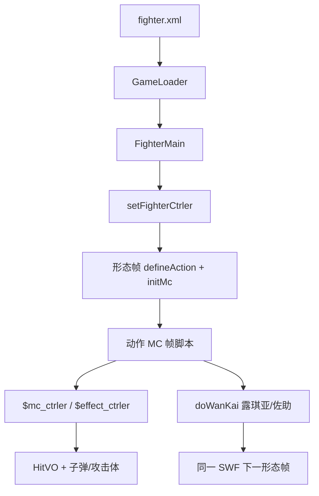

# 角色 SWF Batch F 索引 — orochimaru / pain / renji / rukia / sakura / sasuke / sasuke_xz

引擎 line-by-line（`net.play5d`）已闭合，见 [`../engine/00-INDEX.md`](../engine/00-INDEX.md)。本批继续注 **主战角色 SWF 时间轴**（`decompiled/fighters/`），不改 `decompiled/`、不播放/重打包 SWF。不注 `fz/`（A 批已收）。

文件清单：[`../_maps/fighters-batch-F-files.txt`](../_maps/fighters-batch-F-files.txt)（68 个 `.as`）。总索引：[`00-INDEX.md`](00-INDEX.md)。G 未开始。

## 本批是什么

| 块 | XML | SWF | 本批 `.as` | 注 |
|---|---|---|---|---|
| 大蛇丸 | `orochimaru` sf=1 | `assets/fighter/orochimaru.swf` | 9 | 拳防；动作类名误作 `一护全动作_1`；语音三路分轨 |
| 佩恩 | `pain` sf=1 | `assets/fighter/pain.swf` | 17 | 拳防；六道攻击体最多；脸图尺寸不齐 |
| 阿散井·恋次 | `renji` sf=1 | `assets/fighter/renji.swf` | 7 | 斩防；动作类名误作 `一护全动作_1`；脸键就是 `bsfaceN` |
| 朽木·露琪亚 义骸 / 始解 | `rukia` sf=1、`rukia_shijie` sf=2 | `assets/fighter/rukia.swf` | 8 | 同一 SWF 两形态；`doWanKai`；始解大量 ICE |
| 春野·樱 | `sakura` sf=1 | `assets/fighter/sakura.swf` | 7 | 拳防；**无** `snd_*`；有空必 `kbs`；`樱2` 误绑 `bsface1` |
| 宇智波·佐助 / 咒怨 | `sasuke` sf=1、`sasuke_zy` sf=2 | `assets/fighter/sasuke.swf` | 11 | 同一 SWF 两形态；常时斩防、咒怨拳防；大量 ELECTRIC |
| 宇智波·佐助 须佐能乎 | `sasuke_xz` sf=1 | `assets/fighter/sasuke_xz.swf` | 9 | 拳防；本批唯一完整 AI 面（含 `kbsmian`）；jump 17 |

引擎加载：`GameLoader.loadFighter` → `new FighterMain(mc)`。形态：`FighterMain.initlize` 里 `_mainMc.gotoAndStop(data.startFrame+1)`，所以 XML `startFrame="1"` 跑的是时间轴 **第 2 帧**。露琪亚两形态 / 佐助两形态是同一 SWF 多帧；其余 sf=1 → F2。

交叉：[`FighterMain`](../engine/game/bvn/fighter/FighterMain.md)、[`FighterCtrler`](../engine/game/bvn/fighter/ctrler/FighterCtrler.md)、[`FighterMcCtrler`](../engine/game/bvn/fighter/ctrler/FighterMcCtrler.md)、[`HitVO`](../engine/game/bvn/fighter/models/HitVO.md)、[`FighterHitRange`](../engine/game/bvn/fighter/FighterHitRange.md)、[`FighterMC`](../engine/game/bvn/fighter/FighterMC.md)、[`FighterAttacker`](../engine/game/bvn/fighter/FighterAttacker.md)。

## 共享时间轴模式

与 A–E 批相同的根时间轴骨架：

```
FighterMain.initlize
  new FighterCtrler
  mainMc.setFighterCtrler(ctrler)     → $fighter_ctrler，defineAction 别名
  ctrler.initFighter
    setEffectCtrler / setFighterMcCtrler
  gotoAndStop(startFrame+1)           → frame2（露琪亚 / 佐助 F3）
    if (!$fighter_ctrler) return
    defineAction(id, HitVO 字面量) × N
    defineBishaFace / defineHurtSound*   // 樱无语音
    speed / jumpPower / heavy / defenseType
    initMc(this.mc)                   → 内部动作 MC 交给 FighterMC
```

`defineAction` 第一参是 HitVO `id`（`tk`/`k1`/`zh1`/`bs`/`sbs`/`kbs`/`cbs`/`sh1`…），**不是** 帧标签。帧标签在动作 MC 上，由 `setAttack("砍2")` 一类写入 `FighterAction`。

| id 前缀 | 含义 |
|---|---|
| `tk` / `tz` | 跳轻 / 跳重 |
| `k1`… | 地面普攻段 |
| `kj*` | 空中技 |
| `zh*` | 招 1/2/3 |
| `bs` / `sbs` / `kbs` / `cbs` | 必杀 / 上必 / 空必 / 超必（id 含 `bs` → `HitVO.isBisha`） |
| `sh1`/`sh2` | 抓（hitType 11 + isBreakDef → `isCatch`）；`sh12`/`sh22` 是伤害段 |

本批 `defenseType` 混斩/拳：恋次、佐助常时、露琪亚始解是 **0 斩防**；其余拳防。咒怨从斩切到拳。

切形态（白哉 / 小李 / 鸣人同款 `doWanKai()`）：

- 露琪亚 F2 `露琪雅_1`：`startWanKai("bsface2")` → `doWanKai()` 切根时间轴 F3 始解。
- 露琪亚 F3 `露琪雅2_8`：`endWanKai()`。
- 佐助 F2 `佐助_1`：`startWanKai("佐助2")` → `doWanKai()` 切 F3 咒怨。
- 佐助 F3 `佐助咒化_12`：`endWanKai()`。

### 动作 MC（`*全动作*` / 误名模板）

根时间轴的 `this.mc`。脚本走 **`parent.$mc_ctrler`**（`FighterMcCtrler`）、`parent.$effect_ctrler`、偶发 `parent.$fighter_ctrler`。

`FighterMC.renderChildren` **跳过** 名为 `AImain`、`bdmn`、名字含 `atm` 的子剪辑（当盒子，不自动 `nextFrame`）。

Flash 帧标签 **不在** 反编译 AS 里，只留下 `addFrameScript` 数字。注里按帧号分段，标签名从 `setAttack`/`loop`/`gotoAndPlay`/`justHitToPlay` 字符串回推。

典型段序：走 `loop("走")` → 冲刺 `dash` → 回 `idle` → 普攻 `setAttack("砍N")` 中间 `endAct` → 招/必杀 `bisha`/`addAttacker`/`fire` → 胜负 `stop()`。

本批类名坑（FLA 模板残留，与 XML 名对不上）：

- 大蛇丸、恋次动作类都叫 `一护全动作_1`。
- 须佐能乎动作类叫 `须作_1`（「佐」写成「作」）。
- 露琪亚动作类名与角色一致：`露琪雅_1` / `露琪雅2_8`（「琪」用字与 XML「琪亚」同音不同形，源文件如此）。

### AI 面

实例名 `AImain`。`FighterMC.initHitRange`：`gotoAndStop(2)` → 按 `FighterHitRange.getALL()` 取 `*mian` bounds → 停回第 1 帧并隐藏。`frame1` 只有 `stop()`。缺某个 `*mian` = 该招没有独立 AI 盒。

| 角色 | AI 类 | 缺 |
|---|---|---|
| 大蛇丸 | `AI面_2` | 缺 `kbsmian`（F2 也无 HitVO `kbs`） |
| 佩恩 | `AI面_2` | 缺 `kbsmian` |
| 恋次 | `AI面_2` | 缺 `bsmian`、`kbsmian`（有 HitVO `bs*`，盒仍缺） |
| 露琪亚义骸 / 始解 | `AI面_2` / `AI面副本_9` | 两份都缺 `kbsmian` |
| 樱 | `AI面_2` | 缺 `sbsmian`、`kbsmian`（F2 **有** HitVO `sbs*`/`kbs*`）；多余 `absmian`（不在 `getALL()`，? 不采样） |
| 佐助常时 / 咒怨 | `AI面_2` / `AI面副本_13` | 两份都缺 `kbsmian` |
| 须佐能乎 | `AI面_2` | **不缺**（本批唯一含 `kbsmian`，且有 HitVO `kbs`） |

### 必杀脸 / 受击音

- `bsfaceN extends BitmapData`：无名包 + Embed PNG。本批默认 168×119；佩恩三张例外（169×121 / 170×124 / 169×120）。`defineBishaFace` 只存 Class。
- `snd_hurt*` / `snd_die` extends Sound：Embed MP3。
- **樱没有 `snd_*`**，不调 `defineHurtSound*`。? 受击无声。库里仍导出 `bsface2`，但 F2 把 `樱1` 和 `樱2` 都绑到 `bsface1`（`bsface2` 未登记）。
- 大蛇丸分轨：受击 `snd_hurt1,snd_hurt2`，击飞 `snd_hurt3`，死亡 `snd_die`。
- 恋次 / 露琪亚脸键名就是 `bsface1`/`bsface2`（没有中文角色名）。
- 佩恩三路共用 `snd_hurt1`；脸 `佩恩1/2/3`。
- 佐助两形态脸键一律 `佐助1/2/3`；切咒怨用 `startWanKai("佐助2")`。
- 须佐能乎脸键 `须佐助1`/`须佐助2`。

### 攻击体 / 空 `元件*`

`setAttackerCtrler` 接 `$attacker_ctrler`（没有也不 throw）：

| 角色 | 攻击体类 | 典型 `addAttacker` / `fire` 名 |
|---|---|---|
| 大蛇丸 | （动作 MC 子件 `zzz1`/`snake`） | `addAttacker("zzz1")` `addAttacker("snake")`；`fire("zh1atm")` |
| 佩恩 | `万象牵引_12` `人间道_跳砍_9` `招1_人物_14` `招1_人物副本_18` `招2效果_20` `招2效果副本_21` `上必杀效果1_23` `人间道_上必杀_26` `修罗道_2_27` `恶鬼道_1_29` | `tk2` `kj2` `zh1` `zh2` `zh20` `zh3` `sbs1` `rjd` `xld` |
| 恋次 | （子件 `zz1`/`dao`） | `addAttacker("zz1")` `addAttacker("dao")` |
| 露琪亚始解 | （子弹） | `fire("tzatm")` `fire("zh1atm")` |
| 樱 | `元件6_6`（空中技） | `addAttacker("stone")`；`fire("zh1atm"/"zh3atm"/"zh31atm"/"zh32atm")` |
| 佐助常时 | `佐助_超必杀效果_9` | `addAttacker("huo", applyG:false)` |
| 佐助咒怨 | （子件 `zz1`；`麒麟1_19` 只 `stop()`） | `fire("tkatm")` `fire("zh1atm")`；`addAttacker("zz1")` |
| 须佐能乎 | `须作_砍技2效果_9` `天照效果22_13` `加具土命效果_15` | `huo` `tianzhao` `fenshen` `sbsmc` |

空/只 `stop()`：樱 `元件12_10`；佐助咒怨 `麒麟1_19`（仍挂 `cbsatm`/`cbs1atm`）。佩恩 `万象牵引_12` 有 `setAttackerCtrler` 但 F1 空脚本。



## 可玩要点

| 角色 | speed / jump / heavy / 防 | 必杀脸 | 语音 | 动作 MC | 脚本帧 |
|---|---|---|---|---|---|
| 大蛇丸 | 10 / 15 / 3 / 拳 | `大蛇丸1` `大蛇丸2` | hurt×2 / fly3 / die | [`一护全动作_1`](orochimaru/scripts/orochimaru_fla/一护全动作_1.md) | 89 |
| 佩恩 | 10 / 15 / 3 / 拳 | `佩恩1/2/3` | `snd_hurt1` ×3 | [`佩恩_1`](pain/scripts/pain_fla/佩恩_1.md) | 99 |
| 恋次 | 8 / 15 / 3 / 斩 | `bsface1/2/3` | `snd_hurt1` ×3 | [`一护全动作_1`](renji/scripts/renji_fla/一护全动作_1.md) | 89 |
| 露琪亚义骸 | 6 / 15 / 1 / 拳 | `bsface1` `bsface2` | `snd_hurt1` ×3 | [`露琪雅_1`](rukia/scripts/rukia_fla/露琪雅_1.md) | 84 |
| 露琪亚始解 | 9 / 15 / 2 / 斩 | 同 `bsface1/2` | 同 | [`露琪雅2_8`](rukia/scripts/rukia_fla/露琪雅2_8.md) | 84 |
| 樱 | 6 / 15 / 2 / 拳 | `樱1`/`樱2` 都←`bsface1` | 无 | [`樱_1`](sakura/scripts/sakura_fla/樱_1.md) | 104 |
| 佐助 | 8 / 15 / 3 / 斩 | `佐助1/2/3` | `snd_hurt1` ×3 | [`佐助_1`](sasuke/scripts/sasuke_fla/佐助_1.md) | 103 |
| 咒怨 | 10 / 15 / 3 / 拳 | 同 `佐助1/2/3` | 同 | [`佐助咒化_12`](sasuke/scripts/sasuke_fla/佐助咒化_12.md) | 84 |
| 须佐能乎 | 12 / 17 / 3 / 拳 | `须佐助1` `须佐助2` | `snd_hurt1` ×3 | [`须作_1`](sasuke_xz/scripts/sasuke_xz_fla/须作_1.md) | 110 |

须佐能乎本批最快也跳最高（speed 12 / jump 17）。露琪亚义骸最慢最轻（speed 6 / heavy 1，拳防）；始解改斩防、走速 9。樱同样 speed 6，但有空必。

大蛇丸 `sh22` 写 `hitType:0`（? 不是 `HitType` 表内的砍/打/抓）。超必 `cbs` power 300 且破防。

佩恩上必拆成 `sbs`+`sbs1..5` 五段；`justHitToPlay("sbs1","上必杀1")`。攻击体按六道命名（人间道 / 修罗道 / 恶鬼道 / 万象牵引）。

恋次超必 `cbs` power 只有 30，真正高伤在 `cbs2` 300 破防。AI 面缺 `bsmian`。

露琪亚义骸超必 `cbs` 是 ICE（hitType 8）power 450；始解更多 ICE（`k4`/`kj1`/`kj21`/`zh31`/`sbs`/`sh12`/`sh22`/`cbs1`）。招 2 两形态都是抓（hitType 11 + 破防）。

樱有空必 `kbs`/`kbs2`，AI 面却缺 `kbsmian`/`sbsmian`。`元件6_6` 是下攻攻击体。

佐助常时大量 ELECTRIC（`kj1`/`kj2`/`zh2`/`bs`/`sbs`/`sh22`）；超必末段 `cbs` 改 FIRE power 280。咒怨 `zh2` 160 破防雷、`cbs` 300 破防重法。`justHitToPlay("cbs1","超必杀1")`。

须佐能乎普攻到 `k5`；空必 `kbs` 260 FIRE；`addAttacker("tianzhao")` / `"huo"` / `"fenshen"` / `"sbsmc"`。`justHitToPlay("zh2","招21")`。

## 清单（68/68 done）

### orochimaru（9）

- [x] [`orochimaru/scripts/bsface1.md`](orochimaru/scripts/bsface1.md)
- [x] [`orochimaru/scripts/bsface2.md`](orochimaru/scripts/bsface2.md)
- [x] [`orochimaru/scripts/orochimaru_fla/AI面_2.md`](orochimaru/scripts/orochimaru_fla/AI面_2.md)
- [x] [`orochimaru/scripts/orochimaru_fla/MainTimeline.md`](orochimaru/scripts/orochimaru_fla/MainTimeline.md)
- [x] [`orochimaru/scripts/orochimaru_fla/一护全动作_1.md`](orochimaru/scripts/orochimaru_fla/一护全动作_1.md)
- [x] [`orochimaru/scripts/snd_die.md`](orochimaru/scripts/snd_die.md)
- [x] [`orochimaru/scripts/snd_hurt1.md`](orochimaru/scripts/snd_hurt1.md)
- [x] [`orochimaru/scripts/snd_hurt2.md`](orochimaru/scripts/snd_hurt2.md)
- [x] [`orochimaru/scripts/snd_hurt3.md`](orochimaru/scripts/snd_hurt3.md)

### pain（17）

- [x] [`pain/scripts/bsface1.md`](pain/scripts/bsface1.md)
- [x] [`pain/scripts/bsface2.md`](pain/scripts/bsface2.md)
- [x] [`pain/scripts/bsface3.md`](pain/scripts/bsface3.md)
- [x] [`pain/scripts/pain_fla/AI面_2.md`](pain/scripts/pain_fla/AI面_2.md)
- [x] [`pain/scripts/pain_fla/MainTimeline.md`](pain/scripts/pain_fla/MainTimeline.md)
- [x] [`pain/scripts/pain_fla/万象牵引_12.md`](pain/scripts/pain_fla/万象牵引_12.md)
- [x] [`pain/scripts/pain_fla/上必杀效果1_23.md`](pain/scripts/pain_fla/上必杀效果1_23.md)
- [x] [`pain/scripts/pain_fla/人间道_上必杀_26.md`](pain/scripts/pain_fla/人间道_上必杀_26.md)
- [x] [`pain/scripts/pain_fla/人间道_跳砍_9.md`](pain/scripts/pain_fla/人间道_跳砍_9.md)
- [x] [`pain/scripts/pain_fla/佩恩_1.md`](pain/scripts/pain_fla/佩恩_1.md)
- [x] [`pain/scripts/pain_fla/修罗道_2_27.md`](pain/scripts/pain_fla/修罗道_2_27.md)
- [x] [`pain/scripts/pain_fla/恶鬼道_1_29.md`](pain/scripts/pain_fla/恶鬼道_1_29.md)
- [x] [`pain/scripts/pain_fla/招1_人物_14.md`](pain/scripts/pain_fla/招1_人物_14.md)
- [x] [`pain/scripts/pain_fla/招1_人物副本_18.md`](pain/scripts/pain_fla/招1_人物副本_18.md)
- [x] [`pain/scripts/pain_fla/招2效果_20.md`](pain/scripts/pain_fla/招2效果_20.md)
- [x] [`pain/scripts/pain_fla/招2效果副本_21.md`](pain/scripts/pain_fla/招2效果副本_21.md)
- [x] [`pain/scripts/snd_hurt1.md`](pain/scripts/snd_hurt1.md)

### renji（7）

- [x] [`renji/scripts/bsface1.md`](renji/scripts/bsface1.md)
- [x] [`renji/scripts/bsface2.md`](renji/scripts/bsface2.md)
- [x] [`renji/scripts/bsface3.md`](renji/scripts/bsface3.md)
- [x] [`renji/scripts/renji_fla/AI面_2.md`](renji/scripts/renji_fla/AI面_2.md)
- [x] [`renji/scripts/renji_fla/MainTimeline.md`](renji/scripts/renji_fla/MainTimeline.md)
- [x] [`renji/scripts/renji_fla/一护全动作_1.md`](renji/scripts/renji_fla/一护全动作_1.md)
- [x] [`renji/scripts/snd_hurt1.md`](renji/scripts/snd_hurt1.md)

### rukia（8）

- [x] [`rukia/scripts/bsface1.md`](rukia/scripts/bsface1.md)
- [x] [`rukia/scripts/bsface2.md`](rukia/scripts/bsface2.md)
- [x] [`rukia/scripts/rukia_fla/AI面_2.md`](rukia/scripts/rukia_fla/AI面_2.md)
- [x] [`rukia/scripts/rukia_fla/AI面副本_9.md`](rukia/scripts/rukia_fla/AI面副本_9.md)
- [x] [`rukia/scripts/rukia_fla/MainTimeline.md`](rukia/scripts/rukia_fla/MainTimeline.md)
- [x] [`rukia/scripts/rukia_fla/露琪雅2_8.md`](rukia/scripts/rukia_fla/露琪雅2_8.md)
- [x] [`rukia/scripts/rukia_fla/露琪雅_1.md`](rukia/scripts/rukia_fla/露琪雅_1.md)
- [x] [`rukia/scripts/snd_hurt1.md`](rukia/scripts/snd_hurt1.md)

### sakura（7）

- [x] [`sakura/scripts/bsface1.md`](sakura/scripts/bsface1.md)
- [x] [`sakura/scripts/bsface2.md`](sakura/scripts/bsface2.md)
- [x] [`sakura/scripts/sakura_fla/AI面_2.md`](sakura/scripts/sakura_fla/AI面_2.md)
- [x] [`sakura/scripts/sakura_fla/MainTimeline.md`](sakura/scripts/sakura_fla/MainTimeline.md)
- [x] [`sakura/scripts/sakura_fla/元件12_10.md`](sakura/scripts/sakura_fla/元件12_10.md)
- [x] [`sakura/scripts/sakura_fla/元件6_6.md`](sakura/scripts/sakura_fla/元件6_6.md)
- [x] [`sakura/scripts/sakura_fla/樱_1.md`](sakura/scripts/sakura_fla/樱_1.md)

### sasuke（11）

- [x] [`sasuke/scripts/bsface1.md`](sasuke/scripts/bsface1.md)
- [x] [`sasuke/scripts/bsface2.md`](sasuke/scripts/bsface2.md)
- [x] [`sasuke/scripts/bsface3.md`](sasuke/scripts/bsface3.md)
- [x] [`sasuke/scripts/sasuke_fla/AI面_2.md`](sasuke/scripts/sasuke_fla/AI面_2.md)
- [x] [`sasuke/scripts/sasuke_fla/AI面副本_13.md`](sasuke/scripts/sasuke_fla/AI面副本_13.md)
- [x] [`sasuke/scripts/sasuke_fla/MainTimeline.md`](sasuke/scripts/sasuke_fla/MainTimeline.md)
- [x] [`sasuke/scripts/sasuke_fla/佐助_1.md`](sasuke/scripts/sasuke_fla/佐助_1.md)
- [x] [`sasuke/scripts/sasuke_fla/佐助_超必杀效果_9.md`](sasuke/scripts/sasuke_fla/佐助_超必杀效果_9.md)
- [x] [`sasuke/scripts/sasuke_fla/佐助咒化_12.md`](sasuke/scripts/sasuke_fla/佐助咒化_12.md)
- [x] [`sasuke/scripts/sasuke_fla/麒麟1_19.md`](sasuke/scripts/sasuke_fla/麒麟1_19.md)
- [x] [`sasuke/scripts/snd_hurt1.md`](sasuke/scripts/snd_hurt1.md)

### sasuke_xz（9）

- [x] [`sasuke_xz/scripts/bsface1.md`](sasuke_xz/scripts/bsface1.md)
- [x] [`sasuke_xz/scripts/bsface2.md`](sasuke_xz/scripts/bsface2.md)
- [x] [`sasuke_xz/scripts/sasuke_xz_fla/AI面_2.md`](sasuke_xz/scripts/sasuke_xz_fla/AI面_2.md)
- [x] [`sasuke_xz/scripts/sasuke_xz_fla/MainTimeline.md`](sasuke_xz/scripts/sasuke_xz_fla/MainTimeline.md)
- [x] [`sasuke_xz/scripts/sasuke_xz_fla/加具土命效果_15.md`](sasuke_xz/scripts/sasuke_xz_fla/加具土命效果_15.md)
- [x] [`sasuke_xz/scripts/sasuke_xz_fla/天照效果22_13.md`](sasuke_xz/scripts/sasuke_xz_fla/天照效果22_13.md)
- [x] [`sasuke_xz/scripts/sasuke_xz_fla/须作_1.md`](sasuke_xz/scripts/sasuke_xz_fla/须作_1.md)
- [x] [`sasuke_xz/scripts/sasuke_xz_fla/须作_砍技2效果_9.md`](sasuke_xz/scripts/sasuke_xz_fla/须作_砍技2效果_9.md)
- [x] [`sasuke_xz/scripts/snd_hurt1.md`](sasuke_xz/scripts/snd_hurt1.md)
