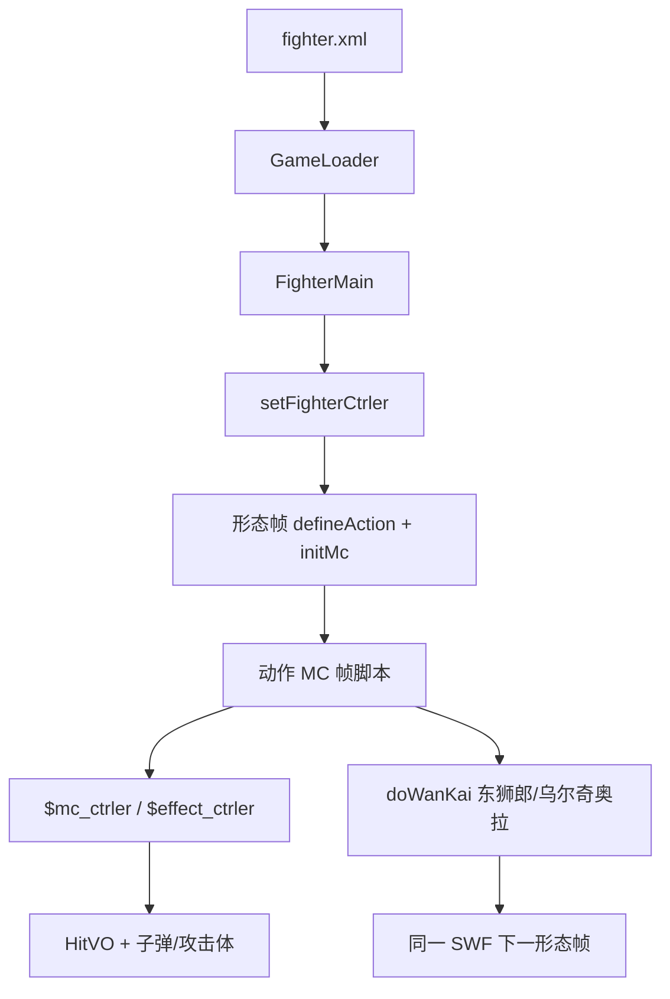

# 角色 SWF Batch G 索引 — sasuke_xz_old / soifon / temari / toushirou / ulquiorra / uryuu / yin

引擎 line-by-line（`net.play5d`）已闭合，见 [`../engine/00-INDEX.md`](../engine/00-INDEX.md)。本批继续注 **主战角色 SWF 时间轴**（`decompiled/fighters/`），不改 `decompiled/`、不播放/重打包 SWF。不注 `fz/`（A 批已收）。不注 `decompiled/ui`。

文件清单：[`../_maps/fighters-batch-G-files.txt`](../_maps/fighters-batch-G-files.txt)（68 个 `.as`）。总索引：[`00-INDEX.md`](00-INDEX.md)。主战花名册到此闭合；UI / effect 未开始。

## 本批是什么

| 块 | XML | SWF | 本批 `.as` | 注 |
|---|---|---|---|---|
| 宇智波·佐助 须佐能乎（旧档） | **无**（遗留） | `assets/fighter/sasuke_xz_old.swf` | 9 | 拳防；不在 `fighter.xml`；动作类名 `Timeline_1` |
| 碎蜂 | `soifon` sf=1 | `assets/fighter/soifon.swf` | 11 | 斩防、heavy 1；脸图远大于默认；`bs2` power 700 |
| 手鞠 | `temari` sf=1 | `assets/fighter/temari.swf` | 6 | 拳防；动作类名误作 `佐助咒化_1`；无空必 |
| 日番谷·东狮郎 / 卍解 | `toushirou` sf=1、`toushirou_wanjie` sf=2 | `assets/fighter/toushirou.swf` | 12 | 同一 SWF 两形态；常时大量 ICE；`doWanKai` |
| 乌尔奇奥拉 / 归刃 | `ulquiorra` sf=1、`ulquiorra_guiren` sf=2 | `assets/fighter/ulquiorra.swf` | 10 | 同一 SWF 两形态；**无** `snd_*`；动作类名误作一护虚化 |
| 石田·雨龙 | `uryuu` sf=1 | `assets/fighter/uryuu.swf` | 11 | 拳防；普攻几乎全是 MAGIC 箭；语音四路分轨 |
| 市丸·银 | `yin` sf=1 | `assets/fighter/yin.swf` | 9 | 斩防；普攻到 `k5` |

引擎加载：`GameLoader.loadFighter` → `new FighterMain(mc)`。形态：`FighterMain.initlize` 里 `_mainMc.gotoAndStop(data.startFrame+1)`，所以 XML `startFrame="1"` 跑的是时间轴 **第 2 帧**。东狮郎两形态 / 乌尔奇奥拉两形态是同一 SWF 多帧；其余 sf=1 → F2。`sasuke_xz_old` 选人表不会加载。

交叉：[`FighterMain`](../engine/game/bvn/fighter/FighterMain.md)、[`FighterCtrler`](../engine/game/bvn/fighter/ctrler/FighterCtrler.md)、[`FighterMcCtrler`](../engine/game/bvn/fighter/ctrler/FighterMcCtrler.md)、[`HitVO`](../engine/game/bvn/fighter/models/HitVO.md)、[`FighterHitRange`](../engine/game/bvn/fighter/FighterHitRange.md)、[`FighterMC`](../engine/game/bvn/fighter/FighterMC.md)、[`FighterAttacker`](../engine/game/bvn/fighter/FighterAttacker.md)。

## 共享时间轴模式

与 A–F 批相同的根时间轴骨架：

```
FighterMain.initlize
  new FighterCtrler
  mainMc.setFighterCtrler(ctrler)     → $fighter_ctrler，defineAction 别名
  ctrler.initFighter
    setEffectCtrler / setFighterMcCtrler
  gotoAndStop(startFrame+1)           → frame2（东狮郎 / 乌尔奇奥拉 F3）
    if (!$fighter_ctrler) return
    defineAction(id, HitVO 字面量) × N
    defineBishaFace / defineHurtSound*   // 乌尔奇奥拉无语音
    speed / jumpPower / heavy / defenseType
    initMc(this.mc)                   → 内部动作 MC 交给 FighterMC
```

`defineAction` 第一参是 HitVO `id`（`tk`/`k1`/`zh1`/`bs`/`sbs`/`kbs`/`cbs`/`sh1`…），**不是** 帧标签。帧标签在动作 MC 上，由 `setAttack("砍2")` 一类写入 `FighterAction`。

| id 前缀 | 含义 |
|---|---|
| `tk` / `tz` | 跳轻 / 跳重 |
| `k1`… | 地面普攻段 |
| `kj*` | 空中技 |
| `zh*` | 招 1/2/3 |
| `bs` / `sbs` / `kbs` / `cbs` | 必杀 / 上必 / 空必 / 超必（id 含 `bs` → `HitVO.isBisha`） |
| `sh1`/`sh2` | 抓（hitType 11 + isBreakDef → `isCatch`）；`sh12`/`sh22` 是伤害段 |

本批 `defenseType` 混斩/拳：碎蜂、东狮郎两形态、银、归刃是 **0 斩防**；须佐旧档、手鞠、乌尔常时、雨龙是 **1 拳防**。归刃从拳切到斩。

切形态（白哉 / 小李 / 鸣人 / 露琪亚 / 佐助同款 `doWanKai()`）：

- 东狮郎 F2 `全动作_1`：`startWanKai("日番谷万解")` → `doWanKai()` 切根时间轴 F3 卍解。
- 东狮郎 F3 `万解全动作_8`：`endWanKai()`。
- 乌尔奇奥拉 F2 `一护虚化全动作_1`：`startWanKai("一户万解")`（「护」写成「户」）→ `doWanKai()` 切 F3 归刃。
- 乌尔奇奥拉 F3 `一护虚化全动作副本_9`：`endWanKai()`。

### 动作 MC（`*全动作*` / 误名模板）

根时间轴的 `this.mc`。脚本走 **`parent.$mc_ctrler`**（`FighterMcCtrler`）、`parent.$effect_ctrler`、偶发 `parent.$fighter_ctrler`。

`FighterMC.renderChildren` **跳过** 名为 `AImain`、`bdmn`、名字含 `atm` 的子剪辑（当盒子，不自动 `nextFrame`）。

Flash 帧标签 **不在** 反编译 AS 里，只留下 `addFrameScript` 数字。注里按帧号分段，标签名从 `setAttack`/`loop`/`gotoAndPlay`/`justHitToPlay` 字符串回推。

典型段序：走 `loop("走")` → 冲刺 `dash` → 回 `idle` → 普攻 `setAttack("砍N")` 中间 `endAct` → 招/必杀 `bisha`/`addAttacker`/`fire` → 胜负 `stop()`。

本批类名坑（FLA 模板残留，与 XML 名对不上）：

- 手鞠动作类叫 `佐助咒化_1`。
- 乌尔奇奥拉两形态动作类都叫 `一护虚化全动作_*`。
- 须佐旧档动作类叫 `Timeline_1`（与迪达拉/雨龙/银同款无中文名）。
- 碎蜂动作类名与角色一致：`碎蜂全动作_1`。
- 东狮郎动作类名与形态一致：`全动作_1` / `万解全动作_8`。

### AI 面

实例名 `AImain`。`FighterMC.initHitRange`：`gotoAndStop(2)` → 按 `FighterHitRange.getALL()` 取 `*mian` bounds → 停回第 1 帧并隐藏。`frame1` 只有 `stop()`。缺某个 `*mian` = 该招没有独立 AI 盒。

| 角色 | AI 类 | 缺 |
|---|---|---|
| 须佐旧档 | `AI_2` | 缺 `kbsmian`（F2 **有** HitVO `kbs`/`kbs2`） |
| 碎蜂 | `AI面_2` | 缺 `kbsmian`（F2 **有** HitVO `kbs*`） |
| 手鞠 | `AI面副本_2` | 缺 `kbsmian`（F2 也无 HitVO `kbs`） |
| 东狮郎常时 / 卍解 | `AI面副本_2` / `AI面_9` | 两份都缺 `kbsmian` |
| 乌尔奇奥拉常时 / 归刃 | `AI面副本_2` / `AI面副本2_10` | 两份都缺 `kbsmian`（两形态都有 HitVO `kbs*`） |
| 雨龙 | `AI_2` | 缺 `bsmian`、`kbsmian`（有 HitVO `bs`，无 `kbs`）；多余 `absmian`（不在 `getALL()`，? 不采样） |
| 银 | `AI_2` | 缺 `kbsmian`（F2 也无 HitVO `kbs`） |

本批 **没有** 一份 AI 面含 `kbsmian`。

### 必杀脸 / 受击音

- `bsfaceN extends BitmapData`：无名包 + Embed PNG。本批默认 168×119；碎蜂三张例外（254×180 / 254×180 / 213×179）。`defineBishaFace` 只存 Class。
- `snd_hurt*` / `snd_die` / `snd_hurtfly` extends Sound：Embed MP3。
- **乌尔奇奥拉没有 `snd_*`**，两形态都不调 `defineHurtSound*`。? 受击无声。库里只有一张 `bsface1`，两形态都绑 `小乌1`。
- 碎蜂分轨：受击 `snd_hurt1`，击飞 `snd_hurt2`，死亡 `snd_hurt3`。脸 `碎蜂1/2/3`。
- 雨龙分轨：受击 `snd_hurt1,snd_hurt2`，击飞 `snd_hurtfly`，死亡 `snd_die`。脸 `石田1/2/3`。
- 银分轨：受击 `snd_hurt1,snd_hurt2`，击飞 `snd_hurt2`，死亡 `snd_die`。脸 `银1`/`银2`。
- 东狮郎两形态脸键一律 `日番谷1/2/3`；切卍解用 `startWanKai("日番谷万解")`。击飞/死亡都走 `snd_hurt2`。
- 手鞠只有一张脸 `手鞠1`←`bsface1`；三路语音共用 `snd_hurt1`。
- 须佐旧档脸键 `须佐助1`/`须佐助2`；动作里还有一次 `bisha(..., "佐助1")`（? 该键未登记）。

### 攻击体 / 空 `元件*`

`setAttackerCtrler` 接 `$attacker_ctrler`（没有也不 throw）：

| 角色 | 攻击体类 | 典型 `addAttacker` / `fire` 名 |
|---|---|---|
| 须佐旧档 | （子件 `tianzhao`） | `addAttacker("tianzhao")` |
| 碎蜂 | `元件21_10`（必杀） | `addAttacker("flymc")`；`fire("cbsatm"/"zh1atm")` |
| 手鞠 | （子弹） | `fire("tz1atm"/"tzatm"/"zh11atm"/"zh1atm"/"zh31atm"/"zh32atm"/"zh3atm")` |
| 东狮郎常时 | （子件 `bsmc`） | `addAttacker("bsmc")`；`fire("tz1atm"/"tz2atm"/"tzatm")` |
| 东狮郎卍解 | `元件10_6` `元件16_18` | `addAttacker("cbsmc")` |
| 乌尔常时 | （无独立 attacker 类） | 无 `addAttacker`/`fire` |
| 乌尔归刃 | （子弹） | `fire("zh1atm")` |
| 雨龙 | `Timeline_13`（招 2） | `addAttacker("jian")`；`fire("k1atm"/"k2atm"/"k31atm"/"k32atm"/"k3atm"/"tkatm"/"tzatm"/"zh1atm")` |
| 银 | （无独立 attacker 类） | 无 `addAttacker`/`fire` |

空/只 `stop()`：须佐旧档 `Timeline_9` `Timeline_11` `adfsasdfasdfadsfasdads_8`（乱名库元件）；碎蜂 `爆炸特效_14`；手鞠 `元件10_9`；乌尔 `元件22_7` `元件34_14` `元件34副本_18` `元件37_16`；银 `Timeline_7`。



## 可玩要点

| 角色 | speed / jump / heavy / 防 | 必杀脸 | 语音 | 动作 MC | 脚本帧 |
|---|---|---|---|---|---|
| 须佐旧档 | 12 / 17 / 3 / 拳 | `须佐助1` `须佐助2` | `snd_hurt1` ×3 | [`Timeline_1`](sasuke_xz_old/scripts/sasuke_xz_old_fla/Timeline_1.md) | 114 |
| 碎蜂 | 12 / 16 / 1 / 斩 | `碎蜂1/2/3` | hurt1 / fly2 / die3 | [`碎蜂全动作_1`](soifon/scripts/soifon_fla/碎蜂全动作_1.md) | 102 |
| 手鞠 | 9 / 15 / 3 / 拳 | `手鞠1` | `snd_hurt1` ×3 | [`佐助咒化_1`](temari/scripts/temari_fla/佐助咒化_1.md) | 75 |
| 东狮郎 | 8 / 16 / 2 / 斩 | `日番谷1/2/3` | hurt1 / fly2 / die2 | [`全动作_1`](toushirou/scripts/toushirou_fla/全动作_1.md) | 88 |
| 东狮郎卍解 | 10 / 18 / 4 / 斩 | 同 `日番谷1/2/3` | 同 | [`万解全动作_8`](toushirou/scripts/toushirou_fla/万解全动作_8.md) | 96 |
| 乌尔奇奥拉 | 12 / 15 / 2 / 拳 | `小乌1` | 无 | [`一护虚化全动作_1`](ulquiorra/scripts/ulquiorra_fla/一护虚化全动作_1.md) | 81 |
| 归刃 | 14 / 16 / 2 / 斩 | 同 `小乌1` | 无 | [`一护虚化全动作副本_9`](ulquiorra/scripts/ulquiorra_fla/一护虚化全动作副本_9.md) | 92 |
| 雨龙 | 10 / 15 / 2 / 拳 | `石田1/2/3` | hurt×2 / fly / die | [`Timeline_1`](uryuu/scripts/uryuu_fla/Timeline_1.md) | 80 |
| 银 | 10 / 16 / 2 / 斩 | `银1` `银2` | hurt×2 / fly2 / die | [`Timeline_1`](yin/scripts/yin_fla/Timeline_1.md) | 87 |

归刃本批最快（speed 14）。东狮郎卍解跳最高也最重（jump 18 / heavy 4）。碎蜂最轻（heavy 1）且斩防、走速 12。须佐旧档与现行须佐能乎同为 speed 12 / jump 17 / 拳防。

须佐旧档 `zh2` 写 hitType 11 抓破防；`zh21`/`zh22` 写 `hitType:-1`（? 不是 `HitType` 表内的砍/打/抓）。上必 `sbs` power 300 FIRE。`justHitToPlay("zh2","招21")`。`addAttacker("tianzhao")`。

碎蜂 `bs2` power **700** MAGIC_HEAVY 破防（本批单段最高）；超必 `cbs` 500 FIRE 破防。抓 id 用 `sh10`/`sh20` 当 catch 盒、`sh1`/`sh2` 当伤害段（与常见 `sh1`+`sh12` 反了）。`justHitToPlay("sbs2","上必杀2")`。`addAttacker("flymc")`。脸图 254×180 / 213×179。

手鞠无空必。招 1/3 拆多段箭（`zh1`/`zh11`/`zh12`、`zh31`/`zh32`）；超必 `cbs` power 只有 25，真正高伤在必杀 `bs` 300。`setCross` 穿人。

东狮郎常时跳重/上攻/招 2 都是 ICE；超必 `cbs` 300 破防。卍解上必 `sbs` 320、超必 `cbs` 400；`bs` 改 ICE 破防。`cbs3` hurtTime 5000（? 超长硬直）。

乌尔常时空必 `kbs1` 250、必杀 `bs` 280；`sh12` 写 `hitType:0`（?）。归刃普攻到 `k4`；下攻 `kj1` 160 破防；超必 `cbs` 300 破防。无语音。

雨龙地面普攻几乎全是 MAGIC（`k1`–`k32`/`tk`）；必杀 `bs` 300、上必 `sbs` 280。AI 面缺 `bsmian`。`addAttacker("jian")`。

银普攻到 `k5`；招 2 `zh2` 130 破防重法；必杀/超必都是 300。无空必。抓伤害还有 `sh23`。

## 清单（68/68 done）

### sasuke_xz_old（9）

- [x] [`sasuke_xz_old/scripts/bsface1.md`](sasuke_xz_old/scripts/bsface1.md)
- [x] [`sasuke_xz_old/scripts/bsface2.md`](sasuke_xz_old/scripts/bsface2.md)
- [x] [`sasuke_xz_old/scripts/sasuke_xz_old_fla/AI_2.md`](sasuke_xz_old/scripts/sasuke_xz_old_fla/AI_2.md)
- [x] [`sasuke_xz_old/scripts/sasuke_xz_old_fla/MainTimeline.md`](sasuke_xz_old/scripts/sasuke_xz_old_fla/MainTimeline.md)
- [x] [`sasuke_xz_old/scripts/sasuke_xz_old_fla/Timeline_1.md`](sasuke_xz_old/scripts/sasuke_xz_old_fla/Timeline_1.md)
- [x] [`sasuke_xz_old/scripts/sasuke_xz_old_fla/Timeline_11.md`](sasuke_xz_old/scripts/sasuke_xz_old_fla/Timeline_11.md)
- [x] [`sasuke_xz_old/scripts/sasuke_xz_old_fla/Timeline_9.md`](sasuke_xz_old/scripts/sasuke_xz_old_fla/Timeline_9.md)
- [x] [`sasuke_xz_old/scripts/sasuke_xz_old_fla/adfsasdfasdfadsfasdads_8.md`](sasuke_xz_old/scripts/sasuke_xz_old_fla/adfsasdfasdfadsfasdads_8.md)
- [x] [`sasuke_xz_old/scripts/snd_hurt1.md`](sasuke_xz_old/scripts/snd_hurt1.md)

### soifon（11）

- [x] [`soifon/scripts/bsface1.md`](soifon/scripts/bsface1.md)
- [x] [`soifon/scripts/bsface2.md`](soifon/scripts/bsface2.md)
- [x] [`soifon/scripts/bsface3.md`](soifon/scripts/bsface3.md)
- [x] [`soifon/scripts/snd_hurt1.md`](soifon/scripts/snd_hurt1.md)
- [x] [`soifon/scripts/snd_hurt2.md`](soifon/scripts/snd_hurt2.md)
- [x] [`soifon/scripts/snd_hurt3.md`](soifon/scripts/snd_hurt3.md)
- [x] [`soifon/scripts/soifon_fla/AI面_2.md`](soifon/scripts/soifon_fla/AI面_2.md)
- [x] [`soifon/scripts/soifon_fla/MainTimeline.md`](soifon/scripts/soifon_fla/MainTimeline.md)
- [x] [`soifon/scripts/soifon_fla/元件21_10.md`](soifon/scripts/soifon_fla/元件21_10.md)
- [x] [`soifon/scripts/soifon_fla/爆炸特效_14.md`](soifon/scripts/soifon_fla/爆炸特效_14.md)
- [x] [`soifon/scripts/soifon_fla/碎蜂全动作_1.md`](soifon/scripts/soifon_fla/碎蜂全动作_1.md)

### temari（6）

- [x] [`temari/scripts/bsface1.md`](temari/scripts/bsface1.md)
- [x] [`temari/scripts/snd_hurt1.md`](temari/scripts/snd_hurt1.md)
- [x] [`temari/scripts/temari_fla/AI面副本_2.md`](temari/scripts/temari_fla/AI面副本_2.md)
- [x] [`temari/scripts/temari_fla/MainTimeline.md`](temari/scripts/temari_fla/MainTimeline.md)
- [x] [`temari/scripts/temari_fla/佐助咒化_1.md`](temari/scripts/temari_fla/佐助咒化_1.md)
- [x] [`temari/scripts/temari_fla/元件10_9.md`](temari/scripts/temari_fla/元件10_9.md)

### toushirou（12）

- [x] [`toushirou/scripts/bsface1.md`](toushirou/scripts/bsface1.md)
- [x] [`toushirou/scripts/bsface2.md`](toushirou/scripts/bsface2.md)
- [x] [`toushirou/scripts/bsface3.md`](toushirou/scripts/bsface3.md)
- [x] [`toushirou/scripts/snd_hurt1.md`](toushirou/scripts/snd_hurt1.md)
- [x] [`toushirou/scripts/snd_hurt2.md`](toushirou/scripts/snd_hurt2.md)
- [x] [`toushirou/scripts/toushirou_fla/AI面_9.md`](toushirou/scripts/toushirou_fla/AI面_9.md)
- [x] [`toushirou/scripts/toushirou_fla/AI面副本_2.md`](toushirou/scripts/toushirou_fla/AI面副本_2.md)
- [x] [`toushirou/scripts/toushirou_fla/MainTimeline.md`](toushirou/scripts/toushirou_fla/MainTimeline.md)
- [x] [`toushirou/scripts/toushirou_fla/万解全动作_8.md`](toushirou/scripts/toushirou_fla/万解全动作_8.md)
- [x] [`toushirou/scripts/toushirou_fla/元件10_6.md`](toushirou/scripts/toushirou_fla/元件10_6.md)
- [x] [`toushirou/scripts/toushirou_fla/元件16_18.md`](toushirou/scripts/toushirou_fla/元件16_18.md)
- [x] [`toushirou/scripts/toushirou_fla/全动作_1.md`](toushirou/scripts/toushirou_fla/全动作_1.md)

### ulquiorra（10）

- [x] [`ulquiorra/scripts/bsface1.md`](ulquiorra/scripts/bsface1.md)
- [x] [`ulquiorra/scripts/ulquiorra_fla/AI面副本2_10.md`](ulquiorra/scripts/ulquiorra_fla/AI面副本2_10.md)
- [x] [`ulquiorra/scripts/ulquiorra_fla/AI面副本_2.md`](ulquiorra/scripts/ulquiorra_fla/AI面副本_2.md)
- [x] [`ulquiorra/scripts/ulquiorra_fla/MainTimeline.md`](ulquiorra/scripts/ulquiorra_fla/MainTimeline.md)
- [x] [`ulquiorra/scripts/ulquiorra_fla/一护虚化全动作_1.md`](ulquiorra/scripts/ulquiorra_fla/一护虚化全动作_1.md)
- [x] [`ulquiorra/scripts/ulquiorra_fla/一护虚化全动作副本_9.md`](ulquiorra/scripts/ulquiorra_fla/一护虚化全动作副本_9.md)
- [x] [`ulquiorra/scripts/ulquiorra_fla/元件22_7.md`](ulquiorra/scripts/ulquiorra_fla/元件22_7.md)
- [x] [`ulquiorra/scripts/ulquiorra_fla/元件34_14.md`](ulquiorra/scripts/ulquiorra_fla/元件34_14.md)
- [x] [`ulquiorra/scripts/ulquiorra_fla/元件34副本_18.md`](ulquiorra/scripts/ulquiorra_fla/元件34副本_18.md)
- [x] [`ulquiorra/scripts/ulquiorra_fla/元件37_16.md`](ulquiorra/scripts/ulquiorra_fla/元件37_16.md)

### uryuu（11）

- [x] [`uryuu/scripts/bsface1.md`](uryuu/scripts/bsface1.md)
- [x] [`uryuu/scripts/bsface2.md`](uryuu/scripts/bsface2.md)
- [x] [`uryuu/scripts/bsface3.md`](uryuu/scripts/bsface3.md)
- [x] [`uryuu/scripts/snd_die.md`](uryuu/scripts/snd_die.md)
- [x] [`uryuu/scripts/snd_hurt1.md`](uryuu/scripts/snd_hurt1.md)
- [x] [`uryuu/scripts/snd_hurt2.md`](uryuu/scripts/snd_hurt2.md)
- [x] [`uryuu/scripts/snd_hurtfly.md`](uryuu/scripts/snd_hurtfly.md)
- [x] [`uryuu/scripts/uryuu_fla/AI_2.md`](uryuu/scripts/uryuu_fla/AI_2.md)
- [x] [`uryuu/scripts/uryuu_fla/MainTimeline.md`](uryuu/scripts/uryuu_fla/MainTimeline.md)
- [x] [`uryuu/scripts/uryuu_fla/Timeline_1.md`](uryuu/scripts/uryuu_fla/Timeline_1.md)
- [x] [`uryuu/scripts/uryuu_fla/Timeline_13.md`](uryuu/scripts/uryuu_fla/Timeline_13.md)

### yin（9）

- [x] [`yin/scripts/bsface1.md`](yin/scripts/bsface1.md)
- [x] [`yin/scripts/bsface2.md`](yin/scripts/bsface2.md)
- [x] [`yin/scripts/snd_die.md`](yin/scripts/snd_die.md)
- [x] [`yin/scripts/snd_hurt1.md`](yin/scripts/snd_hurt1.md)
- [x] [`yin/scripts/snd_hurt2.md`](yin/scripts/snd_hurt2.md)
- [x] [`yin/scripts/yin_fla/AI_2.md`](yin/scripts/yin_fla/AI_2.md)
- [x] [`yin/scripts/yin_fla/MainTimeline.md`](yin/scripts/yin_fla/MainTimeline.md)
- [x] [`yin/scripts/yin_fla/Timeline_1.md`](yin/scripts/yin_fla/Timeline_1.md)
- [x] [`yin/scripts/yin_fla/Timeline_7.md`](yin/scripts/yin_fla/Timeline_7.md)
