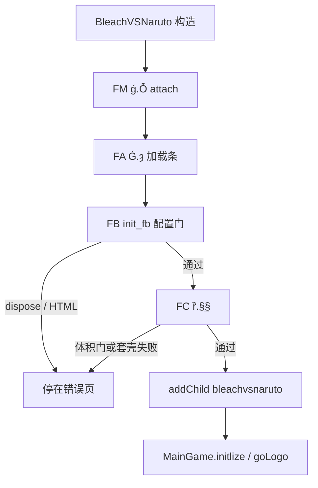

# 壳 line-by-line 索引

GreenHD 引导层（`decompiled/main/scripts/` 里 `shell-files.txt` 的 25 个 `.as`）。玩法引擎不在本目录。符号总表：[`../_maps/SHELL-SYMBOL-MAP.md`](../_maps/SHELL-SYMBOL-MAP.md)。

## 启动顺序：FM → FA → FB → FC → MainGame

时间轴 3 帧，不是关卡。文档类把主 MC 交给 FrameManager 之后，靠 `nextFrame` + `[FrameTask]` 静态方法推进。

```
AVM2 实例化 BleachVSNaruto
  → ǵ.ɐ.Ȱ(this, Ǵ)                         FM attach
       停时间轴，叠 app / progress / remote
       队列：[ƒ.Ǵ, "ƃ.FB", "ɕ.ȑ"]
  → ȵ nextFrame 直到 framesLoaded
  → ȹ 按槽调用 [FrameTask]
       ① FA  ƒ.Ǵ.ȝ                         黑底 + 转圈条
       ② FB  ƃ.FB.init_fb                  版本 / embed / 4399 Hold / 远程
       ③ FC  ɕ.ȑ.§͢§                       反套壳 + 体积门 + new bleachvsnaruto
  → ȑ.§͵§ addChild 到 ǵ.Ɂ
       bleachvsnaruto.initlize
         → ZipAssetLoader / AssetManager
         → MainGame.initlize → goLogo
```

| 步 | 角色 | 类 | 任务方法 | 失败时 |
|----|------|-----|----------|--------|
| FM | 容器单例 | `ƒ.ǵ` | `Ȱ`（文档类调，不是 FrameTask） | 帧数 < 任务数抛错 |
| FA | 加载 UI | `ƒ.Ǵ` | `ȝ` | 几乎不失败；条只是皮肤 |
| FB | 配置门 | `ƃ.FB` | `init_fb` | HTML 错误页 / JS reload；`dispose` 后 FC 不再跑 |
| FC | 应用宿主 | `ɕ.ȑ` | `§͢§` | 体积门 / 套壳 → `showError`；远程失败仍 addChild |
| 游戏 | 根 Sprite | `bleachvsnaruto` | `initlize` | `initFailHandler`（ZIP/引擎，已出壳） |
| 引擎 | 状态机 | `MainGame` | `initlize` → `goLogo` | 不在壳清单内 |

流式加载时 FA/FB/FC 随 `framesLoaded` 分次跑；本地整包 / Ruffle 一次跑完。



## 清单（25 / 25 done）

路径相对 `reverse/line-by-line/shell/`。源文件相对 `decompiled/main/scripts/`。

| # | 源 `.as` | 本文 | 建议名 | 状态 |
|---|----------|------|--------|------|
| 1 | `BleachVSNaruto.as` | [`BleachVSNaruto.md`](BleachVSNaruto.md) | DocumentClass | done |
| 2 | `bleachvsnaruto_2.as` | [`bleachvsnaruto_2.md`](bleachvsnaruto_2.md) | GameRoot | done |
| 3 | `com/green/method/Ǻ.as` | [`com/green/method/Ǻ.md`](com/green/method/Ǻ.md) | JsEmbed | done |
| 4 | `com/green/method/ǻ_2.as` | [`com/green/method/ǻ_2.md`](com/green/method/ǻ_2.md) | Env | done |
| 5 | `com/green/net/ǽ.as` | [`com/green/net/ǽ.md`](com/green/net/ǽ.md) | BinLoader | done |
| 6 | `com/green/net/Ǿ.as` | [`com/green/net/Ǿ.md`](com/green/net/Ǿ.md) | SwfLoader | done |
| 7 | `ƃ/FB.as` | [`ƃ/FB.md`](ƃ/FB.md) | FrameBridge | done |
| 8 | `ƒ/ŋ.as` | [`ƒ/ŋ.md`](ƒ/ŋ.md) | `greenload_internal` ns | done |
| 9 | `ƒ/Ǵ.as` | [`ƒ/Ǵ.md`](ƒ/Ǵ.md) | FrameAdapter（FA） | done |
| 10 | `ƒ/ǵ_2.as` | [`ƒ/ǵ_2.md`](ƒ/ǵ_2.md) | FrameManager（FM） | done |
| 11 | `Ƿ/Ƕ.as` | [`Ƿ/Ƕ.md`](Ƿ/Ƕ.md) | Spinner | done |
| 12 | `ǹ/Ǹ.as` | [`ǹ/Ǹ.md`](ǹ/Ǹ.md) | LoadingUiState | done |
| 13 | `ǹ/ǿ.as` | [`ǹ/ǿ.md`](ǹ/ǿ.md) | AppModel | done |
| 14 | `ǹ/ȃ.as` | [`ǹ/ȃ.md`](ǹ/ȃ.md) | AppLifecycleEvent | done |
| 15 | `ǹ/Ȍ.as` | [`ǹ/Ȍ.md`](ǹ/Ȍ.md) | PlatformMatcher | done |
| 16 | `ǹ/Ȓ.as` | [`ǹ/Ȓ.md`](ǹ/Ȓ.md) | AppKind（壳内未引用） | done |
| 17 | `ȁ/Ȁ.as` | [`ȁ/Ȁ.md`](ȁ/Ȁ.md) | Version | done |
| 18 | `ȁ/Ȃ.as` | [`ȁ/Ȃ.md`](ȁ/Ȃ.md) | TextCodec | done |
| 19 | `ȁ/Ȅ.as` | [`ȁ/Ȅ.md`](ȁ/Ȅ.md) | SwfCodec | done |
| 20 | `Ȋ/Ǵ.as` | [`Ȋ/Ǵ.md`](Ȋ/Ǵ.md) | ns `greenload` | done |
| 21 | `Ȋ/ȉ.as` | [`Ȋ/ȉ.md`](Ȋ/ȉ.md) | LoadCallbacks | done |
| 22 | `Ȋ/ȋ.as` | [`Ȋ/ȋ.md`](Ȋ/ȋ.md) | RepeatCounter | done |
| 23 | `Ȋ/Ȏ.as` | [`Ȋ/Ȏ.md`](Ȋ/Ȏ.md) | LoadState | done |
| 24 | `Ȑ/ȏ.as` | [`Ȑ/ȏ.md`](Ȑ/ȏ.md) | LoadEvent | done |
| 25 | `ɕ/ȑ.as` | [`ɕ/ȑ.md`](ɕ/ȑ.md) | FrameContent（FC） | done |

`_2` 后缀只存在于文件名（FFDec 避冲突）。类名：`ǻ`、`ǵ`、`bleachvsnaruto`。`ƒ.Ǵ` 与 `Ȋ.Ǵ` 不是同一个类。

## 按启动链阅读

1. [`BleachVSNaruto.md`](BleachVSNaruto.md) → [`ƒ/ǵ_2.md`](ƒ/ǵ_2.md)
2. [`ƒ/Ǵ.md`](ƒ/Ǵ.md) + [`Ƿ/Ƕ.md`](Ƿ/Ƕ.md) + [`ǹ/Ǹ.md`](ǹ/Ǹ.md)
3. [`ƃ/FB.md`](ƃ/FB.md) + [`ǹ/ǿ.md`](ǹ/ǿ.md) + [`com/green/method/ǻ_2.md`](com/green/method/ǻ_2.md)
4. [`ɕ/ȑ.md`](ɕ/ȑ.md) → [`bleachvsnaruto_2.md`](bleachvsnaruto_2.md)
