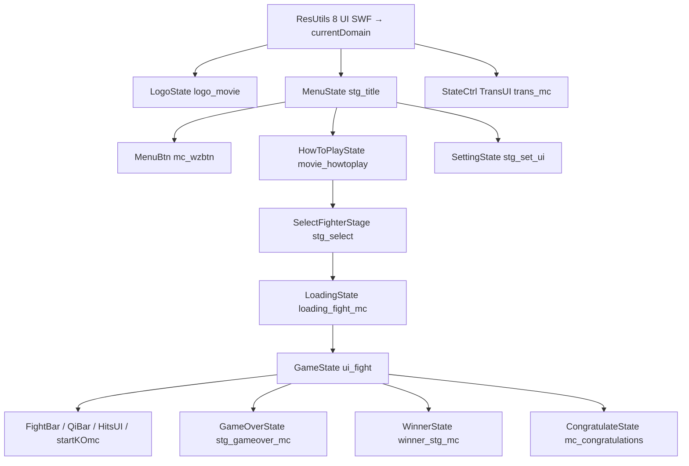

# UI SWF line-by-line 总索引 — `decompiled/ui`

壳：[`../shell/00-INDEX.md`](../shell/00-INDEX.md)。引擎 `net.play5d`：[`../engine/00-INDEX.md`](../engine/00-INDEX.md)（A–D 已闭合，屏幕层在 Batch C）。角色：[`../fighters/00-INDEX.md`](../fighters/00-INDEX.md)（A–G 已闭合）。

本目录注 **8 个嵌入 UI SWF**（`decompiled/ui/**/scripts/**.as`）。镜像路径：`decompiled/ui/` 之后原样换成 `.md`。不改 `decompiled/`。不播 / 不重打包 SWF。

**状态：本批 73 个 `.as` 全部 done。特效 SWF：[`../effect/00-INDEX.md`](../effect/00-INDEX.md)（89/89 done）。不要重开本批。**

对照总表（非逐行）：[`../../04-maps-ui-xml.md`](../../04-maps-ui-xml.md)。工厂：[`../engine/game/bvn/utils/ResUtils.md`](../engine/game/bvn/utils/ResUtils.md)。

清单源：[`../_maps/ui-batch-files.txt`](../_maps/ui-batch-files.txt)。

## 八个 SWF ↔ 引擎

`ResUtils` 把 8 个 `[Embed]` SWF `loadBytes` 进 **`ApplicationDomain.currentDomain`**。之后 `getItemClass(swfClass, linkage)` 用该域 `getDefinition`。第一参只要池里有这个 SWF Class；**链接名跨库也能取到**（引擎有时把 `loading_fight_mc` 写成 `ResUtils.I.fight`，把 `seltwzmc` / `select_arrow_mc_*` 写成 `ResUtils.I.select`，把 `cover_bgimg` 写成 `common_ui`）。反编译目录按 SWF 分，以本批落点为准。

| SWF 目录 | `.as` | `ResUtils` 字段 | 主导出 | 引擎入口 |
|----------|------|-----------------|--------|----------|
| [`common_ui/`](common_ui/scripts/common_ui_fla/MainTimeline.md) | 8 | `common_ui` | `logo_movie` / `mc_wzbtn` / `trans_mc` / `mc_congratulations` | `LogoState`、`MenuBtn`、`TransUI`、`CongratulateState` |
| [`fight/`](fight/scripts/ui_fight.md) | 33 | `fight` | `ui_fight` | `FightUI` → `GameState` 屏幕层 |
| [`gameover/`](gameover/scripts/stg_gameover_mc.md) | 1 | `gameover` | `stg_gameover_mc`（`GAME_OVER`） | `GameOverState` |
| [`howtoplay/`](howtoplay/scripts/movie_howtoplay.md) | 3 | `howtoplay` | `movie_howtoplay` | `HowToPlayState` |
| [`loading/`](loading/scripts/loading_cover_mc.md) | 12 | `loading` | `loading_cover_mc` / `loading_fight_mc` / `winner_stg_mc` | `GameLoadingState`、`LoadingState`、`WinnerState` |
| [`select/`](select/scripts/stg_select.md) | 8 | `select` | `stg_select`（`SELECT`） | `SelectFighterStage` |
| [`setting/`](setting/scripts/stg_set_ui.md) | 5 | `setting` | `stg_set_ui`（`SETTING`） | `SettingState` |
| [`title/`](title/scripts/stg_title.md) | 3 | `title` | `stg_title`（`TITLE`） | `MenuState` |
| **合计** | **73** | | | |

```
LogoState          → common_ui.logo_movie
MenuState          → title.stg_title + MenuBtn(mc_wzbtn) 挂在 btnct
HowToPlayState     → howtoplay.movie_howtoplay
SelectFighterStage → select.stg_select + 格子/光标/已选条/地图
SettingState       → setting.stg_set_ui + keyset_mc / key_set_dialog_mc
GameLoadingState   → loading.loading_cover_mc
LoadingState       → loading.loading_fight_mc（代码写 fight 库）+ SelectIndexUI
GameState          → fight.ui_fight → FightUI / FightBar / QiBar / HitsUI
GameOverState      → gameover.stg_gameover_mc + common_ui.select_arrow_mc
WinnerState        → loading.winner_stg_mc（或 winner_stg_mc2）
CongratulateState  → common_ui.mc_congratulations + mc_win_all
StateCtrl          → common_ui.trans_mc（TransUI）
```



## 共享模式

### MenuBtn / 箭头 / 转场

| 模式 | SWF 件 | 引擎 |
|------|--------|------|
| 主菜单钮 | `mc_wzbtn` + 嵌套 `wzimg_bgimg_5`（`bg` 两帧高亮） | [`MenuBtn`](../engine/game/bvn/ui/MenuBtn.md)：英文位图字藏掉，中文 `BitmapText` 才上屏 |
| 公共箭头 | `common_ui.select_arrow_mc` | `GameOverState`、`SetBtnGroup` |
| 出战序箭头 | `loading.select_arrow_mc_1/2`（引擎从 `select` 取名） | [`SelectIndexUI`](../engine/game/bvn/ui/select/SelectIndexUI.md) |
| 转场遮罩 | `trans_mc` 标签 `fadin` / `fadout` / `stop` | [`TransUI`](../engine/game/bvn/ui/TransUI.md) **不听** COMPLETE，自己 `nextFrame` |
| 设置左右三角 | `txt_arrow_mc` | [`SetBtn`](../engine/game/bvn/ui/SetBtn.md) 两枚，右箭头 `scaleX=-1` |

### 条 / 脸槽

| 模式 | SWF | 引擎 |
|------|-----|------|
| 顶栏 | `hpbar_mc`：`face1/2` + `bar1/2` + `energy1/2` + `timemc` + `win_p1/p2` + `scoremc` | [`FightBar`](../engine/game/bvn/ui/fight/FightBar.md)。F25/F46 `COMPLETE` ↔ `fadin_fin` / `fadout_fin` |
| HP | `hpbar_barmc.bar` 绿 + `redbar` 拖尾 | [`FighterHpBar`](../engine/game/bvn/ui/fight/FighterHpBar.md) |
| 体力（不是气） | `energy_bar` | [`EnergyBar`](../engine/game/bvn/ui/fight/EnergyBar.md)。`comicType` 切死神/火影字 |
| 气 + 辅助 | `qbar_mc`：`barmc` 三格+满格、`fzqibar`、`facemc`、`readymc` | [`QiBar`](../engine/game/bvn/ui/fight/QiBar.md)。脸是 **Assister** |
| 血条脸 | `hpbar_facemc.ct` | [`FightFaceUI`](../engine/game/bvn/ui/fight/FightFaceUI.md) `getFighterFaceBar` 102×64 |
| 选人格子脸 | `slt_item_mc.ct` | [`SelectFighterItem`](../engine/game/bvn/ui/select/SelectFighterItem.md) 50×50 |
| 已选条脸槽 | `selected_item_p*_mc.ct` → `ctmc.ct` | [`SelectedFighterUI.setFighter`](../engine/game/bvn/ui/select/SelectedFighterUI.md) dump 取到 `ctmc` 后截断，脸图可能不上条 ? |
| 必杀脸 | 角色 SWF `bsfaceN` BitmapData | **不是** `fight.bsface_mc`（空导出，引擎从不 `createDisplayObject`） |

`GameUI.BITMAP_UI`（默认 true）时 `FightBar` / `QiBar` 把装饰烤成 Bitmap，MC 淡入基本不播。

### 数字 MC

引擎 `getItemClass` 取 Class，再 `new MCNumber(...)`：

| 链接名 | 用途 | 格宽 |
|--------|------|------|
| `hits_num_mc` | 连击 | 35 |
| `time_txtmc` | 倒计时，2 位补零 | 20 |
| `txtmc_score` | 街机分数 | 10 |

`hits_mc` 自己 `gotoAndPlay("fadin"|"update"|"fadout")`，不经 `FightUI.renderAnimate`。`startKOmc`（`game_start_mc_44`）相反：引擎 `gotoAndStop` 标签后靠 `nextFrame()` 爬，帧脚本 `stop()` 挡不住。

### 时间轴约定

- `addFrameScript(N, …)` 的 N 是 **0-based**，时间轴 **F{N+1}**。
- 标签名多半只在 SWF `FrameLabel`，AS 不写字面量。引擎硬编码 `"fadin"` / `"menu"` / `"continue"` / `"destory"`（拼写贯穿）。
- 文档类 `*_fla.MainTimeline`：F1 `stop`。引擎从不 `new`，只 `loadBytes` 整 SWF。
- 空导出（`stg_test`、`mc_win_all`、多数 `元件*`、`player_pos_*`）仍各有一份 md。

## 按 SWF 找文件

### common_ui（8）done

| 文件 | 用途 |
|------|------|
| [`common_ui_fla/MainTimeline.md`](common_ui/scripts/common_ui_fla/MainTimeline.md) | 文档类，F1 stop |
| [`common_ui_fla/wzimg_bgimg_5.md`](common_ui/scripts/common_ui_fla/wzimg_bgimg_5.md) | `mc_wzbtn.bg` 两帧高亮 |
| [`logo_movie.md`](common_ui/scripts/logo_movie.md) | 片头；F66 COMPLETE → `goMenu` |
| [`mc_congratulations.md`](common_ui/scripts/mc_congratulations.md) | 全通关祝贺；F50 COMPLETE |
| [`mc_win_all.md`](common_ui/scripts/mc_win_all.md) | 通关长图，空类 |
| [`mc_wzbtn.md`](common_ui/scripts/mc_wzbtn.md) | 主菜单钮壳 |
| [`select_arrow_mc.md`](common_ui/scripts/select_arrow_mc.md) | 公共箭头 |
| [`trans_mc.md`](common_ui/scripts/trans_mc.md) | 转场；F26/F61 两个 `"stop"` |

### fight（33）done

HUD 根 / 顶栏：

| 文件 | 用途 |
|------|------|
| [`ui_fight.md`](fight/scripts/ui_fight.md) | HUD 根：`hpbarmc` / `fzqi*` / `hits*` / `startKOmc` |
| [`hpbar_mc.md`](fight/scripts/hpbar_mc.md) | 顶栏；F1/F25/F46 |
| [`hpbar_barmc.md`](fight/scripts/hpbar_barmc.md) | HP 绿+红 |
| [`hpbar_facegroup.md`](fight/scripts/hpbar_facegroup.md) | 三槽 `face/face2/face3` |
| [`hpbar_facemc.md`](fight/scripts/hpbar_facemc.md) | 单槽 `ct` |
| [`energy_bar.md`](fight/scripts/energy_bar.md) | 体力 |
| [`energybar_barmc.md`](fight/scripts/energybar_barmc.md) | 体力条子 |
| [`fight_fla/energybar_bar_8.md`](fight/scripts/fight_fla/energybar_bar_8.md) | 条子嵌套 |
| [`fight_fla/energybar_txt_mc_3.md`](fight/scripts/fight_fla/energybar_txt_mc_3.md) | 体力字，子件 `mc` |
| [`time_mc.md`](fight/scripts/time_mc.md) | 计时；`wuxian` |
| [`time_txtmc.md`](fight/scripts/time_txtmc.md) | 计时数字 Class |
| [`score_mc.md`](fight/scripts/score_mc.md) | 街机分容器 `ct` |
| [`txtmc_score.md`](fight/scripts/txtmc_score.md) | 分数数字 Class |
| [`txt_mc.md`](fight/scripts/txt_mc.md) | `TextField txt`；引擎不直接 new ? |
| [`winmc.md`](fight/scripts/winmc.md) | 胜场灯 `w1`/`w2` |
| [`fight_fla/winmc_bleach_22.md`](fight/scripts/fight_fla/winmc_bleach_22.md) | 灯动画；`in_bleach` / `in_naruto` |
| [`player_pos_p1.md`](fight/scripts/player_pos_p1.md) / [`player_pos_p2.md`](fight/scripts/player_pos_p2.md) | 屏外角色标 |

气条 / 连击 / 开场 KO：

| 文件 | 用途 |
|------|------|
| [`qbar_mc.md`](fight/scripts/qbar_mc.md) | 气条根；F1/F15/F38 |
| [`qbar_barmc.md`](fight/scripts/qbar_barmc.md) | `bar` + `txtmc` |
| [`qbar_barmcgroup.md`](fight/scripts/qbar_barmcgroup.md) | `bar1..bar4` |
| [`qbar_facemc.md`](fight/scripts/qbar_facemc.md) | 辅助脸 `ct` |
| [`qbar_fzqi_mc.md`](fight/scripts/qbar_fzqi_mc.md) | 辅助气 `barmc` |
| [`fight_fla/qbar_txtmc_34.md`](fight/scripts/fight_fla/qbar_txtmc_34.md) | 气格数字 |
| [`hits_mc.md`](fight/scripts/hits_mc.md) | 连击根；F1/10/20/38/56 |
| [`hits_num_mc.md`](fight/scripts/hits_num_mc.md) | 连击数字 Class |
| [`bsface_mc.md`](fight/scripts/bsface_mc.md) | 空导出；不是角色必杀脸 |
| [`fight_fla/game_start_mc_44.md`](fight/scripts/fight_fla/game_start_mc_44.md) | ROUND/FIGHT/KO/TIMEOVER/DRAW/WINNER |
| [`fight_fla/round_num_mc_45.md`](fight/scripts/fight_fla/round_num_mc_45.md) | `nummc`；`r1`…`r5` |
| [`fight_fla/元件25_46.md`](fight/scripts/fight_fla/元件25_46.md) | `winnermc`；`isPerfect` 分叉 |
| [`fight_fla/元件10_4.md`](fight/scripts/fight_fla/元件10_4.md) / [`元件11_6.md`](fight/scripts/fight_fla/元件11_6.md) / [`元件12_10.md`](fight/scripts/fight_fla/元件12_10.md) | 嵌套美术 |

### 其余 SWF done

| SWF | 文件 |
|-----|------|
| gameover | [`stg_gameover_mc.md`](gameover/scripts/stg_gameover_mc.md) — `continue` / `continue_yes` / `continue_no` / `gameover`；`btn_yes/no/back`；`ct_char`/`ct_score` |
| howtoplay | [`movie_howtoplay.md`](howtoplay/scripts/movie_howtoplay.md)（10 个 `txt_*` + `skip_btn`）；[`arrow020321_6.md`](howtoplay/scripts/howtoplay_fla/arrow020321_6.md)；[`元件48_11.md`](howtoplay/scripts/howtoplay_fla/元件48_11.md) |
| loading | [`loading_cover_mc.md`](loading/scripts/loading_cover_mc.md) / [`loading_fight_mc.md`](loading/scripts/loading_fight_mc.md) / [`loading_select_ui_mc.md`](loading/scripts/loading_select_ui_mc.md) / [`loadingbar_mc.md`](loading/scripts/loadingbar_mc.md) / [`cover_bgimg.md`](loading/scripts/cover_bgimg.md) / [`seltwzmc.md`](loading/scripts/seltwzmc.md) / [`select_arrow_mc_1.md`](loading/scripts/select_arrow_mc_1.md) / [`select_arrow_mc_2.md`](loading/scripts/select_arrow_mc_2.md) / [`winner_stg_mc.md`](loading/scripts/winner_stg_mc.md) / [`winner_stg_mc2.md`](loading/scripts/winner_stg_mc2.md) / [`loading_fla/MainTimeline.md`](loading/scripts/loading_fla/MainTimeline.md) / [`元件8_17.md`](loading/scripts/loading_fla/元件8_17.md) |
| select | [`stg_select.md`](select/scripts/stg_select.md) / [`select_item_mc.md`](select/scripts/select_item_mc.md) / [`slt_item_mc.md`](select/scripts/slt_item_mc.md) / [`selected_item_p1_mc.md`](select/scripts/selected_item_p1_mc.md) / [`selected_item_p2_mc.md`](select/scripts/selected_item_p2_mc.md) / [`ctmc.md`](select/scripts/ctmc.md) / [`select_map_mc.md`](select/scripts/select_map_mc.md) / [`select_map_txt_mc.md`](select/scripts/select_map_txt_mc.md) |
| setting | [`stg_set_ui.md`](setting/scripts/stg_set_ui.md)（`ichigo` `key_fadin`/`key_fadout`）/ [`keyset_mc.md`](setting/scripts/keyset_mc.md)（`k0`–`k9`）/ [`key_set_dialog_mc.md`](setting/scripts/key_set_dialog_mc.md) / [`txt_arrow_mc.md`](setting/scripts/txt_arrow_mc.md) / [`setting_fla/元件1_13.md`](setting/scripts/setting_fla/元件1_13.md) |
| title | [`stg_title.md`](title/scripts/stg_title.md)（`btnct` / `logo_mc` / `"menu"`）/ [`title_fla/logomc_3.md`](title/scripts/title_fla/logomc_3.md)（F1 `visible=false`，三渠道 logo 本包 `initTitleUI` 空）/ [`stg_test.md`](title/scripts/stg_test.md)（引擎从不引用） |

## 清单（73 / 73 done）

来源 [`../_maps/ui-batch-files.txt`](../_maps/ui-batch-files.txt)。每条对应一份非 stub md。

### common_ui

- [x] `common_ui/scripts/common_ui_fla/MainTimeline.md`
- [x] `common_ui/scripts/common_ui_fla/wzimg_bgimg_5.md`
- [x] `common_ui/scripts/logo_movie.md`
- [x] `common_ui/scripts/mc_congratulations.md`
- [x] `common_ui/scripts/mc_win_all.md`
- [x] `common_ui/scripts/mc_wzbtn.md`
- [x] `common_ui/scripts/select_arrow_mc.md`
- [x] `common_ui/scripts/trans_mc.md`

### fight

- [x] `fight/scripts/bsface_mc.md`
- [x] `fight/scripts/energy_bar.md`
- [x] `fight/scripts/energybar_barmc.md`
- [x] `fight/scripts/fight_fla/energybar_bar_8.md`
- [x] `fight/scripts/fight_fla/energybar_txt_mc_3.md`
- [x] `fight/scripts/fight_fla/game_start_mc_44.md`
- [x] `fight/scripts/fight_fla/qbar_txtmc_34.md`
- [x] `fight/scripts/fight_fla/round_num_mc_45.md`
- [x] `fight/scripts/fight_fla/winmc_bleach_22.md`
- [x] `fight/scripts/fight_fla/元件10_4.md`
- [x] `fight/scripts/fight_fla/元件11_6.md`
- [x] `fight/scripts/fight_fla/元件12_10.md`
- [x] `fight/scripts/fight_fla/元件25_46.md`
- [x] `fight/scripts/hits_mc.md`
- [x] `fight/scripts/hits_num_mc.md`
- [x] `fight/scripts/hpbar_barmc.md`
- [x] `fight/scripts/hpbar_facegroup.md`
- [x] `fight/scripts/hpbar_facemc.md`
- [x] `fight/scripts/hpbar_mc.md`
- [x] `fight/scripts/player_pos_p1.md`
- [x] `fight/scripts/player_pos_p2.md`
- [x] `fight/scripts/qbar_barmc.md`
- [x] `fight/scripts/qbar_barmcgroup.md`
- [x] `fight/scripts/qbar_facemc.md`
- [x] `fight/scripts/qbar_fzqi_mc.md`
- [x] `fight/scripts/qbar_mc.md`
- [x] `fight/scripts/score_mc.md`
- [x] `fight/scripts/time_mc.md`
- [x] `fight/scripts/time_txtmc.md`
- [x] `fight/scripts/txt_mc.md`
- [x] `fight/scripts/txtmc_score.md`
- [x] `fight/scripts/ui_fight.md`
- [x] `fight/scripts/winmc.md`

### gameover / howtoplay / loading / select / setting / title

- [x] `gameover/scripts/stg_gameover_mc.md`
- [x] `howtoplay/scripts/howtoplay_fla/arrow020321_6.md`
- [x] `howtoplay/scripts/howtoplay_fla/元件48_11.md`
- [x] `howtoplay/scripts/movie_howtoplay.md`
- [x] `loading/scripts/cover_bgimg.md`
- [x] `loading/scripts/loading_cover_mc.md`
- [x] `loading/scripts/loading_fight_mc.md`
- [x] `loading/scripts/loading_fla/MainTimeline.md`
- [x] `loading/scripts/loading_fla/元件8_17.md`
- [x] `loading/scripts/loading_select_ui_mc.md`
- [x] `loading/scripts/loadingbar_mc.md`
- [x] `loading/scripts/select_arrow_mc_1.md`
- [x] `loading/scripts/select_arrow_mc_2.md`
- [x] `loading/scripts/seltwzmc.md`
- [x] `loading/scripts/winner_stg_mc.md`
- [x] `loading/scripts/winner_stg_mc2.md`
- [x] `select/scripts/ctmc.md`
- [x] `select/scripts/select_item_mc.md`
- [x] `select/scripts/select_map_mc.md`
- [x] `select/scripts/select_map_txt_mc.md`
- [x] `select/scripts/selected_item_p1_mc.md`
- [x] `select/scripts/selected_item_p2_mc.md`
- [x] `select/scripts/slt_item_mc.md`
- [x] `select/scripts/stg_select.md`
- [x] `setting/scripts/key_set_dialog_mc.md`
- [x] `setting/scripts/keyset_mc.md`
- [x] `setting/scripts/setting_fla/元件1_13.md`
- [x] `setting/scripts/stg_set_ui.md`
- [x] `setting/scripts/txt_arrow_mc.md`
- [x] `title/scripts/stg_test.md`
- [x] `title/scripts/stg_title.md`
- [x] `title/scripts/title_fla/logomc_3.md`

## 不要重开

- 不要把 `decompiled/ui/**` 再注一遍
- 不要重开 shell / engine A–D / fighters A–G
- 特效已闭合：[`../effect/00-INDEX.md`](../effect/00-INDEX.md)
